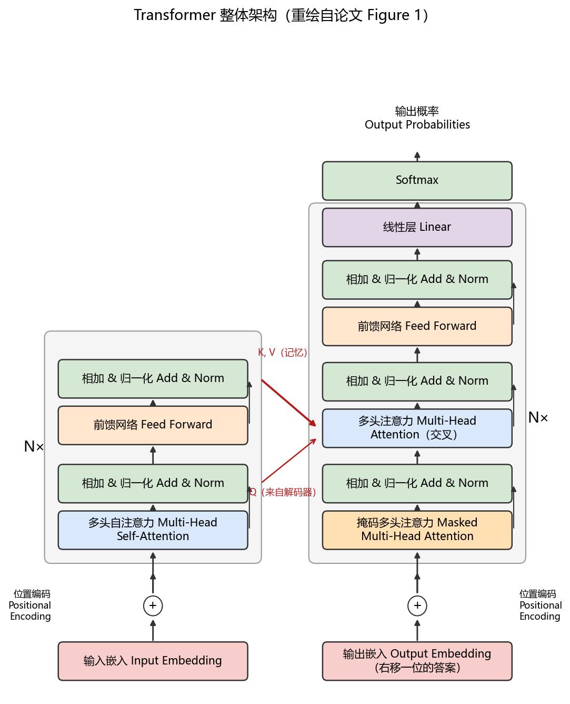
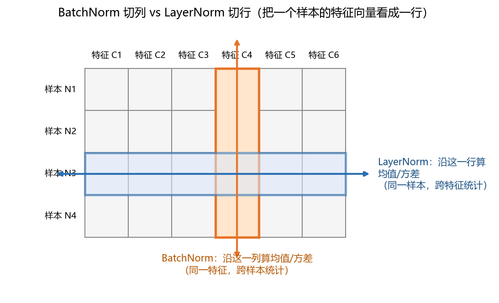
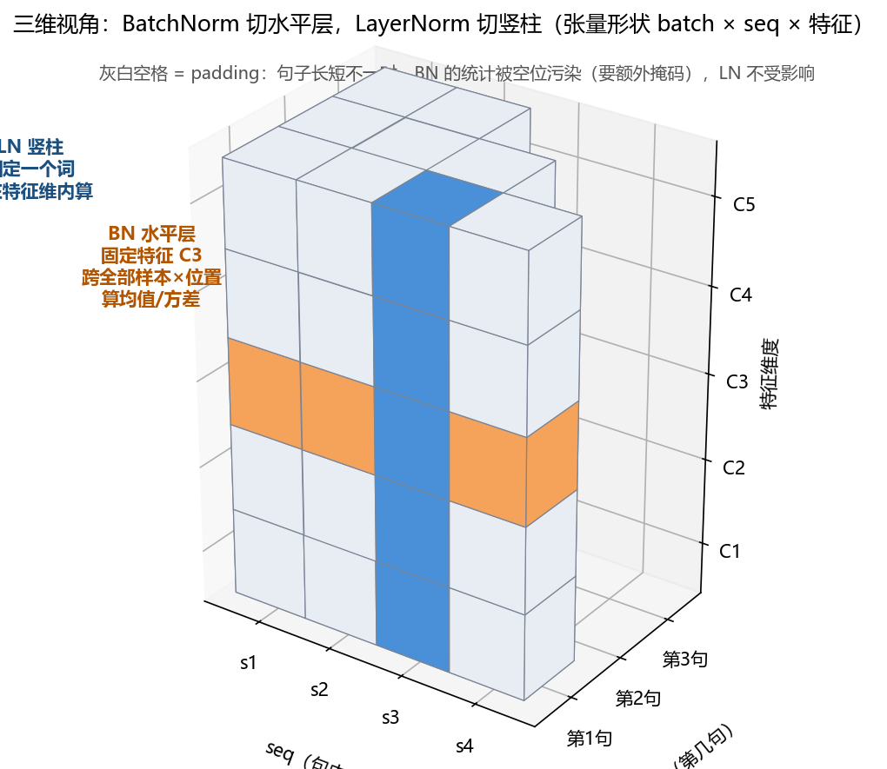
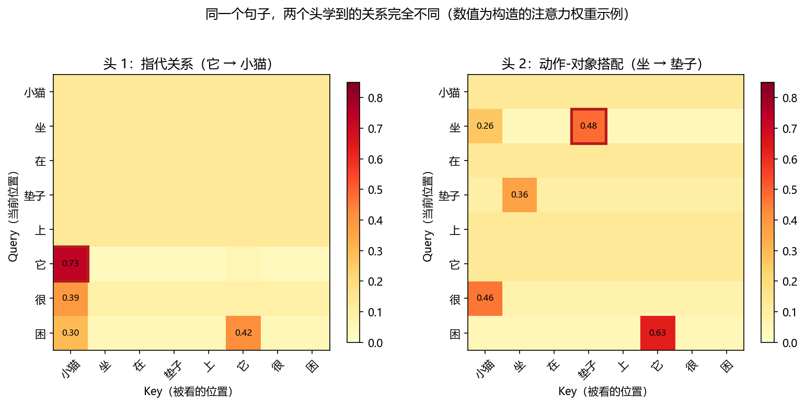
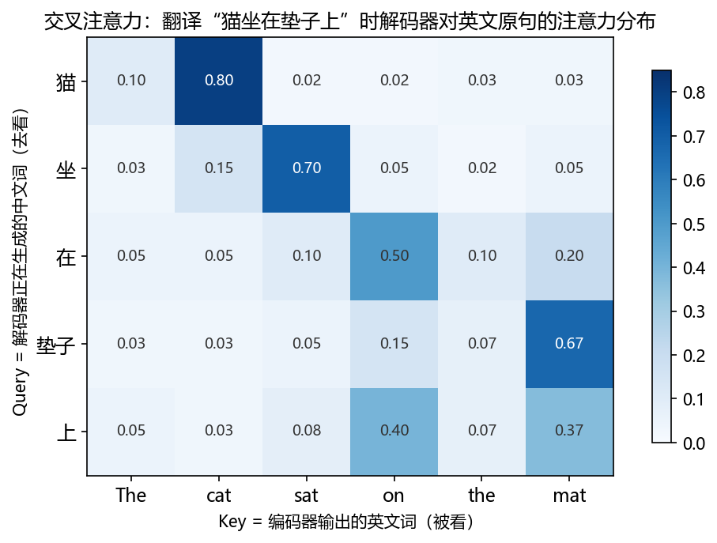
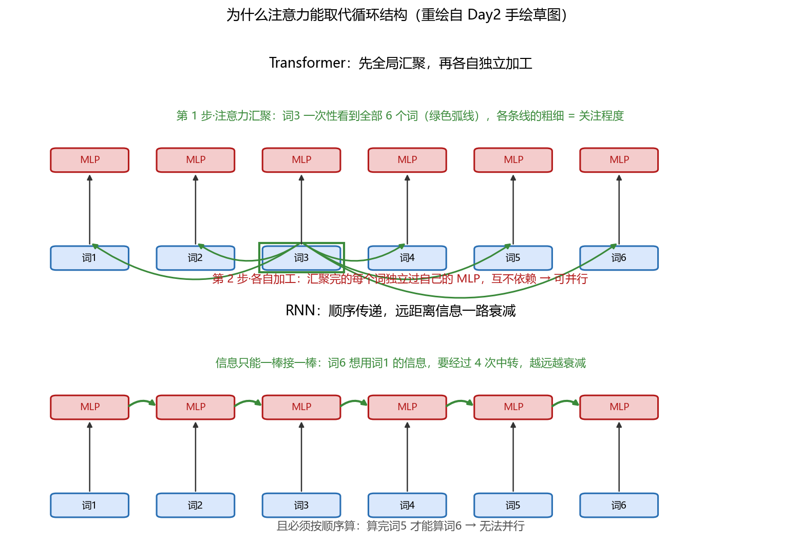
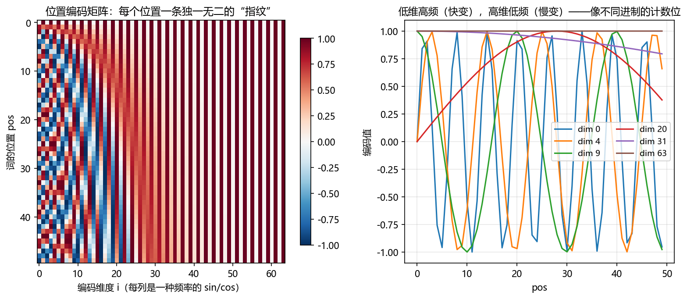

## 前言

今天接着看 Transformer。我曾经跟着黑马程序员敲过 CNN、RNN 什么的，整体感觉都挺公式化的，代码是真的实现了高内聚低耦合，不同版本之间只需要修改少量代码即可训练出不同的模型。虽然我现在忘得差不多了，但偶尔回去翻一翻之前的笔记，应该还是能看懂的吧！这次想顺着往下弄清楚：去掉循环以后，模型怎么处理一个句子？

## 0. 论文的主要观点

假设要把一句英文翻译成德文。编码器读入整句英文；解码器拿着已生成的德文前缀继续预测下一个词，并随时回看英文原句。Transformer 用注意力连接这些位置，再用前馈网络分别加工每个位置的表示。训练时不用像循环网络那样，等前一个位置的状态算完才能算下一个。



## 1. 摘要翻译

占主导地位的序列转换模型基于复杂的循环或卷积神经网络，包括**编码器和解码器**。表现最佳的模型还通过**注意力机制**连接编码器和解码器。我们提出了一种新的简单网络架构，Transformer，完全基于注意力机制，**摒弃了循环和卷积**。在两项机器翻译任务上的实验表明，这些模型**质量更优，且更具并行性**，训练所需时间显著更少。

我们的模型在 WMT 2014 英语-德语翻译任务上取得了 28.4 的 BLEU 值，比包括集成模型在内的现有最佳结果提高了超过 2 个 BLEU。在 WMT 2014 英语-法语翻译任务上，我们在 8 个 GPU 上训练 3.5 天后建立了新的单模型最先进 BLEU 分数 41.8，这只是文献中最佳模型训练成本的一小部分。我们通过将其成功应用于英语成分分析（无论是使用大量还是有限的训练数据），表明 Transformer 很好地推广到其他任务。

## 2. 现有问题：RNN 的两大死穴

RNN 会为每个位置保存一个隐藏状态，可以把它看成「读到这里为止的笔记」。计算下一页笔记需要先拿到上一页，因此句内的状态更新有固定先后顺序；早期翻译模型即便用注意力连接编码器和解码器，也保留了各自内部的循环。

### 2.1 串行计算：前一个词不结束，后一个词不能开始

$h_t = f(h_{t-1}, x_t)$ 的意思是：**想知道第 100 个词的状态，必须先算完第 99 个**。GPU 可以同时处理多个样本，也可以并行做一次状态更新里的矩阵运算；同一句里的这 100 次更新仍要依次进行。

### 2.2 内存限制：反向传播还要把整条链保存下来

完整的时间反向传播（BPTT）需要用到各步中间状态。按常规保存激活的实现，同样的显存能容纳的长句子更少，批处理规模也会受限。自注意力改变的是位置之间的计算依赖；它也有显存成本，见 §10。

### 2.3 为什么“已经用了注意力”还是不够

Bahdanau 等人的翻译模型让解码器在每次预测时从编码器各位置取信息。Transformer 又把注意力用到了编码器内部和解码器内部，接替原本由循环承担的位置间信息传递。

## 3. 注意力 Vs 卷积神经网络

假设读到第 8 个字时，需要用到第 1 个字。宽度为 3、步长为 1 的普通因果卷积，每层只往左多看两个位置，连续叠三层能覆盖 7 个字，仍够不到第 1 个。改成膨胀率 `1、3、9` 的三层卷积，每层仍取三个位置，但间隔变大，覆盖长度依次为 `3、9、27`。

能看整个前缀的因果自注意力在第 8 个位置就能直接读取第 1 个位置的 Value；不带因果掩码的全局自注意力则允许两个方向直接连接。这里比较的是信号需要经过多少层，不是模型一定会给第 1 个字多大的权重。

### 3.1 编码器与解码器的关键区别：多头注意力与掩码

解码器比编码器多两样东西：

1. **掩码多头自注意力**：自己看自己，但只准看已生成的部分，防止作弊偷看答案。
2. **交叉注意力**：$Q$ 来自解码器，$K/V$ 来自编码器输出，这是两个部分的交流通道。

## 4. 关键公式：残差连接 + 两个关键超参数

$$
\text{LayerNorm}\big(x + \text{Sublayer}(x)\big)
$$

这是论文的 Post-Norm 写法：先把子层算出的变化量加回输入 `x`，再对相加结果做层归一化。相加给子层留了一条保留原输入的路径，后面的 LayerNorm 仍然参与整层的梯度计算。

原论文的 Base 模型有 6 层编码器、6 层解码器，每个位置的表示有 512 个特征。LayerNorm 在当前位置的 512 个数上计算均值和方差，标准化后还可以用可学习的参数缩放和平移。

## 5. BatchNorm Vs LayerNorm

这里先把输入看成三维张量：$(batch \times seq \times feature)$。每个文本的长度可能不一样（seq 不一样），所以需要重点观察两种归一化各自切了哪些位置。



### 5.1 两者的共同点

两者都先减均值，再除以带稳定项的标准差，随后可学习缩放和偏移。想象两个位置的特征行是 `[1,3]` 和 `[10,14]`。LayerNorm 分别算出该行均值 `2` 和 `12`；把两行当作 BatchNorm 的两个观察样本时，第一个特征的均值是 `(1+10)/2=5.5`。统计范围不同，后续训练与推理用到的统计量也不同。

### 5.2 BatchNorm：切列，统计量依赖队友

BatchNorm 对“特征 C3”这个通道，拿 batch 里所有样本的值算均值和方差。统计量**依赖队友**：batch 越小越不稳；NLP 里句子长短不一，padding 位置会污染统计；推理时还得用训练集的移动平均，训练和推理行为不一致。

### 5.3 LayerNorm：切行，每个位置自己算

LayerNorm 让每个词的 512 维**自己算自己的**，它跟 batch 里其他句子、跟句子长度统统无关。“seq 不一样，所以每个样本自己算”说的就是这个意思。



- 整个立方体 = 一个 batch 的张量：x 方向是 seq（句内位置 s1..s4），y 方向是 batch（第 1~3 句），z 方向是特征维度（512 维示意成 5 格）。
- **橙色水平层（BN）**：固定一个特征通道，把**所有句子、所有位置**摊在同一层里算均值和方差。
- **蓝色竖柱（LN）**：固定某一个词，只在它自己的特征维度里算。
- **顶部“台阶”**：三句话长度 4/3/2 递减，而空位会混进 BN 的“全层统计”里污染均值和方差；LN 的柱子自己转自己的，长短句、batch 大小统统无关。

## 6. Q、K、V：注意力的最小单元

同一个 Query 对不同的 Key 会算出不同的相似度，得到不同的权重，最后按不同比例混合各个 Value。

输入由维度为 $d_k$ 的查询和键，以及维度为 $d_v$ 的值组成。计算查询与所有键的点积，每个点积除以 $\sqrt{d_k}$，再应用 softmax 函数，得到 Value 上的权重。批量计算时，一组查询组成矩阵 $Q$，键和值分别组成矩阵 $K$ 和 $V$。输出矩阵为：

$$
\text{Attention}(Q, K, V) = \text{softmax}\left( \frac{QK^T}{\sqrt{d_k}} \right) V
$$

### 6.1 一个简单的类比

- **Query（查询卡）**：当前查询的问题，例如“它”指的是什么？
- **Key（书脊标签）**：每个位置用于匹配的标签，例如“小猫”“垫子”。
- **Value（书的内容）**：每个位置提供给其他位置读取的向量。
- **注意力输出**：按“标签与查询卡的匹配度”加权，把各本书的内容**抄进自己的笔记本**。匹配度高的书多抄点，不相关的少抄点。例如一个“小猫形状的坐垫”，就会从小猫和垫子双方各取出不同权重的信息量。

下面是一个简单的计算举例：

| 候选 Key | 点积得分 | 除以 $\sqrt{4}$ | softmax 权重 |
| --- | ---: | ---: | ---: |
| 小猫 | 6.0 | 3.0 | **0.82** |
| 垫子 | 2.0 | 1.0 | 0.11 |
| 昨天 | 1.0 | 0.5 | 0.07 |

三个 Value 分别取 `[1, 0]`、`[0, 2]`、`[0, 0]` 时，输出就是 `0.82 × [1, 0] + 0.11 × [0, 2] + 0.07 × [0, 0] = [0.82, 0.22]`。这里的 `0.82` 是合成输出向量时乘在第一个 Value 上的系数。

### 6.2 为什么要除以 $\sqrt{d_k}$

$q\cdot k$ 是 $d_k$ 项乘积之和。按论文用来说明尺度的假设，各分量独立、均值为 0、方差为 1，那么这笔和的方差是 $d_k$，标准差是 $\sqrt{d_k}$。除以标准差后，不会因为头维从 16 增到 64，就把分数的典型差距放大一倍。这样可减少 softmax 过早接近“全押一个位置”的情况。

### 6.3 K 和 V 是怎么来的

在自注意力里，当前位置的表示 $x$ 经过三个各自可训练的矩阵，得到 $Q$、$K$、$V$。第一层的 $x$ 来自嵌入和位置编码；更深的层用上一层的输出。

$$
K = x \cdot W^K, \qquad V = x \cdot W^V, \qquad Q = x \cdot W^Q
$$

- **训练阶段**：海量语料反复修正 $W^Q$、$W^K$、$W^V$——让“该被关注的词”的 $K$ 恰好和 Query 点出高分，且它携带的 $V$ 确实有用。
- **推理阶段**：矩阵参数已经固定，用当前的 $x$ 算出 $K$ 和 $V$。自回归生成时，早先位置的结果还可缓存，供后续位置复用。

### 6.4 加型注意力 Vs 点乘注意力

加型注意力用小前馈网络算 $q,k$ 的相合度（Bahdanau 2014）。点乘注意力能把所有查询和键的打分写成一次矩阵乘法，适合用现成的并行矩阵运算。

两种打分函数都输出一个标量“相合度”，后面的 softmax 流程完全一样：

$$
\text{score}_{\text{加型}}(q, k) = v_a^\top \tanh(W_q\,q + W_k\,k)
$$

$$
\text{score}_{\text{点乘}}(q, k) = \frac{q \cdot k}{\sqrt{d_k}}
$$

先澄清名字：**“加型”不是“用加法代替乘法”**，而是 $q,k$ 在网络里**先相加**（$W_q q + W_k k$）再过 tanh。

**一个小例子**（$d_k=2$，隐藏维 $d_a=2$，为省事取 $W_q=W_k=I$，$v_a=[1,1]$）：

取 $q=[1,2]$，$k=[3,-1]$：

- 点乘得分：$q\cdot k = 1\times3 + 2\times(-1) = 1$
- 加型得分：$q+k=[4,1] \xrightarrow{\tanh} [0.9993,0.7616] \xrightarrow{v_a} 0.9993+0.7616\approx1.76$

两者都得到一个标量，喂给同一套 softmax 就能当注意力权重——**打分函数可以换，注意力骨架不变**。加型多了可学习的 $W$，理论上更灵活。

| 维度 | 加型注意力 | 点乘注意力 |
| --- | --- | --- |
| 单对 $(q,k)$ 打分 | 两次线性变换 + tanh + 一次点积（约 $2d_kd_a$ 次乘加） | $d_k$ 次乘加 |
| n 个词全配对 | 中间要物化 $n\times n\times d_a$ 的隐藏层张量 | 一次 GEMM 搞定：$QK^T$（n×d 乘 d×n） |
| GPU 契合度 | 小算子串联，访存次数多 | 大矩阵乘，吃满 BLAS / Tensor Core |

从实现上看，点乘注意力能直接利用矩阵乘法库，方便批量计算；两种打分方式的具体效果还要看任务和配置。

### 6.5 MASK：避免看到未来的东西

在 softmax 之前，把“未来”列的分数置为 $-\infty$。例如分数 `[0, 0, 5]` 的第三个位置被遮住后，前两个位置各得 `0.5`，第三个得 `0`。有限负数 `-1e9` 是一些实现中的近似写法：它在实数数学里仍给出正权重，只是在特定浮点计算中可能下溢为 0。布尔掩码能更直接表达要隐藏哪些位置。

```python
import math

scores = [0.0, 0.0, 5.0]
allowed = [True, True, False]
take = [math.exp(score) if show else 0.0
        for score, show in zip(scores, allowed)]
weights = [value / sum(take) for value in take]
assert weights == [0.5, 0.5, 0.0]
```

这行至少要有一个可见位置。若自写代码把整行都遮住，就没有可以归一化的候选，须由实现单独处理这类输入。

**训练时**解码器接收右移后的目标序列，靠掩码让位置 $t$ 只能看到 $1..t$，并行计算各位置的预测；**推理时**才真的一个词一个词生成。去掉因果掩码，训练就可能直接用到待预测的未来 token，和生成时的条件对不上。

### 6.6 多头注意力：同一个词的多种观察视角

先投影到低维，学到不同的投影方法，再把结果融合出来：

$$
\text{MultiHead}(Q,K,V) = \text{Concat}(\text{head}_1,\dots,\text{head}_h)W^O
$$

$$
\text{head}_i = \text{Attention}\left(QW_i^Q,\ KW_i^K,\ VW_i^V\right)
$$

**多头数值迷你示例**：

- 设某词向量是 4 维：$[0.5,-1.2,0.3,2.0]$，头数 $h=2$，每头 $d_h=2$ 维。
- **头 1** 拿前两维 $[0.5,-1.2]$，**头 2** 拿后两维 $[0.3,2.0]$——相当于把同一个词投影到两个不同的“观察子空间”。
- 头 1 在自己的子空间里算出一套注意力（比如专抓“谁指代谁”），头 2 算出另一套（专抓“动词配什么宾语”），各自加权各自的 Value，最后 Concat 回 4 维，再过 $W^O$ 融合。
- 8 个头 × 64 维 = 512：**总计算量和单个 512 维大头几乎一样，但换来了 8 种不同的关系视角**，相当于为 Transformer 额外提供了一个**可训练视角**。



**这个示意图怎么读**：行 = Query（当前正在更新表示的词），列 = Key（被看的位置），格子值 = 注意力权重，每行和为 1；只给大于 0.25 的格子标了数字，免得太挤。

**两个头各自提供了一个视角**：

- 头 1（指代）：“它”的行 0.73 压在“小猫”上；“很”看“小猫”（0.39）、“困”看“它”（0.42）和“小猫”（0.30）——形容词和谓语都在找自己的主语。
- 头 2（搭配）：“坐”的行分给“垫子”0.48、“小猫”0.26（动作找宾语和施事）；“困”看“它”（0.63）；“垫子”回看“坐”（0.36）。

同一句话、同一层，两个头关注的位置完全不同——**这就是“多头 = 多视角”的直观证据**。

**真实模型里这些数从哪来**：$A=\text{softmax}(QK^T/\sqrt{d_k})$，其中 Q、K 是词向量分别乘以该头可学习的 $W^Q$、$W^K$ 之后的产物。“它”的 Query 之所以会和“小猫”的 Key 点出高分，是**训练从语料里学出来的**；本图相当于“训练成功后权重的理想化快照”。

## 7. 三种注意力：Q、K、V 分别从哪来

**自注意力：Q、K、V 来自同一侧。**

整台机器一共就三种接法，区别只在 Q 和 K/V 的来源，下面不妨以中英翻译为例：

| 位置 | Q 来自 | K、V 来自 | 干什么 |
| --- | --- | --- | --- |
| 编码器自注意力 | 编码器输入 | 编码器输入（同源） | 每个英文词看全句，互相理解 |
| 解码器掩码自注意力 | 解码器输入 | 解码器输入（同源） | 每个中文词只看已生成的部分 |
| 交叉注意力 | **解码器** | **编码器输出** | 中文词去英文原句上“找对应” |

### 7.1 交叉注意力：中文 Query 去英文 Key/Value 上取货

下面是第三种注意力的一个注意力分布示意图：



每一行是一个解码器时刻：当前中文词（Query）对 6 个英文词（Key）打分，softmax 后按权重抽取编码器里对应位置的信息。场景是英文原句 *The cat sat on the mat* 已被编码器读完，解码器正在逐字写出“猫坐在垫子上”，**此刻轮到“垫子”**。

| 角色 | 概念理解 | 谁提供 | 通俗比喻 |
| --- | --- | --- | --- |
| **Q 查询** | 生成“垫子”时，需要匹配英文原句中的哪些信息？ | 解码器（中文侧） | 当前的问题卡片 |
| **K 键** | 各英文词用于匹配的特征，例如 cat、mat 对应的表示 | 编码器输出（英文侧） | 书架上的书脊标签 |
| **V 值** | 每个英文词真正携带的语义内容，翻译时要抄的“干货” | 编码器输出（英文侧） | 翻开书后的正文 |

### 7.2 生成“垫子”的四步

注意：此刻解码器手里只有一段已经生成的序列：`[START] 猫坐在`，**垫子还没出生**。

1. **打分**：当前末位（“在”）的 Q 和 6 个英文词的 K 一一点积，mat 得分最高（0.67），on 其次（0.15）。
2. **归一化**：softmax 把分数变成权重，权重和为 1。
3. **取货**：按权重把 6 个英文词的 V 加权混合，打包成“与‘垫子’语义相关”的英文信息包。
4. **预测**：信息包与“在”位置的表示融合，经输出层在词表上打分——“垫子”得分最高，**这才被生成出来**。

**生成每个中文 token 时，都从英文原句中检索相关信息**：Q 表达查询需求，K 提供匹配特征，V 提供被加权汇总的内容。在这个交叉注意力层中，**中文侧出 Q，英文侧出 K 和 V**。

```text
第 1 步  输入 [START]                    → 预测出“猫”
第 2 步  输入 [START, 猫]                → 预测出“坐”
第 3 步  输入 [START, 猫, 坐]             → 预测出“在”
第 4 步  输入 [START, 猫, 坐, 在]         → 预测出“垫子”   ← 生成“垫子”的时刻
第 5 步  输入 [START, 猫, 坐, 在, 垫子]  → 预测出“上”
```

### 7.3 第 4 步的 QKV 分工

- **Q**：来自当前输入 [START, 猫, 坐, 在] 的**最末位置（“在”）**，语义是“猫坐在___，接下来填什么？”此时，**垫子正是要被它问出来的答案**。
- **K、V**：来自编码器对 6 个英文词的输出。
- **参与运算的**：中文侧（解码器）的末位 Q + 英文侧（编码器）的 K、V。

一个小思考：中文的 Q 凭什么能和英文的 K 算点积？

两种语言的原始词向量风马牛不相及，但 $W^Q$、$W^K$ 把它们投影到**同一个 $d_k$ 维空间**。这个公共空间是训练学出来的“语义对齐空间”：语料里“垫子”几乎总和 mat 出现在对齐位置上，梯度就会把“垫子类 Query”和“mat 类 Key”在这个空间里推向相近的方向。

## 8. FFN：汇聚之后的独立加工

$$
\text{FFN}(x)=\max(0,\ xW_1+b_1)W_2+b_2
$$

为什么 MLP 可以分开独立做？注意力已经做了一次汇聚的过程，各自已经有自己的感兴趣的位置信息，以下是一个简易的示意图，展示 Transformer 与 RNN 的区别，以及为什么 MLP 在 Transformer 里可以各自独立处理。



后人对 FFN 的一个有趣解读——两层 MLP 长得像一个巨大的 Key-Value 记忆库：第一层 $W_1$ 是“模式检测器”（Key），第二层 $W_2$ 是“内容库”（Value）。也就是说，**注意力在词与词之间做 KV 检索，FFN 在知识层面再做一次 KV 检索**——模型的“世界知识”大量被认为存在 FFN 里。

## 9. 位置编码：给无序的注意力装上顺序感

加入时序信息，是为了防止所有词打乱后结果没有变化。注意力对“顺序”天然失明：把“猫追狗”和“狗追猫”的词集合放在一起，不带位置信息的注意力算出的结果也一样，这在语言里是灾难。所以要把位置做成向量，**加到词向量上**。

$$
PE_{(pos,\ 2i)} = \sin\left(pos / 10000^{2i/d_{model}}\right)
$$

$$
PE_{(pos,\ 2i+1)} = \cos\left(pos / 10000^{2i/d_{model}}\right)
$$

### 9.1 这两个公式在做什么

- 把每个位置 $pos$ 映射成一个 512 维“指纹”：不同维度用**不同频率**的 sin/cos 振荡——低维频率高（像秒针，翻得快），高维频率低（像时针，走得慢）。
- 可以类比二进制计数：最低位 0/1 交替最快，高位慢慢翻。任意一个位置，它的指纹组合**独一无二**；两个位置的指纹差，还隐含着它们的距离。



### 9.2 为什么偏偏选 sin/cos

1. **唯一性**：不同位置得到不同编码，且值域 $[-1,1]$ 有界，和词向量尺度匹配，不会喧宾夺主。
2. **相对位置可学**：$\text{PE}(pos+k)$ 可以表示为 $\text{PE}(pos)$ 的**线性变换**（sin/cos 的旋转性质）。模型想学“右边第 3 个词”这种相对关系时，只需学一个固定的线性映射，非常容易。
3. **免训练**：不用学参数，直接生成，长句也能外推。
4. **论文实测**：换成可学习的位置嵌入（BERT 的做法）**效果几乎一样**，说明重要的是“有位置信息”，而非具体形式。顺带一提，现在主流已换成 RoPE（旋转位置编码）。

## 10. 复杂度对比

| 层类型 | 每层计算量 | 最少串行步数 | 最大路径长度 |
| --- | --- | --- | --- |
| 自注意力 | $O(n^2 \cdot d)$ | $O(1)$ | $O(1)$ |
| 循环 RNN | $O(n \cdot d^2)$ | $O(n)$ | $O(n)$ |
| 普通卷积（连续核，步长 1，$k>1$） | $O(k \cdot n \cdot d^2)$ | $O(1)$ | $O(n/k)$ |
| 膨胀卷积（膨胀率按层递增） | $O(k \cdot n \cdot d^2)$ | $O(1)$ | $O(\log_k n)$ |
| 自注意力（限窗 $r$） | $O(r \cdot n \cdot d)$ | $O(1)$ | $O(n/r)$ |

论文 §4 的表把卷积合写一行，正文则区分连续核和膨胀核。“每层计算量”问需要做多少乘加；“最少串行步数”问同一层的位置能否并行；“最大路径长度”问相距最远的两个位置要隔几次传递。普通卷积同一层可以并行，却仍要堆多层才能把消息传远。

## NumPy 实验：一次注意力训练改变了什么

输入“小猫 很”，输出目标是“困”。用三个样本训练单头注意力，再把“很”这一行的三个权重与正确答案概率摆在一起，看它们如何分别变化。

[阅读全文](/2026/08/26/attention-is-all-you-need/numpy-experiment/)

<ul>
<li id="11-多看不如多做用简单的实验跑通流程从中观察数据如何变化并给出解释"><a href="/2026/08/26/attention-is-all-you-need/numpy-experiment/#11-多看不如多做用简单的实验跑通流程从中观察数据如何变化并给出解释">11. 多看不如多做：用简单的实验跑通流程，从中观察数据如何变化，并给出解释</a></li>
<li id="111-核心代码"><a href="/2026/08/26/attention-is-all-you-need/numpy-experiment/#111-核心代码">11.1 核心代码</a></li>
<li id="112-前向与反向的路径"><a href="/2026/08/26/attention-is-all-you-need/numpy-experiment/#112-前向与反向的路径">11.2 前向与反向的路径</a></li>
<li id="113-数据如何变化loss-与正确词概率"><a href="/2026/08/26/attention-is-all-you-need/numpy-experiment/#113-数据如何变化loss-与正确词概率">11.3 数据如何变化：loss 与正确词概率</a></li>
<li id="114-训练后的注意力落在哪里"><a href="/2026/08/26/attention-is-all-you-need/numpy-experiment/#114-训练后的注意力落在哪里">11.4 训练后的注意力落在哪里</a></li>
<li id="115-最终权重的含义33-对齐矩阵"><a href="/2026/08/26/attention-is-all-you-need/numpy-experiment/#115-最终权重的含义33-对齐矩阵">11.5 最终权重的含义：3×3 对齐矩阵</a></li>
<li id="116-小猫这条样本为什么不一样"><a href="/2026/08/26/attention-is-all-you-need/numpy-experiment/#116-小猫这条样本为什么不一样">11.6 小猫这条样本为什么不一样</a></li>
<li id="117-实验结果与解释范围"><a href="/2026/08/26/attention-is-all-you-need/numpy-experiment/#117-实验结果与解释范围">11.7 实验结果与解释范围</a></li>
</ul>

## 12. 收工小结

1. **先打分，再取值**：$QK^T$ 决定各位置的权重，$V$ 是被混合的内容，$\sqrt{d_k}$ 用于调整点积分数尺度。
2. **辨认三种接法**：编码器自注意力读输入，解码器自注意力读已知前缀，交叉注意力用解码器的 Q 去读取编码器的 K 和 V。
3. **分清两种计算**：注意力跨位置汇总信息，FFN 独立处理每个位置。原论文用位置编码标记顺序，用残差和 LayerNorm 组织每个子层。
4. **长序列开销**：完整注意力要处理约 $n^2$ 对位置；朴素实现还会存下对应的分数矩阵。

## 附 · 资料下载

本篇配套的 300 轮注意力实验代码，以及用于回顾的 CNN / RNN 基础笔记，可直接下载。

### 300 轮注意力实验

- [generate_walkthrough.py](https://github.com/Redmoon-2333/Redmoon-2333.github.io/releases/download/day2-assets/generate_walkthrough.py)：训练 300 轮并生成训练过程拆解

### CNN / RNN 基础笔记

- [07_卷积神经网络.md](https://github.com/Redmoon-2333/Redmoon-2333.github.io/releases/download/day2-assets/07_%E5%8D%B7%E7%A7%AF%E7%A5%9E%E7%BB%8F%E7%BD%91%E7%BB%9C.md)
- [08_循环神经网络.md](https://github.com/Redmoon-2333/Redmoon-2333.github.io/releases/download/day2-assets/08_%E5%BE%AA%E7%8E%AF%E7%A5%9E%E7%BB%8F%E7%BD%91%E7%BB%9C.md)

