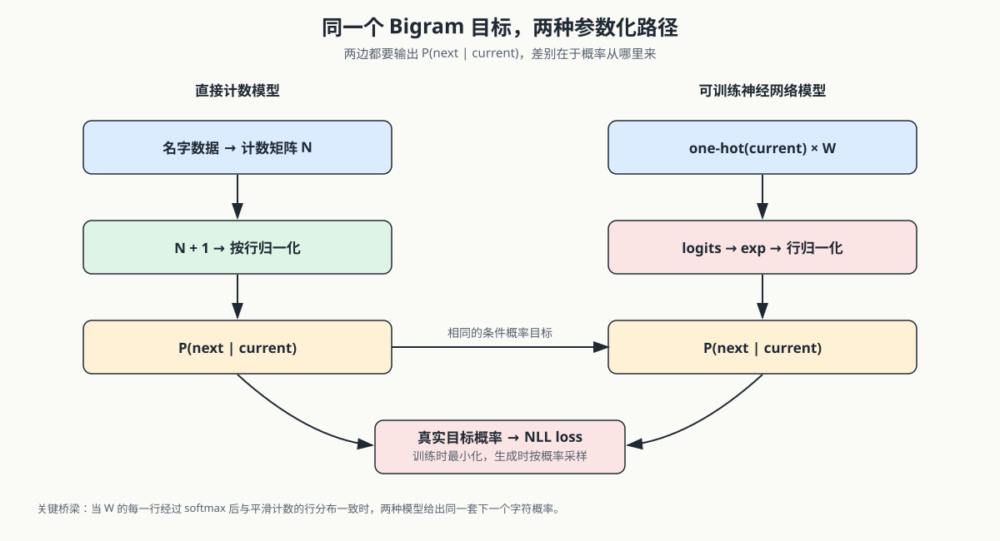
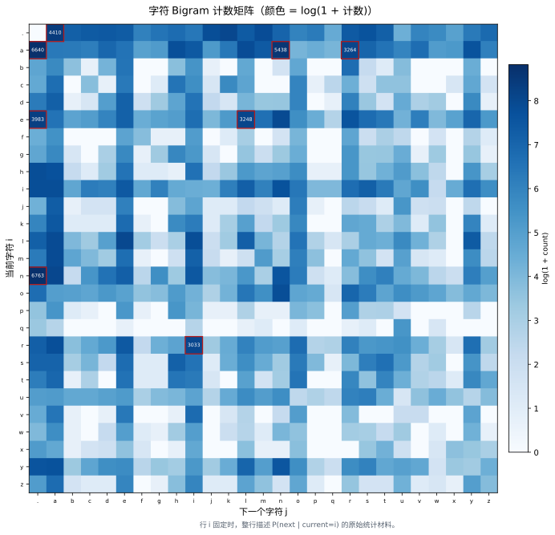
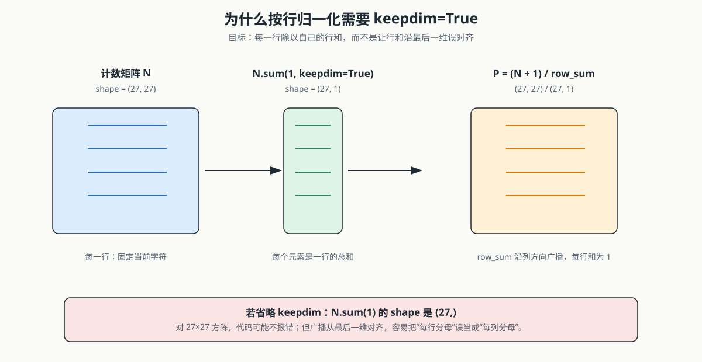
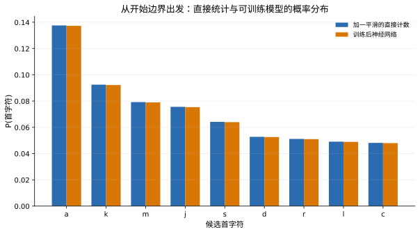

## 前言

昨天的打脸来的好快，本来想CNN，RNN暂且放下不表，但是AI给我的下一个学习建议赫然又回到了基础巩固。不过也好，那就让我们找回从前的记忆吧。

## 0. 这个项目从什么讲到了什么

```text
名字数据
→ 添加起止边界
→ Python 字典统计 bigram
→ 27×27 计数矩阵 N
→ 按行归一化得到条件概率
→ 加一平滑
→ 按概率采样
→ log-likelihood / NLL 评价
→ one-hot × W
→ logits → softmax
→ autograd 反向传播
→ L2 正则化
→ 梯度下降
→ 训练后采样
```

两种写法都在回答“当前是字母 `a`，下一个字母是什么？”计数版先数 `a` 后面跟过什么，再把次数换成概率。训练版也给 `a` 一行，但这行存的是可调整的分数 `W[a]`，由 softmax 换成概率。



## 1. 数据集与起止标记

### 1.1 先看看数据长什么样

原实验读取了 **32033** 个英文名字，最短 **2** 个字符，最长 **15** 个。字母表是 `a` 到 `z`，加上起止标记后共 27 类。先用 `ab、ac、bb` 手算，§3 再读入全量语料：

```python
toy_words = ["ab", "ac", "bb"]
```

全量语料前十个样本包括：

```text
emma, olivia, ava, isabella, sophia,
charlotte, mia, amelia, harper, evelyn
```

### 1.2 一个名字为什么要加边界

只看 `emma` 本身，模型只能看到：

```text
 e → m → m → a
```

它不知道 `e` 是名字的第一个字符，也不知道 `a` 后面应该停止。因此要显式加上开始和结束标记：

```python
chs = ['<S>'] + list("emma") + ['<E>']
```

`emma` 变成：

```text
<S>  e  m  m  a  <E>
```

于是得到 5 个 bigram：

```text
(<S>, e), (e, m), (m, m), (m, a), (a, <E>)
```

一个长度为 `L` 的名字会贡献 `L + 1` 个转移。整个数据集一共贡献：

$$
\sum_{w\in D}(|w|+1)=228146
$$

这 `228146` 个转移就是后面神经网络训练时的监督样本数。

### 1.3 两套边界写法

字典版用 `<S>` 和 `<E>` 两个不同标记。张量版复用同一个编号 `0`：生成时先把 `.` 作为起点，再从表里取概率；某次采样拿到 `.` 就停止，所以不会拿结束标记接着生成下一字。加一平滑会给 `.` 到 `.` 留下一个小概率，正好对应可能一开头就停下的空样本。

因此：

- 第 0 行 `N[0, :]` 主要表示从名字开始边界出发的首字符分布；
- 第 0 列 `N[:, 0]` 主要表示某个字符后面结束名字的次数；
- 但矩阵本身看不出“这个 0 是开始还是结束”，只是借助行列位置赋予不同语义。

这是为了教学和实现方便的简化，不是说开始和结束在语言建模中天然是同一个状态。

## 2. Bigram：先数相邻字符

### 2.1 用字典统计转移次数

最直接的写法是用 Python 字典：

```python
b = {}
for w in toy_words:
    chs = ['<S>'] + list(w) + ['<E>']
    for ch1, ch2 in zip(chs, chs[1:]):
        bigram = (ch1, ch2)
        b[bigram] = b.get(bigram, 0) + 1
```

`zip(chs, chs[1:])` 是这里的关键：

```text
chs       = [<S>, e, m, m, a, <E>]
chs[1:]   = [ e,  m, m, a, <E>]
zip(...)  = [(<S>,e), (e,m), (m,m), (m,a), (a,<E>)]
```

`b.get(bigram, 0) + 1` 的意思是：如果这对字符第一次出现，就从 0 开始；否则就在原有计数上加 1。

数学上，字典中的每个值都是：

$$
C(a,b)=\#\{t\mid c_t=a,\ c_{t+1}=b\}
$$

它只描述相邻两个字符的共现次数，因此叫 **bigram**。这是一个一阶 Markov 假设：下一个字符只依赖当前字符，不看更早的历史。

在 `ab、ac、bb` 里，`a` 后面各出现一次 `b` 和 `c`，所以未平滑时各有一半的概率。`b` 后面出现两次结束标记、一次 `b`，则结束概率是 `2/3`。这说明用哪个分母要看当前字母：算 `a → b` 时，分母是 `a` 的全部去向，和 `b` 有几个去向无关。下面是不依赖数据文件的完整计数：

```python
from collections import Counter

toy_words = ["ab", "ac", "bb"]
counts = Counter(
    (left, right)
    for word in toy_words
    for left, right in zip("." + word, word + ".")
)
candidates = ".abc"
total_after_a = sum(counts["a", c] for c in candidates)
p_after_a = [counts["a", c] / total_after_a for c in candidates]
p_after_a_smoothed = [
    (counts["a", c] + 1) / (total_after_a + len(candidates))
    for c in candidates
]
assert sum(counts.values()) == 9
print(p_after_a)           # [0.0, 0.0, 0.5, 0.5]
print(p_after_a_smoothed)  # [1/6, 1/6, 1/3, 1/3] 的浮点值
```

### 2.2 高频转移不等于高频字符

在全量名字上按计数排序，前几名是：

| bigram | 次数 |
| --- | ---: |
| `n → <E>` | 6763 |
| `a → <E>` | 6640 |
| `a → n` | 5438 |
| `<S> → a` | 4410 |
| `e → <E>` | 3983 |

准确的说法应该是“`n → <E>` 这条转移很常见”，而不是“`n` 是最常见字符”。因为这里统计的是有方向的相邻字符对，而且结束标记也参与了统计。

## 3. 计数矩阵：把字典变成一张表

### 3.1 字符和索引

下面的完整实验由 `names.txt` 提供语料，一行一个名字。`words` 指全量数据；上文的 `toy_words` 不参与全量统计。先给 27 个符号编号：

```python
from pathlib import Path

import torch

words = Path("names.txt").read_text(encoding="utf-8").splitlines()
chars = "." + "".join(sorted(set("".join(words))))
stoi = {s: i for i, s in enumerate(chars)}
itos = {i: s for s, i in stoi.items()}
```

`stoi` 是 string-to-integer，`itos` 是 integer-to-string：

```text
. → 0
 a → 1
 b → 2
...
 z → 26
```

然后创建计数矩阵：

```python
N = torch.zeros((27, 27), dtype=torch.int32)
```

它的含义是：

- `N.shape == (27, 27)`；
- 行索引 `i` 表示当前字符；
- 列索引 `j` 表示下一个字符；
- `N[i, j]` 表示 `i → j` 出现了多少次；
- `dtype=torch.int32` 说明这里存的是计数，不是概率。

### 3.2 把 bigram 映射到矩阵坐标

```python
for w in words:
    chs = ['.'] + list(w) + ['.']
    for ch1, ch2 in zip(chs, chs[1:]):
        ix1 = stoi[ch1]
        ix2 = stoi[ch2]
        N[ix1, ix2] += 1
```

这段代码只是把前面的字典键 `(ch1, ch2)` 换成了 `(ix1, ix2)`。例如：

```text
. → a  对应 N[0, 1]
a → n  对应 N[1, 14]
```

notebook 中可以看到：

```python
N[0]
```

其前几项是：

```text
[0, 4410, 1306, 1542, 1690, 1531, ...]
```

所以 `.` 到 `a` 的原始计数是 **4410**，到 `k` 是 **2963**，到 `m` 是 **2538**。

### 3.3 热图应该怎么看



横轴是下一个字符，纵轴是当前字符。每一行回答一个问题：

> 当前字符固定为 `i` 时，数据中下一字符 `j` 的转移次数如何分布？

图中颜色使用 `log(1 + count)` 映射，而不是直接使用原始计数。因为高频转移和低频转移差距很大，直接映射会让大部分低频格子看起来几乎一样；对数变换只改变显示尺度，不改变计数矩阵里的事实。

有一个细节值得注意：`. → a` 的计数位于第 0 行，而 `a → .` 的计数位于第 1 行第 0 列。它们都使用索引 0，但在行、列中的语义不同。

## 4. 从计数到条件概率

### 4.1 未平滑的首字符分布

只看第 0 行：

```python
p = N[0].float()
p = p / p.sum()
p
```

得到的是从开始边界出发时的首字符分布：

$$
P(j\mid i)=\frac{N_{ij}}{\sum_kN_{ik}}
$$

特别地，首字符分布是：

$$
P(j\mid .)=\frac{N_{0j}}{\sum_kN_{0k}}
$$

notebook 中 `. → a` 的**未平滑**概率约为 `0.1377`。它来自：

```python
N[0, 1] / N[0].sum()
```

这个数字不要和后面的加一平滑概率混淆。

### 4.2 加一平滑：避免零概率

如果一个 bigram 在训练集里从未出现，那么直接归一化会得到：

$$
N_{ij}=0\quad\Longrightarrow\quad P(j\mid i)=0
$$

而 NLL 中需要取对数：

$$
\log 0=-\infty
$$

于是 notebook 使用加一平滑：

```python
P = (N + 1).float()
P = P / P.sum(1, keepdim=True)
```

数学上是：

$$
P(j\mid i)=
\frac{N_{ij}+1}{\sum_k(N_{ik}+1)}
$$

一行有 27 个类别，因此分母等于：

$$
\sum_kN_{ik}+27
$$

它的含义不是“所有字符变得同样可能”，而是给每个没有观察到的转移留下一个很小的概率，避免模型因为“这次数据没出现”就断言“永远不可能”。

## 5. `keepdim=True`：广播方向决定归一化方向（视频里强调）

### 5.1 三个形状

这一行代码看起来简单，但它同时考察了维度、求和和广播：

```python
P = P / P.sum(1, keepdim=True)
```

对一个 `P.shape == (27, 27)` 的矩阵来说：

| 表达式 | shape | 含义 |
| --- | --- | --- |
| `P` | `(27, 27)` | 27 个当前字符 × 27 个候选下一个字符 |
| `P.sum(1)` | `(27,)` | 每一行的总和，但压掉了被求和的维度 |
| `P.sum(1, keepdim=True)` | `(27, 1)` | 每一行的总和，并保留一个长度为 1 的列维度 |

正确写法的除法是：

```text
(27, 27) / (27, 1)
```

`(27, 1)` 会沿着列方向广播成 `(27, 27)`，于是：

```text
第 0 行 ÷ 第 0 行的总和
第 1 行 ÷ 第 1 行的总和
...
```

每一行都被自己的分母归一化。

### 5.2 为什么不建议省略 `keepdim`

若写成：

```python
P = P / P.sum(1)
```

分母形状是 `(27,)`。PyTorch 广播从最后一个维度对齐，因此它把这个向量视作“最后一维上的 27 个分母”，也就是按列对齐，而不是明确按行对齐。

在一个非方阵小例子中，它甚至会直接报形状错误：

```python
A = torch.tensor([
    [1., 2., 3.],
    [4., 5., 6.],
])
A.sum(1).shape                  # torch.Size([2])
A.sum(1, keepdim=True).shape    # torch.Size([2, 1])
```

`(2, 3) / (2,)` 的最后一维是 `3` 对 `2`，无法广播；而 `(2, 3) / (2, 1)` 可以明确按行工作。

当前 notebook 的矩阵恰好是方阵 `(27, 27)`，省略 `keepdim` 可能不报错，但这只是形状碰巧相容，不能说明归一化方向正确。



可以用下面这句检查结果：

```python
P[0].sum()
```

输出为 `tensor(1.)`，说明第 0 行已经是一个概率分布。更完整的检查可以写成：

```python
torch.allclose(P.sum(1), torch.ones(27))
```

### 5.3 `keepdim` 只影响形状，不改变求和结果

`keepdim=True` 并没有改变“求和”本身，只是保留了被压掉的维度。它相当于给广播机制留下了一个明确的方向提示：

> 这是每一行的一个分母，请沿列复制它。

## 6. 按概率逐字符采样

有了 `P`，就可以让模型生成名字：

```python
g = torch.Generator().manual_seed(2147483647)
for i in range(5):
    out = []
    ix = 0
    while True:
        p = P[ix]
        ix = torch.multinomial(
            p, num_samples=1, replacement=True, generator=g
        ).item()
        out.append(itos[ix])
        if ix == 0:
            break
    print(''.join(out))
```

每一步的形状和类型变化是：

```text
P             : (27, 27)
P[ix]         : (27,)       当前字符对应的下一字符分布
multinomial   : (1,)        采出的类别索引
.item()       : Python int   方便作为下一轮的 ix
```

每次调用只抽一个字符，`replacement` 不影响这一次抽取。下一步重新从新字符对应的行抽样，所以 `m → m` 也会出现。`ix == 0` 时遇到结束边界，生成停止。

固定随机种子后，当前 notebook 的统计模型生成结果是：

```text
cexze.
momasurailezitynn.
konimittain.
llayn.
ka.
```

这些字符串看起来像名字，是因为局部拼写规律已经被保留下来；但它们不代表模型理解了词义、语法或真实姓名的语义结构。



上图比较的是平滑计数模型与训练后神经网络在首字符上的分布。它不是在比较“谁更聪明”，只是把两种参数化方式放在同一个条件分布上观察。

## 7. 似然、对数似然与 NLL

### 7.1 一个名字的概率如何分解

对于字符序列：

```text
. → e → m → m → a → .
```

bigram 模型给出的整条序列概率是：

$$
P(w)=\prod_tP(c_{t+1}\mid c_t)
$$

很多小概率直接连乘容易发生数值下溢，所以取对数：

$$
\log P(w)=\sum_t\log P(c_{t+1}\mid c_t)
$$

然后取负号，把“概率越大越好”改写成“损失越小越好”：

$$
\mathrm{NLL}
=-\frac{1}{n}\sum_{t=1}^{n}
\log P(c_{t+1}\mid c_t)
$$

### 7.2 notebook 如何展开这个定义

```python
total_log_likelihood = 0.0
num_bigrams = 0
for w in words:
    chs = ['.'] + list(w) + ['.']
    for ch1, ch2 in zip(chs, chs[1:]):
        ix1 = stoi[ch1]
        ix2 = stoi[ch2]
        prob = P[ix1, ix2]
        logprob = torch.log(prob)
        total_log_likelihood += logprob
        num_bigrams += 1

nll = -total_log_likelihood
print(nll / num_bigrams)
```

当前输出为：

```text
total_log_likelihood = -559951.5625
nll                    =  559951.5625
average NLL            =  2.4543561935424805
```

`2.4543561935424805` 是全体字符转移事件的平均 NLL，使用自然对数，单位可以称为 **nats**。它不是“每个名字的 NLL”，因为分母 `num_bigrams` 统计的是所有名字贡献的字符转移数量，即 `228146`。

### 7.3 目标到底是什么

若把 `P` 看成模型参数化出来的概率，那么评价的目标是：

$$
\max\sum_{(x,y)\in D}\log P(y\mid x)
$$

训练时通常写成等价的最小化问题：

$$
\min -\frac{1}{n}\sum_{(x,y)\in D}\log P(y\mid x)
$$

因此：

- log-likelihood 越大越好；
- NLL 越小越好；
- 真实目标字符的概率越高，它对平均 NLL 的贡献越小。

## 实作与运行结果

`.emma.` 相邻字符组成五个训练样本。一次输入只选中参数表的一行，交叉熵看这一行给真实下一个字符的概率，反向传播再调整分数。

[继续阅读：Bigram 实作：从字符计数到可训练的权重表](/2026/08/27/makemore-bigram/implementation/)

<ul>
<li id="8-用一个名字拆开神经网络输入"><a href="/2026/08/27/makemore-bigram/implementation/#8-用一个名字拆开神经网络输入">8. 用一个名字拆开神经网络输入</a></li>
<li id="81-emma-变成-5-个监督样本"><a href="/2026/08/27/makemore-bigram/implementation/#81-emma-变成-5-个监督样本">8.1 emma 变成 5 个监督样本</a></li>
<li id="82-one-hot-的形状"><a href="/2026/08/27/makemore-bigram/implementation/#82-one-hot-的形状">8.2 one-hot 的形状</a></li>
<li id="9-one-hot--w把表变成可训练参数"><a href="/2026/08/27/makemore-bigram/implementation/#9-one-hot--w把表变成可训练参数">9. one-hot × W：把表变成可训练参数</a></li>
<li id="91-初始化权重矩阵"><a href="/2026/08/27/makemore-bigram/implementation/#91-初始化权重矩阵">9.1 初始化权重矩阵</a></li>
<li id="92-one-hot-矩阵乘法其实是在选行"><a href="/2026/08/27/makemore-bigram/implementation/#92-one-hot-矩阵乘法其实是在选行">9.2 one-hot 矩阵乘法其实是在选行</a></li>
<li id="93-从-logits-到概率"><a href="/2026/08/27/makemore-bigram/implementation/#93-从-logits-到概率">9.3 从 logits 到概率</a></li>
<li id="10-这次-lossbackward-报错到底错在哪里"><a href="/2026/08/27/makemore-bigram/implementation/#10-这次-lossbackward-报错到底错在哪里">10. 这次 loss.backward() 报错到底错在哪里</a></li>
<li id="101-报错信息的直译"><a href="/2026/08/27/makemore-bigram/implementation/#101-报错信息的直译">10.1 报错信息的直译</a></li>
<li id="102-真正的错误行"><a href="/2026/08/27/makemore-bigram/implementation/#102-真正的错误行">10.2 真正的错误行</a></li>
<li id="103-正确初始化与重新运行顺序"><a href="/2026/08/27/makemore-bigram/implementation/#103-正确初始化与重新运行顺序">10.3 正确初始化与重新运行顺序</a></li>
<li id="11-单样本-nll高级索引如何选出正确答案"><a href="/2026/08/27/makemore-bigram/implementation/#11-单样本-nll高级索引如何选出正确答案">11. 单样本 NLL：高级索引如何选出正确答案</a></li>
<li id="12-全量数据训练"><a href="/2026/08/27/makemore-bigram/implementation/#12-全量数据训练">12. 全量数据训练</a></li>
<li id="121-回到全部名字"><a href="/2026/08/27/makemore-bigram/implementation/#121-回到全部名字">12.1 回到全部名字</a></li>
<li id="122-训练目标"><a href="/2026/08/27/makemore-bigram/implementation/#122-训练目标">12.2 训练目标</a></li>
<li id="123-加一平滑和-l2-正则不是一回事"><a href="/2026/08/27/makemore-bigram/implementation/#123-加一平滑和-l2-正则不是一回事">12.3 加一平滑和 L2 正则不是一回事</a></li>
<li id="124-清零反传更新"><a href="/2026/08/27/makemore-bigram/implementation/#124-清零反传更新">12.4 清零、反传、更新</a></li>
<li id="13-训练结果"><a href="/2026/08/27/makemore-bigram/implementation/#13-训练结果">13. 训练结果</a></li>
<li id="131-训练曲线与参数更新"><a href="/2026/08/27/makemore-bigram/implementation/#131-训练曲线与参数更新">13.1 训练曲线与参数更新</a></li>
<li id="14-训练后采样为什么不保证和统计模型一样"><a href="/2026/08/27/makemore-bigram/implementation/#14-训练后采样为什么不保证和统计模型一样">14. 训练后采样：为什么不保证和统计模型一样</a></li>
<li id="15-收工小结"><a href="/2026/08/27/makemore-bigram/implementation/#15-收工小结">15. 收工小结</a></li>
<li id="附--资料下载"><a href="/2026/08/27/makemore-bigram/implementation/#附--资料下载">附 · 资料下载</a></li>
<li id="完整实验代码与笔记"><a href="/2026/08/27/makemore-bigram/implementation/#完整实验代码与笔记">完整实验代码与笔记</a></li>
</ul>
