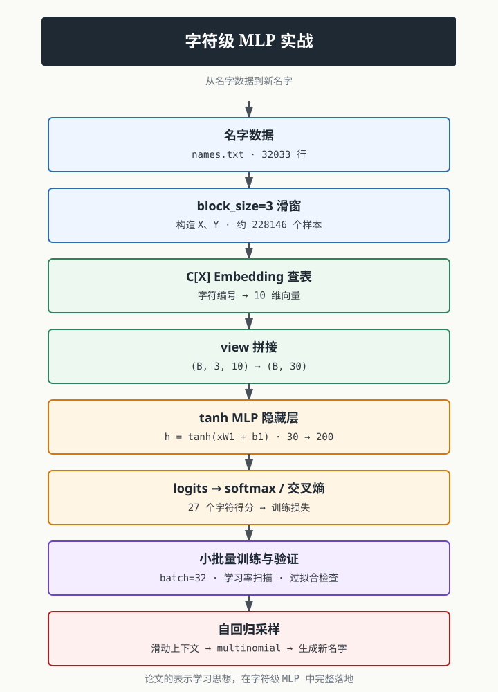
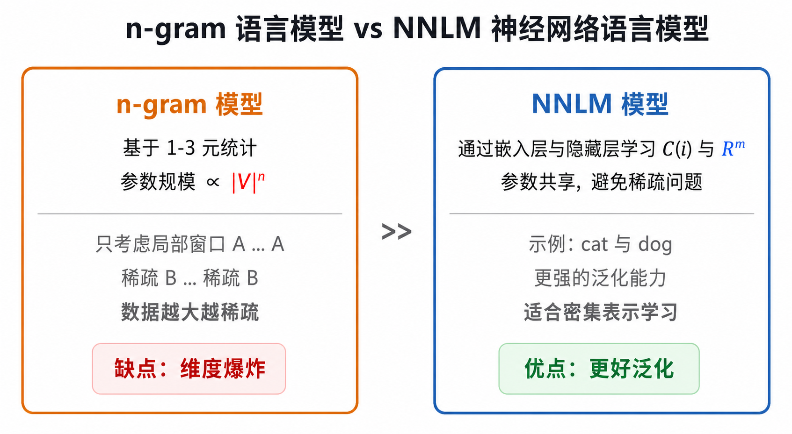
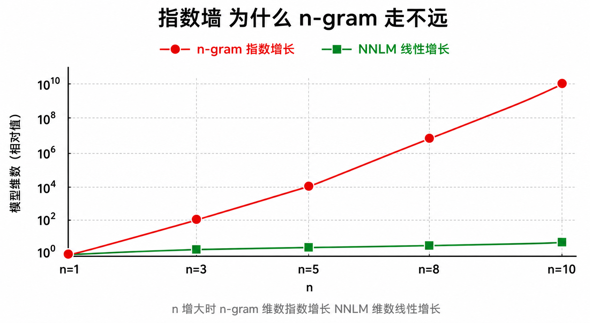
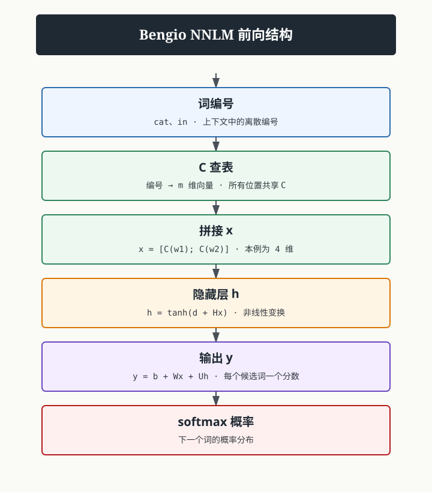
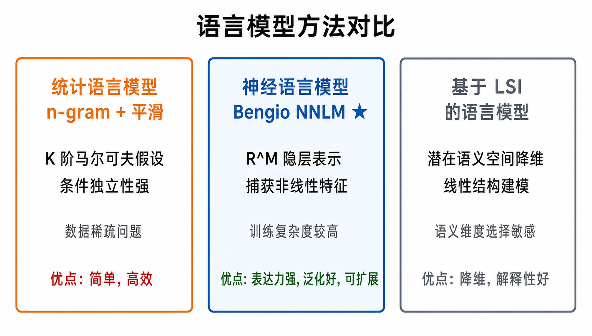

## 前言

刚准备开始看卡帕西的MLP部分，结果视频打开上来就告诉我这篇论文讲的不赖，那我势必要去阅读一下了。
Day3 的 bigram 给每个字符存了一行转移概率。这次我想弄清楚，换成一个可学习的向量 `C(i)` 后，模型多了什么能力。Bengio 2003 把词向量和预测下一个词的网络放在一起训练，正好能接上这个问题；后面再把词换成字符，用名字数据搭一个 MLP。

## 0. 这篇论文讲了什么

bigram 只记住当前字符，读到 `...em` 和 `...am` 时都从 `m` 的一行取概率。要让前面的 `e` 或 `a` 影响结果，可以把最近几个字符各查成一个短向量，再按顺序交给网络。Bengio 的论文把这套结构用于预测下一个词，下面的练习改成预测下一个字母。

## 0.1 预备：先把符号一次性讲清（看到后面不再卡住）

先认 `C` 和 `g`：`C` 存向量，`g` 用这些向量做预测。其余符号按公式需要回查即可。

| 符号 | 怎么读 | 它是什么 | 形状/取值 | 一句话通俗理解 |
| --- | --- | --- | --- | --- |
| `V` | Vocabulary | **词表**：所有允许出现的词的集合 | $\lvert V\rvert$，如 17 000 或 100 000 | 一本词典的“目录页”，共 $\lvert V\rvert$ 个词 |
| $R^m$ | R 的 m 次方 | **m 维实数向量空间** | $m = 30/60/100$，远小于 $\lvert V\rvert$ | 每个词的“坐标系”，`m` 是坐标轴根数 |
| `C` | C 矩阵 | **查表**：词 `i → 向量 C(i)` 的映射表 | $\lvert V\rvert\times m$ 矩阵，行是词，列是特征 | 一张“词→坐标”的大表格，第 `i` 行就是词 `i` 的向量 |
| `C(i)` | C of i | 词 `i` 的向量 | `m` 维，如 `[0.1, -0.3, ...]` | `cat` 的坐标 |
| `g` | g 函数 | **神经网络**：把上下文向量算成概率 | 输入 $(n-1)m$ 维，输出 $\lvert V\rvert$ 维 | 一台“概率计算器”，输入旧词向量，输出下一个词的概率分布 |
| `n` | n | **上下文窗口** | 如 3/5/8 | 每次看前面 `n-1` 个词来猜第 `n` 个 |
| `h` | hidden | **隐藏单元数** | 如 50/100 | 隐藏层的“神经元个数” |
| `H` | H 矩阵 | 隐藏层权重 | `h × (n-1)m` | 把长向量 `x` 压进隐藏层的“投影仪” |
| `U` | U 矩阵 | 隐藏→输出权重 | $\lvert V\rvert\times h$ | 把隐藏层信号“翻译”回词表大小 |
| `W` | W 直连 | 输入→输出直连权重 | $\lvert V\rvert\times(n-1)m$，可省略 | 一条“捷径”，让 `x` 直接对输出投票（论文称直连） |
| `b` | bias 输出偏置 | 输出偏置 | $\lvert V\rvert$ 维 | 每个词的“基础人气分” |
| `d` | bias 隐藏偏置 | 隐藏偏置 | `h` 维 | 隐藏层的“起点偏移” |
| `x` | x 向量 | 上下文拼接向量 | `(n-1)·m` 维 | `n-1` 个词向量排成一排 |
| `y` | y 向量 | 未归一化分数（logits） | $\lvert V\rvert$ 维 | 每个词的“原始票数”，进 softmax 前 |
| `y_i` | y 的第 i 维 | 词 `i` 的分数 | 标量 | 词 `i` 比别人高多少分 |
| $\lvert V\rvert\times m$ 类记号 | — | 矩阵形状 | 行×列 | 如 $17000\times30$ 就是 51 万个参数 |

**三条快速区分**

1.  **`C` vs `g`**：`C` 是**记忆**（查表得向量），`g` 是**计算**（向量→概率），合起来 `f = g∘C` 才是完整语言模型。
2.  **`C(i)` vs $R^m$**：`C(i)` 是一个具体向量（如 `cat` 的坐标），$R^m$ 是所有这类向量住的空间（$m$ 维实数空间）。
3.  **`H/U` vs `W`**：`H/U` 走“隐藏层弯路”（非线性，能力强），`W` 走“直连高速路”（线性，快但简单）；论文实测直连有益但非必须，核心是 `C→H→U` 的主干。

> 读法小贴士：$R^m$ 读“R 的 m 次方”即 $m$ 维实向量；$C\in\mathbb{R}^{\lvert V\rvert\times m}$ 表示 `C` 住在 $\lvert V\rvert\times m$ 的矩阵空间里。

## 0.2 这篇论文解决了什么

计数模型可以把长上下文回退到较短的统计。Bengio 提供另一种共享：如果两个词查到的向量接近，放进同一个预测网络后，模型对许多候选词的打分也可以接近。

图上画的是可能共享预测的邻居。向量相近具体对应哪些语言现象，要用任务上的预测或单独的分析来检验。

## 1. 维度灾难：为什么离散建模注定走不远

> **原文关键内容**：For example, if one wants to model the joint distribution of 10 consecutive words ... with $\lvert V\rvert=100,000$, there are potentially $100000^{10}-1 = 10^{50}-1$ free parameters.

**翻译**：若想对词表 $\lvert V\rvert=100000$ 的连续 10 个词的联合分布直接建模，自由参数数量是 $100000^{10}-1 = 10^{50}-1$。

**解释**：

从两个可能的词 `cat`、`dog` 里连续选三个词，已经有 `2³=8` 种序列。词表换成 10 万、长度换成 10，完整联合表就有 $10^{50}$ 格；概率的和必须为 1，所以少一个自由参数。真实语料覆盖不了这么多组合。

这里爆炸的是给每种组合单独设参数的做法。one-hot 本身只是一种编码，从 one-hot 选出向量也能共享权重；回退和平滑则让计数模型可以处理没见过的序列。

## 2. 核心方案

> **原文关键内容**：1. associate with each word ... a distributed word feature vector in $R^m$, 2. express the joint probability function ... in terms of the feature vectors, 3. learn simultaneously the word feature vectors and the parameters of that probability function.

**翻译**：1. 为每个词关联一个 `m` 维实值分布式特征向量；2. 用这些特征向量来表达词序列的联合概率；3. 同时学习词向量与概率函数的参数。

**解释**：

每个词先有一个编号，再用编号从 `C` 取一行。例如 `the` 可能被表示成 `[0.2, -1.1, …, 0.5]`。网络用这些数字算预测；同一份预测损失沿计算图传回来，分别更新预测网络和查表时用到的行。词向量的数字因此受到下一个词的训练信号，而不是事先固定的编码。

## 3. 为什么能泛化：一个训练句照亮指数个邻居

> **原文关键内容**：if we knew that dog and cat played similar roles ... we could naturally generalize from "The cat is walking in the bedroom" to "A dog was running in a room" and many other combinations ... because the probability function is a smooth function of these feature values, a small change in the features will induce a small change in the probability.

**翻译**：若已知 `dog/cat`、`the/a`、`bedroom/room` 扮演相似角色，就能从第一句自然泛化到第二句及大量组合——因为概率函数是特征值的光滑函数，特征小变化只会引起概率小变化。

**解释**：

把 `the cat is` 中的 `cat` 换成 `dog`。如果两者的向量只差一点，且网络在这一带的输出平缓，那么包括 `sleeping` 在内的下一个词的概率，也只会差一点。共享的网络使它有机会借用已经见过的组合，实际能借到多少，取决于训练学到了怎样的向量和预测函数。

## 4. 模型全貌：C 表 + g 网络

> **原文关键内容**：We decompose $f(w_t,\ldots,w_{t-n+1})=\hat{P}(w_t\mid w_{t-n+1}\ldots w_{t-1})$ in two parts: 1. A mapping $C$ from any element $i$ of $V$ to $C(i)$ in $R^m$ ($\lvert V\rvert\times m$ matrix). 2. The probability function $g$ maps $(C(w_{t-n+1}),\ldots,C(w_{t-1}))$ to a distribution over $V$.

**翻译**：把条件概率 $f$ 拆成两部分：1. 查表 $C$ 把词编号 $i$ 映成向量 $C(i)\in R^m$；2. 函数 $g$ 把上下文 $(n-1)$ 个向量映射成词表上的概率分布。

**公式**：

$$
f(i, w_{t-1}, ..., w_{t-n+1}) = g(i, C(w_{t-1}), ..., C(w_{t-n+1}))
$$

约束：对任意上下文，$\sum_{i=1}^{\lvert V\rvert} f(i, \cdot) = 1$，$f > 0$。

### 4.1 逐层数据流（以 `n=3` 为例，`m=2` 可视化）

输入 $w_{t-2}\ w_{t-1}\to w_t$，词表 $\lvert V\rvert=5$（a, cat, dog, in, bedroom）：

**Day3 vs NNLM**：

| | Day3 bigram `one-hot×W` | Bengio NNLM |
| --- | --- | --- |
| 查表 | $W\in\mathbb{R}^{27\times27}$，one-hot 选行，等价于查表 | $C\in\mathbb{R}^{\lvert V\rvert\times m}$，编号查表 |
| 上下文 | 只看前 1 个词 (`n=2`) | 看前 `n-1` 个词，拼接成长向量 |
| 非线性 | 无（线性+softmax） | `tanh` 隐藏层，学复杂交互 |
| 参数共享 | 同一个字符的转移分数行可在所有该字符出现处复用 | `C` 跨位置复用，预测网络也由不同上下文共同使用 |

**为什么重要**：`C` 在各位置之间共享。同一个词出现在不同位置，都会查到同一行向量；反向传播时，各位置对这行参数的梯度累加起来，方向不必相同。

**关键思想提炼**：**查表（记忆）+ 函数（推理）分离，但参数共享**。`C` 学“词是什么”，`g` 学“词怎么组合成句”，二者拼接即 $f=g\circ C$。

### 4.2 维度与复杂度

- **参数量**：$C$ 有 $\lvert V\rvert\times m$ 个参数（如 $17000\times30=510000$）。$H$ 有 $h\times(n-1)m$ 个，$U$ 有 $\lvert V\rvert\times h$ 个；加上可选直连 $W$ 时还要计入 $\lvert V\rvert\times(n-1)m$。哪一部分最大取决于配置。
- **计算量**：每预测一次只算一次前向，与 $\lvert V\rvert^n$ 无关，因此 `n` 可从 trigram 的 3 轻松提到 5/8。
- **训练目标**：最大化对数似然 $\sum_t \log f(w_t\mid w_{t-n+1}\ldots w_{t-1})$，等价于最小化困惑度（perplexity）。

## 5. 与 n-gram、聚类、LSI 的边界

**n-gram**：离散拼接短块，$P(w_t\mid w_{t-n+1}\ldots w_{t-1})$ 直接查计数表 + 回退/插值平滑。泛化靠“多看短块”，天花板是数据稀疏与上下文长度。

**词聚类 n-gram**（Brown 等）：把词硬/软分到 `K` 个离散类，类内共享计数。已在利用相似性，但**类是离散跳变**，类内一视同仁、类间老死不相往来，不够细腻。

**LSI/信息检索**：也学连续词向量，但目标是“文档级共现”，且往往固定向量再训分类器。论文的差异在于**为“预测下一个词”而联合学习**，向量直接对困惑度负责，效果显著更好（作者试过冻住 LSI 向量去训，效果差）。

**神经文本压缩/语音合成**：已有用神经网络预测下一个字符/音素，但规模小、未证实可训动大词表语言模型。本文首次把规模做到“能跟 state-of-the-art trigram 打，且把 trigram + 模型插值后还能再降困惑度”。

## 6. 训练：“能训动”本身就是贡献

- **样本量**：百万到千万词，上下文滑窗每步一个样本，远超当时常见的 UCI 小表。
- **优化**：随机梯度下降 + 权重衰减（weight decay，岭回归思想），梯度需穿过 `softmax → U/W → tanh → H → C`，`C` 的梯度是**多个位置的和**（共享带来的聚合）。
- **提速技巧**：论文已讨论用重要性采样/层次 softmax 逼近归一化分母（完整 softmax 需对 $\lvert V\rvert$ 求和，$O(\lvert V\rvert)$ 是瓶颈），这为后来的层次 softmax、负采样埋下伏笔。

## 7. 关键公式

**联合概率分解（链式法则，n-gram 马尔可夫近似）**：

$$
\hat{P}(w_1^T) = \prod_{t=1}^{T} \hat{P}(w_t | w_1^{t-1}) \approx \prod_{t} f(w_t, w_{t-1}, ..., w_{t-n+1})
$$

**NNLM 前向（论文式）**：

$$
\begin{aligned}
x &= [C(w_{t-n+1}); ...; C(w_{t-1})] \in \mathbb{R}^{(n-1)m} \\
h &= \tanh(d + Hx), \quad y = b + Wx + U\tanh(d+Hx) \\
\hat{P}(w_t = i | \cdot) &= \frac{e^{y_i}}{\sum_j e^{y_j}}
\end{aligned}
$$

**训练损失**：

$$
L = -\frac{1}{T}\sum_t \log \hat{P}(w_t | w_{t-n+1}...w_{t-1}) + \lambda\|\theta\|^2
$$

字符练习保留查表、拼接、非线性和下一个符号预测。词表变成 26 个字母加一个起止标记，所以下面的张量能一眼数清。

---

## 实作与运行结果

Bengio 的方法用同一张向量表服务所有上下文。字符练习把词换成字母，让 `...`、`..e`、`.em` 这样的窗口逐个预测下一个字符。

[继续阅读：字符级 MLP 实作：从三个字母到下一个字母的概率](/2026/08/28/bengio-mlp-char/implementation/)

<ul>
<li id="mlp-实战把-bengio-的图跑通在字符上"><a href="/2026/08/28/bengio-mlp-char/implementation/#mlp-实战把-bengio-的图跑通在字符上">MLP 实战：把 Bengio 的图跑通在字符上</a></li>
<li id="8-上下文窗口block_size3"><a href="/2026/08/28/bengio-mlp-char/implementation/#8-上下文窗口block_size3">8. 上下文窗口：block_size=3</a></li>
<li id="9-embedding-查表c-是字典"><a href="/2026/08/28/bengio-mlp-char/implementation/#9-embedding-查表c-是字典">9. Embedding 查表：C 是字典</a></li>
<li id="10-拼接cat-与-view"><a href="/2026/08/28/bengio-mlp-char/implementation/#10-拼接cat-与-view">10. 拼接：cat 与 view</a></li>
<li id="11-tanh-隐层"><a href="/2026/08/28/bengio-mlp-char/implementation/#11-tanh-隐层">11. tanh 隐层</a></li>
<li id="12-小批量梯度"><a href="/2026/08/28/bengio-mlp-char/implementation/#12-小批量梯度">12. 小批量梯度</a></li>
<li id="13-学习率与-loss-曲线"><a href="/2026/08/28/bengio-mlp-char/implementation/#13-学习率与-loss-曲线">13. 学习率与 loss 曲线</a></li>
<li id="14-采样复盘multinomial-如何写出新名字"><a href="/2026/08/28/bengio-mlp-char/implementation/#14-采样复盘multinomial-如何写出新名字">14. 采样复盘：multinomial 如何“写”出新名字</a></li>
<li id="17-收工小结n-gram--bengio--mlp-的递进"><a href="/2026/08/28/bengio-mlp-char/implementation/#17-收工小结n-gram--bengio--mlp-的递进">17. 收工小结：N-gram → Bengio → MLP 的递进</a></li>
<li id="附--资料下载"><a href="/2026/08/28/bengio-mlp-char/implementation/#附--资料下载">附 · 资料下载</a></li>
<li id="完整实验代码与笔记"><a href="/2026/08/28/bengio-mlp-char/implementation/#完整实验代码与笔记">完整实验代码与笔记</a></li>
</ul>
