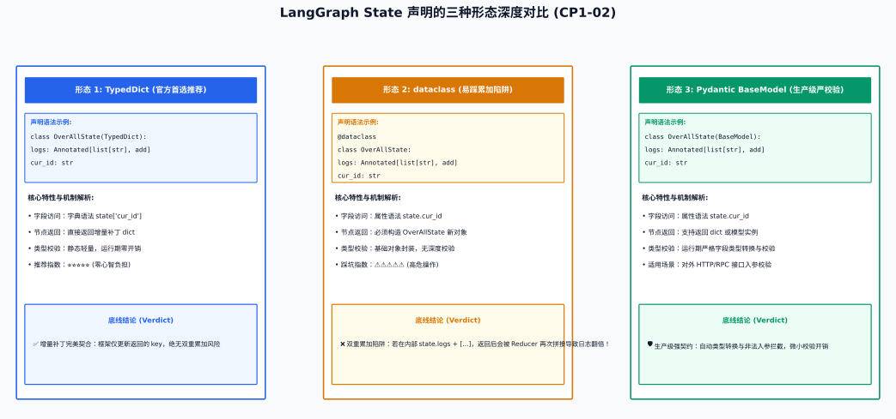
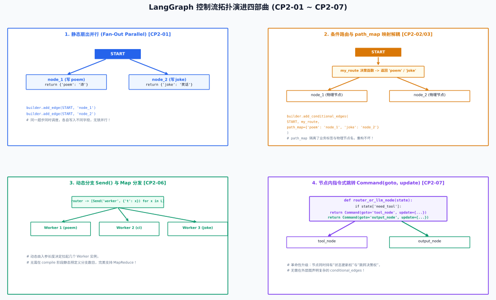
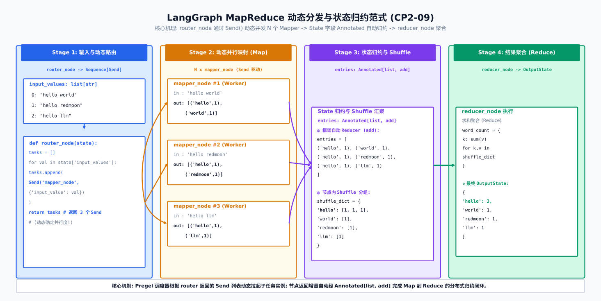
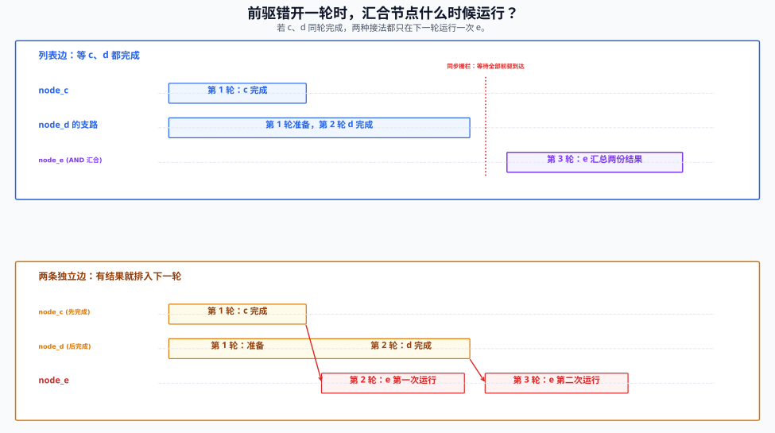
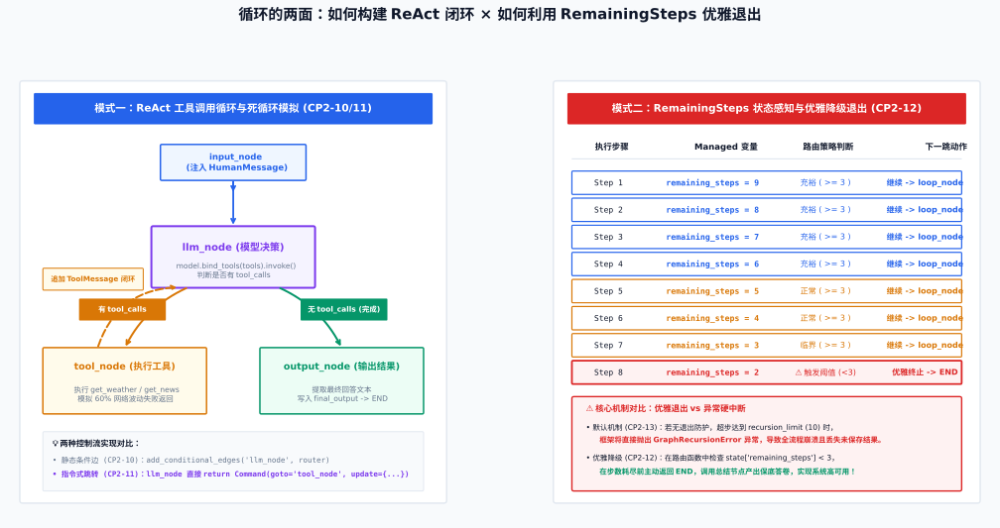
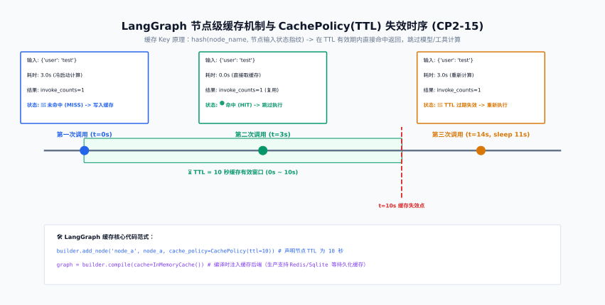
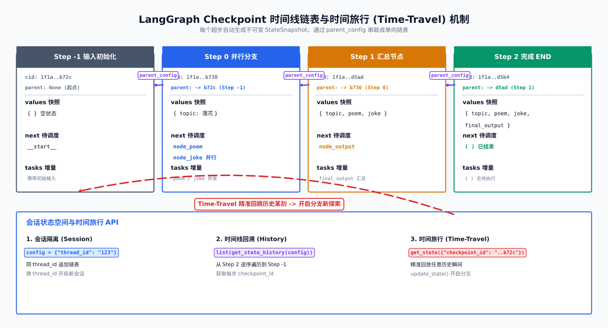

## 前言

前几天都在跟模型结构，今天换个脑子，翻回尚硅谷的 LangGraph 课。用一个小流程串起来：用户发来“写一首诗和一个笑话”，程序得分派两项工作，等结果齐了再合成回复。图决定先跑谁，状态保存已经拿到的文字，检查点让程序停下后还能接回来。

---

## 0. 目前的学习进展

课上的例子按三个部分组织。先看节点怎样读写状态，再看图怎样分派任务，最后给图加上检查点：

```text
【CP1 状态底座】
TypedDict / dataclass / BaseModel 三形态
→ Reducer 归约合并（add / 自定义）
→ 消息专用归约 add_messages 与 MessagesState
→ 节点增量补丁（Partial State Update）与 Overwrite 强制覆盖
→ 多 Schema 视图隔离（Input / OverAll / Output / Private）
→ MessagesState 与 DeepSeek LLM 对话联动
        │
        ▼
【CP2 控制流与运行时治理】
扇出并行（Fan-Out）
→ 条件路由（Conditional Edges）与 path_map 解耦
→ 多路分支 Sequence 扇出与 defer 延迟审计节点
→ 动态分支（Send API）：输入决定并行度的 Map-Reduce
→ 指令式控制流：Command(goto, update) 原生状态跳转
→ 汇合语义：列表边等齐结果，独立边按到达轮次触发
→ ReAct 工具调用循环与随机失败模拟
→ 递归上限限制与 RemainingSteps 优雅退避
→ RetryPolicy 异常重试策略与 CachePolicy(TTL) 内存缓存
        │
        ▼
【CP3 记忆、持久化与时间旅行】
InMemorySaver 内存检查点与 thread_id 会话隔离
→ PostgresSaver 数据库落盘持久化与 setup() 初始化
→ StateSnapshot 数据结构剖析（values, next, step, parent_config）
→ get_state_history 与 get_state(checkpoint_id) 任意时刻状态回放（时间旅行）
```

---

## 1. 状态底座（CP1）：State 的三形态与 Reducer 归约机制

State 是图在一次运行中要记住的数据，例如主题、写好的诗和写好的笑话。节点读取自己需要的字段，返回本次产生的更新。两项工作并行时，各节点在这一轮读不到另一项尚未合并的新结果。



### 1.1 State 的三种声明形态与选型对比

同一个日志字段可以写在字典、数据类或 Pydantic 模型里。先看节点如何取值，再看返回值怎样合并。

| 特性 | TypedDict | dataclass | Pydantic BaseModel |
| :--- | :--- | :--- | :--- |
| **定义语法** | `class S(TypedDict): ...` | `@dataclass class S: ...` | `class S(BaseModel): ...` |
| **字段访问** | 字典语法：`state["logs"]` | 属性语法：`state.logs` | 属性语法：`state.logs` |
| **节点返回** | 可以只返回要更新的字段 | 也可以返回字典增量 | 也可以返回字典增量 |
| **类型校验** | 类型提示可供静态工具检查 | 构造方法管理字段，不自动检查字段类型 | 构建模型时可校验或转换字段，行为由配置决定 |
| **列表重复的条件** | 返回旧列表加新增项 | 相同 | 相同 |

#### ⚠️ dataclass 中的“双重累加陷阱”代码深度解析

下面的节点把旧日志和一条新日志一起交还给框架：

```python
@dataclass
class OverAllState:
    logs: Annotated[list[str], add]  # 声明了 add 归约器
    cur_id: str

def node_1(state: OverAllState) -> OverAllState:
    pre_id = state.cur_id
    # 返回的 logs 已经带上了旧值。
    return OverAllState(state.logs + ["node_1 运行完毕"], pre_id + ", node_1")
```

假设旧列表是 `["收到请求"]`。如果节点返回 `["收到请求", "写完诗"]`，`add` 会再和旧列表拼接一次，结果是 `["收到请求", "收到请求", "写完诗"]`。重复的是旧记录。保留相同的 Reducer，改成只返回 `{"logs": ["写完诗"]}`，结果就只有两项。这和选择哪种 State 声明无关。装好 `langgraph==1.2.9` 后，可以直接运行下面的代码对照两种结果。

```python
from dataclasses import dataclass
from operator import add
from typing import Annotated

from langgraph.graph import END, START, StateGraph

@dataclass
class LogState:
    logs: Annotated[list[str], add]

def collect_logs(return_old_logs):
    def write(state: LogState):
        new_logs = ["写完诗"]
        return {"logs": state.logs + new_logs if return_old_logs else new_logs}

    builder = StateGraph(LogState)
    builder.add_node("write", write)
    builder.add_edge(START, "write")
    builder.add_edge("write", END)
    result = builder.compile().invoke({"logs": ["收到请求"]})
    return result["logs"]

print(collect_logs(True))   # ['收到请求', '收到请求', '写完诗']
print(collect_logs(False))  # ['收到请求', '写完诗']
```

---

### 1.2 Reducer 的本质与归约规则

Reducer 是写入规则：收到一个字段的新值时，告诉框架怎样和旧值合并。给 `logs` 声明 `Annotated[list[str], add]` 后，节点只返回这一轮新增的日志；框架把它们接到已有列表后面。

Reducer 的数学定义是一个二元归约函数：

$$
\text{State}_{\text{new}}[k] = \text{Reducer}\left(\text{State}_{\text{old}}[k],\; \Delta\text{State}_{\text{node}}[k]\right)
$$


- **默认覆盖语义（无 Annotated）**：对先后到达的单次更新，新值覆盖旧值。同一个超步里有两个任务同时写普通字段时，框架会报并发更新错误，而不是选一个“最后完成”的值。
- **列表追加归约（`operator.add`）**：`lambda old, new: old + new`，适合收集各节点执行日志或分布式子任务结果。
- **消息专用归约（`add_messages`）**：针对对话消息设计的智能 Reducer，具备按 `message.id` 覆盖更新、无 ID 追加以及特殊删除标记识别功能。

```python
# 自定义 Reducer 示例（CP1/03_reducer.ipynb）
def my_reducer(left: list[str], right: list[str]) -> list[str]:
    return left + right  # 一次合并：已有列表在前，本次增量在后

class OverAllState(TypedDict):
    logs: Annotated[list[str], my_reducer]
```

---

### 1.3 强制覆盖：`Overwrite` 语义

在某些业务场景下（如重置对话上下文、清空错误重试计数器），即使字段声明了追加 Reducer，某个特定节点也需要强行将其重置。LangGraph 提供了 `Overwrite` 包装类（`CP1/05_overwrite.ipynb`）：

```python
from langgraph.types import Overwrite

def node_2(state: OverAllState) -> OverAllState:
    # 强制覆盖：忽略 logs 上的 add reducer，直接将 logs 替换为单元素列表
    return {
        "cur_id": "node_2",
        "logs": Overwrite(["node_2 运行完毕"])
    }
```

---

### 1.4 多 Schema 架构（Multi-Schema）与视图隔离

多 Schema 可以分别声明输入、内部状态和输出，让调用方只接触所需字段。下面的例子将三者分开：

```python
# 1. 外部调用输入接口：仅暴露必要入参
class InputState(TypedDict):
    username: str

# 2. 外部调用最终输出：仅暴露脱敏/精简后的结果
class OutputState(TypedDict):
    graph_output: str

# 3. 图内部全局流转状态：包含全量上下文与内部私有字段
class OverAllState(TypedDict):
    username: str
    graph_output: str
    nickname: str  # 内部中间字段

# 4. 节点私有局部状态：高内聚
class PrivateState(TypedDict):
    greeting: str

builder = StateGraph(
    state_schema=OverAllState,
    input_schema=InputState,
    output_schema=OutputState
)
```

这个调用接口接收 `username`，结束时返回 `graph_output`；中间算出的 `nickname` 不出现在普通返回里。Schema 划分字段，用户权限仍由调用层控制，例如谁能调用 `get_state` 读取线程的检查点。

---

## 2. 控制流拓扑演进（CP2）：从静态边到动态分发与指令式跳转

前面已经能把两份更新写入同一张状态表。下面决定先运行哪个节点，以及什么时候等齐两条支路。



### 2.1 静态边与条件路由解耦（`path_map`）

在 `CP2/02_route.ipynb` 和 `CP2/03_path_map.ipynb` 中，对比了两种条件分支写法：

```python
# 写法A：路由函数直接返回实际节点名（高耦合，重构节点名时易碎）
def my_route(state: OverAllState) -> Literal["node_1", "node_2"]:
    return "node_1" if "诗" in state["content_type"] else "node_2"

builder.add_conditional_edges(START, my_route)

# 写法B（推荐）：路由函数返回抽象业务标签，通过 path_map 映射到物理节点（解耦）
def my_route(state: OverAllState) -> Literal["poem", "joke"]:
    return "poem" if "诗" in state["content_type"] else "joke"

builder.add_conditional_edges(
    START,
    my_route,
    path_map={
        "poem": "node_1",
        "joke": "node_2"
    }
)
```

---

### 2.2 延迟节点（`defer=True`）

`defer=True` 让已经被触发的节点等普通任务跑完再上场。设主线是 `START → first → second`，另有 `START → audit`。`audit` 虽然从起点就能触发，实跑顺序仍是 `first、second、audit`；它会等跨超步的 `second`，不是只等同一轮的 `first`。如果图走在循环中，循环仍需要自己的结束条件。

```python
builder.add_node("audit_node", audit_node, defer=True)
builder.add_edge(START, "audit_node")  # 虽然连自 START，但会在常规任务完成后触发
```

---

### 2.3 动态分支（`Send` API）与 MapReduce 范式

静态边指定固定后继，条件边可以在运行时选择路径。若想按收到的文档数启动任务，而且每个任务有自己的输入，可用 `Send`：三个文档就给同一个摘要节点发三个任务，每次只带一份文档；结果再写回共享状态。

`CP2/06_dynamic_branch.ipynb` 与 `CP2/09_mapreduce.ipynb` 展示了 `Send` API 的能力：



```python
# 分发路由：动态产生 N 个 Send 任务（CP2/09_mapreduce.ipynb）
def router_node(state: OverAllState) -> Sequence[Send]:
    input_values = state["input_values"]  # 如 ['hello world', 'hello redmoon', 'hello llm']
    tasks = []
    for item in input_values:
        # Send(目标节点名, 该节点的独立输入入参)
        tasks.append(Send("mapper_node", {"input_value": item}))
    return tasks

# 构建图
builder.add_conditional_edges(START, router_node, path_map=["mapper_node"])
builder.add_edge("mapper_node", "reducer_node")  # 所有 Mapper 节点并行完成后自动汇入 Reducer
```

**MapReduce 三阶段协同机理**：
1. **Map 分发**：`router_node` 使用 `Send` 将句子列表拆分为 N 个并发的 `mapper_node`；
2. **Shuffle 汇聚**：`entries: Annotated[list[tuple[str, int]], add]` 自动将所有并发 Mapper 返回的单词元组汇总入全局 State；
3. **Reduce 聚合**：`reducer_node` 从 `entries` 中读取所有键值对并完成合并计数。

---

### 2.4 指令式控制流：`Command` 原生跳转

`Command` 可以在节点的一次返回中同时更新状态和指定下一跳。`CP2/07_command.ipynb` 和 `CP2/11_loop.ipynb` 用的是 **`Command(goto=..., update=...)`**：

```python
from langgraph.types import Command

def llm_node(state: OverAllState) -> Command[Literal["tool_node", "output_node"]]:
    ai_msg = model_with_tools.invoke(state["messages"])
    if ai_msg.tool_calls:
        goto = "tool_node"    # 动态指示下一跳为工具节点
    else:
        goto = "output_node"  # 动态指示下一跳为输出节点
    
    return Command(
        goto=goto,
        update={"messages": [ai_msg]}  # 同时携带状态更新补丁
    )
```

图收到这份 `Command`，会保存本轮消息并安排选中的下一跳。`goto` 会增加动态路径；原来从这个节点引出的静态边仍然生效。只想执行一条后继路径时，就用一种方式配置。

---

### 2.5 扇入汇合语义：AND 汇合 vs OR 汇合

假设两条支路分别整理一份材料，`node_e` 把两份材料合成一份摘要。`node_c` 在第一轮整理完；另一支多经过一个准备节点，`node_d` 到第二轮才完成。需要等齐两份结果时，把两个前驱写在同一条列表边里。



图中画的是两支错开一轮的情况。这里的「轮」是图调度的超步（superstep）；同一超步里的两个节点即使耗时不同，也属于同一轮。

```python
# 1. AND 汇合（列表边）：node_e 必须等待 node_c 和 node_d 全部执行完毕才触发一次
builder.add_edge(["node_c", "node_d"], "node_e")

# 2. 独立边：任一前驱可触发；错开一轮到达时可运行两次
# builder.add_edge("node_c", "node_e")
# builder.add_edge("node_d", "node_e")
```

| 汇合模式 | 语法形式 | 触发条件 | 执行次数 | 适用场景 |
| :--- | :--- | :--- | :--- | :--- |
| 列表边 | `builder.add_edge([A, B], C)` | A、B 都完成 | 两个例子中均为 1 次 | 等齐后汇总 |
| 两条独立边 | `add_edge(A, C)` 加 `add_edge(B, C)` | 任一前驱完成 | 同轮到达 1 次，错开到达 2 次 | 每轮有新结果时更新 |

这个时序用 LangGraph 1.2.9 实跑过。让两个前驱直接接在同一个起点后，下一轮的汇合节点只排进一次；多加一个准备节点后，两条独立边会把汇合节点排进两个不同的轮次。

---

## 3. 循环、容错与运行时防护（CP2 后半）

工具接口偶尔超时，可以重试；如果图一直走回同一个节点，则需要在步数耗尽前结束。这两种情况分别在节点和整张图上处理。



### 3.1 经典 ReAct 工具调用循环与死循环防护

在 `CP2/10_static_loop.ipynb` 中，构建了 `input_node -> llm_node <-> tool_node -> output_node` 的完整循环链路，并在工具节点中以 60% 概率模拟网络波动抛出错误信息。模型根据错误反馈重新发起工具调用，直到获取成功响应后退出循环。

#### 递归深度限制：`recursion_limit`

为了防止无限循环耗尽 Token 与算力，LangGraph 在调用时支持指定 `recursion_limit`（默认 25）。当超步数达到上限时，框架会主动抛出 `GraphRecursionError`（`CP2/13_end_loop.ipynb`）：

```python
from langgraph.errors import GraphRecursionError

try:
    graph.invoke({}, config={"recursion_limit": 10})
except GraphRecursionError as e:
    logger.error(f"达到最大递归限制，安全中断: {e}")
```

#### 优雅降级退出：`RemainingSteps`

相比直接被动抛出异常中断整个程序，更好的做法是在步数耗尽前主动降级并产出当前最优答卷。`CP2/12_remaining_setps.ipynb` 演示了托管变量 `RemainingSteps` 的使用：

```python
from langgraph.managed import RemainingSteps

class OverAllState(TypedDict):
    remaining_steps: RemainingSteps  # 由框架自动注入与扣减

def router(state: OverAllState) -> Literal["loop_node", END]:
    remaining = state["remaining_steps"]
    if remaining < 3:
        # 当剩余步数不足 3 步时，主动中断循环流向收尾节点
        logger.warning(f"可用超步仅剩 {remaining} 步，执行优雅退出策略")
        return END
    return "loop_node"
```

---

### 3.2 节点故障重试策略：`RetryPolicy`

在 `add_node` 上配置 `RetryPolicy`，可以指定哪些错误值得再试。下面只重试网关错误 502/504；收到 400（请求有误）时，把错误交给上层处理。

```python
from langgraph.types import RetryPolicy
from urllib.error import HTTPError

builder.add_node(
    "node_a",
    node_a,
    retry_policy=RetryPolicy(
        max_attempts=3,         # 含首次调用，最多执行三次
        retry_on=lambda exc: isinstance(exc, HTTPError) and exc.code in (502, 504),
        jitter=False,
    )
)
```

用这条规则做三次试验：`502 → 504 → 200` 要调用三次才成功；首次返回 `400`，只调用一次就失败；一直返回 `502`，第三次后停止。`max_attempts` 数的是调用总次数，设为 `3` 等于首次调用加最多两次重试。

---

### 3.3 节点级结果缓存：`CachePolicy`

在 `CP2/15_ache.ipynb` 中，针对耗时较长、入参幂等的节点（如高耗时联网检索或 Embedding 计算），通过 `CachePolicy` 挂载 TTL 缓存机制：



```python
from langgraph.types import CachePolicy
from langgraph.cache.memory import InMemoryCache

# 节点设置 10 秒 TTL 缓存
builder.add_node("node_a", node_a, cache_policy=CachePolicy(ttl=10))

# 编译时挂载缓存后端
graph = builder.compile(cache=InMemoryCache())
```

缓存用节点命名空间和输入键定位结果。10 秒内遇到匹配项时，可以跳过节点函数，比如复用上一次摘要；过期后重新生成。它适合输入不变时允许沿用结果的步骤。检查点保存的是某个线程进行到了哪一步，与按输入复用结果的缓存用途不同。

---

## 4. 记忆与状态持久化（CP3）：Checkpointer 与时间旅行

Checkpointer 是图保存执行状态的地方。只在一个进程里做试验，可以把记录放在内存；想重启后接着上一次的对话或处理任务，则把检查点存在持久化后端。



### 4.1 检查点存储器选型：`InMemorySaver` vs `PostgresSaver`

在 `CP3/01_in_memory.ipynb` 与 `CP3/02_in_SQL.ipynb` 中分别演示了两种典型的检查点持久化实现：

```python
# 1. 内存存储（仅用于本地单测 / 开发原型）
from langgraph.checkpoint.memory import InMemorySaver
checkpointer = InMemorySaver()
graph = builder.compile(checkpointer=checkpointer)

# 2. PostgreSQL 数据库持久化（生产推荐）
from langgraph.checkpoint.postgres import PostgresSaver
import os

DB_URL = os.environ["LANGGRAPH_DB_URL"]

with PostgresSaver.from_conn_string(DB_URL) as checkpointer:
    checkpointer.setup()  # 首次使用自动初始化 checkpoints 表结构
    graph = builder.compile(checkpointer=checkpointer)
```

#### 会话级隔离：`thread_id`

在同一个保存器与命名空间内，`thread_id` 区分对话，`checkpoint_id` 区分这段对话的不同时间点。只传 `thread_id` 时默认定位该线程的最近检查点；想选过去某一步，要传那一步的 `checkpoint_id`。换成新 `thread_id`，不会自动拿到旧会话的消息或节点状态。

---

### 4.2 核心数据结构深度拆解：`StateSnapshot`

在 `CP3/03_history_state.ipynb` 中调用 `graph.get_state_history(config)`，可取得由 `StateSnapshot` 构成的历史时间链。

下面结合真实执行输出，详细解析 `StateSnapshot` 的核心字段构成：

| 字段名称 | 类型 | 核心含义与作用 | 典型输出取值样例 |
| :--- | :--- | :--- | :--- |
| **`values`** | `dict` | 当前超步结束时，全局 State 字典的完整数据快照 | `{'topic': '莲花', 'poem': '《咏莲》...', 'joke': '...'}` |
| **`next`** | `tuple[str]` | 下一个等待被调度的节点名称元组（若为空元组 `()` 则表示图已结束） | `('node_output',)` 或 `()` |
| **`config`** | `dict` | 定位当前检查点的配置字典，包含 `thread_id` 与本快照专属的 `checkpoint_id` | `{'configurable': {'thread_id': '123', 'checkpoint_id': '1f1a2296-d5ad-6eb5-8001-2afa8c444f2f'}}` |
| **`metadata`** | `dict` | 框架运行元信息，记录触发来源 `source`（如 `input`/`loop`）以及当前逻辑步骤 `step` | `{'source': 'loop', 'step': 1, 'parents': {}}` |
| **`created_at`** | `str` | 该检查点生成的 UTC 时间戳（ISO 8601 格式） | `'2026-08-27T15:10:23.722667+00:00'` |
| **`parent_config`** | `dict` \| `None` | 指向**上一个父级检查点**的定位字典，串联成单向链表 | `{'configurable': {'checkpoint_id': '1f1a2296-b730-6552-8000-2b88cd283dec'}}` |
| **`tasks`** | `tuple[PregelTask]` | 在当前超步中被执行的底层任务列表，包含任务 ID、执行节点及该节点的增量返回 `result` | `(PregelTask(name='node_output', result={'final_output': ...}),)` |
| **`interrupts`** | `tuple` | 人工介入中断信号元组（若遇到 `interrupt()` 断点则携带中断上下文） | `()` |

---

### 4.3 时间旅行（Time-Travel）与任意时刻回放

完整的检查点链既支持向后追加对话，也支持**从已保存的历史步骤恢复执行（Time-Travel）**，或从历史分叉点尝试不同的执行路径：

```python
# 1. 获取某个历史检查点的 checkpoint_id
history = list(graph.get_state_history(config=config))
target_checkpoint_id = history[3].config["configurable"]["checkpoint_id"]

# 2. 精准加载历史某时刻的快照
target_config = {
    "configurable": {
        "thread_id": "123",
        "checkpoint_id": target_checkpoint_id
    }
}
snapshot = graph.get_state(config=target_config)
print("历史快照状态:", snapshot.values)

# 3. 从该历史快照分叉继续执行（Time-Travel Branching）
# 可以通过 graph.update_state 修改历史状态，或以此 config 继续 invoke 新输入
```

---

## 5. LangGraph 核心 API 官方定义与概念溯源速查

为了避免概念模糊，本节对照 LangGraph 官方底层设计规范，将全系列涉及的关键组件整理为速查矩阵：

| 核心组件 | 官方概念定义 / 角色 | 底层机理与注意事项 |
| :--- | :--- | :--- |
| **`StateGraph`** | 图结构定义构建器 | 必须绑定 `state_schema`。通过 `add_node`、`add_edge` 构建静态拓扑，经 `compile()` 编译为可执行的 `CompiledStateGraph`。 |
| **`Node`** | 图中的计算处理单元 | 普通 Python 函数（同步/异步），接收当前 State 快照，返回 Partial Update 增量字典或 `Command`。 |
| **`Edge`** | 节点之间的确定性有向连接 | 静态声明控制权转移，支持一对一、扇出（一对多）以及 AND 汇合（多对一列表形式）。 |
| **`ConditionalEdge`** | 基于状态判断的动态路由边 | 接收路由函数，根据返回值动态决定下游走向；推荐配合 `path_map` 实现业务标签与节点名解耦。 |
| **`Send`** | 动态并行子任务投递原语 | 允许在路由函数中返回 `Sequence[Send]`，根据运行时数据动态分发 N 个子任务，是 MapReduce 的核心支撑。 |
| **`Command`** | 在返回更新时安排下一步 | `update` 提交字段变更，`goto` 增加运行路径；原有静态边仍生效。 |
| **`MessagesState`** | 预置消息列表 | `add_messages` 按消息 ID 追加或替换。同样的文字使用不同 ID 时，仍是两条消息。 |
| **`InMemorySaver` / `PostgresSaver`** | 检查点保存后端 | 保存图的状态与调度进度，可在同一线程继续或从历史位置重跑。外部业务写入由应用单独管理。 |
| **`RemainingSteps`** | 框架托管的剩余步数变量 | 受 `recursion_limit` 约束逐步递减，节点或路由函数可感知剩余可用步数以实现优雅降级退出。 |
| **`RetryPolicy`** | 节点级故障重试规则配置 | 声明 `max_attempts`、`retry_on` 及指数退避抖动 `jitter`，增强面对不稳定外设/API 时的系统鲁棒性。 |
| **`CachePolicy`** | 节点级计算结果缓存规则配置 | 结合编译时挂载的 Cache 后端（如 `InMemoryCache`），按入参指纹与 `ttl` 自动复用计算结果。 |

---

## 6. Day 4 收工小结

“节点返回了什么”和“图接下来执行什么”属于两个层面。State 的字段及其覆盖、追加、按消息 ID 更新等合并规则决定状态如何变化；条件边、`Send` 分发和 `Command` 跳转决定执行路径。

循环跑起来以后，还要分别处理步数、异常和重复计算：`RemainingSteps` 用来感知剩余步数，`RetryPolicy` 处理适合重试的异常，`CachePolicy` 复用结果。它们解决的问题不同。

最后是跨次执行的状态。`PostgresSaver` 保存检查点，`StateSnapshot` 展示现场，`checkpoint_id` 定位历史位置。

---

## 附 · 项目仓库

先用内存状态跑通日志例子，再读[并行任务失败后如何续跑](/2026/08/31/langgraph-cp3-error-replay-fork/)。课程中的模型调用和数据库配置可在 [LangGraph 课程实战仓库](https://github.com/Redmoon-2333/Langgraph) 查到。
