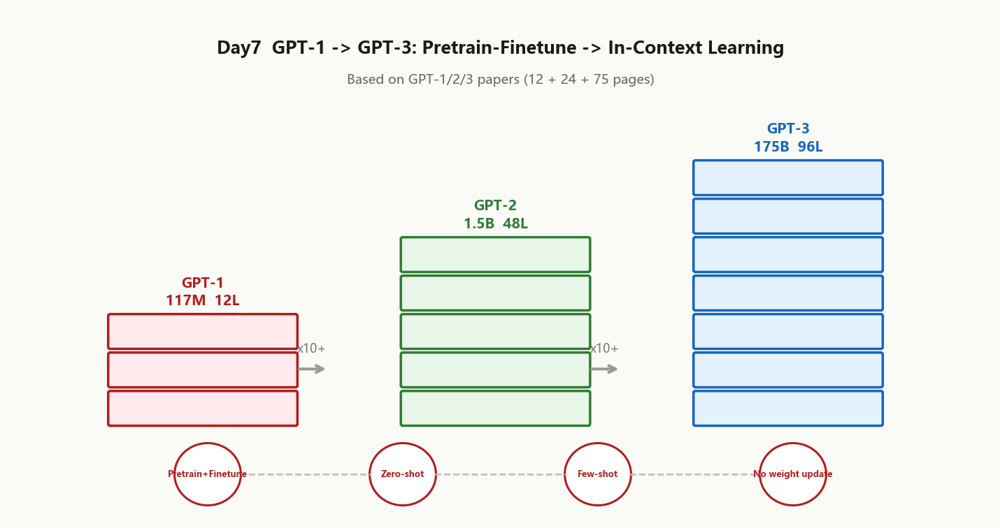

# 浅尝 GPT-1 至 GPT-3

读个论文放松一下，尝一口 GPT-1 到 GPT-3。第一次看，常把“在提示里看过例子”和“训练时拿例子更新权重”当成同一件事。先拿一道简单的分类题把这两种操作分开。

---

## 0. 三个版本都写了些什么?

| 世代    | 论文                                                                      | 标题怎么读              | 争的核心问题                                         |
| ----- | ----------------------------------------------------------------------- | ------------------ | ---------------------------------------------- |
| GPT-1 | *Improving Language Understanding by Generative Pre-Training* (2018.06) | 用**生成式**目标做**理解**  | 标注少、目标不统一、架构各搞一套 → 能否先无监督学通用表示，再少改动迁移？         |
| GPT-2 | *Language Models are Unsupervised Multitask Learners* (2019.02)         | 语言模型**本身**就是多任务学习器 | 每个任务都要有监督数据、换头换结构 → 能否让自然语言**本身**描述任务，模型零样本去做？ |
| GPT-3 | *Language Models are Few-Shot Learners* (2020.05)                       | 少样本就能学             | 微调仍要上千样本、梯度与部署成本高 → 能否**不改权重**，只靠上下文里的几个例子就学会？ |

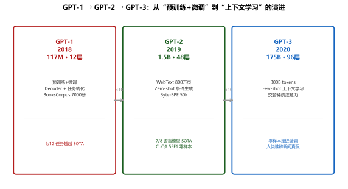

想判断“这个键盘很好用”是好评还是差评。三种方式可以用在同一道题上：

| 方式 | 例子放在哪里 | 遇到新句子时做什么 |
| --- | --- | --- |
| GPT-1 式微调 | 把“手感不错 → 好评”作为训练样本，计算损失并更新参数 | 把新句子交给训练后的分类头，读出两个标签的分数 |
| GPT-2 式零样本 | 提示只写“判断评论是好评还是差评”，不附带已解题目 | 按语言模型对标签补全的分数选答案 |
| GPT-3 式少样本 | 把“手感不错 → 好评”“按键失灵 → 差评”写到提示里 | 读完示例再预测新句子的标签，参数保持不变 |

这是同一道教学题的三种用法，不是三篇论文共同跑过的实验。关键差别是：**微调把样本的影响写进参数；上下文学习让样本成为这一次预测的输入。**

---

## 1. GPT-1：生成预训练 + 判别微调

### 1.1 核心问题

> 原文要点：“不知道该用什么目标函数、子任务差别较大 → 半监督/自监督+监督微调；Transformer 语义提取 > RNN。”

原文点出两大痛点——
(1) **目标函数该选什么**才能从无标注语料学到可迁移的语言能力；
(2) **下游形态太分裂**（蕴含要比两句、问答要文档+问题+候选答案、相似度要成对回归、分类只要单句）。

### 1.2 无标注预训练：怎么算(核心算式)

给定无标注语料 $\mathcal{U} = \{u_1,\dots,u_n\}$，用**自回归语言建模**最大化

$$L_1(\mathcal{U}) = \sum_i \log P(u_i \mid u_{i-k},\dots,u_{i-1}; \Theta) \tag{1}$$

即：**用前 $k$ 个词预测第 $i$ 个词**（$k$ 为上下文窗口，GPT-1 设为 **512**）。
所用模型为 **Transformer 解码器（decoder-only）**，原文明确对比 RNN，取 Transformer 的原因是**并行+长程语义提取更强**：

$$h_0 = U W_e + W_p$$
$$h_l = \text{transformer\_block}(h_{l-1}),\ \forall l\in[1,n],\ n=12$$
$$P(u) = \text{softmax}(h_n W_e^{T})$$

其中 $U$ 为 token 序列（one-hot），$W_e$ 为 **40k BPE** 的 token 嵌入，$W_p$ 为**可学习位置嵌入**，$W_e$ 在输入与输出端**权重共享**。块内为 **GELU + 0.1 dropout + 残差**，12 层 × 12 头 × 768 维 × FFN 3072，约 **117M 参数**，BooksCorpus 困惑度 18.4。

> **类比**：把句子读成“完形填空”的无限版——永远用已读的左边去猜下一个词是谁；$L_1$ 就是在统计“猜对的 log 概率”越堆越高。

### 1.3 有标注微调：怎么用

原文要点：

> $P(y\mid x^1,\dots,x^m)=\text{softmax}(h_l^{m} W_y)$，$L_2(\mathcal{C})=\sum\log P(y\mid x)$，$L_3=L_2+\lambda L_1$

- $h_l^{m}$ 是**最后一层在输入末端的隐藏状态**，$W_y$ 把它变成任务标签的分数。下游适配还要学习分隔标记的嵌入。
- 联合目标 $L_3 = L_2 + \lambda L_1$ 中 $\lambda=0.5$。分类损失教模型选标签，语言建模辅助目标则让它继续预测文本。论文 Table 5 的消融显示，自然语言推断任务和 QQP 从辅助目标中受益，较小数据集不一定获益。

### 1.4 任务感知的输入转化

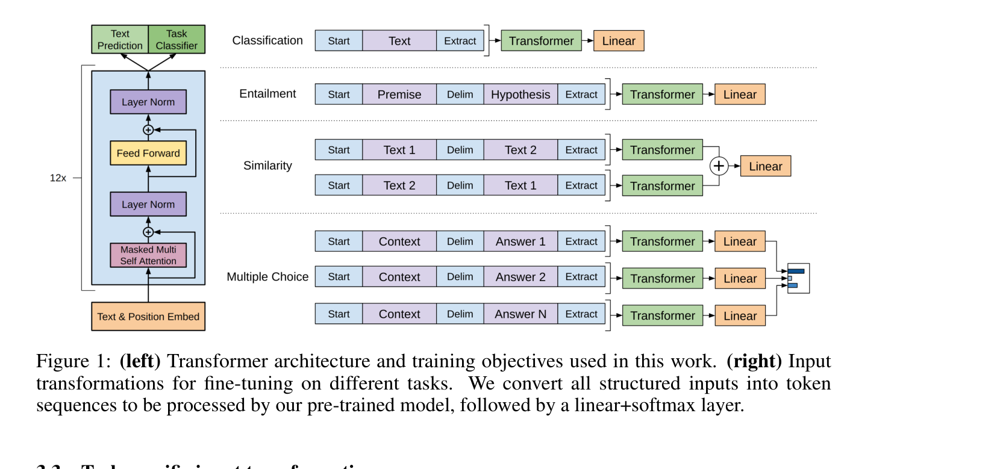

> **原图解读**：Figure 1 右半以 `Start` 和 `Extract` 标出输入两端；分类从尾端表示读标签。蕴含任务在前提和假设间插入 `Delim`，相似度任务把两句按两个顺序输入再合并表示，选择题把上下文、问题与每个候选分别拼起来，在候选之间归一化。论文报告在 12 项下游任务的 9 项刷新当时的结果，Story Cloze 和 RACE 分别提高 8.9 和 5.7 个百分点。

- **数据集**：预训练 **BooksCorpus**（7000+ 未出版小说，跨体裁，长连续段落，保留长依赖）；微调覆盖 **12 任务**：NLI（SNLI/MultiNLI/QNLI/RTE/SciTail）、QA/常识（RACE/Story Cloze）、相似度（MRPC/QQP/STS-B）、分类（SST-2/CoLA）。
- **优化**：Adam，峰值 lr $2.5\times10^{-4}$，前 2000 次更新线性 warmup，之后余弦衰减；batch 64，100 epoch，非偏置与非增益权重的正则化系数为 0.01（论文 §4.1）。

---

## 2. GPT-2：把模型做更大，让任务自己从文本里长出来

GPT-2 将任务的表达方式转向文本条件：能不能直接用文本告诉模型要做什么？

### 2.1 把任务写进输入

GPT-1 针对不同任务拼装输入并微调；GPT-2 将“做什么”也交给输入文本。给语言模型 `文档：…… 问题：…… 答案：`，它可以用已有的下一 token 分布接着写答案。联合概率可以这样分解，但具体补出的答案是否正确，要看训练数据、提示格式与模型实际学到的分布。

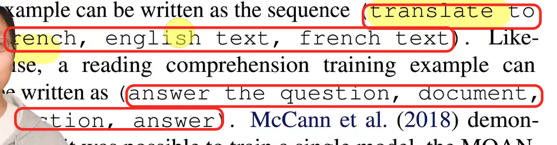

> 这个图是 prompt 的来源——论文 Figure 2/Figure 3 即展示了将 QA/翻译/摘要写成自然语句序列的思路，这正是后来 **prompt** 的雏形。

### 2.2 架构：最大区别是“预归一化 + 残差缩放 + Byte-BPE”

| 维度    | GPT-1            | GPT-2                                                    |
| ----- | ---------------- | -------------------------------------------------------- |
| 模型族   | 117M 单点          | **117M / 345M / 762M / 1.5B** 四档                         |
| 上下文   | 512              | **1024**                                                 |
| 词表    | 40k BPE          | **50,257 Byte-BPE**（可逆，任意 Unicode 可编码为 bytes，压缩效率+通用性兼顾） |
| 归一化   | 后置 LN（post-norm） | **Pre-LN**（每子块输入处）+ 末端再 LN                               |
| 残差初始化 | 常规               | **缩放 $1/\sqrt{N}$**（$N$ 为残差层数，训深模型更稳）                    |
| 适配    | 微调               | **零样本，零梯度，零新参数**                                         |

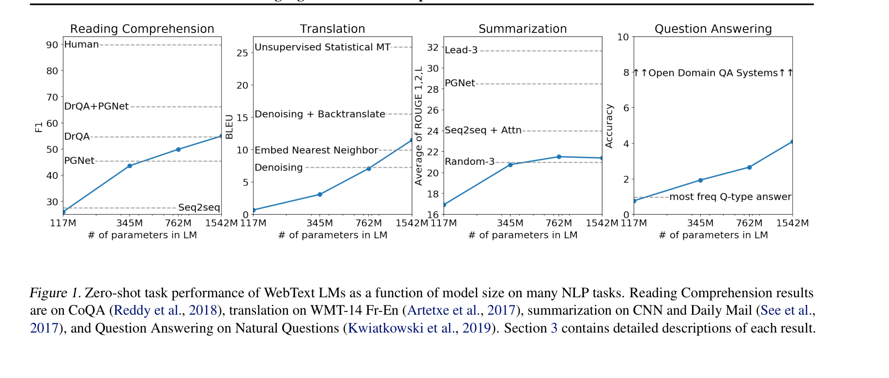

> **读图**：横向比较同一任务在四档模型规模下的分数，不要直接比较不同任务的纵轴值：问答的 F1、翻译的 BLEU 和语言建模的困惑度不是同一把尺。

### 2.3 数据：Common Crawl 与 Reddit 的区别

 `common crawl (公开网页)` 与 `reddit（新闻聚合）`：

- **Common Crawl** = 定期全网抓取的**原始网页**镜像。
- **WebText**（论文实际所用） = **从 Reddit 获至少 3 个 karma 的外链**中抽取的网页（去维基、清洗后约 800 万篇/40GB）。用 Reddit 分数做**人类筛选的质量代理**，刻意**不**直接用 Common Crawl，以换多样性与质量。

### 2.4 实验结论

- Table 3 中，**1542M** 模型的 LAMBADA 正确率为 **63.24%**、WikiText-2 困惑度为 **18.34**；117M 模型对应 **45.99%** 和 **29.41**。LAMBADA 的 63.24% 含论文说明的停用词筛选。最大模型在 **8 项语言建模数据集中的 7 项**达到论文报告的当时最佳成绩。
- **CoQA 开发集 55 F1**，在未使用那 12.7 万条标注问答做任务训练的情况下，匹配或超过 4 个有监督基线中的 3 个。
- 翻译和摘要的零样本结果低于当时有监督方法；同一模型族随规模扩大呈现改善趋势。后文的 GPT-3 进一步测试了上下文示例带来的少样本适配。

---

## 3. GPT-3：把示例放进上下文

GPT-3 重点考察：参数保持不变，只给几条示例，模型能在多大程度上适应新任务？

### 3.1 核心问题（逐句精读）

> (1) 每个新任务都要大量标注 → (2) 模型越大、数据越窄，越易学到虚假相关（过拟合）→ (3) 人类不需要大数据就能学新任务。

① fine-tuning 范式的数据与梯度成本随任务数线性增长，部署与多任务混用不便；
② **窄分布+强表达**放大虚假相关与泛化风险；
③ 人类凭**几句说明+少数示例**就能掌握新任务，机器也应具备类似的**任务无关适配力**。
GPT-3 将同一个模型分别放在零示例、单示例和多示例的条件下评估。图 1.3 汇总了 42 项按准确率计分的评测；在这组模型上，规模变大时，多示例设置的平均准确率提升得更快。

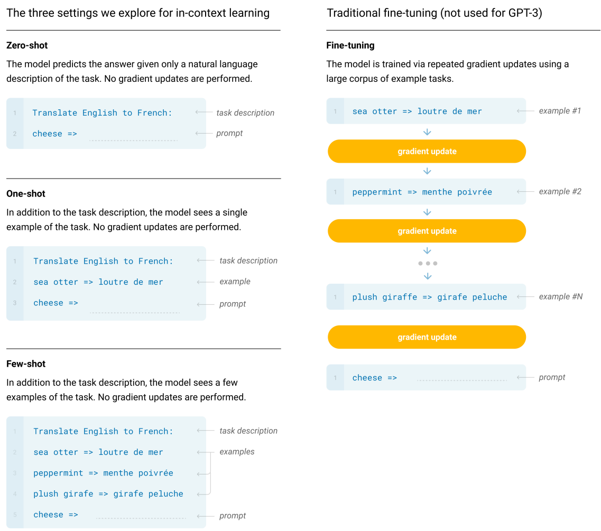

> **原图解读**：Figure 2.1 把 `Fine-tuning`（改权重）与 `Zero/One/Few-shot`（只给上下文）分开。上下文学习改变的是模型当下接收的输入，权重不在任务示例上更新。

### 3.2 架构：与 GPT-2 的异同

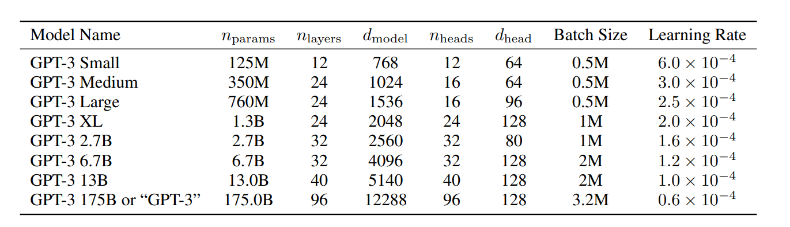

> 原图即论文 Table 2.1 的 **8 模型族**（125M~175B，层数 12~96，$d_{model}$ 768~12288），下面是两条规律：
>
> - **Sparse Transformer 式交替稀疏注意力**（dense + locally banded sparse），为撑大上下文到 **2048** 且控制计算；
> - 论文按模型大小调整头数、头维、批量和学习率；例如表 2.1 里最小和最大模型的头维分别为 64 和 128。这是该组实验的配置，不是对新模型通用的调参公式。

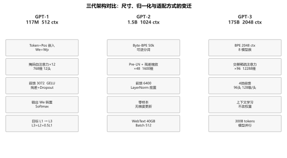

### 3.3 训练数据：从三词到四步管线

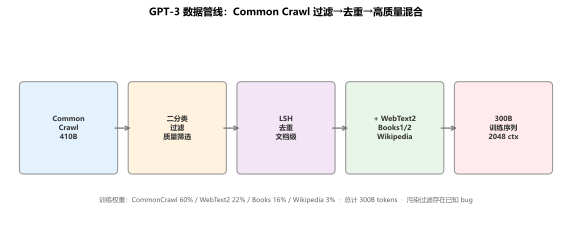

| 占比 | 数据集 | 规模 | 训练期感知 | 作用 |
| --- | --- | --- | --- | --- |
| 60% | **Common Crawl（过滤后）** | 410B tokens | 0.44 epoch | 广度 |
| 22% | **WebText2** | 19B | 2.9 epoch | 质量代理的高分 Reddit 网页 |
| 8% | **Books1** | 12B | 1.9 epoch | 长依赖 |
| 8% | **Books2** | 55B | 0.43 epoch | 长依赖 |
| 3% | **Wikipedia** | 3B | 3.4 epoch | 事实性 |

- **过滤**：以高质量语料为正例训**二分类器**筛 Common Crawl；
- **去重**：**LSH 模糊去重**（文档级），与 Common Crawl 去重及样本间去重；
- **混合**：按上表**加权采样**，而非等比堆砌；
- **瑕疵**：论文自述**污染过滤存在 bug**（部分评测集与训练重叠），为后续工作敲警钟。

### 3.4 评估协议

- **分类/二选一**：把标签改写成更具语义的词（`True`/`False` 而非 `0`/`1`），**按候选补全的似然度择优**（像做选择题）；
- **自由生成**：`beam=4, \alpha=0.6` 的束搜索，按数据集用 **F1 / BLEU / 精确匹配**计分。
- 论文在零、单、少示例三个条件下报告结果。少示例时 $K$ 随任务和上下文长度而变，典型范围是 **10–100**，受 2048 token 的窗口限制。图 1.3 的 42 项是按准确率计分的汇总子集。

### 3.5 关键结果：四类曲线解读

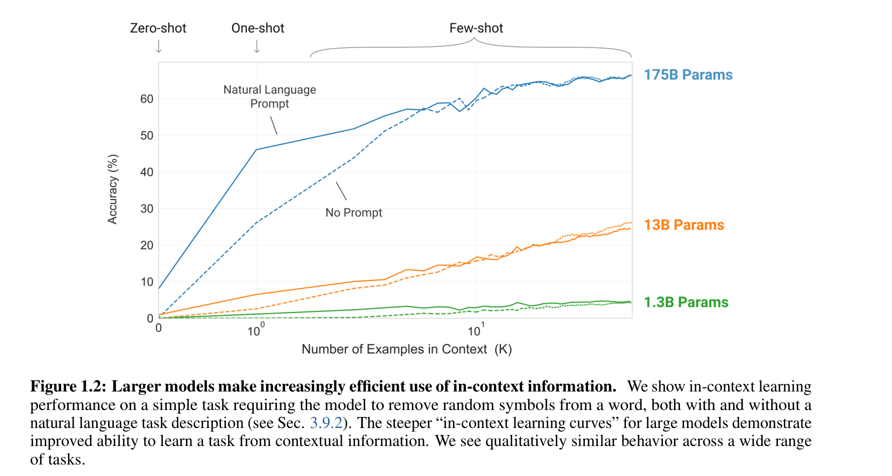

> **解读 1 · 论文 Figure 1.2 词内符号去除**：模型越大，**上下文学习曲线越陡**——大模型更会“看例子学”，小模型即便给示例也提升有限。

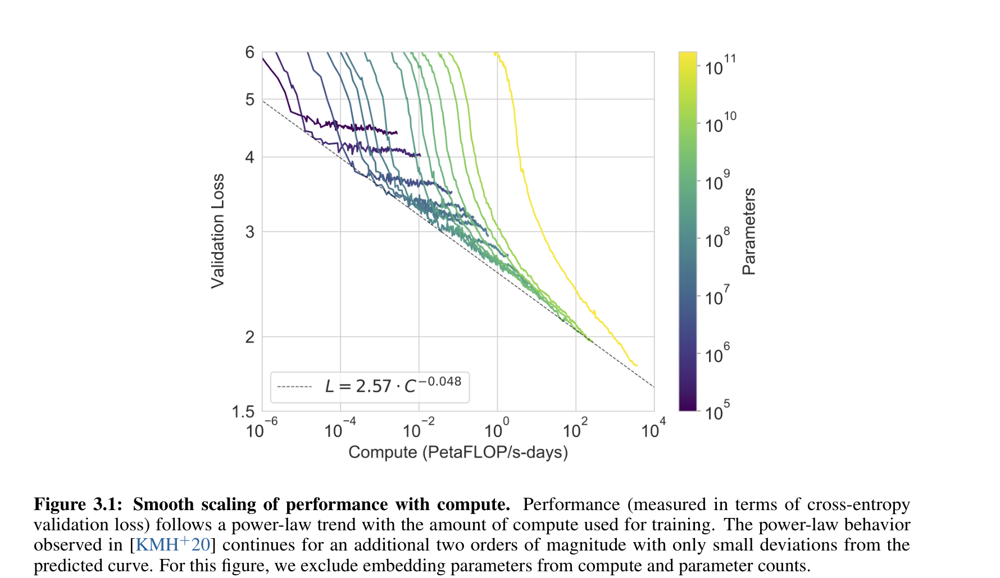

> **解读 2 · 论文 Figure 3.1 损失缩放**：横轴是训练计算量，纵轴是验证交叉熵损失。论文报告的是损失随计算量变化的幂律趋势。图中的模型参数规模也在变化，并非固定模型后只增加数据的实验。

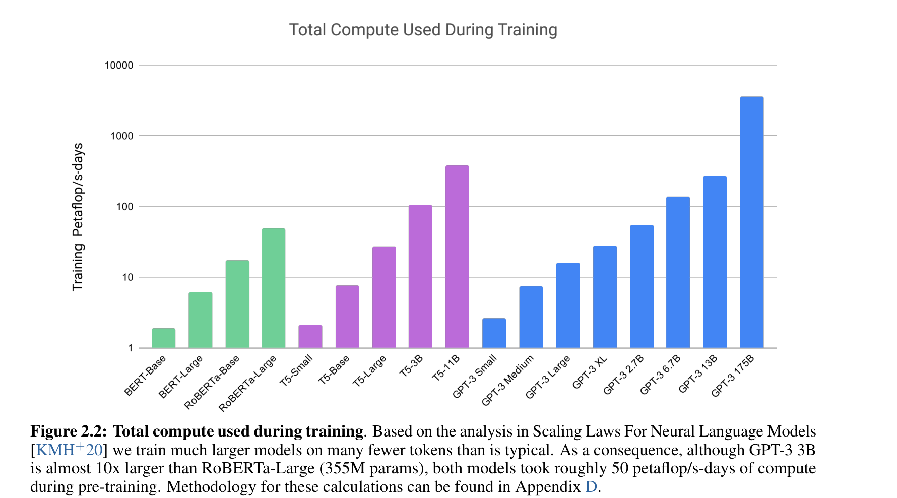

> **解读 3 · 论文 Figure 2.2 训练算力**：8 种模型**各训练 300B tokens**（Table 2.1），175B 模型需要的计算量最高。结合 Figure 1.3 看，模型扩大时，聚合评测中的 few-shot 表现也随之提高。

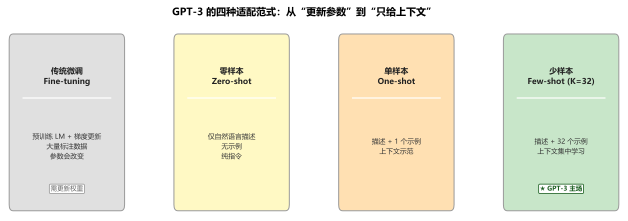

> **自绘对照 2 · 范式对比**：对应论文 Figure 2.1 的`微调（改权重）` vs `零/单/少样本（不改权重、只给上下文）`四格，是第 1 条解读的方法论底色。

### 3.6 局限性

> (1) 文本生成弱 (2) 不能双向 (3) 词均匀加权 (4) 无物理接地 (5) 是否真正学会存疑 (6) 训练贵 (7) 不可解释。

| 评估问题 | 论文中的表现 | 补充 |
| --- | --- | --- |
| 文本生成还是比较弱 | 长文易**重复/自相矛盾/离题** | 采样与束搜索已用，仍难稳态 |
| 不能反向看（解码器） | **自回归单向**，无双向注意力 | 比较/回读/抽取式任务天然吃亏 |
| 每个词均匀预测下一个词 | **token 加权均等**，不区分实体/事实重要性 | 改进方向：目标加权或显式记忆 |
| 没见过真实物理交互 | **无视觉/物理/交互接地** | 后续多模态与具身的动机 |
| 不确定是不是从头开始学 | **是识别还是真正学习**未定 | 是论文最诚实的开放问题之一 |
| 训练起来很贵 | **175B 推理极贵、不便部署** | 论文即指出成本与可及性风险 |
| 模型无法解释 | **难解释、校准差、继承数据偏见** | §6 偏见分析：职业/种族/宗教刻板印象显著 |

---

## 4. 串起三代

| 维度         | GPT-1 (2018)                | GPT-2 (2019)                              | GPT-3 (2020)                         |
| ---------- | --------------------------- | ----------------------------------------- | ------------------------------------ |
| **范式**     | 预训练+微调（改权重）                 | 零样本条件生成（不改权重）                             | 少样本上下文学习（不改权重，强 few-shot）            |
| **规模**     | 117M, 12L, 512 ctx, 40k BPE | 1.5B, 48L, 1024 ctx, 50k Byte-BPE, Pre-LN | 175B, 96L, 2048 ctx, 8模型 300B tokens |
| **数据**     | BooksCorpus 7000册           | WebText 800万篇 40GB                        | CommonCrawl+WebText2+Books+Wiki 混合   |
| **语言建模目标** | $L_1$ 自回归                   | 同左                                        | 同左（单一目标，无任务特定辅助）                     |
| **下游适配**   | 任务转化+线性头，全参微调               | 文本条件化，零梯度                                 | 演示凑进上下文，零梯度                          |
| **代表成绩**   | 9/12 SOTA                   | 7/8 LM 零样本 SOTA                           | 少样本逼近/超越微调 SOTA（LAMBADA、QA 等）        |
| **遗留问题**   | 仍需标注与微调                     | 预训练未充分，弱于监督                               | 贵、不可解释、长文弱、污染、未对齐                    |

三代模型的区别也体现在任务怎样进入模型：GPT-1 在预训练后微调，GPT-2 用文本条件描述任务，GPT-3 再把示例放进上下文。参数规模在变，使用模型的方法也在变。

---

## 5. 小的记忆点

1. GPT-1 学表示再微调；GPT-2 让任务在文本中自然出现，零样本做；GPT-3 让任务在上下文中示范，少样本做。
2. **三代公式**：$L_1$ 自回归、$L_3=L_2+0.5L_1$（仅 GPT-1）、$p(x)=\prod p(s_i\mid s_{\lt i})$。
3. **三代架构增量**：12L→48L→96L；512→1024→2048 ctx；后置 LN→Pre-LN+末端 LN→交替稀疏；40k→50k Byte-BPE。
4. **三代数据增量**：BooksCorpus→WebText→300B 混合（60%CC）；过滤器、LSH 去重、加权采样。
5. **三代适配增量**：微调更新参数；零示例和少示例都在推理时改变输入，其中少示例把若干道已解题目写入上下文。
6. **三代评估跃迁**：12任务全量微调评估→0样本语言模型8基准→42准确率基准的0/1/少样本三档。

---

## 附 · 资料下载

本篇配套的论文原文（GPT-1/2/3 三篇，12+24+75 页）及图文笔记可直接下载。

### 论文原文（PDF）

- [gpt1_2018.pdf](https://github.com/Redmoon-2333/Redmoon-2333.github.io/releases/download/day7-assets/gpt1_2018.pdf)（Improving Language Understanding by Generative Pre-Training, OpenAI 2018, 12 页）
- [gpt2_2019.pdf](https://github.com/Redmoon-2333/Redmoon-2333.github.io/releases/download/day7-assets/gpt2_2019.pdf)（Language Models are Unsupervised Multitask Learners, OpenAI 2019, 24 页）
- [gpt3_2020.pdf](https://github.com/Redmoon-2333/Redmoon-2333.github.io/releases/download/day7-assets/gpt3_2020.pdf)（Language Models are Few-Shot Learners, NeurIPS 2020, 75 页）

### 图文笔记

- [Day7.md](https://github.com/Redmoon-2333/Redmoon-2333.github.io/releases/download/day7-assets/Day7.md)（本篇完整 Markdown，含全部插图引用）
