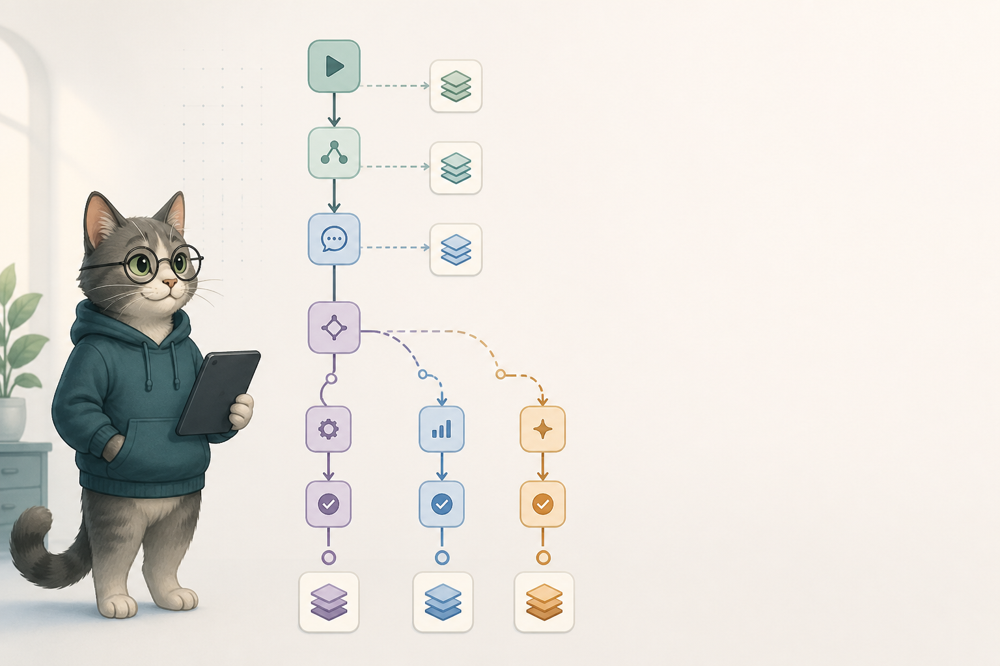
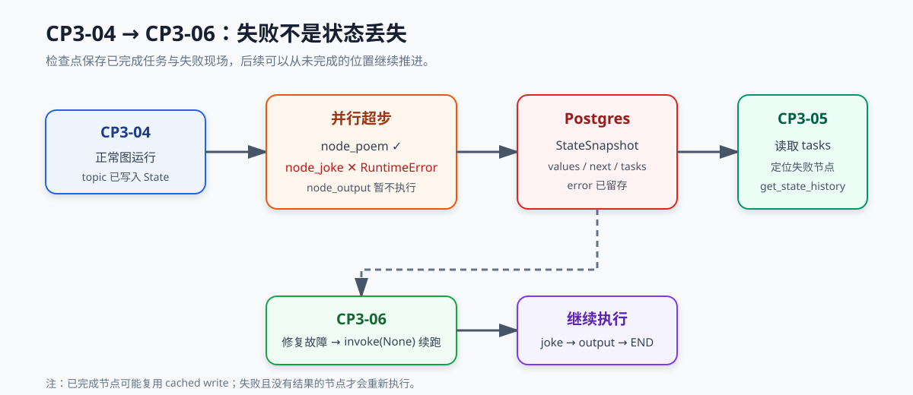
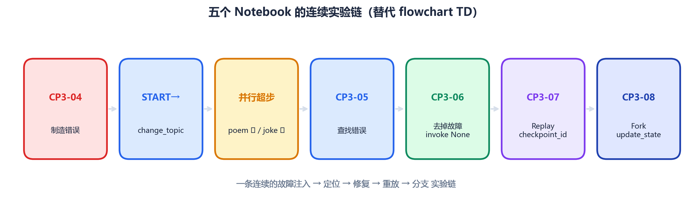
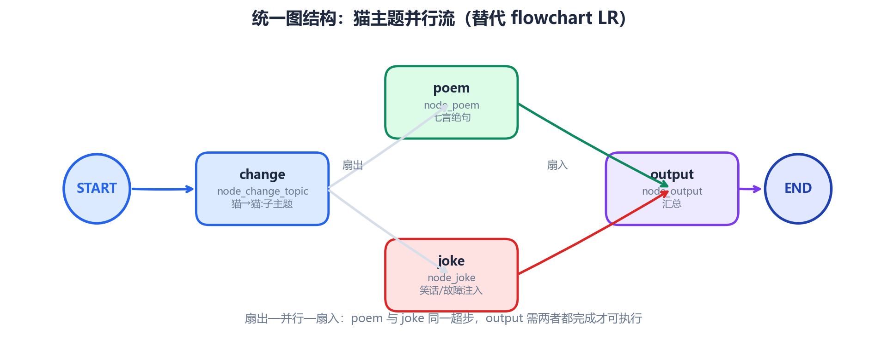
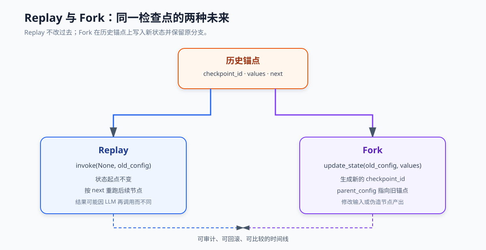
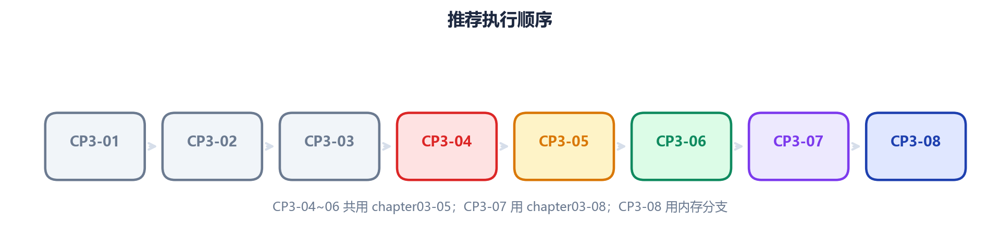

## 前言：让 Agent 的失败变成可解释的状态
这两天被学生会和一些活动整的抽不开身了，学点轻松的放松一下，回归到 LangGraph 上。
这次把问题推进了一层：如果图已经运行到一半，其中一个并行节点突然报错，应该怎么办？如果只看终端 traceback，我们只能知道“这次调用失败了”；但一个生产 Agent 还需要回答：

- 哪个节点失败了？
- 失败发生前，哪些节点已经成功写入结果？
- 任务停在了哪个超步？
- 修复代码后，能不能只重跑失败部分？
- 如果我想从历史某一时刻重新试一次，怎样避免覆盖原来的未来？
- 人工审核发现路由错了，能不能修改过去的状态，分出一条新的执行路径？

拿“写诗和写笑话”这一单来试：诗已经写好，笑话节点报错。先读检查点查出缺哪一项，再从原线程续跑。也可以回到更早一步重新执行，或者在那一步换个主题再跑。



---

## 0. 讲了什么（一图流）



> 检查点示例的执行顺序：`CP3-04 制造错误 -> 并行超步(成功/失败) -> CP3-05 定位 -> CP3-06 修复续跑 -> CP3-07 Replay -> CP3-08 Fork`。

### 0.1 统一图结构

其中 `CP3/04~07` 复用同一张猫主题并行图，`CP3/08` 则使用以 `router_node` 为入口的结构化路由图：



`node_change_topic` 把输入的 `猫` 扩成 `猫:布偶猫`，再把同一个主题交给写诗和写笑话的节点。原例用两条独立边汇合：这两个前驱在同一超步成功时，`node_output` 会在下一超步运行一次。若以后给某一支增加前置步骤，需要等齐两份结果，就把汇合边改成 `add_edge(["node_poem", "node_joke"], "node_output")`。

### 0.2 状态视角

| 视角 | 代码位置 | 说明 |
| --- | --- | --- |
| 内部全量状态 | `OverAllState(TypedDict)` 含 `topic/poem/joke/final_output` | 04~07 共用；08 的 `OverAllState` 仅 `username/user_input/output` |
| 外部输入状态 | `InputState(TypedDict)` 含 `topic` | 04~07 要求调用者只给 `topic` |
| 外部输出状态 | `OutputState(TypedDict)` 含 `final_output` | 仅暴露最终拼接结果 |
| 私有路由状态 | `StructuredOutputState` 含 `topic/mode` | 仅 08 使用，`Annotated` + `Literal` 约束 |

> `OverAllState` 按 `TypedDict` 默认全部必填，但在 LangGraph 增量写入场景下仍以 `return {"key": value}` 的补丁形式逐步补齐（首步只有 `topic`，并行后才有 `poem/joke`）。

---

## 1. 重要词汇

### 1.1 Checkpoint：执行现场的持久化快照

LangGraph 在超步边界保存检查点，记录截至这一轮的状态和执行进度。一个 `thread_id` 标记整次对话，`checkpoint_id` 找到对话里的某一站。单个任务先完成时，保存器还可以写下它在本轮的结果；同轮另一项任务失败时，续跑可以复用这份结果。

### 1.2 StateSnapshot：读取出来的对象

`graph.get_state(config)` 给出一份 `StateSnapshot`；`get_state_history(config)` 逐份给出历史快照。先看 `next` 还有谁没跑，再用 `tasks` 看报错和任务结果。`values` 是这次读取能看到的状态值；`metadata.step` 和 `parent_config` 则帮忙沿时间线找前一站：

```python
{
    "step": snapshot.metadata.get("step"),
    "values": snapshot.values,
    "next": snapshot.next,
    "tasks": [(task.name, task.result, task.error) for task in snapshot.tasks],
}
```

### 1.3 Replay、Resume、Fork 的边界

| 机制 | 是否修改历史状态 | 从哪里开始 | 典型调用 | 主要用途 |
| --- | --- | --- | --- | --- |
| Resume / 恢复 | 不修改旧快照 | 当前失败检查点 | `invoke(None, config)` | 修复故障后继续跑 |
| Replay / 回放 | 保留选中的快照，从后继重新执行 | 指定历史 `checkpoint_id` | `invoke(None, snapshot.config)` | 重新运行那一步以后的节点 |
| Fork / 分支 | 以旧快照为起点另存带有新值的检查点 | 指定历史锚点 | `update_state(...)` | 从改过的状态试另一条路 |



比如检查点里的主题是“猫”。续跑补齐缺失的笑话；回放从旧的“猫”状态重新调用后继节点，模型生成的文字可以不同；分支先把主题改成“狗”，再按新检查点向下运行。三者要找的起点和需要重新执行的节点都不同。

---

## 2. CP3-04：制造错误——并行超步里的局部失败

先用固定文字跑一遍，依赖是 `langgraph==1.2.9`。写诗和写笑话仍属同一轮并行任务。为把故障放在想观察的位置，保存器写入诗句后发出信号，写笑话节点收到信号才报错。这样每次都能看到「诗句已保存，笑话还缺」的现场。

```python
from threading import Event
from typing import TypedDict

from langgraph.checkpoint.memory import InMemorySaver
from langgraph.graph import END, START, StateGraph

class State(TypedDict, total=False):
    poem: str
    joke: str
    output: str

def demonstrate_resume():
    calls = {"poem": 0, "joke": 0, "output": 0}
    broken = True
    poem_saved = Event()

    class ObservedSaver(InMemorySaver):
        def put_writes(self, config, writes, task_id, task_path=""):
            super().put_writes(config, writes, task_id, task_path)
            if any(key == "poem" for key, _ in writes):
                poem_saved.set()

    def poem(_state):
        calls["poem"] += 1
        return {"poem": "一首诗"}

    def joke(_state):
        calls["joke"] += 1
        if broken:
            if not poem_saved.wait(timeout=10):
                raise TimeoutError("poem write was not saved")
            raise ValueError("controlled failure")
        return {"joke": "一个笑话"}

    def output(state):
        calls["output"] += 1
        return {"output": state["poem"] + "；" + state["joke"]}

    builder = StateGraph(State)
    builder.add_node("poem", poem)
    builder.add_node("joke", joke)
    builder.add_node("output", output)
    builder.add_edge(START, "poem")
    builder.add_edge(START, "joke")
    builder.add_edge("poem", "output")
    builder.add_edge("joke", "output")
    builder.add_edge("output", END)
    graph = builder.compile(checkpointer=ObservedSaver())
    config = {"configurable": {"thread_id": "resume-demo"}}

    try:
        graph.invoke({}, config, durability="sync")
    except ValueError as exc:
        if str(exc) != "controlled failure":
            raise
    else:
        raise AssertionError("Expected the controlled failure")
    before = calls.copy()
    snapshot = graph.get_state(config)
    assert snapshot.values["poem"] == "一首诗"

    broken = False
    result = graph.invoke(None, config, durability="sync")
    return before, snapshot.next, calls, result["output"]

print(demonstrate_resume())
```

失败时，`poem/joke/output` 的调用次数是 `1/1/0`，快照里有诗句，`next` 只剩 `("joke",)`。把 `broken` 改为 `False` 后，用同一个 `thread_id` 续跑，次数变成 `1/2/1`，输出“一首诗；一个笑话”。`None` 的作用是让图从该线程的检查点接着走；传一个新的请求字典会开启一次新调用。`Event` 只用来安排这次故障注入；两条分支在图里仍没有先后依赖。原练习用 PostgreSQL 保存检查点，另一段程序也能读取同一线程的记录。

对应代码：[`CP3/04_error.ipynb`](https://github.com/Redmoon-2333/Langgraph/blob/main/CP3/04_error.ipynb)

### 2.1 代码概览

本 Notebook 为单代码单元，结构为 `状态声明 -> 节点定义 -> 构图 -> 检查点后端 -> 编译与调用`。下面保留图的状态声明与模型配置：

```python
from langchain_deepseek import ChatDeepSeek
from langgraph.graph import StateGraph, START, END
……

model = ChatDeepSeek(model = "deepseek-v4-flash", extra_body={"thinking":{"type":"disabled"}})

class OverAllState(TypedDict):
    topic:str; poem:str; joke:str; final_output:str
class InputState(TypedDict):  topic:str
class OutputState(TypedDict): final_output:str
……
topics = ["布偶猫","狸花猫","金渐层"]; topic_index = 0
```

PostgreSQL 的连接串从 `LANGGRAPH_DB_URL` 读取。使用远程模型时，由对应 SDK 从 `DEEPSEEK_API_KEY` 读取访问凭据。

### 2.2 节点与故障注入

```python
def node_change_topic(state:InputState)->OverAllState:
    global topic_index
    ……  # 轮换子主题
    return {"topic":f"{state['topic']}:{sub_topic}"}

def node_poem(state:OverAllState) -> OverAllState:
    ……  # model.invoke([HumanMessage(...)]) -> {"poem": poem}

def node_joke(state:OverAllState) -> OverAllState:
    logger.info("node_joke正在执行")
    ……
    raise Exception("人为抛异常")  # 关键：其后 joke 生成不可达
    ……

def node_output(state:OverAllState) -> OutputState:
    ……  # f"关于{topic}的七言绝句:{poem}\n 笑话:{joke}\n" -> {"final_output": ...}
```

要点：
- `raise Exception("人为抛异常")` 后的 `joke = model.invoke(...)` 为不可达代码，刻意保留以便与下一节的修复版本形成对比。
- `import time` 写在 `node_poem` 之后，不影响运行。

### 2.3 构图与检查点调用

```python
builder = StateGraph(state_schema=OverAllState, input_schema=InputState, output_schema=OutputState)
builder.add_node("node_change_topic",node_change_topic)
……
builder.add_edge(START,"node_change_topic")
builder.add_edge("node_change_topic","node_poem")
builder.add_edge("node_change_topic","node_joke")  # 扇出
builder.add_edge("node_poem","node_output")
builder.add_edge("node_joke","node_output")       # 扇入
builder.add_edge("node_output",END)

import os

DB_URL = os.environ["LANGGRAPH_DB_URL"]
with PostgresSaver.from_conn_string(DB_URL) as checkpointer:
    #checkpointer.setup()  # 首次建库取消注释
    graph = builder.compile(checkpointer=checkpointer)
    ……
    res = graph.invoke({"topic":"猫"}, config={"configurable":{"thread_id":"chapter03-05"}})
```

- `checkpointer.setup()` 默认为注释，首次运行需取消注释以初始化表；建表后保持注释即可（幂等）。
- `display(graph)` 会直接渲染并行拓扑。
- `invoke` **未捕获异常**，失败时会直接以 `error` 状态落盘并在 Notebook 中抛出。

### 2.4 实际运行输出
- 日志（顺序不固定）：
  ```
  topic_index:0 | node_joke正在执行 | node_poem正在执行
  ```
- 错误：
  ```
  Exception: 人为抛异常
  ```
  此时 `node_output` 未执行，但 `PostgresSaver` 已写入 `chapter03-05` 的失败快照，供下一节定位。

---

## 3. CP3-05：查找错误——用 StateSnapshot 还原现场

对应代码：[`CP3/05_find_error.ipynb`](https://github.com/Redmoon-2333/Langgraph/blob/main/CP3/05_find_error.ipynb)

### 3.1 代码：只读历史，不重跑

与 04 完全同构的图，仅末尾不同：

```python
with PostgresSaver.from_conn_string(DB_URL) as checkpointer:
    graph = builder.compile(checkpointer=checkpointer)
    ……
    # 关键：只读历史，不重跑
    state_history = list(graph.get_state_history(config=config))
    print(state_history)  # 聚焦 tasks.error / next
```

- 保留 `display(graph)` 便于对照拓扑。
- 直接 `print(state_history)`，会展开每个 `StateSnapshot` 的 `values/next/tasks/config/metadata` 全量文本，适合教学中“看到一切”，但信息密度大。

### 3.2 实际输出解读

运行后 `state_history` 按新→旧排列。若已按 04→05→06 顺序执行过，最新条目可能已累积 `topic/poem/joke`；在全新线程的首次失败现场，`values` 通常仅含 `topic`。典型条目：

```
StateSnapshot(values={'topic': '猫:布偶猫', 'poem': '《咏布偶猫》...', 'joke': '...'},
  next=('node_poem','node_joke'), tasks=(PregelTask(name='node_poem', error=None, ...), PregelTask(name='node_joke', error=Exception('人为抛异常'), ...)))
```

排错时应聚焦：`tasks[0].error is None`（poem 成功）与 `tasks[1].error`（joke 失败），而非被长文本淹没的 `values`。

> 若 `state_history` 为空，请检查：是否已执行 04、`DB_URL` 是否与 04 同库、`thread_id` 是否为 `chapter03-05`。

---

## 4. CP3-06：修复错误——去掉故障，`invoke(None)` 续跑

对应代码：[`CP3/06_fix_error.ipynb`](https://github.com/Redmoon-2333/Langgraph/blob/main/CP3/06_fix_error.ipynb)

### 4.1 关键改动

```python
topic_index = 1  # 仅影响新起运行
……
def node_joke(state:OverAllState) -> OverAllState:
    # time.sleep(5)
    # raise Exception("人为抛异常")  # 关键：注释掉故障
    joke = model.invoke([HumanMessage(f"写一首关于{topic}主题的笑话")]).content
    return {"joke":joke}
```

其余图结构与 04 完全一致。

### 4.2 恢复调用

```python
with PostgresSaver.from_conn_string(DB_URL) as checkpointer:
    graph = builder.compile(checkpointer=checkpointer)
    ……
    # 关键：None 表示沿用检查点
    res = graph.invoke(None, config={"configurable":{"thread_id":"chapter03-05"}})
```

- 直接以 `invoke(None, config)` 从失败检查点续跑，无需先打印 `resume_from`。
- `topic_index=1` 仅对**新起运行**生效，恢复时主题来自快照 `猫:布偶猫`。

### 4.3 实际输出

```
node_joke正在执行
node_output正在执行
{'final_output': '关于猫:布偶猫的七言绝句:《咏布偶猫》雪裹蓝眸... \n 笑话:这里有几个关于布偶猫的笑话...'}
```

`poem` 的更新留在检查点后端，叫作 **pending writes（待合并写入）**：节点结果已保存，整轮状态要等 `joke` 也完成才能一起合并。这里按同一线程、同一次任务找回诗句；`CachePolicy` 则按节点输入查找可复用结果。若失败的节点已在外部创建订单，续跑会再次执行该节点，检查点不会撤销原订单。写入端可按原业务操作编号去重。

---

## 5. CP3-07：Replay——主动从历史位置重放

对应代码：[`CP3/07_replay.ipynb`](https://github.com/Redmoon-2333/Langgraph/blob/main/CP3/07_replay.ipynb)（三单元）

### 5.1 三单元结构

**单元1**（`chapter03-08` 首次运行）：
```python
with PostgresSaver.from_conn_string(DB_URL) as checkpointer:
    ……
    res = graph.invoke({"topic":"猫咪"}, config={"configurable":{"thread_id":"chapter03-08"}})
```

**单元2**（同 `thread_id` 第二次运行，`topic_index` 自增）：
```python
with PostgresSaver.from_conn_string(DB_URL) as checkpointer:
    ……
    res = graph.invoke({"topic":"猫咪"}, config={"configurable":{"thread_id":"chapter03-08"}})
```

**单元3**（历史回放）：
```python
history_checkpoints = list(graph.get_state_history(config=config))
for checkpoint in history_checkpoints:
    if checkpoint.next == ('node_poem', 'node_joke'):  # 关键：定位并行起点
        new_checkpoint = checkpoint; break
……
# 关键：从历史 checkpoint_id 重放
res = graph.invoke(None, config=new_checkpoint.config)
```

- 代码中使用元组相等 `== ('node_poem','node_joke')` 定位并行起点；若调度顺序不稳定，生产环境建议改为 `set(checkpoint.next) == {"node_poem","node_joke"}`。

### 5.2 实际输出（三次 `invoke`）

- 单元1：`猫咪:布偶猫` 的 `final_output`（诗+笑话）
- 单元2：`猫咪:狸花猫` 的 `final_output`（主题轮换）
- 单元3：从 `next==('node_poem','node_joke')` 的历史点重放，同样得 `final_output`，但 `poem/joke` 文本与前两次不保证逐字相同（保证的是同一 `values` 起点与拓扑）。

> Replay ≠ 新运行：`invoke({"topic":...})` 会重走 `START`，而 `invoke(None, config=history.config)` 才是从 `checkpoint_id` 重放。

---

## 6. CP3-08：Fork——修改过去，分出新的未来

对应代码：[`CP3/08_fork.ipynb`](https://github.com/Redmoon-2333/Langgraph/blob/main/CP3/08_fork.ipynb)（七单元，`InMemorySaver`）

### 6.1 图结构：结构化路由 + 列表式 `path_map`

```python
class OverAllState(TypedDict):
    username:str; user_input:str; output:str
class StructuredOutputState(TypedDict):
    topic:Annotated[str,"主题"]; mode:Annotated[Literal["poem","joke"],"模式"]
model_with_structure = model.with_structured_output(schema=StructuredOutputState)
……

def router_node(state:OverAllState) -> StructuredOutputState:
    ……  # model_with_structure.invoke([HumanMessage(user_input)]) -> {topic, mode}

def router(state:StructuredOutputState) -> Literal["node_poem","node_joke","node_default"]:
    if state["mode"] == "poem": return "node_poem"
    elif state["mode"] == "joke": return "node_joke"
    return "node_default"  # 兜底
……

def node_poem(state:StructuredOutputState) -> OverAllState:
    ……  # 写诗 -> {"output": poem}
def node_joke(state:StructuredOutputState) -> OverAllState:
    ……  # 写笑话 -> {"output": joke}
def node_default(state:StructuredOutputState) -> OverAllState:
    return {"output":"无法处理的任务类型"}

builder = StateGraph(state_schema=OverAllState)
builder.add_node("router_node",router_node)
……
builder.add_conditional_edges("router_node", router, path_map=["node_poem","node_joke","node_default"])
……
checkpointer = InMemorySaver(); config = {"configurable":{"thread_id":"123"}}
graph = builder.compile(checkpointer=checkpointer)
res = graph.invoke({"username":"小王","user_input":"写一首关于荷花的诗"}, config=config)
```

要点：
- `OverAllState` 仅含 `username/user_input/output`，`topic/mode` 由路由节点以 `StructuredOutputState` 产出，不在全局 State 中持久化。
- `Annotated[str,"主题"]` 的中文为字段描述，非 Reducer。
- `path_map` 为列表 `["node_poem","node_joke","node_default"]`，`router` 直接返回物理节点名。
- `BUILD` / `graph` / `Annotation` 为未使用的导入，不影响运行。

### 6.2 锚点与分支 A：改输入重走路由

```python
history_checkpoints = list(graph.get_state_history(config=config))
before_router_checkpoint = next(h for h in history_checkpoints if h.next == ('router_node',))
……

change_input = graph.update_state(
    config=before_router_checkpoint.config,
    values={"user_input":"帮我写一个荷花的笑话"},  # 关键
    as_node=START  # 视为新输入，重走 router_node
)
……
res = graph.invoke(None, config=change_input)  # 得荷花笑话
```

- `before_router_checkpoint` 的 `next==('router_node',)` 表示输入已写、路由未执行。
- `as_node=START` 使 `update_state` 视为新输入，新快照 `next` 仍为 `router_node`，续跑会重调 `model_with_structure`。

### 6.3 分支 B：伪造节点产出，跳过模型但重算边

```python
skip_router_config = graph.update_state(
    config=before_router_checkpoint.config,
    values={"topic":"狸花猫","mode":"笑话"},  # 关键：中文会走 default，正确为 "joke"
    as_node="router_node"  # 伪造该节点产出，跳过 LLM 但重算边
)
……
graph.invoke(None, config=skip_router_config)  # -> "无法处理的任务类型"
```

- `as_node="router_node"` 表示“这些值就是该节点产出”，**不**再调用 `router_node` 的 LLM。
- 条件边仍用新 `mode` 重算；但当前 `mode="笑话"` 为中文，与 `Literal["poem","joke"]` 不匹配，`router` 会走 `node_default`，实际输出 `无法处理的任务类型`。正确取值应为 `mode="joke"`。
- 两个 `update_state` 均产生新 `checkpoint_id`，`parent_config` 指向锚点，旧历史保留。

### 6.4 两种 Fork 对照

| 方式 | `as_node` | 修改字段 | 是否重跑 `router_node` | 新 `next` | 实际结果 |
| --- | --- | --- | --- | --- | --- |
| 改输入 | `START` | `user_input` | 是 | `router_node` | 重调路由，通常得 `joke` |
| 改节点产出 | `router_node` | `topic/mode` | 否 | `node_default`（因 `mode="笑话"`） | `无法处理的任务类型` |

### 6.5 实际输出（本仓验证）

- 首次 `invoke`（写诗）得 `output` 为七言诗《荷花》。
- 分支 A `invoke(None, change_input)` 得荷花笑话（`mode` 重识别为 `joke`）。
- 分支 B `invoke(None, skip_router_config)` 得 `无法处理的任务类型`，验证了 `mode` 中文取值与 `Literal["poem","joke"]` 不匹配时的兜底行为。

---

## 7. 恢复时容易看漏的两个细节

- `checkpoint.next == ('node_poem','node_joke')` 的元组匹配在并行调度不稳定时可改为 `set` 比较。
- `08_fork.ipynb` 中 `mode="笑话"` 的中文取值会命中 `node_default`，如需命中 `node_joke` 请使用 `mode="joke"`。

---

## 8. 执行顺序与排错清单

### 8.1 推荐执行顺序



> 8 步顺序：`CP3-01 -> 02 -> 03 -> 04 -> 05 -> 06 -> 07 -> 08`；`04~06` 共用 `chapter03-05`（`PostgresSaver`），`07` 用 `chapter03-08`，`08` 用 `thread_id="123"` 的 `InMemorySaver`（重启即失）。

### 8.2 运行前检查

```bash
python --version  # 3.11+
pip install langgraph langchain-deepseek langgraph-checkpoint-postgres "psycopg[binary]" python-dotenv loguru jupyterlab
jupyter lab
```

- 数据库实验需要可连接的 PostgreSQL 和可用的模型配置。正文把连接串从 `LANGGRAPH_DB_URL` 读取；查看历史和续跑时使用同一数据库与线程编号。
- `04` 的 `#checkpointer.setup()` 首次需取消注释以建表，`08` 为内存后端无需此步。
- 启动路径应在仓库根，使 `load_dotenv(override=True)` 能找到 `.env`。

### 8.3 常见错误定位

| 现象 | 可能原因 | 检查方向 |
| --- | --- | --- |
| `SyntaxError: f-string: unmatched '['` | `f-string` 引号写法不规范 | 检查 `f"{state['topic']}"` 的单双引号配对 |
| `Exception: 人为抛异常` | 04 预期故障 | 正常，查 `05` 的 `tasks.error` |
| `state_history` 为空 | 未先跑 04 或 `thread_id` 错 | 对照 `chapter03-05` 与 `DB_URL` |
| 06 无待执行节点 | 该线程已到 `END` | 换新 `thread_id` 重做 04→06 |
| 08 `无法处理的任务类型` | `mode="笑话"` 中文不匹配 | 改为 `mode="joke"` |
| `UndefinedTable` | 首次未 `setup()` | 取消注释 `checkpointer.setup()` 执行一次 |

---

## 9. 复习卡片

- 先读 `tasks` 查任务错误和已保存的写入，再用 `values` 核对已合并状态。两者的时间点可以不同。
- 从当前故障点续跑用线程配置，回到历史位置则带上该快照的 `checkpoint_id`。回放中的模型调用会重新执行。
- `update_state(..., as_node=...)` 生成新检查点。选 `START` 从输入端重新路由；指定路由节点则把新值当作该节点的输出，接下来重新计算出边。

---

## 附 · 项目仓库

错误注入、检查点定位、续跑、Replay 和 Fork 分别放在下面 5 个 Notebook 中。运行前需要配置模型服务和 PostgreSQL；`08_fork` 使用内存检查点。

- [Redmoon-2333/Langgraph — CP3 错误恢复、Replay 与 Fork](https://github.com/Redmoon-2333/Langgraph) — 含 `CP3/04_error.ipynb` ~ `08_fork.ipynb`（带可复现输出）与 `assets/img/` 原图，依 `04 → 05 → 06 → 07 → 08` 顺序执行即可复现。


