## 前言
依旧听取一些越来越难听懂的课程。
Day5 把字符级 MLP 跑通了，我当时主要盯着 loss 往下降。这一节再看初始化、激活和梯度，才发现训练曲线下面还有不少值得检查的东西。
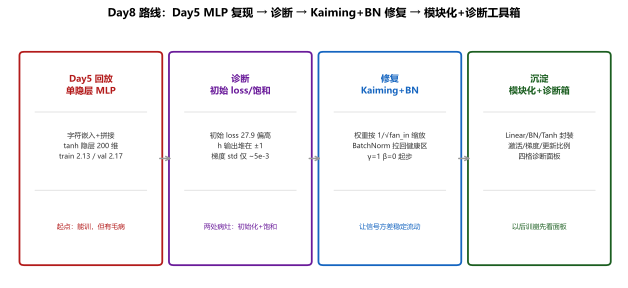

## 1. 基线复现：先确认"病"长什么样

把 Day5 的单隐层 MLP（`n_emb=10, n_hidden=200`，11897 个参数）原样重训 200k 步，同种子下面貌完全可复现：

**公式：** 训练配置

$$
\text{batch}=32,\quad \text{steps}=200000,\quad \text{lr}=\begin{cases}0.1 & i<10^5\\ 0.01 & i\ge 10^5\end{cases}
$$

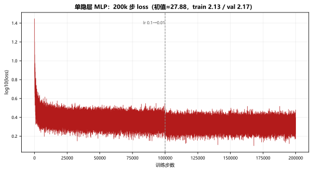

> **实现要点：** 起点 loss≈27.9、终点 train 2.1256 / val 2.1674，与 Day5 一致。曲线抖是 batch=32 的正常噪声。但有两个"症状"藏在这条平静曲线下面：初始 loss 太大、tanh 大面积饱和——下面逐一拆解。

---

## 2. 症状一：初始 loss 违反数学预期

27 个字符都打相同分数时，softmax 给每个字符 $1/27$ 的概率，交叉熵是 $\ln 27 \approx 3.30$。这是一条均匀猜测的参照线。实际初始 loss 是 **27.88**，说明模型给真实字符的概率整体很低。

缩到两个字符看：分数 `[0, 0]` 时，正确字符的概率是 `0.5`，损失约 `0.693`；分数 `[0, 10]` 且正确的是第一个字符时，它的概率只有 `1 / (1 + exp(10)) ≈ 0.0000454`，损失约 `10`。两种分数都没从数据里学过，后者猜错时却扣得更重。

**公式：** 均匀分布下的期望损失

$$
\mathcal{L}_0 = -\ln\frac{1}{27} = \ln 27 \approx 3.30 \quad(\text{实测 }27.88\text{，偏离一个数量级})
$$

**病因在输出层的初始化：** `W2 = torch.randn(...)`、`b2 = torch.randn(...)` 都是标准正态，200 个隐层输出的加权和轻松把 logits 推到 ±20，softmax 一算就给出极端错误的置信度。

练习先把输出权重 `W2` 缩为原来的 `0.01`，并把输出偏置 `b2` 置零。保留小的非零权重，第一步就能经由输出层把梯度传回隐藏层。若把 `W2` 全设为零，第一步传给隐藏层的梯度 `dlogits @ W2.T` 就为零；输出层本身仍有机会收到梯度并在下一步改变。

---

## 3. 症状二：tanh 饱和

**类比：** `tanh` 是一扇只在中间开启的门：输入在 ±0.5 以内时导数接近 1，信号畅通；输入一旦跑到 ±3 开外，门基本焊死，导数趋近 0——梯度传到这里就"消失"了。

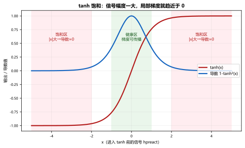

**公式：** tanh 的局部梯度

$$
h=\tanh(x),\qquad \frac{\partial h}{\partial x}=1-\tanh^2(x)\xrightarrow{|x|\to\infty}0
$$

体检方式是两句 matplotlib：直方图看 `hpreact`/`h` 的分布，`imshow(h.abs()>0.99)` 把饱和神经元点成白点。结果：`hpreact` 横跨 ±20，`h` 两端堆出高墙，白色饱和点大面积出现。

> **实现要点：** 病根是 `embcat @ W1 + b1` 的方差随 `fan_in=30` 个输入累加放大（$\text{Var}(y)=30\,\text{Var}(w)\text{Var}(x)$），信号进 tanh 之前就爆了。修法：`b1 *= 0.01`、`W1 *= 0.1`，让 `hpreact` 回到健康区。同一组阈值图立刻全黑（零饱和）。

---

## 4. 药方一：Kaiming 初始化——缩放不是玄学

"权重除个 $\sqrt{\text{fan-in}}$"听起来像经验玄学，其实是一道方差算术。

**公式：** 线性层输出的方差

$$
y_i=\sum_{k=1}^{fan\text{-}in}w_kx_k,\qquad
\text{Var}(y_i)=fan\text{-}in\cdot\text{Var}(w)\cdot\text{Var}(x)
\;\xrightarrow{\;\text{Var}(w)=1/fan\text{-}in\;}\;\text{Var}(x)
$$

这个估算把权重和输入视作独立的零均值量，各项乘积间也不相关。若每项的方差是 1，30 项相加，方差增至 30，标准差是 $\sqrt{30}$。把权重除以 $\sqrt{30}$ 后，每项方差缩到 $1/30$，加起来回到 1。这里算的是初始化时线性层的量级；经过激活函数或训练后，需要再量实际分布。

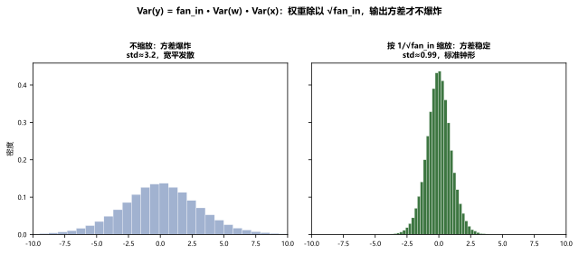

> **实现要点：** notebook 里做了两组对照（同分布输入，一组 `w` 缩放一组不缩放）：不缩放 `y.std()≈3.2`，缩放后 `y.std()≈1.0`。Kaiming 论文 (He et al., 2015) 给出的是针对 ReLU 的精确版（乘 $\sqrt{2/fan\text{-}in}$，因为 ReLU 砍掉一半信号），`5/3` 这个增益则是给 tanh 用的经验修正——但"除以 $\sqrt{\text{fan-in}}$"这个骨架是同一件事：**方差守恒**。

---

## 5. 药方二：BatchNorm——把每一层的输入"重新校准"

缩放初始化调整的是起点，参数更新后，中间量的分布也会变化。BatchNorm 在训练时用当前 batch 的均值和方差做归一化，再通过可学习的参数缩放、平移。归一化控制均值和方差，并不把任意分布变成正态分布。

**公式：** BatchNorm 前向（论文原式）

$$
\mu_B=\frac{1}{m}\sum_{i=1}^{m}x_i,\quad
\sigma_B^2=\frac{1}{m}\sum_{i=1}^{m}(x_i-\mu_B)^2,\quad
\hat{x}_i=\frac{x_i-\mu_B}{\sqrt{\sigma_B^2+\epsilon}},\quad
y_i=\gamma\hat{x}_i+\beta
$$

$\gamma$（初始全 1）和 $\beta$（初始全 0）分别控制缩放和平移。在同一特征列里，训练时先减去当前批次均值，再除以标准差。公式里的 $\epsilon$ 防止方差为零时除以零。

只看一列，设批次 A 是 `[2, 4, 6]`，批次 B 是 `[0, 2, 4]`。两批方差都是 `8/3`，但均值分别是 `4` 和 `2`。忽略很小的 $\epsilon$、保持初始 $\gamma=1,\beta=0$，同一个输入 `2` 在 A 里得到 `(2-4)/sqrt(8/3) ≈ -1.225`，在 B 里得到 `0`。推理时如果保存的均值是 `4`，方差是 `8/3`，这个 `2` 就固定输出约 `-1.225`，不受同批其他样本影响。

**训练 / 推理的不对称**是 BN 最容易踩的坑：

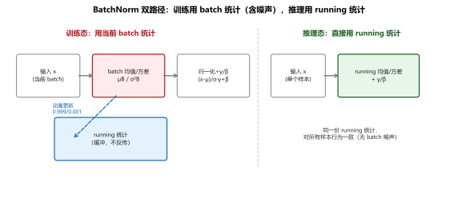

| | 训练态 | 推理态 |
| --- | --- | --- |
| 均值/方差 | 当前 mini-batch 的 $\mu_B,\sigma_B^2$ | `running_mean` / `running_var` |
| running 更新 | `running = (1 - momentum) * running + momentum * batch_stat` | 冻结不动 |
| 副作用 | 同一样本随 batch 组成轻微抖动（附带正则化效果） | 确定性输出 |

本篇先手写均值和标准差的更新，后面的 `BatchNorm1d` 类改存均值与方差，默认 `momentum=0.1`。这些统计量在 `no_grad` 下更新。紧挨 BN 的线性层可以省掉偏置：如果每个样本都加了同一个偏置，均值也加了同一个数，训练时一减就抵消；BN 自己的 $\beta$ 仍可以学习输出偏移。

**效果：** 加上 BN 后，同样训练 200k 步，初始 loss 在 3.3 附近，train/val 到 2.07/2.11。除了最终损失，初始化敏感性和学习率适用范围也是评估 BN 的维度；下文的模块化实验对比了其中一组训练配置。

---

## 6. Pytorch 化：Linear / BatchNorm1d / Tanh 三件套

散装代码堆到 4 个隐层就该模块化了。手写三个类，接口对齐 `nn.Module`（但不用 autograd 之外的框架设施）：

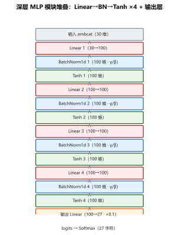

**公式：** 模块接口约定

$$
\text{Layer: }x\mapsto \text{call}(x),\qquad \theta\leftarrow \text{parameters}()
$$

每层还把中间输出保存在 `out` 中，供后面检查激活和梯度。

> **实现要点：** 三个设计点——① `Linear` 构造时就做 `randn/fan_in**0.5` 的缩放初始化（药方一内置化）；② `BatchNorm1d` 内部区分 `training` 标志并维护 running 缓冲；③ 每层把输出存到 `self.out`，训练循环里 `retain_grad()` 一挂，诊断数据就有了。最后层权重 `*= 0.1` 压低初始置信度（症状一的修法），其余 Linear 层 `*= 5/3`（tanh 增益补偿）。

---

## 7. 诊断工具箱：训网络要会看三张图

深层网络训完不能只看一个 loss 数字。Karpathy 的做法是把网络切开看三样东西：激活、梯度、更新量。

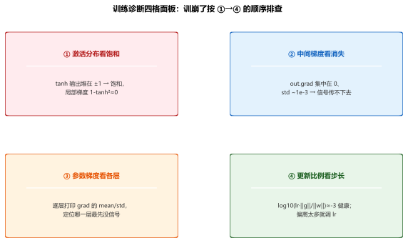

### 7.1 激活分布——查饱和

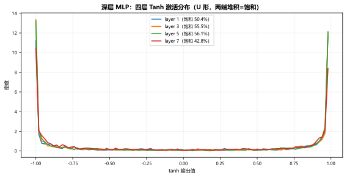

横轴是 tanh 的输出，纵轴是密度，四条曲线对应四个隐层。两端堆得高，对应这里的饱和阈值 `abs(h) > 0.99`。例如 `h=0.99` 时，局部导数只有 `1 - 0.99² = 0.0199`。看的是两端有多少激活及梯度还能传多远，直方图不必长成钟形。

### 7.2 中间层梯度——查消失

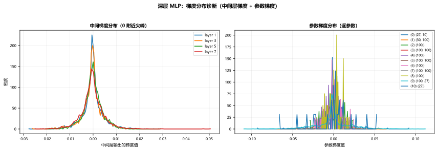

图中四层标准差都在 $4\sim5\times10^{-3}$ 左右，这次观测没有看到梯度沿层数快速缩小。若前几层长期比后几层小两个数量级，应再看激活是否饱和以及权重是否实际更新。单批的梯度直方图只能反映该次前向和反向。

### 7.3 参数更新比例——查步长

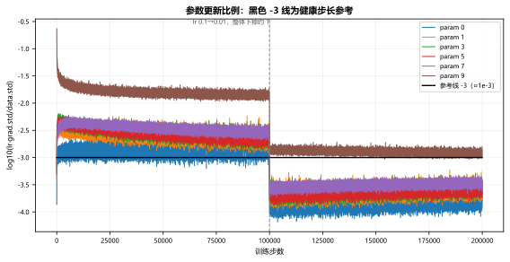

**怎么读：** 纵轴是 $\log_{10}\dfrac{\text{lr}\cdot\text{grad.std()}}{\text{data.std()}}$，即**每步更新量占参数尺度的比例**。黑色参考线 $-3$ 是经验法则：更新量约为参数的千分之一比较健康。

三个看点：
1. **100000 步处的整体断层**：所有曲线整齐下掉恰好 1 个单位——是学习率 `0.1→0.01` 造成的。纵轴公式里乘了 lr，$\log_{10}$ 坐标下 lr 缩小 10 倍正好是 $-1$；断层后曲线走平说明梯度本身没突变，训练连续，只是步子变小了。
2. **param 9（输出层权重）高居 -1.8**：它初始化时被乘了 0.1 压低置信度，分母 `data.std()` 小，比例显得大——衰减后回落到 -2.8，回到参考线附近，属于"设计如此"而非病态。
3. **开局毛刺**：前几百步梯度/参数尺度未稳，忽略即可。

---

## 8. 收尾对照实验：两个"如果"

### 8.1 如果不缩放初始化

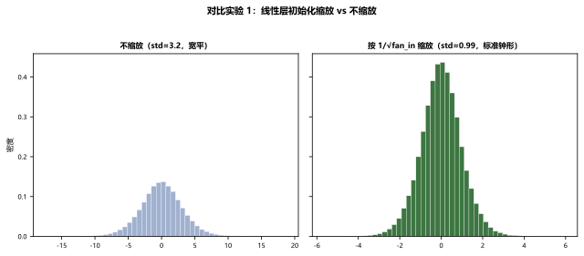

同分布输入、同尺寸权重，只差一个 `1/√fan_in`：输出 std 从 1.0 膨胀到 3.2。单层 3.2 倍，十层就是 $3.2^{10}$——这就是没有方差守恒时深层网络"训不动"的算术本质。

### 8.2 如果加不加 BatchNorm

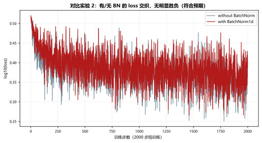

相同结构、相同初始化、相同 minibatch 序列各训 2000 步，两条 loss 曲线基本交织，这次短训练没有显示出明显差异。该结果对应当前网络深度和训练配置，不能直接外推到更深网络；更完整的比较还需包含验证损失与饱和率。

---

## 9. BatchNorm 全面上线：bias 退场、饱和率减半

§7 诊断图里的 U 形饱和是"只有初始化、没有 BN"的形态。这节把 BatchNorm 真正铺进网络，四个改动一次到位：

1. **每个 `Linear` 都 `bias=False`**——反正后面跟的 BN 会减均值，bias 是无效参数；
2. **每层 Linear 后面都跟一个 `BatchNorm1d`**（5 个隐层 + 输出层，共 6 个 BN，47024 参数）；
3. **增益归一**：`5/3` 的 tanh 增益不再需要（BN 每层重新校准），只有输出层 `gamma *= 0.1` 压低初始置信度；
4. **学习率衰减挪到 150k**（§7 的诊断图保持在 100k，两版不混）。

**公式：** 完整版前向（对比 §6 的无 BN 版）

$$
x \to \texttt{Linear}(\text{bias=False}) \to \texttt{BatchNorm1d} \to \texttt{Tanh} \;\times 5 \to \texttt{Linear} \to \texttt{BatchNorm1d} \to \text{logits}
$$

完整配置训练 200k 步后的记录：

1. **开局 loss = 3.3001**，接近均匀预测的 $\ln 27 = 3.2958$；
2. **train 2.0020 / val 2.0828**：这是这份 notebook 所记录配置中最低的验证损失，低于 Kaiming 初始化版的 2.1070，也是第一个把 val 压到 2.1 以下的配置；
3. **饱和率从 42%–56% 降到 18.7%–24.3%**，激活标准差从 0.85–0.90 降到 0.73–0.79。同一次对比也改了层数和学习率安排，因此把这些数字读作整套配置的结果；第 8.2 节才是短训练里专门开关 BN 的比较。

> **实现要点：** 评估时必须先把各层切到推理态（`layer.training = False`），BN 才会用 running 统计而不是当前 batch——评估完再切回来。

---

## 10. 小的记忆点

排查时按数据流往回走。开局 loss 偏离均匀参照，先看输出分数；激活挤在 `±1` 附近，再看 tanh 之前的值。若更新比例恰好在学习率切换时下移一格，先把 `lr` 的十倍变化代进公式，别误判成梯度突然消失。

---

## 附 · 资料下载

初始化、BatchNorm 和诊断图的代码及运行输出放在这份 Notebook 中：

- [MLP的一些收尾工作.ipynb](/assets/attach/day8/MLP%E7%9A%84%E4%B8%80%E4%BA%9B%E6%94%B6%E5%B0%BE%E5%B7%A5%E4%BD%9C.ipynb)：Day8 收尾版（初始化/BatchNorm/模块化 + 三张诊断图 + 有无 BN 对照实验，200k 步全量输出）

> 说明：Notebook 请放在 `names.txt` 同级目录运行；Python 3.11 + PyTorch。
