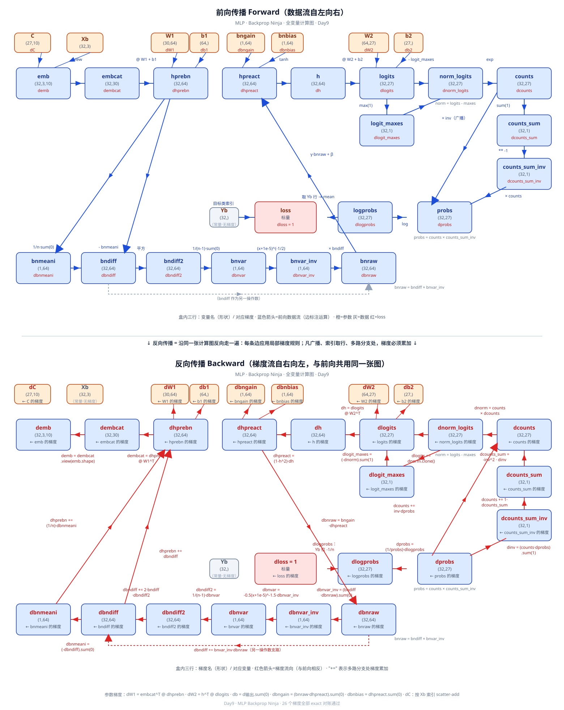
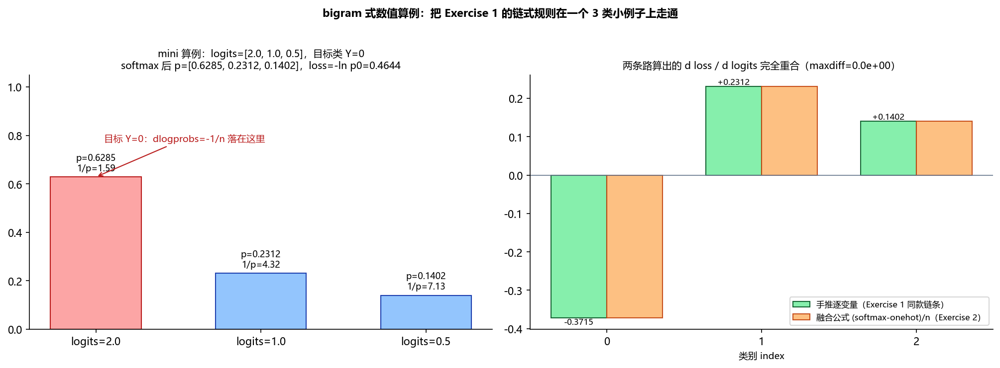
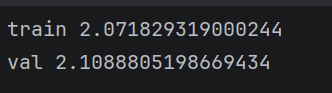

## 前言
（居然过了这么多节课还不能进入下一步吗？）
ok啊,上次说好的把MLP收个尾，结果还没收好，还有一个点值得细细推敲——`loss.backward()`。调用它就能得到梯度，可它**到底怎么算出来的**？这次我把 26 个梯度逐个写出来，与 autograd 对照。softmax 加交叉熵、BatchNorm 这两段尤其长，展开算一遍后，再看融合公式就有来路了。



图 1 上半部从输入走到损失，下半部从损失沿相反方向求导。先看右侧的 `loss` 从哪个变量算出，再跟红色箭头回到参数。一个变量被下游用几次，就要把几路贡献加起来。

---

## 1. 对账尺 `cmp()` 与"防作弊"初始化
对 19 个中间张量先调用 `retain_grad()`，再用 `loss.backward()` 留下 PyTorch 的参考梯度。比较时看三项：是否逐元素相等、是否在数值容差内、最大绝对误差是多少。初始化保留了非零的偏置和各不相同的权重；如果某路梯度碰巧是零，漏写那一路也可能蒙混过关。

## 2. 前向拆链（20 个变量）

前向传播被刻意"碎片化"（chunkated）：emb → embcat → hprebn → {bnmean, bndiff → bndiff² → bnvar → bnvar_inv → bnraw} → hpreact → h → logits → {logit_maxes → norm_logits} → counts → counts_sum → counts_sum_inv → probs → logprobs → loss。

## 3. Exercise 1：26 个梯度

沿数据流反向计算，可分成下面五组：

**① softmax 链**：`dlogprobs` 是稀疏散布（只有 n=32 个目标位拿到 -1/n）；`log` 的导数是 1/p；广播乘法的反向是对广播维求和（压回 32×1）；x⁻¹ 的导数是 -x⁻²；`dcounts` 两路相加（直连路 + sum 的"全 1 广播"路）；`exp` 的导数还是 exp 本身；`logits - logit_maxes` 的反向把 -dlogit_maxes 广播给整行，而 `max` 只把值路由给 argmax 列（用 `F.one_hot` 掩码加回）。

**② 矩阵乘法三规则**（`h @ W2 + b2`，W1 同理）：`dh = dlogits @ W2.T`、`dW2 = h.T @ dlogits`、`db2 = dlogits.sum(0)`。最后一条可以用两个样本手算：同一个偏置分别加到两行输出，如果这两行对它的梯度贡献是 `2` 和 `-0.5`，共享偏置的梯度就是 `1.5`。求和把反向张量的形状收回到偏置原来的形状。

**③ tanh**：`dhpreact = (1 - h²) * dh`——局部梯度 1-tanh²(x)，正好用输出 h 表示；这就是 Day8 诊断 tanh 饱和用的同一把尺子。

**④ BatchNorm 链（8 个变量）**：γ/β 广播到 batch 维 → 反向对 batch 维求和；x^(-1/2) 的导数是 -0.5·x^(-3/2)；`dbndiff2 = 1/(n-1) * dbnvar`——**Bessel 校正在这里落地**；`dbndiff` 两路相加（bnraw 直连路 + 平方路）；`dhprebn` 也两路（bndiff 路 + 均值路，均值路经 sum 广播回全 batch）。

**⑤ Embedding 查表**：`C[Xb]` 索引取行，同一行被 batch 内多个位置查到 → **scatter-add**：`dC[ix] += demb[k,j]`，双层 for 最直观。

**公式**：loss 对 logits 的融合梯度（Exercise 2 预告）

$$\frac{\partial L}{\partial\ \mathrm{logits}} = \frac{1}{n}\left(\mathrm{softmax}(\mathrm{logits}) - \mathrm{onehot}(Y_b)\right)$$

这次保存的输出中，26 个变量均逐元素相等，`maxdiff=0.0`。

梯度的**累加**贯穿广播、索引取行和多路分支。这里共五处 `+=`：`dcounts`（sum 支路）、`dlogits`（max 支路）、`dbndiff`（平方支路）、`dhprebn`（均值支路）、`dC`（索引重复）。漏掉任一支路都会使结果与 autograd 不一致。

## 4. 数值算例：3 个小例子走通 softmax 链
取三个类别的分数 `[2.0, 1.0, 0.5]`，正确类别是第 `0` 列，批次只有一条样本。先把每个分数减去最大值 `2.0`，再取指数，得到 `counts ≈ [1, 0.3679, 0.2231]`。每项除以总和 `1.5910`，得到概率 `[0.6285, 0.2312, 0.1402]`，损失约 `0.4644`。

| 步骤 | 数值 |
| --- | --- |
| dlogprobs | [−1, 0, 0]（只有目标位） |
| dprobs = dlogprobs/p | [−1.591, 0, 0] |
| dcounts_sum_inv | counts·dprobs 求和 = −1.591 |
| dcounts_sum | +0.6285，分母总和对三列都有贡献 |
| dcounts（两路相加） | [−0.3715, +0.6285, +0.6285] |
| dnorm_logits = counts·dcounts | [−0.3715, +0.2312, +0.1402] |

为什么第二、三列的 `dcounts` 都是 `+0.6285`？它们没有直接进入正确类别的分子，但都加进了分母。把某个错误类别的权重加大，正确类别的概率就会下降，损失随之升高。再乘各自的指数值，才是表里最后一行的梯度。这里三个分数的梯度合计为零；把三个原分数一起加 `1`，概率不会变。



> **图 2**：左——3 类概率与各位置的 1/p 局部梯度（目标位标红，−1/n 落在这里）；右——手推逐变量结果 vs Exercise 2 融合公式的对比条形图，两条路完全重合。

## 5. Exercise 2：softmax + 交叉熵融合成一行

把整条 softmax 链代入 loss 化简，得到开头那条融合公式——"**预测概率减目标指示，除以 n**"，代码三行：`F.softmax(logits, 1)` → 目标位 `-1` → `/= n`。

下面可以单独运行。`target` 每行只写正确答案的列号，`arange` 给出每行的编号。先在正确列减 `1`，最后除以批次大小，对应默认的平均损失。

```python
import torch
import torch.nn.functional as F

scores = torch.tensor([[2.0, 1.0, 0.5]], requires_grad=True)
target = torch.tensor([0])
F.cross_entropy(scores, target).backward()

manual = scores.detach().softmax(dim=1)
manual[torch.arange(len(target)), target] -= 1
manual /= len(target)
assert torch.allclose(manual, scores.grad)
print(manual.round(decimals=4).tolist()[0])  # 约 [-0.3715, 0.2312, 0.1402]
```

手写完整版和融合公式在实数运算中等价。本次保存的浮点对照最大差约 `6e-9`，计算顺序不同，所以用容差比较。

## 6. Exercise 3：BatchNorm 反向压缩成一行

$$\frac{\partial L}{\partial\ hprebn} = \frac{\gamma \cdot bnvar\_inv}{n}\left(n\cdot dhpreact - \sum_i dhpreact_i - \frac{n}{n-1}\cdot bnraw \sum_i (dhpreact_i \cdot bnraw_i)\right)$$

括号内三项：**直通项**（γ·inv 缩放）、**均值项**（减 μ 的反向）、**方差项**（除 σ 的反向，系数 n/(n−1) 来自 Bessel 校正）。这一行合并了 Exercise 1 中 8 步链式计算的结果。

## 7. Exercise 4：接进训练循环

对照通过后，训练循环每批重新计算梯度。`dC` 对应嵌入表；`dW1, db1, dW2, db2` 对应两层线性变换；最后两个对应 BatchNorm 的缩放与偏移。列表中的顺序必须与 `parameters` 对齐，否则会把梯度用到另一组参数上：

```python
grads = [dC, dW1, db1, dW2, db2, dbngain, dbnbias]
lr = 0.1 if i < 100_000 else 0.01
with torch.no_grad():
    for param, grad in zip(parameters, grads, strict=True):
        param -= lr * grad
```

这是训练循环中参数更新的片段，前面各节的反向计算提供 `grads`。`no_grad` 让这次更新留在计算图之外。

接进 200k 步训练后，保存的评估输出为 train **2.0718**、val **2.1089**。Notebook 文末注释里的 2.0719 / 2.1162 是另一组参考结果，和这次输出分开记录。



## 8. 收工小结

给手写反传挑测试数据时，至少让同一字符在一个批次里出现两次。`C[Xb]` 此时从嵌入表取了同一行两次，两个位置的梯度应加到同一行上；用一次赋值把其中一步覆盖掉，损失照样能算，训练却从错误的梯度开始。

---

## 附 · 资料下载

- [MLP的另外一项收尾——重写反向传播.ipynb](/assets/attach/day9/MLP%E7%9A%84%E5%8F%A6%E5%A4%96%E4%B8%80%E9%A1%B9%E6%94%B6%E5%B0%BE%E2%80%94%E2%80%94%E9%87%8D%E5%86%99%E5%8F%8D%E5%90%91%E4%BC%A0%E6%92%AD.ipynb)：本期 notebook——前 12 个 cell 为干净内核全量输出（Exercise 1 对账 26 个梯度全部 exact: True），Exercise 4 训练段代码已按 TODO 补全
