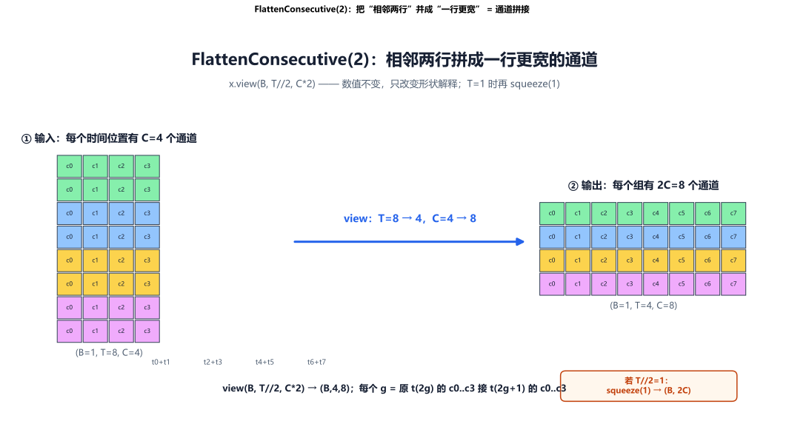
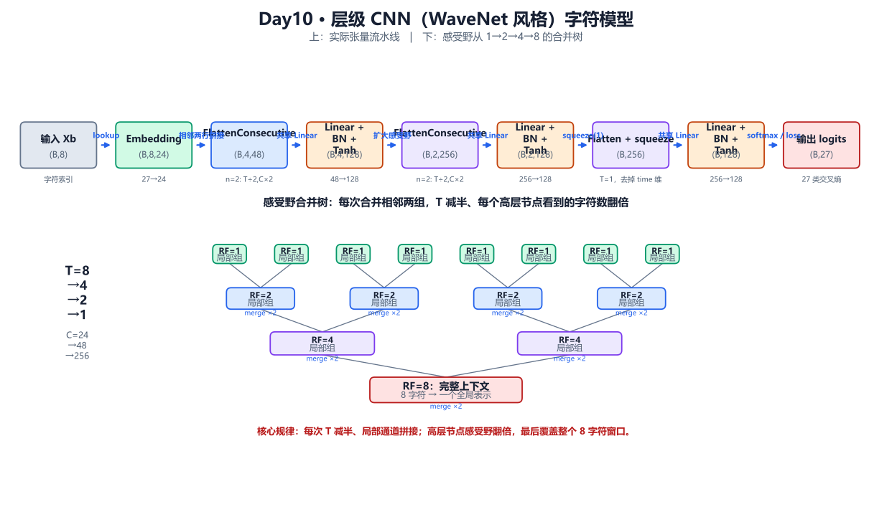
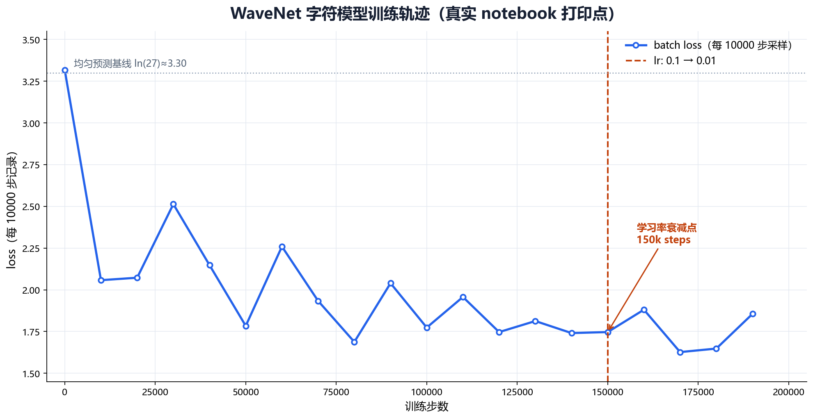

## 前言

这次我想把上下文从 3 个字符拉长到 8 个。沿用前面的 MLP 当然能做，但首层输入也跟着变宽了，有没有另一种组织方式？

最省事的办法是把 8 个字符拍平直接喂 MLP——但首层就是 `8×24` 的全连接，每个字符跟其他字符平等相待，模型必须自己从零发现「相邻字符更像一家人」这件事实。这一讲的做法恰好相反：**先固定「相邻成对」这个局部结构，再让它逐层放大**。不引入 `torch.nn.Conv1d`，只用 `FlattenConsecutive + 共享 Linear` 就能手拼出一台「逐级两两合并」的层级 CNN，感受野 1→2→4→8。

上一篇刚手写完 26 个梯度，这一篇正好练手：看清「为什么能这样堆」，比记住「怎么堆」更重要。

---

## 1. 主角：`FlattenConsecutive`

先说这一讲唯一的新零件。它做的事情一句话能说完：**把时间上相邻的 n 个位置并成一行更宽的特征**。

`B` 是一批有多少条序列，`T` 是每条序列有多少个位置，`C` 是每个位置有多少个特征。如果 `T` 能整除 `n`，把连续 `n` 个位置的特征排到一起，形状就从 `(B,T,C)` 变成 `(B,T/n,C×n)`。重排本身不引入权重；原来的每个值仍有一个对应位置，梯度沿那个位置传回。

- 最后一组只剩一个位置时，`squeeze(1)` 把 `(B,1,C×n)` 变为 `(B,C×n)`，便于分类头产出 `(B,27)`；
- 与 `torch.nn.Flatten` 的区别：后者把整个样本拍成一长向量，前者只做「局部两行合并」，保留 batch、时间维减半。



> **图 1**：左为 view 前 (T=8,C=4)，同色两行将被拼成一组；右为 view 后 (T=4,C=8)，每组 = `t_{2g}` 的 c0..c3 接 `t_{2g+1}` 的 c0..c3——数值一个没变，只是形状重解释。

---

## 2. 它「等于」一个卷积

把 `(B,T,C)` 当成一张一维特征图，`FlattenConsecutive(2)` + `Linear(2C→H)` 的组合可以写成一行公式：

每个时间组都用**同一份权重**做 `W·[x_t; x_{t+1}]`——这正是 **kernel=2、stride=2、无 padding 的一维卷积**。也就是说这套写法在数学上等价于：

```python
nn.Conv1d(in_channels=C, out_channels=H, kernel_size=2, stride=2, padding=0)
```

两处对应关系值得记住：

- 同一个 `Linear` 在起点 `0, 2, 4, ...` 的所有组上复用。步长是 `2`，所以移动输入一个位置会改变分组；一格平移并不会简单地把原输出也挪一格；
- **权重可以逐项对应**。`Linear(48→128)` 有 `48×128=6144` 个权重；本例设置了 `bias=False`，没有额外偏置，与后面的参数表一致。

用四个数试一遍。`[1, 2, 3, 4]` 分成 `[1, 2]` 与 `[3, 4]`，每组都乘同一对权重 `[0.5, 1.5]` 再相加，得到 `3.5` 和 `7.5`。下面的卷积沿着同两个起点计算，结果逐项相等：

```python
import torch
import torch.nn.functional as F

x = torch.tensor([[[1.0], [2.0], [3.0], [4.0]]])  # B, T, C
weight = torch.tensor([[[0.5, 1.5]]])              # 输出通道、输入通道、核宽
grouped = x.reshape(1, 2, 2) @ weight.flatten()  # [[3.5, 7.5]]
conv = F.conv1d(x.transpose(1, 2), weight, stride=2).squeeze(1)
assert torch.equal(grouped, conv)
print(conv.tolist())  # [[3.5, 7.5]]
```

PyTorch 的卷积把通道放在位置维前面，所以要先交换第 1、2 维。若步长改成 `1`，卷积还会读 `[2, 3]`；直接两两分组就不再等价。

---

## 3. 感受野 1→2→4→8

三层合并的信息流很有节奏感：

- 第一次合并，每个输出组拿到 2 个字符的信息；
- 第二次把两个「2 字符组」并成「4 字符组」；
- 第三次得到「8 字符组」。

信息不是一次看全，而是**两两配对、逐层加宽**。低层只认局部小模式（某两个相邻字符的组合），高层才有资格把它们组合成更长范围的规律——这就是「感受野」直观的来历。



> **图 2**：逐级两两合并的数据流。绿=embedding(24)、蓝=两字符拼接(48)、橙=隐层(128)、紫=4/8 字符拼接(256)、红=logits；左侧感受野 1→2→4→8。

手写 BatchNorm 也要认得 `(B,T,C)`。`dim=(0,1)` 把所有样本的所有位置合在一起，每个特征只算一组均值和方差。若只写 `dim=0`，则每个位置各算一组统计；它仍会归一化，只是不再共享跨位置的统计量。

---

## 4. 搭模型：逐层形状与参数账

模型非常克制的四层结构：

```
Embedding(27→24)
→ Flatten(2) → Linear(48→128) → BN → Tanh     # (B,8,24)→(B,4,48)→(B,4,128)
→ Flatten(2) → Linear(256→128)→ BN → Tanh     # (B,4,128)→(B,2,256)→(B,2,128)
→ Flatten(2) → Linear(256→128)→ BN → Tanh     # (B,2,128)→(B,1,256)→squeeze→(B,256)→(B,128)
→ Linear(128→27)                                # (B,27)
```

| 层 | 输入 | 输出 | 参数 |
|---|---|---|---|
| Embedding(27,24) | (B,8) | (B,8,24) | 648 |
| FlattenConsecutive(2) | (B,8,24) | (B,4,48) | 0 |
| Linear(48,128) | (B,4,48) | (B,4,128) | 6,144 |
| BatchNorm1d(128) | (B,4,128) | 同左 | 256 |
| FlattenConsecutive(2) | (B,4,128) | (B,2,256) | 0 |
| Linear(256,128) | (B,2,128) | (B,2,128) | 32,768 |
| BatchNorm1d(128) | 同左 | 同左 | 256 |
| FlattenConsecutive(2) | (B,2,128) | (B,1,256)→(B,256) | 0 |
| Linear(256,128) | (B,256) | (B,128) | 32,768 |
| BatchNorm1d(128) | (B,128) | 同左 | 256 |
| Linear(128,27) | (B,128) | (B,27) | 3,483 |
| **合计** | | | **76,579** |

每级的 `fan_in` 是 `48` 或 `256`，因为只收两组特征。把上下文扩到 `16` 时，可以增加一级并沿用相同宽度，参数会随新增层增加；直接把整窗展平的 MLP 则是第一层从 `192` 个输入特征涨到 `384` 个，同样数量的输出单元会需要两倍权重。

两个复用旧结论的细节：

- 三个卷积层都 `bias=False`——紧邻 BatchNorm（自带 β 作偏置），再加 bias 是冗余（Day8 结论）；
- 代码里留了一份注释掉的 *original network*（整窗 MLP：8 字符拍平进 300 隐层）当对照，本期真正用的是 hierarchical network。

---

## 5. 训练：三处与之前不同

训练配置大部分沿用前几期：200k 步、batch 32、SGD 无动量、`lossi` 记 log10 并 1000 步平均。只有三处跟着架构调整：

| 改动 | 之前 | 本期 | 为什么 |
|---|---|---|---|
| lr 衰减点 | 100k | **150k** | 本次保存运行使用这一安排 |
| 随机源 | 独立 generator | **全局 `manual_seed(42)`** | 本期不需要 Day9 那种「手写 vs autograd 对账」的独立随机流 |
| block_size | 3 | **8** | 上下文从 3 个字符扩到 8 个，样本仍是 18.2 万个 |



> **图 3**：配图使用 notebook 训练 cell 每 10000 步打印的真实 loss 点重新绘制；橙色虚线是 150k 步学习率衰减点。起点≈3.3，随后在 1.6–2.5 区间波动；batch=32 带来的抖动是正常梯度噪声。

---

## 6. 评估与采样：val 从 ~2.17 到 ~1.99

- **切 eval 模式有个坑**：自定义层没有 `.train()`，得遍历所有层把 `training` 置 `False`（尤其要让 BatchNorm 改用 running 统计）。框架不代劳，这类事就得自己记着；
- 结果：**train 1.7690 / val 1.9937**；
- 采样与前几期完全一致（context 滑窗 + `torch.multinomial`），这一期已经能产出像模像样的完整长名了：`hendrix. jamylie. jayce. aubreana. marianah.`

---

## 7. 与之前项目的对比

| 维度 | 前几期（Day5–Day9）MLP | 本期层级 CNN |
|---|---|---|
| 上下文长度 | 3 | 8 |
| 首层如何看输入 | 整窗拍平、一次全连接 | 两两合并、逐级加宽（1→2→4→8） |
| 局部结构 | 无（字符平等相处） | 有（相邻配对，低层小模式、高层组合） |
| 与卷积的关系 | 无关 | ≈ 三层 kernel=2/stride=2 的 1D 卷积 |
| 中间张量维度 | 2D (B,H) | 3D (B,T,C) |
| BatchNorm | 只归一 batch 维 | 归一 batch+time（新增 3D 分支） |
| Embedding 维 | 10 | 24 |
| 隐层 | 单层 200/300 | 3 级 ×128 |
| 参数 | ~12k | 76,579 |
| lr 衰减点 | 100k | 150k |
| 随机源 | 独立 generator（尤其 Day9） | 全局 seed |
| val loss | ~2.17 | ~1.99 |

验证损失由约 `2.17` 降到 `1.99`，对应两份不同配置。表里同时改了上下文、嵌入维度、参数量和训练安排。要单独比较连接方式，可以让整窗 MLP 也读 8 个字符，匹配参数量和训练预算后再跑。

---

## 8. 总结与延伸思考

这里的两种写法可以逐项对应：`nn.Conv1d` 做的局部线性变换，也能拆成 `Flatten + 共享 Linear`。拆开以后，每一层的时间维和特征维变化都显式呈现在数据流中。

一个容易混淆的地方：这里每一级都把相邻组收成一组，时间长度减半。膨胀卷积的“膨胀”是卷积核内部隔着位置取值，比如直接读原序列的第 `0` 和 `2` 位。两者都能扩大感受野，但走过的路径和保留的位置不同。下一篇的注意力又换了取法：在掩码允许的范围内，每个位置可以直接访问其他位置，权重由当前输入决定。

---

## 附 · 资料下载

本篇配套 notebook 与一键重跑全部技术示意图的配图脚本：

- [WaveNet.ipynb](/assets/attach/day10/WaveNet.ipynb)（本期完整 notebook，exec 1–17 全量运行）
- [make_figures.py](/assets/attach/day10/make_figures.py)（重绘 CNN 架构图、Flatten 机制图与 loss 采样曲线，需 matplotlib + numpy）

> 说明：notebook 需与 `names.txt` 放在同一目录运行；配图脚本请放在自身所在目录执行，输出到同级 `img/`。
