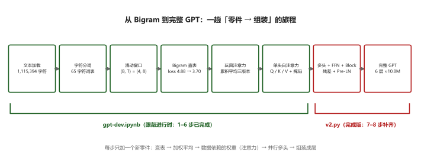
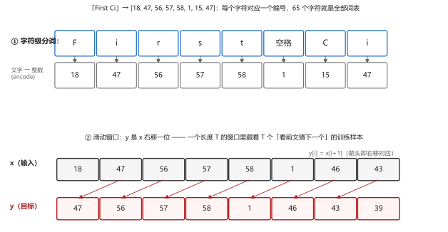
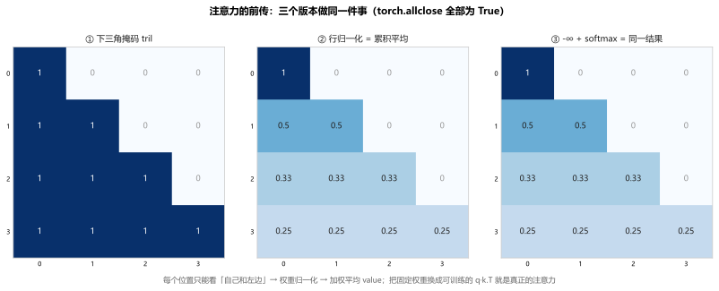
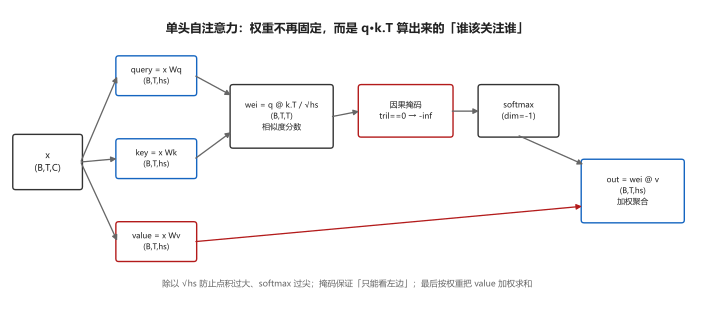
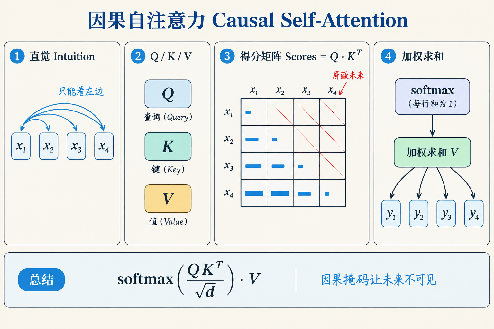
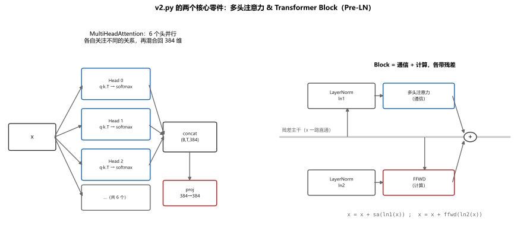
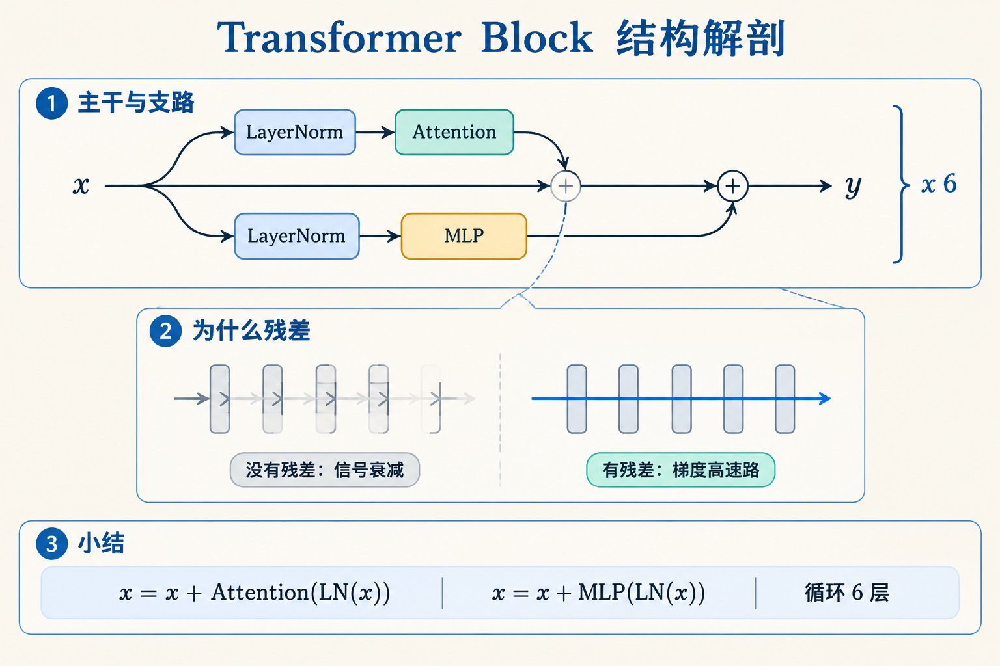
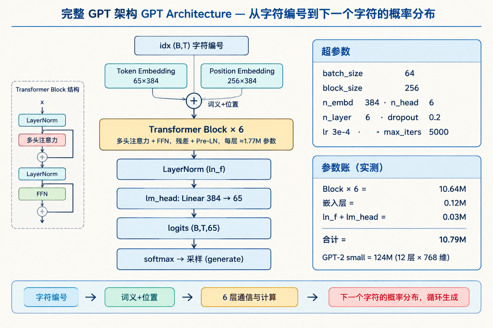

## 前言

前面试过 MLP 和层级 CNN，这次终于轮到 GPT 了。我跟着《Let's build GPT》从 bigram 往上搭：先让一个位置汇总前文，再把固定平均换成随输入变化的权重，自注意力就逐渐有了样子。

练习先做到单头注意力，再接入多头、前馈层与六层 Block。贯穿全文的线索是每个位置能读到什么，以及它要预测哪个字符。

---

## 1. 两份代码的分工

两份代码对应不同的实现阶段：

| | 单头练习 | 六层模型 |
| --- | --- | --- |
| 覆盖范围 | 数据 → 分词 → 滑动窗口 → Bigram → 训练 → 注意力玩具例 → **单头自注意力** | 在上面基础上补齐：缩放注意力、多头、FFN、Block、6 层堆叠、初始化、训练、生成 |
| 代码风格 | 教学式，每步拆开、逐行打印验证 | 工程式，封装成 `Head` / `MultiHeadAttention` / `FeedFoward` / `Block` / `GPTLanguageModel` 五个类 |
| 适合什么时候看 | 复习「每个零件的原理」 | 复习「零件怎么组装、超参怎么配」 |



图 1 绿色是单头练习，红色是六层模型。查表得到每个位置的表示；注意力决定前文的哪些表示会进入当前位置；多头与前馈层把这个计算重复组合起来。

---

## 2. 字符级分词：65 个字符的字典

GPT 不认字，只认数字。分词就是把「文本 ↔ 整数」互相转换的一套字典：

```python
chars = sorted(list(set(text)))                # 65 个字符：换行/标点/大小写字母
stoi = { ch:i for i,ch in enumerate(chars) }   # 字符 → 编号
encode = lambda s: [stoi[c] for c in s]        # "hii there" → [46, 47, 47, ...]
```

- 数据集是 tiny shakespeare，111 万字符全部变成一长串编号，存进 `torch.tensor`；
- 前 90% 做训练集、后 10% 做验证集，**验证集只用于体检过拟合，不参与训练**。

这个「字典」思路和 Day3 的 bigram 一脉相承，区别只是 Day3 面对的是名字数据集、这里是莎士比亚。GPT-2 用的是 5 万词表的 byte-level BPE，粒度不同，本质相同：**文本先变成一串整数，之后的一切都在这串整数上做文章**。



> **图 2**：上半部分——「First Ci」逐字符映射成编号；下半部分——滑动窗口里 `y` 是 `x` 右移一位，红箭头画出「下一个字符」的对应关系。

---

## 3. 滑动窗口：一个窗口里藏着 T 个训练样本

语言模型的训练信号藏在「错位」里。`block_size = 8` 时：

```
x = [18, 47, 56, 57, 58, 1, 46, 43]   ← 输入
y = [47, 56, 57, 58, 1, 46, 43, 39]   ← 目标（右移一位）
```

一个长度为 `T` 的窗口提供 `T` 个预测位置：看到第 1 个字符猜第 2 个，看到前 2 个猜第 3 个。它们共享同一段文本。例如从 `abcd` 取 `x=abc、y=bcd`，位置 `0` 的目标 `b` 已经出现在输入的位置 `1`；如果注意力不挡住未来，模型可以直接抄答案。`get_batch` 随机抽 `B` 个窗口，堆成 `(B,T)`：

```python
x = torch.stack([data[i:i+block_size] for i in ix])        # (B, T) 输入
y = torch.stack([data[i+1:i+block_size+1] for i in ix])    # (B, T) 目标 = 右移一位
```

六层模型仍用同一规则，只把窗口长度从 `8` 加到 `256`。

---

## 4. Bigram 基线：查表也能算语言模型

第一个模型简单到不像神经网络：**一个 65×65 的嵌入表，第 i 行直接就是「当前字符 i 的下一个字符分数」**。没有隐藏层、没有注意力，前向传播只有一句「查表」：

```python
logits = self.token_embedding_table(idx)   # (B,T,65)：查表即预测
loss = F.cross_entropy(logits.view(B*T, C), targets.view(B*T))
```

两个细节：

- 交叉熵要求展平：logits `(B,T,65)` → `(B×T, 65)`，目标 `(B,T)` → `(B×T)`；
- `generate`：只取最后一个位置的 logits → softmax → `torch.multinomial` 按概率采样一个字符 → 拼回序列，循环。

训练五步曲（后面所有模型都是这五步）：

```
取 batch → 前向算 loss → optimizer.zero_grad() → loss.backward() → optimizer.step()
```

AdamW 训 1000 步，loss 从 **4.88 降到 3.70**，生成的文本从纯乱码变成「有字母统计规律的乱码」。这个 4.88 也有讲究：65 类均匀分布的理论值 ln 65 ≈ 4.17，初始值偏高说明初始化还没校准——和 Day8 里「初始 loss 应接近 ln 27」是同一套体检方法。

---

## 5. 注意力前传：三个版本看懂「掩码矩阵」

注意力是本期最难的概念，视频先用一个玩具例子搭直觉：**让每个位置的输出 = 它之前所有位置的平均值**（只看过去，不看未来）。三个版本做同一件事：

1. **双层循环版**：老实巴交地 `mean(x[:t+1])`；
2. **矩阵版**：`tril` 下三角 + 行归一化，一次矩阵乘法完成所有位置的累积平均——**矩阵乘法就是并行版的循环**；
3. **softmax 版**：掩码处填 `-inf` 再 softmax：

```python
wei = torch.zeros((T,T))
wei = wei.masked_fill(tril == 0, float('-inf'))   # 未来位置 → -inf
wei = F.softmax(wei, dim=-1)                       # 每行归一化成权重
```

三个版本的结果用 `torch.allclose` 互相验证，全部为 `True`。这步的关键收获是把注意力的两个核心零件提前准备好：**因果掩码（谁不能看）+ softmax（权重归一化）**——下一步只要把「固定均匀的权重」换成「由数据算出来的权重」，就是真正的注意力。

用三个位置手算。令它们携带的值是 `[2, 4, 90]`，允许读到的位置初始分数都是 `0`。第二行的分数为 `[0,0,-inf]`，softmax 后是 `[1/2,1/2,0]`，输出 `3`。把第三个值从 `90` 改成 `900`，第二个位置的输出仍是 `3`。模型训练时可以同时算三行，每一行依然遵守先后关系。

```python
import torch

mask = torch.ones(3, 3, dtype=torch.bool).tril()
weights = torch.zeros(3, 3).masked_fill(~mask, float("-inf")).softmax(-1)
first = weights @ torch.tensor([2.0, 4.0, 90.0])
changed = weights @ torch.tensor([2.0, 4.0, 900.0])
assert torch.equal(first[:2], changed[:2])
print(first.tolist())  # [2.0, 3.0, 32.0]
```



> **图 3**：三个版本权重矩阵逐格对照。从「下三角 0/1 掩码」到「行归一化」再到「负无穷 + softmax」，数值完全一致——这就是视频里「用笨办法验证聪明办法」的典型套路。

---

## 6. 单头自注意力：Q/K/V 登场

玩具例子的权重是固定且均匀的；真正的自注意力让权重**由数据决定**——由三个线性变换配合完成：

| 角色 | 含义 | 代码 |
| --- | --- | --- |
| query | 当前的查询需求 | `q = query(x)` |
| key | 用于匹配的特征 | `k = key(x)` |
| value | 被加权汇总的信息 | `v = value(x)` |

```python
wei = q @ k.transpose(-2,-1)                     # 相似度分数 (B,T,T)
wei = wei.masked_fill(tril == 0, float('-inf'))  # 因果掩码：未来 → -inf
wei = F.softmax(wei, dim=-1)
out = wei @ v                                     # 按权重聚合 value
```

流程记住一句话就够了：**每个位置用自己的 query 去和所有位置的 key 算相似度，归一化成权重后，把 value 加权求和**。

两个容易忽略的点：

- **缩放**：完整模型把点积除以 `√head_size`。当各维的乘积近似独立、方差相近，头越宽，点积波动越大。除以平方根可以把不同宽度的分数拉回相近的量级，softmax 不易在初始化时过尖；
- **`tril` 是 buffer 不是参数**：`register_buffer` 让它随模型搬运（`.to(device)`）但不参与训练——因果掩码是固定的，不该被学。



> **图 4**：单头自注意力的完整数据流。x 分三路投影出 q/k/v，q·k.T/√hs 得到相似度，掩码挡住未来，softmax 归一化，最后加权聚合 value。



> **图 5**：因果自注意力教学海报（Faro 生成）。四个编号分区：① 直觉——x₄ 的箭头只能指向左边；② Q/K/V 三个角色；③ 得分矩阵——**下三角**蓝条 = 注意力权重（逐行增多），**上三角**红纹 = 屏蔽未来；④ softmax（每行和为 1）归一化后加权求和 V，输出 y₁…y₄；底部小结栏给出完整公式。

---

## 7. 多头注意力：6 个视角并行

单头注意力只有一种「关注方式」，而语言里同时存在多种关系（语法、指代、邻近……）。多头让 6 个 Head 并行：

```python
out = torch.cat([h(x) for h in self.heads], dim=-1)  # (B,T,6×64) 拼接
out = self.dropout(self.proj(out))                    # proj 混合回 384 维
```

- 每个 Head 有自己的 q/k/v（`head_size = 384/6 = 64`），各自学一种关注模式；
- 拼接后仍是 384 维，`proj` 学习如何把各头结果混合成每个输出特征；
- 保持总宽度不变时，六头的 Q 投影共有 `6 × 384 × 64 = 384 × 384` 个权重，K、V 同理。与相同总宽度的单头相比，权重规模相同，但现在有六张分别归一化的注意力表。



> **图 6**：左——6 个 Head 各自算注意力、拼接、proj 混合；右——Block 内两条支路（通信/计算）+ 残差主干的结构。

---

## 8. FFN 与 Transformer Block：通信 + 计算

`v2.py` 的 Block 把两件事拼在一起：

```python
self.sa = MultiHeadAttention(n_head, head_size)   # 通信：token 之间交换信息
self.ffwd = FeedFoward(n_embd)                    # 计算：单 token 内部加工
...
x = x + self.sa(self.ln1(x))      # 通信支路 + 残差
x = x + self.ffwd(self.ln2(x))    # 计算支路 + 残差
```

- **FFWD = 384 → 1536 → ReLU → 384**：先扩宽 4 倍再收回来。每个位置独立走同一组前馈权重；位置之间的信息由注意力交换；
- **残差**：`x + f(LN(x))`。主干道一路直通，支路只负责「增量」，梯度可以沿着 `+` 直接回流——这是深层网络能训起来的关键（和 Day9 手推反向传播时「分支处梯度相加」是同一件事）；
- **Pre-LN**：归一化放在子层**之前**（`ln1(x)` 而不是 `ln(x + ...)`）。对比 Day8 的 BatchNorm：这里用的是 `nn.LayerNorm`，沿特征维归一化、与 batch 无关，推理时也不需要 running 统计；notebook 最后一个 cell 对照了这一差别。



> **图 7**：Transformer Block 教学海报（Faro 生成）。① 主干与支路——残差主干 x → y 直通，LayerNorm→Attention 与 LayerNorm→MLP 两条支路**依次**汇入两个 ⊕（对应 `x = x + sa(ln1(x))`、`x = x + ffwd(ln2(x))` 的先后顺序），右侧「×6」表示堆叠六层；② 放大标注对比「没有残差：信号衰减」与「有残差：梯度高速路」；③ 底部小结给出两行公式。

---

## 9. 组装完整 GPT：零件清单

`GPTLanguageModel` 把零件按顺序装好：

| 顺序 | 组件 | 作用 | 形状/参数 |
| --- | --- | --- | --- |
| 1 | Token Embedding | 字符 → 向量 | (65, 384) |
| 2 | Position Embedding | 位置 → 向量（与①相加） | (256, 384) |
| 3 | Block × 6 | 多层通信 + 计算 | 每层 ≈1.77M |
| 4 | LayerNorm（ln_f） | 末层归一化 | — |
| 5 | lm_head | 384 → 65，输出每个字符的分数 | (65, 384) |

这份代码的参数合计 **10,788,929（约 10.79M）**。例如一层 Block 的四组投影权重占 `4 × 384²`，前馈的两组权重占 `8 × 384²`；还要计入偏置与两组 LayerNorm。它与 GPT-2 同属只用因果注意力的解码器模型，训练数据、词表与实现细节不同。线性层与嵌入层的权重以标准差 `0.02` 初始化，线性层偏置置零；LayerNorm 保持自己的初始化。



> **图 8**：完整 GPT 架构示意（Faro gpt-image-2.5 生成）。中部是数据流：字符编号 → 词义+位置 → Block ×6 → 末层归一化 → lm_head → logits → 采样；左侧展开 Block，右侧列出超参数与参数量，合计 10.79M。

---

## 10. 训练与生成：两个工程细节

**训练**：每 500 步从训练集、验证集各抽 200 个批次取平均。`model.eval()` 关掉 dropout；`torch.no_grad()` 省去求导所需的图，并不负责切换 dropout；评估完再用 `model.train()` 回到训练模式。

**生成**：

```python
idx_cond = idx[:, -block_size:]        # 只保留最近 256 个 token（上下文上限）
logits, _ = model(idx_cond)
logits = logits[:, -1, :]              # 只看最后一个位置
probs = logits.softmax(dim=-1)
idx_next = torch.multinomial(probs, num_samples=1)   # 按概率采样
idx = torch.cat((idx, idx_next), dim=1)
```

`idx` 保存已生成的全部编号，模型这一轮只读末尾窗口。若最后一行给 `a` 的概率是 `0.6`、给 `b` 的概率是 `0.4`，取最大总会选 `a`，按概率抽仍有四成机会选 `b`。保存的生成样本有 `The top in a world by susphoring grace.`，能看到训练语料的句式，也能看到模型把字母组合成了不存在的词。

---

## 附 · 资料下载

本篇配套两份代码与一键复跑的配图脚本：

- [gpt-dev.ipynb](/assets/attach/day11/gpt-dev.ipynb)（跟敲过程版，30 个单元全量可执行）
- [v2.py](/assets/attach/day11/v2.py)（完整版 GPT，含中文注释）
- [make_figures.py](/assets/attach/day11/make_figures.py)（一键复跑全部技术示意图，需 matplotlib）

> 说明：notebook 与 v2.py 都需与 `input.txt`（tiny shakespeare 语料）放在同一目录运行；配图脚本需安装 matplotlib。
