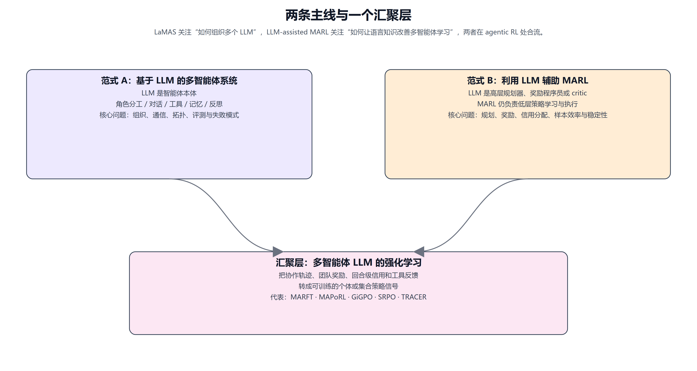
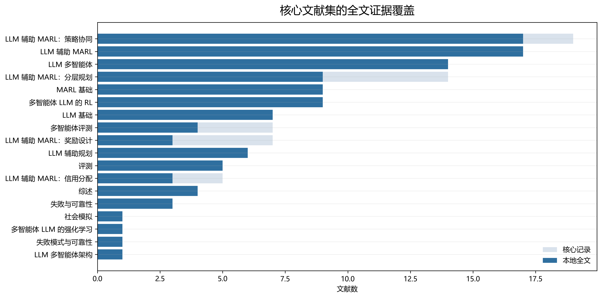
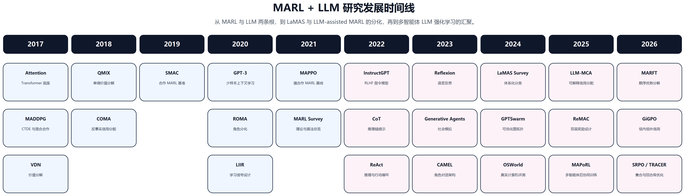
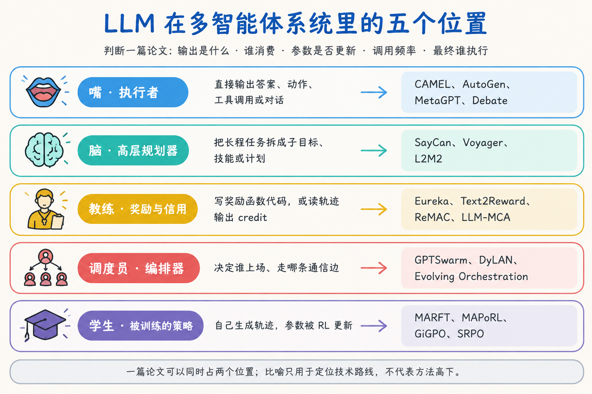
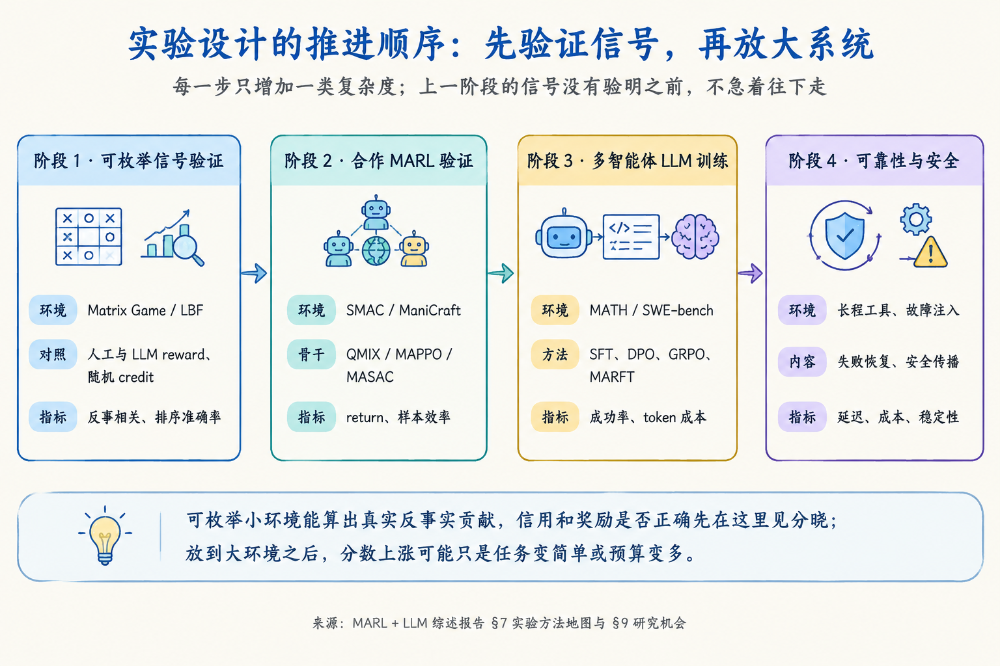

> 从基础术语和 PPO 出发，理解语言智能体、多智能体强化学习，以及奖励与信用分配之间的关系。

## 前言：三篇论文读完了，地图还没拼起来

既然原本的课题结束了，那就正好投身于新的一轮研究吧。

之前把导师给的三篇论文看了一下，发现自己对很多东西都不了解：无论是技术细节，还是对强化学习这个领域目前的研究进展。

于是启动codex神力，让它帮我搜集论文总结该领域的研究。多库检索、开放全文下载、逐页文本抽取、发展树与时间线，最后落到一份中文综述和一份「LLM 角色说明」。本地归档 150 篇全文、130 条核心文献、75 个关键节点——codex牛逼！

---

## 0. 先理解术语

设想两个机器人共同搬运箱子。它们需要观察周围、决定移动方向，在合作失败后调整行为。把机器人换成「分析需求的语言智能体」和「编写代码的语言智能体」，决策形式变了，但仍然有观察、行动、反馈和协作的问题。

### 0.1 LLM、agent、RL 和 MARL 分别是什么

**LLM（大语言模型）**根据输入上下文预测并生成后续 token。token 是模型处理的文本单位，可能是字、词的一部分或标点，不等同于一个汉字。模型能生成回答、计划和工具调用文本，但完成任务还需要外部程序执行工具、传回结果、维护上下文。

**Agent（智能体）**是持续接收信息、作出决策并影响环境的主体。一个语言智能体通常由 LLM、上下文或记忆、工具接口和控制循环组成。例如，模型提出运行测试，程序执行测试，再把报错送回模型继续修改代码。单次生成一段文字与这种闭环交互的区别，在于是否持续根据环境反馈行动。

**RL（强化学习）**利用行动后获得的奖励调整策略，使长期回报更高。**MARL（多智能体强化学习）**研究多个决策主体相互影响时的学习，既包括合作，也包括竞争和混合关系。多 agent 系统可以完全不训练参数；有多个角色对话，也不自动意味着使用了 MARL。

同一个基础模型可以支撑多个 agent：只要各主体维护自己的上下文或决策过程，并通过消息、工具或共享环境相互影响，就可以构成多智能体系统。是否共享模型权重与是否存在多个智能体，是两个问题。至于开五个会话是否比单个智能体有效，需要另做预算相当的实验。

例如，同一个开源 Qwen 检查点开两个会话：A 得到通道宽度，B 得到箱子尺寸。A 把宽度告诉 B，B 才能选择路线。如果分工全写在提示词里，改变的是每个会话能看到的内容，Qwen 权重保持不变。把两人的消息与选择记录下来，由任务是否成功给分，再用这些经历更新 Qwen 的 LoRA，才进入「训练语言策略」这条路。还可以把 Qwen 改成训练教练，由它读记录、给反馈，实际行动交给熟悉的 MAPPO Actor。此时更新的是小策略，不是 Qwen。这三个方案可以用同一任务比较，区别在输出交给谁、奖励最后更新了谁。

### 0.2 状态、观测、动作与策略

在搬箱子例子中，**状态 state** 可以包括所有机器人的位置、箱子重量和障碍物分布；**观测 observation** 是某个机器人实际能看到的部分，例如局部摄像头画面。**动作 action** 是它能执行的选择，例如向前移动或抓取。状态描述环境，观测描述主体拿到的信息，二者在部分可观测任务中并不相同。

**策略 policy** 是根据已有信息选择动作的规则，常写作：

$$
\pi_\theta(a\mid o).
$$

这里的 $\theta$ 是模型参数，$\pi_\theta(a\mid o)$ 是看到观测 $o$ 后选择动作 $a$ 的概率。策略可以是神经网络，也可以是规则。部分可观测任务通常还需要历史信息 $h_t$，实际使用的是 $\pi_\theta(a_t\mid h_t)$，而不仅是当前画面。

对于 LLM，输入信息可以是任务、对话历史和工具返回值，动作可以按 token、整段回复或一次工具调用定义。读公式时必须先确认动作粒度：一个 token 的概率和一整段回复的概率不是同一个量。

**训练 training** 更新参数；**推理 inference** 使用当前参数产生输出。增加提示词、保存反思记录、扩充上下文，可以改变后续行为，但这些操作本身不等于梯度训练。后文的「被训练对象」指实际接受参数更新的模型或模块。

### 0.3 奖励与回报：眼前得分和长期收益

**奖励 reward** 是某一步得到的反馈，记为 $r_t$。例如搬运成功得到 10 分，每次碰撞扣 1 分。**回报 return** 把之后的奖励累计起来：

$$
G_t=\sum_{k=0}^{T-t-1}\gamma^k r_{t+k},
$$

其中 $T$ 是任务结束时刻，$\gamma$ 是折扣因子。取 $\gamma=0.9$，未来依次得到 0、0、10 分，那么当前回报为 $0+0.9\times0+0.9^2\times10=8.1$。这是一条实际轨迹的回报；对可能的后续轨迹求平均，才得到期望回报。

只有任务结束才给分，称为**稀疏奖励**；每步根据接近目标等进展给分，称为**稠密奖励**。稠密信号更容易指导学习，也可能诱导钻空子：机器人反复靠近目标刷分，却始终不完成搬运。这类优化代理分数、偏离真实任务的行为称为 **reward hacking（奖励投机）**。

团队得到一个总分之后，还要回答「哪个主体的哪次行动促成了结果」。这就是 **credit assignment（信用分配）**。这里的信用指贡献归属，不是可信度评分。

### 0.4 一段交互到底有多长

| 术语 | 含义 | 代码智能体例子 |
|---|---|---|
| trajectory，轨迹 | 按时间排列的观测、动作、奖励等记录，可以是完整任务也可以是片段 | 查看代码、编辑、运行测试及各步反馈 |
| rollout，采样交互 | 用某个策略与环境交互来收集轨迹的过程，也常指收集到的片段或批次 | 用当前模型实际跑一批修复任务 |
| episode，完整任务回合 | 从任务初始化到结束的一次完整交互 | 从接到 issue 到通过测试、失败或超时 |
| turn，对话轮次 | 协议定义的一次发言或交互轮，具体边界依论文而定 | 分析者发言，或一次模型与工具往返 |
| token，生成单位 | 模型逐步生成的最小文本单位 | 一次发言内部的许多个生成步骤 |

一个 episode 往往包含多个 turn，每个 turn 又包含多个 token。一次 rollout 可以在 episode 结束前截断，也可以收集多个 episode。因此，「回合级奖励」必须说明指完整任务还是对话轮次，不能把这些粒度混用。

---

## 1. 领域地图：两条主线与一个汇聚层

> 范式 A 把 LLM 作为智能体的决策核心；范式 B 用 LLM 辅助传统 MARL 的规划与学习信号。汇聚层关注多个语言智能体的强化学习。来源：综述工作区的两范式示意。图中 GiGPO 应理解为相关的多轮 agent 训练方法，不能直接列作多智能体训练证据。

### 1.1 主线一：怎样组织多个语言智能体

基于 LLM 的多智能体系统常简称 **LaMAS**。典型系统让不同主体负责规划、检索、编码或检查，再通过消息交换结果。这里的主要问题是角色怎样分工、消息传给谁、什么时候结束，以及最终结果怎样验证。

例如，分析者拆解需求，编码者完成实现，检查者运行测试。LLM 直接输出影响任务的行动，而多个主体之间的依赖由程序组织。CAMEL、AutoGen、MetaGPT、ChatDev 的原始系统主要属于这条路线，角色编排并不要求重新训练基础模型。

### 1.2 主线二：怎样用语言知识辅助 MARL

**LLM-assisted MARL** 让语言模型提供高层计划、奖励程序、贡献评价或策略建议，再由低层策略学习和执行。搬箱子时，LLM 可以提出「先共同抓取，再同步移动」，而具体速度和转向由控制策略决定。

这里最重要的区分是：LLM 输出建议，并不意味着 LLM 参数正在被训练。ReMAC 生成奖励程序，LLM-MCA 生成贡献反馈，接受强化学习更新的主要是低层策略。

### 1.3 汇聚层：直接训练协作中的语言策略

当语言智能体根据协作轨迹和任务奖励更新参数，研究对象就进入多个 LLM 策略的联合或协调优化。MAPoRL、MARFT、SRPO 分别探索协作训练、顺序优势分解和集合级优化。

**组织多个 LLM、训练多个 LLM、用 LLM 辅助 MARL，是并行且可组合的技术路径，不是依次替代的三代历史。** 一个系统可以同时用固定提示词安排角色、用奖励模型打分，再用强化学习更新部分角色的参数。

这些路径都可能遇到信用分配问题，但各自还受制于任务表示、探索、观测不足、通信和计算成本。团队最终得分无法自动说明每个成员的贡献，只是其中一项共同困难。

### 1.4 综述覆盖了什么

本笔记所依据的综述版本日期为 2026-09-22，记录了 177 条检索候选、150 篇归档全文、130 条核心文献和 75 个关键节点。这些数字描述本地资料集，核心文献和归档全文是不同口径。

> 深色表示本地已有全文，浅色表示核心记录的覆盖范围。来源：综述工作区的全文覆盖统计。条目分类存在相近名称，阅读时宜把它作为资料分布，而非严格互斥的领域分类。

能下载多少全文，受检索词、分类和开放获取情况影响。判断某项结论是否可靠，需要看具体实验、对照设置和独立复现；不能由某个分支的本地文件较多，就推断该方向的科学证据更强。

---

## PPO 与多智能体训练：从动作概率到团队评分

两台搬运机器人一起选路线。一次配合成功后，先算每台机器人原来有多大概率选这条路，再看它的动作比预期好多少。从这两项数值出发，看 PPO 怎么更新策略，以及加入队友后评分有哪些变化。

[阅读全文](/2026/09/22/marl-llm-survey-two-mainlines/ppo-and-marl/)

<ul>
<li id="2-ppo怎样从一次尝试更新策略"><a href="/2026/09/22/marl-llm-survey-two-mainlines/ppo-and-marl/#2-ppo怎样从一次尝试更新策略">2. PPO：怎样从一次尝试更新策略</a></li>
<li id="21-actor-负责行动critic-估计前景"><a href="/2026/09/22/marl-llm-survey-two-mainlines/ppo-and-marl/#21-actor-负责行动critic-估计前景">2.1 Actor 负责行动，critic 估计前景</a></li>
<li id="22-策略梯度好动作多做一点差动作少做一点"><a href="/2026/09/22/marl-llm-survey-two-mainlines/ppo-and-marl/#22-策略梯度好动作多做一点差动作少做一点">2.2 策略梯度：好动作多做一点，差动作少做一点</a></li>
<li id="23-新旧概率比比较同一个状态下的同一个动作"><a href="/2026/09/22/marl-llm-survey-two-mainlines/ppo-and-marl/#23-新旧概率比比较同一个状态下的同一个动作">2.3 新旧概率比：比较同一个状态下的同一个动作</a></li>
<li id="24-clip-和-min-到底限制了什么"><a href="/2026/09/22/marl-llm-survey-two-mainlines/ppo-and-marl/#24-clip-和-min-到底限制了什么">2.4 Clip 和 min 到底限制了什么</a></li>
<li id="25-优势怎样估计一批数据怎样使用"><a href="/2026/09/22/marl-llm-survey-two-mainlines/ppo-and-marl/#25-优势怎样估计一批数据怎样使用">2.5 优势怎样估计，一批数据怎样使用</a></li>
<li id="26-sftdporlhfgrpo-与-ppo-的关系"><a href="/2026/09/22/marl-llm-survey-two-mainlines/ppo-and-marl/#26-sftdporlhfgrpo-与-ppo-的关系">2.6 SFT、DPO、RLHF、GRPO 与 PPO 的关系</a></li>
<li id="3-多个主体一起学比单个主体多了什么"><a href="/2026/09/22/marl-llm-survey-two-mainlines/ppo-and-marl/#3-多个主体一起学比单个主体多了什么">3. 多个主体一起学，比单个主体多了什么</a></li>
<li id="31-非平稳性与-ctde"><a href="/2026/09/22/marl-llm-survey-two-mainlines/ppo-and-marl/#31-非平稳性与-ctde">3.1 非平稳性与 CTDE</a></li>
<li id="32-mappo把-ppo-放进合作任务"><a href="/2026/09/22/marl-llm-survey-two-mainlines/ppo-and-marl/#32-mappo把-ppo-放进合作任务">3.2 MAPPO：把 PPO 放进合作任务</a></li>
<li id="33-vdn-与-qmix把团队价值分解成局部效用"><a href="/2026/09/22/marl-llm-survey-two-mainlines/ppo-and-marl/#33-vdn-与-qmix把团队价值分解成局部效用">3.3 VDN 与 QMIX：把团队价值分解成局部效用</a></li>
<li id="34-信用分配与反事实基线"><a href="/2026/09/22/marl-llm-survey-two-mainlines/ppo-and-marl/#34-信用分配与反事实基线">3.4 信用分配与反事实基线</a></li>
</ul>

## 4. 发展脉络：传统 MARL 与语言智能体怎样相遇

> 时间线串联了 MARL 基础、语言模型基础与后续交叉工作，来源为综述工作区。它混合了预印本与发表年份，不能把所有列项都看成 MARL 方法；GiGPO 的相关预印本工作见 2025 年，图中的 2026 年位置不宜作为首次提出年份。LIIR 与另一篇激励学习论文的名称、作者和年份也不能混用。

### 4.1 传统 MARL 与语言模型的基础

2017—2021 年的 MARL 工作集中解决联合决策与训练困难。MADDPG 把集中式 critic 与分散 actor 用于连续动作及合作—竞争任务；VDN、QMIX 研究价值分解，COMA 研究反事实基线，MAPPO 展示 PPO 式方法在合作任务中的表现。SMAC 提供基于星际争霸微操的合作评测，ROMA 则探索通过学习形成角色分工。

内在奖励学习也是相关分支。LIIR 通常指 *Learning Individual Intrinsic Reward in Multi-Agent Reinforcement Learning*；*Learning to Incentivize Other Learning Agents* 是另一项学习如何激励其他主体的工作。两者不因都涉及「奖励学习」就共用缩写、作者或年份。

语言模型一侧，Transformer 提供序列建模架构，GPT-3 展示少样本上下文学习。到 2022 年，InstructGPT 使用人类反馈训练指令模型；CoT（思维链提示）让模型生成中间推理步骤；ReAct 把推理、行动和环境反馈交替组织。上下文学习指通过输入示例改变当前输出，不要求当场更新模型参数。

### 4.2 2022—2023 年：规划、反思与角色协作

SayCan 用语言模型评价技能与任务的相关性，再结合技能的可执行性得分选择行动；Inner Monologue 把执行反馈送回规划循环。Code as Policies、ProgPrompt 让语言计划落实为程序或控制接口；Voyager 在 Minecraft 中积累可复用技能。

这些规划与具身控制工作解释了「语言怎样影响行动」，主要作为相关先行路线。Eureka、Text2Reward 说明 LLM 可以生成奖励程序；Reflexion 则把失败反馈写成文字记忆，供后续尝试使用。它们各自的原始设置不能直接充当多智能体强化学习实验的证据。

同期，CAMEL、AutoGen、MetaGPT、ChatDev 展开角色对话与软件工程协作；Generative Agents 用多个带记忆和计划的主体模拟社会互动；Multiagent Debate、ChatEval 分别将多方讨论用于答题和评价；RoCo 研究多机器人语言协作与重规划。多机器人合作是否还包含学习，需要继续看低层策略和训练流程。

### 4.3 2024 年以后：组织结构与训练信号进入优化对象

LaMAS 综述开始按智能体、通信、能力与评测组织文献。GPTSwarm 把系统表示为图，DyLAN 动态选择参与者，MACNET 研究更大协作网络，Optima 用生成、排序、选择与训练改善通信效率。ProAgent 与 Hypothetical Minds 研究伙伴建模：根据队友的行为推测其目标、知识或策略，再调整自己的行动。

到 2025—2026 年，MAPoRL、MARFT、SRPO 等工作更直接地优化协作中的语言策略；LLM-MCA、ReMAC 继续探索语言模型怎样改善传统 MARL 的反馈。GiGPO、RAGEN、AgentGym-RL 则提供相关的多轮 agent 训练思路。**多轮描述时间长度，多智能体描述决策主体数量；两者需要分别判断。**

---

## 5. 主线一：基于 LLM 的多智能体系统

### 5.1 角色、流程与可执行的分工

| 工作 | 主要做法 | 解决的具体问题 |
|---|---|---|
| CAMEL | 角色扮演与对话协议 | 让不同角色按约定交换任务信息 |
| AutoGen | 可编程对话与工具调用 | 把模型、工具和控制流程接起来 |
| MetaGPT | SOP，即标准作业流程，与角色流水线 | 规定需求、设计、实现等阶段的交付关系 |
| ChatDev | 多角色软件开发工作流 | 用角色协作组织软件生成 |
| AgentVerse | 成员调整与协作组织 | 根据任务调整参与者 |
| MACNET | 规模化协作网络 | 研究团队规模与连接方式的影响 |
| MoRSE | 角色—子任务专家分工，按综述所列前沿工作理解 | 研究更细的专业化分配 |

角色名本身不会产生专业能力。分工有效，需要每个角色获得相应信息、可执行工具与明确输出接口。例如「检查者」若只能读编码者的自述，不能运行测试，就很难独立验证代码。

### 5.2 辩论与反思能提供什么

Multiagent Debate 让多个主体先提出答案，再相互质疑；ChatEval 把这种讨论用于评价文本。有效的分歧可以暴露遗漏条件，重复同一错误则只会增加成本。多轮讨论达成一致，也不等于答案已经正确，仍需要测试、事实核验或任务判定。

Reflexion 的文字反思机制可以被多智能体系统借用，但原方法不应仅因有执行与反思模块就归入 MARL。判断 agent 数量，需要看交互主体和决策边界，而不是数提示词模板。

相同基础模型的多个主体可以构成协作系统。独立上下文、不同工具权限和可验证的中间结果，可能带来信息互补；收益大小仍应与预算相当的单智能体、多次采样或自检方案比较。

### 5.3 拓扑、路由与动态编排

**拓扑 topology** 指谁能向谁发送信息。链式流程按顺序传递，全连接让各方互相交流，**DAG（有向无环图）**用没有循环的依赖关系组织任务。动态编排则根据当前进展选择参与者和下一条通信边。

GPTSwarm、DyLAN、Optima 关注结构或通信优化；Evolving Orchestration 用中心编排器调度；综述中的 E2-Explainer 研究通信子图的解释；AgentNet 为主体配置 router（路由器，决定任务或消息发给谁）与 executor（执行器，完成分配到的工作）。

通信会占用输入输出 token，增加等待时间，也可能传播错误。稀疏连接能降低开销，但可能切断必要信息；动态拓扑是否更好，要比较任务质量、调度费用与总延迟，而不是只数通信边。

### 5.4 应用、评测与失败分析

Generative Agents 和 AgentSociety 用于社会模拟；ChatDev、MapCoder 用于代码生成；Agent Laboratory 涉及科研辅助；综述列出的 PhySciBench 以专家题评价物理研究任务。社会模拟与开放研究尤其需要明确评价标准，专家判断、现实数据对照和自动验证各自覆盖不同问题。

| 评测或分析工具 | 主要测量对象 |
|---|---|
| AgentBench、GAIA | 多环境任务、工具与综合推理能力 |
| WebArena、OSWorld | 网页、桌面的长程操作 |
| SWE-bench | 真实软件仓库中的问题修复 |
| τ-bench | 业务规则约束下的工具—用户交互 |
| MultiAgentBench | 多主体协作、竞争与通信 |
| SOTOPIA | 社会互动与社交目标 |
| MAST、ToMAS | 多智能体失败分类与心理理论相关诊断 |

其中不少基准最初用于一般 agent 评测；在上面运行多个主体，并不能单凭最终分数证明协作机制有效。

MAST 将所研究系统的失败整理为规格与系统设计、主体间协调、任务验证与终止等类别。它提示评测应记录完整过程：信息是否传到、约束是否被遵守、任务是否被错误宣布完成。没有相应样本与统计数据时，不能把这种分类推广为「多数多智能体失败都由组织问题造成」。ToMAS 在综述中被列为利用失败轨迹诊断心理理论能力的后续工作；心理理论在这里指推测其他主体的知识、信念与意图。

---

## 6. 主线二：LLM 怎样辅助 MARL

### 6.1 先定位 LLM 的输出与使用者

| LLM 的位置 | 输出由谁使用 | 相关例子与范围 |
|---|---|---|
| 高层规划器 | 低层控制器或技能库 | SayCan 是先行规划方法；L2M2 连接高层规划与 MARL |
| 奖励设计器 | RL/MARL 训练程序 | Eureka、Text2Reward 是奖励生成先行工作；ReMAC 面向多智能体双层奖励 |
| 信用分配器 | 各主体的学习模块 | LLM-MCA 读取联合轨迹并生成个体反馈 |
| 策略指导模块 | 采样器或低层策略 | LAMARL、LLM-Mediated Guidance 用先验或建议影响学习 |

> 配图按执行、规划、反馈、编排与参数训练区分角色，依据《LLM角色说明》制作。SayCan、Eureka、GiGPO 等例子展示可借鉴的机制，不能因列在这张多智能体示意中就认定原方法属于 MARL；GiGPO 主要讨论多轮 LLM agent 的训练。

阅读方法时，可以依次确认五件事：LLM 输出什么，谁使用输出，更新哪些参数，多久调用一次，以及部署时最终由谁行动。这比仅凭论文标题中的「agent」或「RL」分类更明确。

### 6.2 高层规划与低层控制

高层规划决定「先抓住箱子再移动」，低层控制决定「这一刻施加多大的力」。**技能 skill** 是可重复调用的一段行为，例如抓取、导航或运行测试；**行为原语**则是更基础的可执行操作。

SayCan 的 affordance 得分表达某项技能在当前条件下能否成功；Inner Monologue 通过实际反馈修正计划；Voyager 用技能库减少重复构造动作；RoCo 结合多机器人对话与运动规划；L2M2 在综述中对应高层语言规划与低层 MARL 的连接。共同的接口问题是：语言提出的子目标能否被执行器实现，以及失败后是否有可靠反馈。

### 6.3 奖励设计、PBRS 与经验回放

奖励设计定义「怎样才算做得好」，**奖励塑造 reward shaping** 则在原任务奖励之外增加学习信号。例如只在箱子搬到目标时给分很稀疏，于是额外奖励有效进展。增加的信号如果写错，可能把最优行为改成刷分行为。

经典的 **PBRS（基于势函数的奖励塑造）**采用：

$$
r'_t=r_t+\gamma\Phi(s_{t+1})-\Phi(s_t),
$$

其中固定势函数 $\Phi(s)$ 可以表示状态的进展程度，并使用与原回报相同的折扣因子。新增奖励在折扣累计后逐项抵消：

$$
\sum_{t=0}^{T-1}\gamma^t
\bigl(\gamma\Phi(s_{t+1})-\Phi(s_t)\bigr)
=-\Phi(s_0)+\gamma^T\Phi(s_T).
$$

如果初始状态固定，且终止边界处理使最后一项为零或不依赖所选策略，塑造回报与原回报只差一个不影响策略排序的量。例如有限回合任务可令终止势为零；无限折扣情形常要求势函数有界，使远端项消失。不能忽略不同终止状态或不同结束时间留下的边界项。

这些是固定势函数形式的基本条件。动态势函数需要说明时间索引、更新规则与相应边界条件，再检查是否仍能得到不变性；不能断言任何动态势函数都必然破坏最优策略。多智能体系统还要说明塑造的是团队奖励还是个人奖励，以及奖励变化如何影响博弈目标。

**经验回放池 replay buffer** 存储历史状态转移，供 off-policy 算法重复训练。若 LLM 不断改写奖励，而旧样本保留旧得分，同一类行为可能同时带有不同版本的标签。价值网络就可能拟合一个含义混杂的目标。可比较固定奖励、周期更新、版本化存储、按当前奖励重标注等方案，而不是把「奖励会变」直接等同于算法不能工作。

Eureka、Text2Reward 提供自动奖励生成的思路；ReMAC 同时设计个体与团队奖励，并搜索多个奖励—策略候选组合，即种群。LLM-ALSO 与综述中的 Regime-Conditional Stabilisation 关注迭代奖励和训练稳定性。评价这类方法时，要记录奖励尺度、版本与更新频率，并检验最终原任务指标，而不只看塑造后的训练回报。

### 6.4 LLM critic 与其他细粒度信用方法

LLM-MCA 让集中式语言模型读取联合轨迹，生成逐主体的 credit 和文字解释。这里的 **LLM critic** 是贡献评估模块；它不必等同于 PPO 中通过回归训练的数值价值网络。名字都叫 critic，输入、输出和训练目标仍可能不同。

解释通顺、团队回报提高、贡献估计符合某项反事实定义，是三种不同的证据。要检验最后一种，需要在确定的替代动作或移除规则下重新评估，再比较信用排序和贡献变化。

与此相邻的工作包括：

- **GiGPO** 为多轮 LLM agent 构造细粒度优势：用完整轨迹的相对表现提供整体信号，再对共享锚点状态的步骤分组比较。critic-free 指不另训练独立价值网络，不是没有奖励评价。它解决的是长轨迹中的时间信用问题，不能仅因有多个采样组就认定为多智能体信用分配。
- **TRACER** 在综述中以控制器与生成器两层处理协作。控制器决定发言还是跳过，遗憾匹配根据「若换一个选择可能多得多少收益」调整选择；生成层优化提议和审查内容。具体的回合边界与奖励定义决定其信用含义。
- **MASkills** 以可复用技能为单位组织持续优化，关注某项技能对后续任务的作用。
- **Divide and Cooperate** 把搜索与生成等角色分开，研究不同角色间怎样传递学习信号。

这些方法的共同比较轴是信用分到哪里：主体、时间步、对话轮次、技能，还是一组共同生效的输出。不同粒度对应不同问题，不构成天然优劣顺序。

### 6.5 从辅助信号到语言策略训练

MAPoRL 直接优化多个语言智能体的协作。MARFT 用 Flex-MG 形式表示异构、异步和动态组织的交互；异构指主体能力或模型不同，异步指它们不必同时行动。其顺序优势分解把联合改进与按顺序加入的主体决策联系起来，再更新相应策略。

SRPO 的优化单位是**活跃集**：一次状态转移实际使用的那组主体输出。它把成员的对数概率比组合并按集合大小归一化，再构造集合级比值、相对优势与裁剪目标。理解它与 PPO 的关系，首先要辨认「一个动作」已从单个输出变成共同生效的集合；不能把逐成员裁剪与整组裁剪视为同一操作。

RAGEN、AgentGym-RL 研究相关的长程、多轮交互训练问题，其是否属于多智能体学习仍取决于具体任务设置。LAMARL 则用 LLM 生成先验策略与奖励，辅助低层 MARL。**先验**指开始探索前已有的结构或建议，**样本效率**指达到同等效果需要多少环境交互；语言指导减少交互步数的同时，也可能增加模型调用费用。

---

## 7. 前沿工作可以沿哪些问题比较

2025—2026 年的相关研究同时改变优化粒度、优化对象和评测方式。按问题对齐，比把所有新名字放进同一条技术演进链更容易比较。

| 问题 | 代表工作 | 需要对照的内容 |
|---|---|---|
| 协作怎样进入参数训练 | MAPoRL、MARFT | 更新哪些主体，联合优势怎样分解，异构角色是否稳定 |
| 长轨迹怎样获得细粒度反馈 | GiGPO，以及相关多轮训练工作 | 时间信用与主体信用的区别，状态分组能否可靠构造 |
| 共同生效的输出怎样优化 | SRPO | 集合大小、归一化、裁剪粒度与估计方差 |
| 发言、角色与技能怎样获得反馈 | TRACER、MASkills | 跳过决策、角色搭便车、技能冲突与长期任务迁移 |
| 语言生成的奖励与信用是否有效 | ReMAC、LLM-MCA | 原任务回报、信用干预验证、部分观测与团队规模 |
| 奖励迭代如何保持训练稳定 | LLM-ALSO、Regime-Conditional | 奖励版本、回放重标注、势函数条件与尺度 |
| 失败和不安全动作如何传播 | MAST、ToMAS、Unsafe Actions Propagation | 失败分类、故障传播路径、恢复与防护成本 |

角色搭便车指某成员依赖队友完成任务，却仍共享团队收益；安全传播指一个主体受到错误信息或恶意输入影响后，通过通信使其他主体也采取不安全行动。两者都需要过程记录，最终成功率无法单独区分原因。

上述前沿条目的定位主要依据随文综述，其中部分为预印本或审稿稿。跨论文比较时，模型规模、任务难度、外部工具和采样预算必须一并考虑，方法名称的新旧不能代替效果证据。

---

## 8. 实验方法地图：怎样分辨改进来自哪里

### 8.1 环境选择与可枚举条件

| 环境或任务 | 适合观察的问题 | 使用条件 |
|---|---|---|
| 小型 Matrix Game（矩阵博弈） | 联合动作、合作收益和明确定义的贡献 | 动作组合有限，收益表已知 |
| Spaceworld、LBF、RWARE 的受控小配置 | 导航、合作采集、仓储协作和干预测试 | 需检查状态、动作、时域与模拟器重置能力 |
| SMAC、ManiCraft、Multi-Agent MuJoCo | 战术、任务或连续控制协作 | 固定环境版本、观测条件与交互预算 |
| ALFRED、RoboSuite、RoCo 任务 | 语言计划到具身执行 | 区分规划错误和控制失败 |
| MATH、CMATH、GSM8K、CodeForces、SWE-bench | 数学推理、竞赛代码与仓库修复 | 规定验证器、工具权限与采样次数 |
| WebArena、τ-bench、OSWorld、GAIA | 长程工具、网页、桌面与综合任务 | 记录环境变化、交互成本和成功判定 |
| SOTOPIA、AgentSociety、PhySciBench | 社会互动、模拟与研究任务 | 说明专家评估或现实数据对照标准 |

LBF 是合作采集环境，RWARE 是多机器人仓储环境。名称本身不保证「可枚举」：地图规模、主体数量和任务长度一增加，联合状态与轨迹数量就可能迅速增长。能够重置并运行替代动作，也不等于能穷举所有可能轨迹。

小配置的价值在于控制变量。若转移规则已知，可以精确计算定义好的反事实量；若主要依靠模拟器，则可用多次反事实 rollout 估计期望差异，并报告采样误差。环境、基准动作和干预规则应随结果一起给出。

### 8.2 训练协议与低层骨干

**Backbone（骨干）**在这里指承担主要策略或价值学习的基础算法。比较 LLM 辅助方法时，固定骨干有助于分离新增信号的作用。

| 协议 | 主要更新对象 | 需要控制的变量 |
|---|---|---|
| Prompt-only | 不做梯度参数更新 | 提示词、角色、工具、通信与调用预算 |
| SFT | 语言策略参数 | 示范质量、数量、角色覆盖和训练步数 |
| DPO | 语言策略参数 | 偏好对来源、参考模型、数据分布 |
| PPO / GRPO 等 RL | 采样策略或部分可训练参数 | 奖励、优势、rollout 数量、更新轮数与 KL |
| QMIX / MAPPO / MASAC 等 MARL 骨干 | 局部价值、actor、critic 或混合网络 | 观测范围、团队奖励、经验回放与动作空间 |
| LLM-as-signal | 主要是消费语言反馈的低层模型 | LLM 输出定义、调用频率、解析失败与信号版本 |

**DDQN（Double DQN）**是离散动作的价值学习方法，用在线网络选择下一动作，再用目标网络评价该动作，减轻同一个噪声估计既挑选又评价时产生的高估。它常使用经验回放与延迟更新的目标网络。

**MASAC** 通常指多智能体 Soft Actor-Critic 类方法。SAC 在追求回报之外加入策略熵，鼓励保留探索；多智能体版本常结合集中式 critic 与分散 actor，并使用 off-policy 经验回放。具体实现对动作空间、critic 输入与参数共享的选择不同，不能仅凭缩写判断细节。

**LoRA（低秩适配）**则不是强化学习算法。它冻结基础权重 $W$，只训练较小的低秩增量，如 $\Delta W=BA$，有效权重变为 $W+\Delta W$。PPO、SFT 或其他目标都可以用来更新这些增量。各角色共享基础模型但使用独立 LoRA，意味着共享语言能力底座，同时保留可分别训练的角色参数。

### 8.3 指标与基线必须回答同一个问题

| 指标类别 | 可读的衡量方式 |
|---|---|
| 任务表现 | 成功率、每个完整任务的累计回报、达到同等回报所需的环境步数 |
| 学习信号 | 与明确定义的贡献参考之间的排序相关、错误归因率、奖励投机发生率 |
| 协作作用 | 移除主体后的变化、角色替换效果、通信中断后的恢复、同预算单主体对照 |
| 成本 | 输入输出 token、每任务调用次数、GPU/CPU 小时、实际经过的墙钟时间 |
| 可靠性 | 多个随机种子的波动、失败恢复率、安全约束违反率 |

排序相关衡量「谁更重要」的顺序是否一致，不证明贡献数值准确，更不单独证明因果解释正确。**消融 ablation** 指去掉或替换一个组件，观察结果变化；若同时改变预算、模型大小和角色数，就很难把变化归因于该组件。

基线宜覆盖无 LLM 的同骨干策略、人工奖励、随机或打乱的 credit、固定与动态拓扑、一次性与迭代信号，以及预算相当的单主体方案。错误奖励或打乱信用可用于受控诊断，测试应限定在安全的实验环境内。

比较多智能体和单智能体时，可以为单主体提供相当的总采样、工具与 token 预算。否则团队更高的成功率可能主要来自更多计算，而非分工本身。零样本迁移指在新任务上不提供该任务示范，少样本迁移则允许少量示范；两者都需要说明是否继续更新参数。

### 8.4 分层验证模板

> 配图依据综述的实验模板制作。图中文字中的「真实反事实贡献」应按本文解释为指定干预与基准下的贡献参考；LBF 也只有经过规模与时域限制后，才适合作为可穷举候选环境。

模板包含四类验证：在受控小任务中检验奖励与信用信号；在合作 MARL 中观察策略改进；在语言智能体任务中比较训练粒度；最后测试故障、成本与安全。它们是逐步增加实验复杂度的选择，不是必须依次完成的个人日程。

跨层迁移时，应保留原任务奖励、对照方法与预算口径。例如在小任务中信用排序更准确，迁移后却没有减少环境交互，就需要区分信号是否失真、低层算法是否无法利用，以及额外调用成本是否抵消收益。

---

## 9. 五个可检验的问题

### 9.1 贡献解释是否经得起干预

固定任务和策略，明确替代动作、成员移除或联盟形成规则，再比较 LLM credit 与反事实回报变化。LOO 和 Shapley 应分别报告，不能把两者统称为同一份贡献真值。随机或打乱信用可以检验算法是否真正依赖信用内容。

### 9.2 奖励更新会怎样改变学习目标

比较固定、周期更新与更频繁更新的奖励，记录回放池中的版本分布，再对照重标注或版本隔离。评价既包括训练波动，也包括原任务表现。若使用 PBRS，需要明确势函数和终止处理，而不只展示一个形式相似的奖励公式。

### 9.3 动态通信的收益是否超过费用

在相同模型、任务与总预算下比较固定链、静态 DAG、动态拓扑与随机连接。除了成功率，还要计入编排器本身消耗的 token、延迟和失败恢复成本。动态连接减少消息数，却增加昂贵路由调用时，总费用仍可能上升。

### 9.4 协作是否依赖特定成员与信息条件

对某个已验证的两主体设置，可以增加到三至五个主体，再改变局部观测、模型规模或通信预算。成员移除、角色替换与消息中断能检验系统是否真的使用了分工。这是扩展某项实验的检验方式，不能据此概括整个领域都只研究两主体或全局观测。

### 9.5 预算相当时，结论还成立吗

环境步数、梯度更新步数、rollout token、外部模型调用和奖励候选搜索，都属于训练费用；部署延迟、显存与工具调用属于使用费用。可以报告单位 token 或单位 GPU 小时的表现，同时给出原始质量与成本，避免一个比值掩盖任务质量的大幅下降。

---

## 10. 回到 Day12：三篇论文在地图上的位置

| 论文 | 所属路线 | LLM 的角色 | 主要被训练对象 |
|---|---|---|---|
| MARFT | 多智能体语言策略训练的汇聚层 | 直接行动、接受反馈的策略 | 各角色的可训练参数，如 LoRA |
| LLM-MCA | LLM 辅助 MARL 的信用分配 | 读取联合轨迹、输出贡献反馈的集中式评估器 | Double DQN 策略所用的价值网络 |
| ReMAC | LLM 辅助 MARL 的奖励设计 | 奖励程序生成与反思 | MASAC 类低层策略及价值网络 |

ReMAC 改变用于学习的奖励规则；LLM-MCA 提供个体贡献反馈；MARFT 更新协作中的语言策略参数。它们都利用任务反馈，但反馈进入训练的位置不同，也就对应不同的验证问题。

三篇论文的公式与具体实验记录见 [Day12 笔记](/2026/09/18/multi-agent-learning-marft-mca-remac/)。定位方法时，先确认输出、使用者、参数更新、调用频率与最终执行者，再追踪优势、奖励或信用如何进入损失函数。

---

## 附 · 资料下载

- [MARL + LLM 研究发展综述（图文质检版 3，PDF）](/assets/attach/day13/MARL_LLM_综述报告_图文质检版3.pdf)
