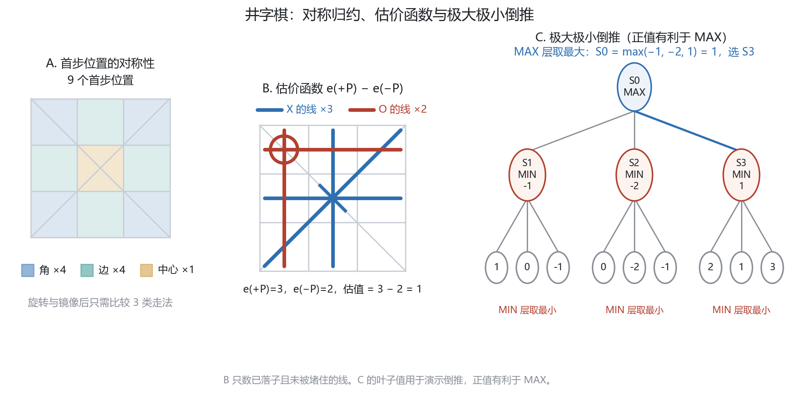
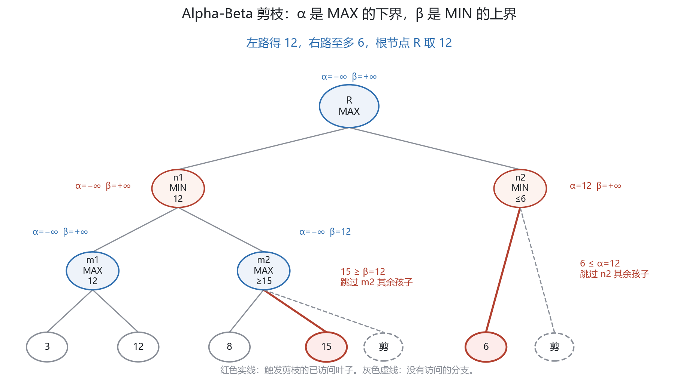
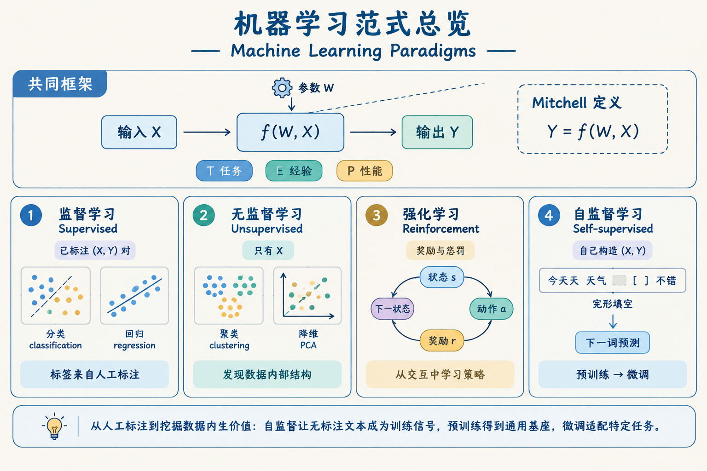
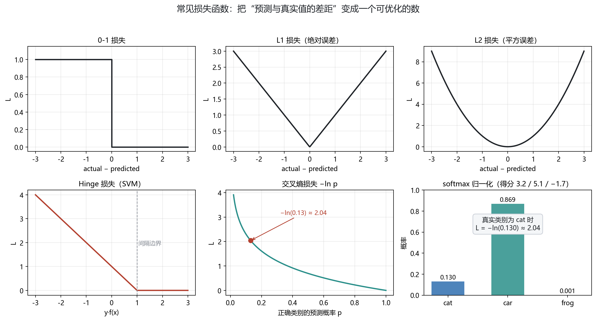
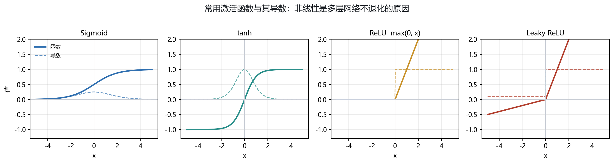

> RedMoon · 2026-09-29 · 课堂笔记

上节课讲到博弈搜索。井字棋要替对手算一步：如果对方总挑对自己最有利的走法，我该下哪一格？这节课先用极大极小法把这个问题算一遍，再看 Alpha-Beta 怎样少算几个分支。后半节换到机器学习，以监督学习为例：给定输入 $X$ 和正确答案 $Y$，让模型从这些例子里学出参数 $W$。

## 一、规则式方法与学习式方法

| 维度 | 规则式方法 | 学习式方法 |
| --- | --- | --- |
| 代表 | Minimax、Alpha-Beta、A*、汉诺塔的任务分解 | 线性回归、SVM、神经网络、大模型 |
| 知识来源 | 人根据经验定义的规则与估价函数 | 数据或交互经验；监督学习使用 $(X,Y)$ 对 |
| 可调整的部分 | 改写规则、更换启发函数 | 优化参数 $W$ |
| 效果怎么衡量 | 逻辑推演是否正确 | 损失函数是否下降、测试集表现 |
| 主要风险 | 规则覆盖不到的情形 | 分布变化、过拟合、标注成本 |

课堂说手写估价规则“很难讲它是 learning based 的方法，因为它是根据人的经验提炼出来的”。例如井字棋的线路计数由人写定，换一批对局也不会自动改变。搜索仍可以使用学出来的估价函数；此时训练负责学会评分，搜索负责用评分挑走法。

## 二、井字棋：估价函数与极大极小倒推

### 1. 估价函数怎么定

搜索截在某一层时，叶子可能还没分出胜负。估价函数给这种局面打一个静态分，供上层倒推。图 1 的井字棋示例数的是**已有己方棋子、还没有被对方堵住的线路**，再把两方的线路数相减。

空棋盘共有 8 条线：3 行、3 列、2 条对角线。设 $e(+P)$ 为 MAX 按上述规则数出的线路数，$e(-P)$ 为 MIN 的对应数目，则

$$
\text{估值}=e(+P)-e(-P).
$$

估值为正有利于 MAX，为负有利于 MIN。以“X 占中心、O 占左上角”为例：X 还剩中间行、中列、右上—左下那条对角线 3 条；O 还剩上行、左列 2 条，它所在的左上—右下对角线已被 X 占住。于是一件很局部的事被压成一个数 $3-2=1$。

图里没有给全空的线计分。另一种口径是数所有没被对方堵住的线，包括全空的线：在这个棋面上 X 有 5 条，O 有 4 条，差仍是 1。课堂说“从八条变成六条”，用的是把全空线也计入的口径。两种计数都在评估线路，还要向下搜索才能确认具体走法。

### 2. 对称性把 9 个首步压成 3 类

$3\times 3$ 棋盘的第一步有 9 个位置，但棋盘在旋转与镜像下等价：4 个角同类，4 个边同类，中心单独一类。真正需要比较的只有 3 种走法，搜索树的第一层从 9 个分支降到 3 个。

课堂由同学讲完整棵树：根节点 $S_0$ 由 MAX（叉）走，下设 $S_1$、$S_2$、$S_3$ 三个 MIN（圈）节点。倒推规则是 MAX 层取子节点最大值，MIN 层取子节点最小值，一路回传到根：

$$
S_1=-1,\qquad S_2=-2,\qquad S_3=1,\qquad S_0=\max\{-1,-2,1\}=1.
$$

MAX 选 $S_3$：即使对手在这条支路上选最不利于 MAX 的应对，MAX 仍能拿到 1。井字棋可以搜到终局；棋盘扩大后，程序通常限制搜索深度，优先看更有希望的走法。



### 3. 复杂度的量级差别

同一个“先生成博弈树、再算每个节点倒推值”的思路，代价随棋盘急剧上升：

| 棋盘 | 可用线路数 | 能否穷举 |
| --- | --- | --- |
| $3\times 3$ 井字棋 | 8 条 | 可以，加上对称归约后很小 |
| 五子棋 | 随连子路径快速增长 | 可重点搜威胁和应对，实战搜索与枚举所有对局不同 |
| $19\times 19$ 围棋 | 每一步的合法落点已极多 | 现有算力无法穷尽 |

课堂同时提醒，AlphaGo 那批论文里也用到了这类非常简单的规则，只是另外叠加了更多加速搜索的技巧。搜索部分到此结束，后续结合 AlphaGo 系列与 Nature 上的新论文再看蒙特卡洛树搜索、策略网络与价值网络。

## 三、Alpha-Beta：把不影响选择的分支砍掉

### 1. α 与 β

剪枝不是在生成完整树之后做，而是**边生成博弈树边计算倒推值**，一旦发现某分支已无必要就停止扩展。为此维护两个界：

- $\alpha$：当前搜索上下文中，MAX 已经能够保证的下界；
- $\beta$：当前搜索上下文中，MIN 已经能够保证的上界。

### 2. 剪枝条件

当前窗口闭合（$\alpha\ge\beta$）时，可以跳过当前节点还没访问的孩子。触发剪枝的那个孩子已经算过：

- **MAX 节点 $N$**：见到一个值 $\ge\beta$，$N$ 的最大值至少这么高。上层 MIN 已有值 $\le\beta$ 的备选，可以跳过 $N$ 的其余孩子。
- **MIN 节点 $N$**：见到一个值 $\le\alpha$，$N$ 的最小值至多这么高。上层 MAX 已有值 $\ge\alpha$ 的备选，可以跳过 $N$ 的其余孩子。

下面这棵自拟的小树把两种剪枝都走一遍。根 $R$ 为 MAX，$n_1$、$n_2$ 为 MIN，$n_1$ 下挂 $m_1$、$m_2$ 两个 MAX 节点。

- $m_1$ 的叶子为 3、12，得 $m_1=12$，于是 $n_1$ 的上界 $\beta(n_1)=12$。
- $m_2$ 带着 $\beta=12$ 进去，先看 8，再看 15。看到 15 就知道 $m_2\ge15$，后面的孩子不必看：$n_1$ 取两路中较小的，已有 $m_1=12$，一定选 12。根的 $\alpha$ 因此更新为 12。
- $n_2$ 带着 $\alpha=12$ 进去，第一个叶子是 6。MIN 取最小，$n_2$ 最多是 6，余下的孩子就可以跳过。根是 MAX，在左边的 12 和右边至多 6 之间选 12。



下面用 `21` 和 `2` 填上图中两处没访问的叶子，便于对照完整搜索。`visited` 按顺序记录实际读到的叶子。把 `prune` 设为 `False` 就会看完所有叶子；设为 `True` 时，窗口一闭合就跳过剩余孩子。

```python
from math import inf

tree = (((3, 12), (8, 15, 21)), (6, 2))


def search(tree, prune):
    visited = []

    def walk(node, maximizing, alpha, beta):
        if isinstance(node, int):
            visited.append(node)
            return node

        best = -inf if maximizing else inf
        for child in node:
            score = walk(child, not maximizing, alpha, beta)
            if maximizing:
                best = max(best, score)
                alpha = max(alpha, best)
            else:
                best = min(best, score)
                beta = min(beta, best)
            if prune and alpha >= beta:
                break
        return best

    return walk(tree, True, -inf, inf), visited


print(search(tree, prune=False))  # (12, [3, 12, 8, 15, 21, 6, 2])
print(search(tree, prune=True))   # (12, [3, 12, 8, 15, 6])
```

完整搜索知道 $m_2=21$、$n_2=2$。剪枝版本在当时只确定 $m_2\ge 15$、$n_2\le 6$，这些信息已经足够算出根值 12。

### 3. 走法顺序决定收益

剪掉多少取决于子节点的生成顺序：

- MAX 节点若**估值最高**的子节点最先生成，剪枝最多；
- MIN 节点若**估值最低**的子节点最先生成，剪枝最多。

这种顺序称为最优 $\alpha$-$\beta$ 剪枝。对于分支因子 $b$、深度 $d$ 的近似均匀树，理想情况下复杂度可从 $O(b^d)$ 降到约 $O(b^{d/2})$，相当于有效搜索深度加倍；最坏情形仍是 $O(b^d)$。“平方根级别”是特定理想口径下的结论，不是每棵树都有的固定收益。

### 4. 返回值可能是界值

图 2 中 $m_2$ 已经读到了 15，后面没读到的叶子可能更大。所以缓存结果时，应把 15 标成下界；若实现按搜索窗口回传 12，也应把 12 标成下界。下一次换个窗口搜到同一局面时，程序才能区分“已知至少这么大”和“已经算出确切值”。同一棵树上，Alpha-Beta 保留 Minimax 的根值；多个走法并列最优时，先搜哪条会影响最终选中的走法。

### 5. 课堂走的更深的例子

课堂上另走了一个更深的例子，剪枝的触发方式与上面一致：从 $S_0$ 出发按深度优先先搜左支；左支第一个孩子已由叶子 4 得到下界 4，而它的另一个孩子是 MIN 节点且已经出现 1，于是那一支被剪掉；左支第二个孩子出现 5 并已达到 $\beta=4$，同样被剪掉；于是左支回传 4 成为 $\alpha(S_0)$。右支的子树被判定不超过 0，小于 $\alpha=4$，整支剪掉，根取左支的值。

课堂用模型轻量化作类比。Alpha-Beta 省的是对局搜索，判定依据是上下界；模型剪枝删减权重、通道等结构，通常要重新测精度。单把几个权重置零，稠密张量的形状并不会变，得有相应的稀疏存储或算子才会省资源。[DeepSeek-V3 的 MoE](https://arxiv.org/html/2412.19437v2#S2.SS1.SSS2) 又是另一种做法：路由器按当前词元的表示挑选部分前馈专家，其他路由专家在这一步不计算；下一词元仍可以选到它们。

## 四、机器学习的定义：T、E、P 与 $Y=f(W,X)$

课件引用 Tom Mitchell 在《Machine Learning》（1997）中的定义：

> A computer program is said to learn from experience E with respect to some class of tasks T and performance measure P, if its performance at tasks in T, as measured by P, improves with experience E.

翻译过来：一个程序如果能从经验 $E$ 中学习，并在任务类 $T$ 上以性能度量 $P$ 衡量时表现随 $E$ 改善，就称它学习了。课堂把这个定义拆成四个可指认的部分：

| 符号 | 含义 | 具体例子 |
| --- | --- | --- |
| $T$ | 要做的任务 | 识别表情、翻译句子 |
| $E$ | 学习用的经验 | 监督学习中的图片及标签，或强化学习中的交互记录 |
| $P$ | 用来衡量任务做得怎样 | 测试集准确率；训练时也可优化能提供梯度的损失函数 |
| $W$ | 待学参数 | 训练阶段调节，推理阶段固定 |

于是学习被写成一个拟合问题：

$$
Y=f(W,X).
$$

以表情分类为例，训练时根据图片与标签调 $W$。测试时模型只看到留出的图片，评估程序用对应标签计算准确率；部署时往往只有新图片，模型照样能推理，只是现场未必有标签可当场评分。



## 五、监督学习

### 1. 分类与回归

给定输入输出对，学习从输入到输出的函数。按输出形式分成两类：

| 任务 | 输出 | 课堂与课件例子 |
| --- | --- | --- |
| 分类 classification | 离散类别 | 是否下雨（二分类）、数字 0–9（多类）、两万名学生的人脸识别（两万类） |
| 回归 regression | 连续值 | 房价预测、快递到达时间预测 |

课件中“是否下雨”的例子把湿度与气压作为两维输入，最后一列是标签；模型要找的是能把两类点分开的界面。Hypothesis（假设）指我们相信或希望与真实函数相近的那个候选函数，训练就是从训练集中实例化一个假设 $h$，测试时对新样本 $x$ 输出 $h(x)$。

### 2. 从最近邻到线性分类器

- **最近邻分类**：给定输入，选离它最近的那个数据点的类别。
- **$k$ 近邻分类**：选离它最近的 $k$ 个点中占多数的类别。课堂的说法是“物以类聚，人以群分”——不了解一个学生，就看他周围几个学生的类别，用投票定类。
- **线性分类器**：在输入空间里找一个超平面。以湿度、气压为例，

$$
h(x_1,x_2)=\begin{cases}
\text{Rain}, & w_0+w_1x_1+w_2x_2\ge 0,\\
\text{No Rain}, & \text{otherwise}.
\end{cases}
$$

把权重组记成 $W=(w_0,w_1,w_2)$，输入组记成 $X=(1,x_1,x_2)$，判断就写成内积 $W\cdot X$。把偏置 $b$ 并进权向量、同时在输入里补一个常数 1 的技巧称为 bias trick，于是 $f(x,W)=Wx+b$ 与 $f(x,W)=Wx$ 可以统一书写。

### 3. 感知机：用误差更新权重

课件给出的学习规则是

$$
w_i\leftarrow w_i+\alpha\,(y-h_w(x))\,x_i,
$$

这里取 $y,h_w(x)\in\{0,1\}$；$\alpha$ 是学习率，$y$ 是实际类别，$h_w(x)$ 是阈值判断后的预测。比如 $x=(2,-1)$ 的真实类别为 1，当前权重是 $(0,0)$、偏置是 $-1$，所以模型先给出 0。取 $\alpha=0.1$，两项权重分别加 $0.2$ 和 $-0.1$；将偏置视作常数输入 1 的权重，它也加 $0.1$。同一个样本的新分数是 $0.2\times2+(-0.1)\times(-1)-0.9=-0.4$。分数已经向正确方向移动，一次小步更新尚未越过 0。

感知机、逻辑回归、线性 SVM 都能从加权分数开始，训练规则各不相同。感知机在分错时按上式修正；逻辑回归用概率损失，SVM 用间隔约束。

### 4. SVM：最大间隔

在线性可分的情况下，支持向量机找**最大间隔分离器**：先量分界线到最近训练点的距离，再选能把这个距离拉得最远的线。离边界最近的这些点决定分界线的位置。核方法可以在变换后的特征空间里寻找分界面。

### 5. 线性分类器的一般形式

把输入看成向量、权重组看成矩阵，就是深度学习里最常见的写法：

$$
f(x,W)=Wx+b.
$$

课件以 CIFAR-10 为例：一张 $32\times 32$ 的彩色图是 $32\times 32\times 3=3072$ 个数（每个数在 0–255 之间，0 黑 255 白），分成 10 类，则输入为 $3072\times 1$，输出为 10 个类别得分，参数量为 $10\times 3072$ 再加 10 个偏置。同一个形式往下推就是多类 SVM 损失与 Softmax 分类器。

### 6. 过拟合与正则化

假设在训练集上表现很好、在新数据上变差，就是过拟合。正则化的做法是惩罚复杂假设、偏向简单假设：

$$
\operatorname{cost}(h)=\operatorname{loss}(h)+\lambda\cdot\operatorname{complexity}(h),
$$

其中 $\lambda$ 是正则化强度，属于超参数。课件列举的常见手段有权重衰减式的 L2、L1、L1 与 L2 结合的 Elastic Net，以及 Dropout、Batch Normalization、Stochastic depth、fractional pooling 等。

### 7. 监督学习的两个现实困难

一是需要标注数据，标注本身有成本；二是它依赖一个关键假设——训练样本与测试（未来）样本同分布。课件明确指出，真实应用中这个假设经常被违反，这是该领域的常见挑战之一。

## 六、损失函数：把差距变成可优化的数

损失函数衡量一组参数 $W$ 有多好：依据是它产生的分数与训练数据中真实标签的一致程度。损失高表示做得差，低表示做得好。常见形式如下，横轴统一取“实际值 − 预测值”（hinge 取 $y\cdot f(x)$）：

| 损失 | 形式 | 特点 |
| --- | --- | --- |
| 0-1 损失 | 预测正确取 0，否则取 1 | 不可微，难以直接优化 |
| L1 损失 | $L=\lvert \text{actual}-\text{predicted}\rvert$ | 对离群点不如 L2 敏感 |
| L2 损失 | $L=(\text{actual}-\text{predicted})^2$ | 课堂说明：假设误差服从高斯分布 |
| Hinge 损失 | $L=\max(0,\,1-y\,f(x))$，此处 $y\in\{-1,+1\}$ | 二分类 SVM 的常见写法；分错或分对但间隔不足时有损失 |
| 交叉熵损失 | $L=-\ln P_W(y_i\mid x_i)$ | 分类任务主流，与 Softmax 配合 |

Softmax 先把得分转成概率：

$$
P_W(c\mid x_i)=\frac{e^{s_c}}{\sum_j e^{s_j}}.
$$

概率必须非负且总和为 1。以得分 3.2、5.1、−1.7 三类为例，归一化后约为 0.130、0.869、0.001；若真实类别是第一类，则 $L_i=-\ln(0.130)\approx 2.04$。课件该页写作 $-\log(0.13)=0.89$，与自然对数不符，此处按常用定义取自然对数。



## 七、无监督、强化与自监督

### 1. 无监督学习

只给输入 $X$、不给任何额外反馈，从数据内部找规律。两种典型任务：

- **聚类**：把对象分组，使相似的对象倾向于落在同一组。$k$-means 反复做两件事——把点指派到簇、更新簇中心。应用包括基因研究、图像分割、市场研究、社交网络分析。
- **降维**：课件以 PCA 为例，做特征分解后取最大特征值对应的特征向量保留，其余扔掉，数据维度随之降低。

课堂借 PCA 和聚类谈研究热点的转移。课件给这两类方法安排了两项实际用途：先看数据里有什么分组或主要变化，再把得到的低维表示交给下游模型。

课件还区分了两个容易混的概念：

- **自监督学习**：依靠只用无标注数据就能构造的代理任务（pretext task）来学习的一般框架；
- **半监督学习**：同时使用有标注与无标注样本的一类算法，通常假设两类样本来自相同或相近分布。

### 2. 强化学习

给定奖励或惩罚，学习未来该采取什么动作。课件的模型是马尔可夫决策过程，由四部分构成：

| 组成 | 含义 |
| --- | --- |
| 状态集 $S$ | 环境可能处于的情形 |
| 动作集 $\mathrm{Actions}(s)$ | 状态 $s$ 下可执行的动作 |
| 转移模型 $P(s'\mid s,a)$ | 执行动作后到达下一状态的概率 |
| 奖励函数 $R(s,a,s')$ | 该步获得的回报 |

Q-learning 估计在状态 $s$ 先执行 $a$、之后按最优策略走时的折扣回报。可以把表初始化为 0，每次交互后用实际奖励 $r$ 和下一状态的估值更新：

$$
Q(s,a)\leftarrow Q(s,a)+\alpha\bigl(r+\gamma\max_{a'}Q(s',a')-Q(s,a)\bigr).
$$

$\alpha$ 决定这次更新往目标靠多少，$\gamma$ 决定下一步的价值打几折；到达真正终点时，目标就是 $r$。行动时可以用 $\varepsilon$ 的概率随机试一下，其余时候选当前估计最好的动作。状态-动作对太多时，可以训练一个函数近似 $Q$，不用为每一对存一个格子。

### 3. 自监督学习：大模型时代的主流范式

只给 $X$、不给 $Y$，就自己从数据里构造 $(X,Y)$ 对。课堂举了几种构造方式：把一句话做**完形填空**；用新闻的正文作 $X$、标题作 $Y$；图片与其描述文字配对；甚至用“左耳朵当 $X$、右耳朵当 $Y$”这类自身部件互为输入输出的做法，类似左右手自我博弈。

用语言模型举例：从“明天可能下雨”里截出“明天可能下”，余下的内容就能当训练目标。同一份文本可以自动构造很多这样的样本，拿来预训练基座模型。要让基座更稳定地按指定格式回答，还可以用指令及范例回答做监督微调。

从监督到自监督的变化，本质上是标注的来源从人变成了数据本身。

## 八、课件延伸：神经网络与深度网络

这部分取自随堂的三份课件，接着看单个神经元怎样组合成卷积网络和序列模型。

### 1. 单个神经元

人工神经网络是对生物神经网络的简化模拟。生物神经元由树突接受传入信息，经细胞体整合后沿轴突传到末梢，通过突触把信号交给下一个神经元。人工模型里，每个输入相当于树突接受的外部刺激，连接权重相当于带权轴突，输出相当于轴突末梢传递的信息；网络分为输入层、输出层与若干隐层。

一个神经元做两件事：对前一层各输入加权求和，再经激活函数判断是否“兴奋”输出。课件同时提醒，加权求和部分与激活判断部分的命名在不同教材中不一致（transfer function / activation function / output function 混用），阅读时以具体公式为准。

### 2. 激活函数与非线性

| 激活函数 | 形式与范围 | 主要问题 |
| --- | --- | --- |
| Sigmoid | $\sigma(x)=1/(1+e^{-x})$，输出在 $(0,1)$ | 输入绝对值大时导数接近 0 |
| Tanh | $\tanh(x)=2\sigma(2x)-1$，输出在 $(-1,1)$ | 正负输入对称时输出居中；两端也会饱和 |
| ReLU | $f(x)=\max(0,x)$ | 正区不饱和、计算高效，课件称实践中收敛可比 sigmoid/tanh 快约 6 倍；输出非零中心 |
| Leaky ReLU | 负区给小斜率 | 不饱和、不会“死” |
| ELU | 负区指数饱和 | 兼有 ReLU 好处，输出更接近零均值，对噪声更稳健 |
| Maxout | 取若干线性组合的最大值 | 推广 ReLU 与 Leaky ReLU，但参数量翻倍 |

没有激活函数引入的非线性时，一个神经元等价于线性分类器，多层网络等价于单层网络。这是多层结构必须配非线性的直接原因。



### 3. 全连接前馈网络与训练

相邻两层之间两两全连接，同一层内不设连接。训练分三步：前向计算得到输出与损失；把误差沿计算图反向传播，用链式法则求每个参数的梯度；按梯度反方向更新参数。

计算图里几种门的梯度模式值得单独记：加法门是“梯度分配器”，把上游梯度原样分给各支路；乘法门是“梯度切换器”，把上游梯度乘以另一侧的取值；最大值门是“梯度路由器”，只把梯度送给取得最大值的支路。反向传播在向量与矩阵情形下要注意维度：直接推导误差信号、避免显式构造巨大的局部导数，保持索引约定一致，并用维度分析自查。

### 4. 表达能力：宽度与深度

权重变了，神经网络表示的函数也会变。选用合适的非线性激活、把隐层加到足够宽，一层隐层就能在给定的紧区间（或紧集）上把连续函数逼近到任意精度。这说的是表达能力。Eldan 与 Shamir 在 [COLT 2016](https://proceedings.mlr.press/v49/eldan16.html) 给出了一类函数，较深的网络能高效表示，较浅的网络要达到同样的逼近效果，宽度却要随维度呈指数增长。

课件还提到特征可视化：卷积网络从低层边缘、中层部件到高层任务相关表示的层次，各层联合训练，逐层从上一层输出中提取特征。

### 5. 卷积网络与后续架构

卷积层用卷积核在输入上滑动，需要四个超参数：卷积核个数 $K$、核尺寸 $F$、步幅 $S$、零填充 $P$。输入 $W_1\times H_1\times C$ 经卷积得到 $W_2\times H_2\times K$，其中

$$
W_2=\left\lfloor\frac{W_1-F+2P}{S}\right\rfloor+1,\qquad
H_2=\left\lfloor\frac{H_1-F+2P}{S}\right\rfloor+1,
$$

上式按不带膨胀的普通卷积计数，向下取整表示放不下一个完整卷积核的尾部不再走一步。每个输出通道有一个跨全部 $C$ 个输入通道的核；因此权重数是 $F^2CK$，若使用偏置，再加 $K$ 个。$1\times1$ 卷积只混合当前位置的通道，相当于在每个位置用同一个全连接层。最大池化与平均池化按通道分别处理，没有可学习参数，通道数保持不变。

架构演进的主线：

| 网络 | 年份 | 关键点 |
| --- | --- | --- |
| LeNet | 1998 | 卷积块加平均池化，$5\times5$ 核、$2\times2$ 窗、步幅 2 |
| AlexNet | 2012 | 将卷积网络用于 ImageNet 大规模分类；使用 ReLU、Dropout 和数据增强 |
| VGG | 2014 | 重复使用 $3\times3$ 卷积（pad 1）加 $2\times2$ 最大池化构成 VGG 块 |
| NiN | 2013 | 用 $1\times1$ 卷积与全局平均池化替代全连接层，缓解最后一层的参量负担 |
| GoogLeNet | 2014 | Inception 块四条支路并行，沿通道拼接；5 个阶段 9 个 Inception 块 |
| ResNet | 2015 | 残差连接，使极深网络可训练 |

AlexNet 和 VGG 展示了更大或更深的卷积网络在各自实验中的收益。GoogLeNet 用并行分支控制计算量，ResNet 用残差连接帮助训练更深的网络。面向移动端时，还要用延迟、内存和准确率一起选架构。

### 6. 序列模型

RNN 每收到一个新输入，就用它和上一步的隐状态一起计算当前状态。训练时沿这条时间链求导，叫作时间反向传播（BPTT）。梯度爆炸可以用梯度裁剪控制；LSTM 用加法更新与门控给旧记忆留出一条更直接的路径。遗忘门每步若保留旧记忆的 90%，十步后的直接保留比例仍只有 $0.9^{10}\approx0.35$。门越接近 1，旧记忆在这条路径上保留得越久。GRU 用较少的门实现类似的保留与更新。

### 7. 框架

课件最后留了一张深度学习框架的对比页，本次未展开。

## 九、课程安排

课堂开头用了一段时间讲小组分享的安排，转写中可确认的部分如下：建议每组 4–5 人，总组数控制在 20 组以内，系统登记约 15 组；第三周确定分组与选题并填入系统表格，两组选题重复的需要分开；每组准备约半节课时间，讲一篇最新论文。可选方向包括搜索算法进阶（AlphaGo 系列）、强化学习、Transformer 架构与智能体应用。授课教师同时提到，跨学科背景同样能做出成果，学校已有中文、体育、化学、物理等方向的模型尝试。
