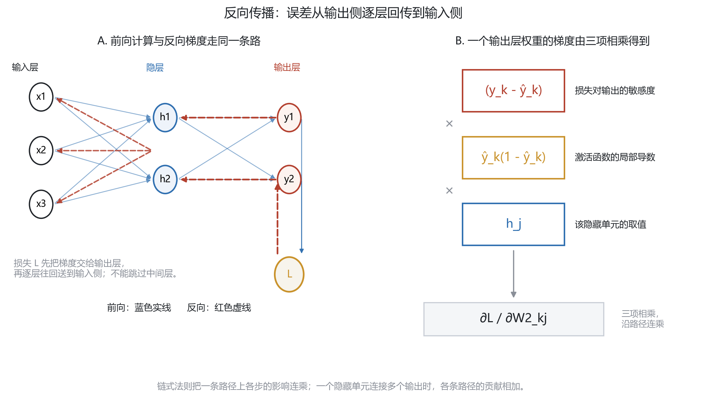
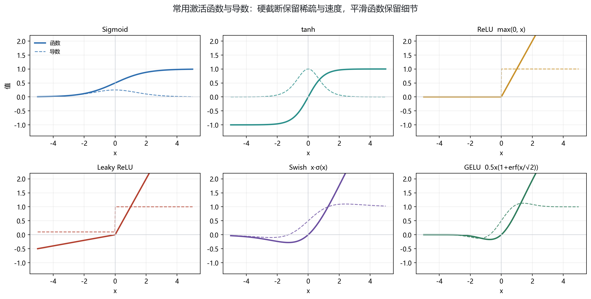
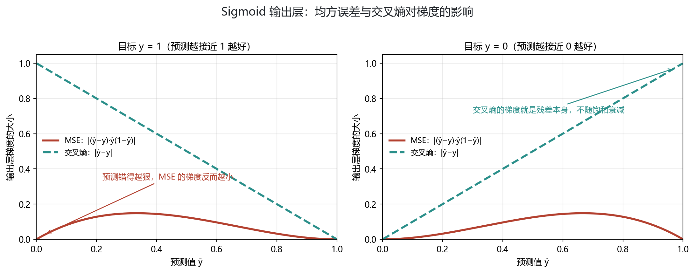
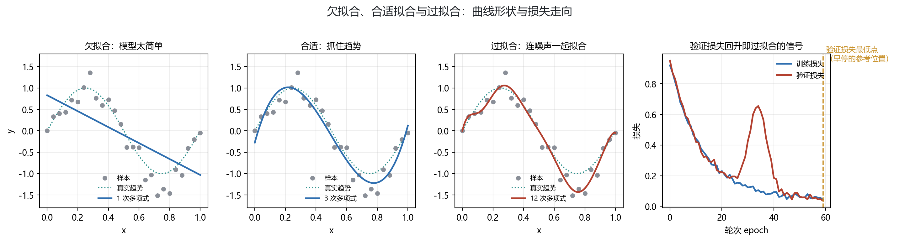
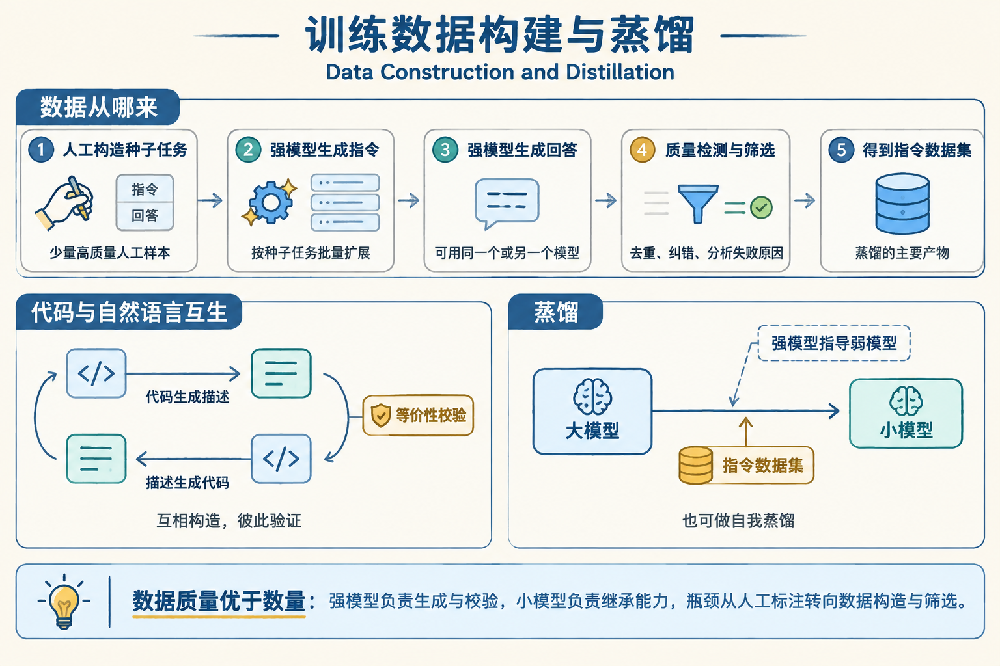

上节课把线性模型和感知机搭了起来。这节课用一个三输入的小网络追一轮训练：先算预测，看它偏离答案多少，再追到每个权重，算出往哪边调。后面用同一套过程解释激活函数、损失函数和验证集分别起什么作用。

## 一、为什么要谈“训练”

真实场景的数据规模与教学例子相差多个数量级。一个 $2000\times2000$ 的 RGB 图像有 400 万像素、1200 万个通道数值；按每秒 72 帧计算，一秒钟就要处理约 $8.6\times10^8$ 个通道数值。课堂用这个数量级说明真实数据是海量的，而教学为了能手工推演，会把输入压缩到三个。

课堂用三输入、四层的小网络演示训练。全连接隐层的权重常用按层宽缩放的随机值初始化，偏置可以从 0 开始。试想两个隐单元的权重和偏置从一开始就完全相同：给它们同一个输入，输出相同；如果后续连接也对称，在确定性更新下它们会一直学同一件事。给权重不同的起点，可以打破这种对称。

参数计数方法本身比这个具体数字更值得掌握。一个全连接层有 $d_{\mathrm{in}}$ 个输入、$d_{\mathrm{out}}$ 个输出时：

$$
N_{\mathrm{params}}=d_{\mathrm{in}}d_{\mathrm{out}}+d_{\mathrm{out}}.
$$

以一个三输入、两个宽度为 2 的隐层、2 输出的网络为例：

| 层 | 权重形状 | 权重数 | 偏置数 | 小计 |
| --- | --- | --- | --- | --- |
| 输入到隐层 1 | $2\times3$ | 6 | 2 | 8 |
| 隐层 1 到隐层 2 | $2\times2$ | 4 | 2 | 6 |
| 隐层 2 到输出 | $2\times2$ | 4 | 2 | 6 |
| 合计 | | 14 | 6 | 20 |

课堂口述总数是 29，转写里的三项“8、8、12”实际相加等于 28，无法据此还原课堂用的层宽。另取一个可以手算的例子：$3\to2\to3\to3$ 三层全连接变换，分别有 $3\times2+2=8$、$2\times3+3=9$、$3\times3+3=12$ 个参数，合计 29。第一层的 2 个偏置来自 2 个输出单元，与输入是几个无关。

训练目标写成一句话：调整参数，使模型的估计输出 $\hat y$ 逼近数据给出的真值 $y$。$\hat y$ 是算出来的，$y$ 是数据给的，两者的差距由损失函数 $L$ 衡量，训练就是让 $L$ 变小。

## 二、正向传播、损失与反向传播

一次训练迭代包含四步：

1. **正向传播**：给一个输入 $x$，逐层计算隐藏表示，从低级特征逐步提取为高层抽象特征，最后输出 $\hat y$。
2. **计算损失**：把 $\hat y$ 与 $y$ 相比较，得到一个标量损失。
3. **反向传播**：沿计算依赖的反方向应用链式法则，求出每个参数的梯度。
4. **参数更新**：用梯度下降一类的方法调整 $W$ 和 $b$，让它们往降低损失的方向走一小步。

更新后用新的权重做下一次正向传播。一个数据批次上的更新和把整个训练集过一遍是两种计数，第三节用 250 张图把它们分开。

### 1. Transformer 中的 FFN 对应哪一部分

课堂用 Transformer 里的 FFN（前馈网络）说明两层全连接变换：先调整一个位置的特征维度，中间加激活函数，再映射回原维度。比如有三个词元、每个词元四个数，可把每行分别做 $4\to8\to4$，三行用同一套权重。FFN 混合的是同一行的特征；不同词元之间怎么交换信息，由注意力层负责。

### 2. 为什么误差必须逐层往回送

损失最先给出对输出的梯度。要知道倒数第二层的权重影响多少，还要算它怎样改变最后一层的输入。这个“先影响中间量，再影响损失”的关系用链式法则相乘。梯度按依赖关系回传，算好以后，优化器再用本轮的梯度一起更新参数。

### 3. 链式法则：一条路与多条路

最简单的情形是一条路。若 $z$ 经函数 $h$ 依赖于 $y$，$y$ 又经函数 $g$ 依赖于 $x$，则：

$$
\frac{dz}{dx}=\frac{dz}{dy}\cdot\frac{dy}{dx}.
$$

课堂把 $y$ 比作隐藏态：从输入 $x$ 到最终损失要经过它，所以要把两段导数连乘。

更常见的是多条路汇合。若 $z$ 同时是 $x$ 和 $y$ 的函数，而 $x$ 与 $y$ 又都依赖于同一个 $s$：

$$
\frac{dz}{ds}
=\frac{\partial z}{\partial x}\frac{dx}{ds}
+\frac{\partial z}{\partial y}\frac{dy}{ds}.
$$

两条路的贡献相加。课堂上教师特意点出，这种多路并联的情形高中数学不讲，但做法只是把各条路分别算完再求和。一个隐藏单元连接多个输出单元时，梯度正是这样累加起来的。

### 4. 一个输出层权重的完整分解

以 $h=\sigma(W_1x+b_1)$、$\hat y_k=\sigma(z^{(2)}_k)$、$z^{(2)}_k=\sum_j W2_{kj}h_j+b2_k$、$L=\frac12\sum_k(\hat y_k-y_k)^2$ 为例：

$$
\frac{\partial L}{\partial W2_{kj}}
=\underbrace{(\hat y_k-y_k)}_{\text{损失对输出的敏感度}}
\underbrace{\hat y_k(1-\hat y_k)}_{\text{激活函数的局部导数}}
\underbrace{h_j}_{\text{该隐藏单元的取值}}.
$$

三项分别回答三个问题：输出差多少、激活函数在这一点放大或缩小多少、这个隐藏单元贡献了多少。沿路径连乘，就得到该权重对最终损失的影响。继续往输入侧走：

$$
\frac{\partial L}{\partial h_j}
=\sum_k\frac{\partial L}{\partial z^{(2)}_k}W2_{kj},
$$

$$
\frac{\partial L}{\partial z^{(1)}_j}
=\frac{\partial L}{\partial h_j}\,h_j(1-h_j),
\qquad
\frac{\partial L}{\partial W1_{ji}}
=\frac{\partial L}{\partial z^{(1)}_j}\,x_i.
$$

更新规则为 $W\leftarrow W-\eta\,\partial L/\partial W$。BP 负责算梯度，优化器决定怎样使用梯度，两者不是同一件事。

## 三、批次、迭代与轮次

课堂用每批 100 张图像演示小批量训练。每轮先把训练样本打乱，再按批次送入网络，显存里只需同时保留当前批的训练中间量。

| 概念 | 含义 |
| --- | --- |
| batch size | 一次参数更新使用的样本数，课堂例中为 100 |
| iteration（迭代） | 用一个 batch 的数据对模型做一次参数更新 |
| epoch（轮次） | 把整个训练集完整过一遍 |

例如，数据集有 250 张图，每批最多放 100 张。一轮分为 `100、100、50` 三批，若每批更新一次，就执行 3 次更新；丢弃尾批则只有 2 次，其中 50 张本轮没用到。另有一种做法是分别算两个小批次的梯度、先累积再更新，这时处理的批次数和更新次数就不同了。批大小既影响中间结果占多少内存，也影响每次估计梯度时用到多少数据。

## 四、激活函数：把直线掰弯的几种方式

纯线性层堆叠多少次仍是一次仿射变换，无法分开 XOR 那类问题。激活函数的作用就是把决策边界“掰弯”，而且要多掰几次。课堂依次点评了几种常用选择。

### 1. Sigmoid

$$
\sigma(z)=\frac{1}{1+e^{-z}},\qquad
\sigma'(z)=\sigma(z)(1-\sigma(z)).
$$

Sigmoid 把实数压到 $(0,1)$，所以常用来表示二分类中正类的概率。它的两端很平：输入绝对值较大时，改一点输入几乎不改输出，导数也接近零。隐层里多次乘这种小导数，靠前的层收到的梯度会变小。

### 2. Tanh

$$
\tanh(x)=2\sigma(2x)-1.
$$

Tanh 的输出在 $(-1,1)$，正负输入对称时，输出均值是 0；任意一批输入的输出不一定恰好居中。它和 Sigmoid 一样，输入绝对值大时导数会变小。ReLU 的正半轴没有这段饱和区。

### 3. ReLU

$$
\operatorname{ReLU}(z)=\max(0,z).
$$

正半轴导数恒为 1，不饱和，计算只是一个比较，因此成为使用最多的激活函数。问题在负半轴：导数为 0，若某单元因学习率过大在反向传播后长期只收到负输入，它就再也不会被激活，称为神经元死亡。输出也没有上界。

### 4. Leaky ReLU 与 ELU

Leaky ReLU 在负半轴给一个小斜率，使负输入仍有梯度，单元不会死。ELU 在负半轴用指数饱和，输出更接近零均值，对噪声更稳健，计算略复杂。两者都是对 ReLU 负半轴的修补。

### 5. Swish 与 GELU：大模型为什么偏好平滑

$$
\operatorname{Swish}(x)=x\,\sigma(x),
\qquad
\operatorname{GELU}(x)=0.5x\left(1+\operatorname{erf}\frac{x}{\sqrt2}\right).
$$

两者都平滑地压低负输入，ReLU 则把负输入直接变成 0。这里比较的是激活值和梯度曲线，分类与生成任务都要结合具体架构和实验选激活函数。如果后续算子仍按稠密张量执行，ReLU 产生的零也照样占位置、参与计算。

## 五、损失函数：MSE 与交叉熵的分工

### 1. MSE 与它的统计假设

均方误差把预测与真值相减后平方：

$$
L=\frac12(\hat y-y)^2.
$$

上式是一项带 $1/2$ 的平方损失，多条样本可以对平方误差取均值得到 MSE。若各样本误差独立、服从同方差的高斯分布，最小化平方误差等价于最大化该模型下的似然；平方误差也可以直接作为回归任务的评分。

### 2. Sigmoid 配 MSE 的问题

若输出层用 Sigmoid、损失用 MSE，输出层的梯度为：

$$
\frac{\partial L}{\partial z}=(\hat y-y)\,\hat y(1-\hat y).
$$

后一项正是 Sigmoid 的局部导数。当 $\hat y$ 接近 0 或 1 时它趋近于零，梯度随之消失——预测错得越极端，回传的梯度反而越小，参数更新缓慢。这正是课堂指出的“输出接近饱和时出现梯度消失”。

### 3. 交叉熵怎样把饱和项消掉

二分类交叉熵写作：

$$
L=-\bigl[y\ln\hat y+(1-y)\ln(1-\hat y)\bigr].
$$

对 $z$ 求导时，对数项产生的 $1/[\hat y(1-\hat y)]$ 与 Sigmoid 的局部导数恰好抵消：

$$
\frac{\partial L}{\partial z}=\hat y-y.
$$

梯度就是残差本身，不再带有饱和因子。多分类情形下配合 Softmax 有同样干净的形式：

$$
L=-\sum_{k=1}^{K}y_k\ln p_k,
\qquad
\frac{\partial L}{\partial z_k}=p_k-y_k.
$$

如果真值是 1，模型却只报 $\hat y=0.01$，用 MSE 时输出分数 $z$ 的梯度约为 $-0.0098$，用交叉熵时是 $-0.99$。这正是交叉熵在这里的用处：预测很有把握但答错时，输出层仍有纠偏信号。越往前的隐层，梯度仍要经过各自的激活函数和权重。

## 六、过拟合、欠拟合与正则化

### 1. 两种失效

课堂用三类拟合结果对照：

- **欠拟合**：训练误差也很高，先查模型有没有足够的表达能力、训练有没有收敛。用直线拟合一条明显弯曲的关系，多给同类样本也不会让直线变弯。
- **合适拟合**：抓住和任务相关的规律，在独立样本上仍能预测，不必经过每个带噪声的观测点。
- **过拟合**：训练误差很低，独立样本上的误差却变大。小样本里偶然出现的模式被当成了规律，是一种常见原因。

过拟合的判断不能只看训练损失。课堂强调神经网络的数据有一个分布假设：拟合出的曲线应当反映数据集背后的概率密度，采样偏差会让“拟合得好”与“真的准”脱钩。

### 2. 正则化手段

| 手段 | 做法 | 作用 |
| --- | --- | --- |
| L2 正则化 | 在损失上加权重平方和惩罚 | 给较大的权重额外代价 |
| L1 正则化 | 在损失上加权重绝对值惩罚 | 促进稀疏，可把大量权重压到零 |
| 稀疏化 | 按设定比例把权重置零，或移除整组连接 | 速度收益取决于张量形状和执行器能否跳过零值 |
| Dropout | 训练时随机将部分激活置零 | 降低模型对固定激活组合的依赖，推理时不再随机屏蔽 |
| 早停 | 验证损失不再下降时停止 | 避免在验证集表现变差后继续训练 |
| 数据增强 | 对样本做变换扩充多样性 | 缓解小样本偏差 |
| Batch Normalization | 对选定层的激活按训练批次做归一化，再缩放和平移 | 调整激活尺度；常见实现推理时使用运行统计量 |

Dropout 让同一组参数在训练中反复面对不同的随机掩码。验证集用来检查这种训练是否真的让新样本做得更好。设四轮的训练损失依次为 `0.60、0.40、0.30、0.20`，验证损失为 `0.62、0.45、0.48、0.54`。训练损失最低的是第 4 轮，按验证损失选的是第 2 轮。源码里要在第 2 轮就保存权重；只记下“第 2 轮最好”，训练结束后手里的仍是第 4 轮参数。若耐心值设为 2 轮，这组数据会在第 4 轮停止并恢复第 2 轮的权重。

### 3. 数据集划分

| 划分 | 用途 |
| --- | --- |
| 训练集 | 计算损失并学习参数 |
| 验证集 | 调超参数（网络结构、学习率、迭代次数），决定何时停止 |
| 测试集 | 方案确定后评价泛化表现 |

划分让参数学习、方案选择和最终评估各用一批数据。比如训练表情分类器，目标是识别从未见过的人的表情，就先按人分组划分，再做数据增强。把同一张照片的原图分到训练集、裁剪图分到测试集，模型见过几乎相同的输入，测出来的分数就会偏乐观。

### 4. 一个开放问题

课堂的问题是：数据量大了，怎么判断模型还会不会过拟合？把训练中出现过的例子与同类留出例子分开测，就能看到差距。例如训练题答对 95%，同类留出题只答对 70%，下一步先查重复、采样和两组题的难度。是否超过人类是另一项比较，不能替代训练集和留出集的对照。

## 七、大模型时代的训练数据构建

### 1. 合成指令数据

课堂给出一套可操作的流程：

1. 人工构造少量**种子任务**，以指令—回答的形式给出高质量范例。
2. 用强模型根据种子任务批量生成更多指令。
3. 让强模型（或另一个模型）为这些指令生成回答。
4. 做质量检测：对测试集去重、分析失败原因、补充修正数据，把人工标注的经验固化成检测脚本。

开源代码也可以作为种子来源：搜集多层次问题、总结出问题与答案，缓解指令数据不足；代码与自然语言还能互生——先用模型把代码总结成自然语言描述，再用另一个模型根据描述重新生成代码，若两者等价、描述与功能一致，就得到一批新样本。这种方式用等价性校验替代了人工标注。

### 2. 蒸馏

强模型生成指令与回答的整套产物，本质上就是一份数据集；拿这份数据去训练自己的小模型，就是蒸馏。课堂举的例子是：先让一个大模型根据自定义任务生成大量指令，再让这些指令去驱动另一个模型产生回答，从而得到训练小模型所需的数据集。模型也可以对自身做自我蒸馏。

## 八、网络设计是一组可调的选择

课堂把可调的部分归为四类：网络结构（层数、每层宽度、连接方式）、激活函数、损失函数、训练用的 $(X,Y)$ 对。训练效果不好时，通常从这几处分别调整再试验。

课上对照的 56 层网络比 20 层网络误差更高。要定位原因，先用同一份数据和评价方式画出训练、验证曲线：如果加深后训练误差都降不下去，优先查优化；如果训练误差更低、验证误差更高，再查泛化。两种现象表面上都是「深的更差」，接下来要查的地方不同。

大模型时代网络结构的变化更灵活，但本节的基本框架——正向传播算预测、损失衡量差距、反向传播回传误差、优化器更新参数——没有改变。

## 九、后续安排

课堂预告下节课进入卷积神经网络、循环神经网络、持续学习、大模型架构与网络轻量化。假期期间的安排是阅读群里发布的论文并分组准备分享，预习卷积与循环神经网络及典型网络结构，了解评价指标（如目标检测中的 mAP、IoU），并思考“大模型海量数据下是否仍存在过拟合”。授课教师说明典型网络本身不会逐层细讲，重点放在评价指标上。

## 参考资料

课堂来源：《多层神经网络训练与优化核心要点》。参数量表和梯度图使用教学算例。

1. Goodfellow、Bengio、Courville，[Deep Learning，Chapter 6：Deep Feedforward Networks](https://www.deeplearningbook.org/contents/mlp.html)。用于对照反向传播的推导与计算图。
2. Michael Nielsen，[Neural Networks and Deep Learning，Chapter 2](http://neuralnetworksanddeeplearning.com/chap2.html)。用于对照链式法则在两层网络上的完整推导。
3. Srivastava、Hinton、Krizhevsky 等，[Dropout: A Simple Way to Prevent Neural Networks from Overfitting](https://jmlr.org/papers/v15/srivastava14a.html)，JMLR 2014。
4. Ioffe、Szegedy，[Batch Normalization: Accelerating Deep Network Training by Reducing Internal Covariate Shift](https://proceedings.mlr.press/v37/ioffe15.html)，ICML 2015。
5. Ramachandran、Zoph、Le，[Searching for Activation Functions](https://arxiv.org/abs/1710.05941)，2017。Swish 的出处。
6. Hendrycks、Gimpel，[Gaussian Error Linear Units (GELUs)](https://arxiv.org/abs/1606.08415)，2016。
7. Vaswani 等，[Attention Is All You Need，第 3.3 节](https://arxiv.org/abs/1706.03762)，2017。逐位置前馈网络的定义。
