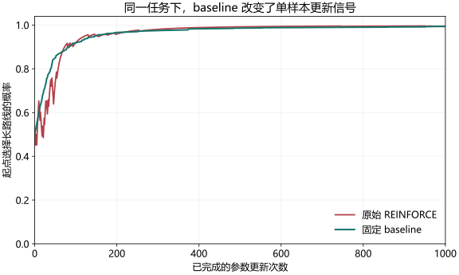

## 这一天解决的问题

前面的 Actor-Critic 练习是“一步一更新”：智能体走一步，就用这一步的 TD 误差更新 Actor 和 Critic。Day4 先把 Actor 单独拿出来，观察**整局 REINFORCE**是怎样使用一条完整轨迹训练策略的，然后再回答三个自然出现的问题：

1. 一局结束后，如何把每一步后面的奖励分配给当前动作？
2. 为什么同一任务下，策略概率的更新会有波动？
3. 如何把整局回报、一步 TD 误差和多步信息组合成更稳定的训练信号？

主线可以压缩成一条链：

```text
采样完整回合
    -> 计算每一步的 reward-to-go
    -> 用 log π(a_t|s_t) 和 G_t 更新 Actor
    -> 用 baseline 减小策略梯度方差
    -> 用 Critic 学习 V(s)，得到 advantage
    -> 用 TD 误差的加权和构造 GAE
```

先算一局：三步奖励为 `[0, -0.2, 2]`，折扣 `0.9`。倒着记账，末步的回报是 `2`，中间一步是 `-0.2 + 0.9 × 2 = 1.6`，起点是 `0 + 0.9 × 1.6 = 1.44`。三步来自同一局，但每个动作只能使用从自己那一步往后的账。

整局结束前，最后的 `2` 还没发生；如果要先估计，可以向 Critic 问未来值多少。REINFORCE 等结果发生再算，TD 用一步真实奖励加预估的将来，GAE 则把后面几次“实际比预期高多少”的误差按距离加权。后文把这三种记法接到同一个轨迹上。

## 1. 先固定一个最小环境

训练练习沿用前一天的两状态环境。起点有两种选择：

```text
                 动作 0，奖励 0
起点 s0 --------------------------------> 中间状态 s1
  |                                           |
  |                                           | 任意动作，奖励 2
  |                                           v
  |---------------------------------------> 终点
          动作 1，奖励 1，直接终止
```

设置折扣因子 $\gamma=0.9$：

| 路线 | 奖励序列 | 未折扣奖励和 | 从起点计算的折扣回报 |
|---|---:|---:|---:|
| 长路线 | $[0,2]$ | $2.0$ | $0+0.9\times2=1.8$ |
| 短路线 | $[1]$ | $1.0$ | $1.0$ |

所以，从长期回报看，动作 0 更好。注意这里有三个不同概念：

- **即时奖励**：当前这一步拿到的奖励，例如长路线第一步的 $0$；
- **回报 $G_t$**：从当前时间步开始，把后面奖励折扣后加起来；
- **策略价值 $V^\pi(s)$**：在当前策略下，从状态 $s$ 出发的平均折扣回报。

如果起点选择长路线的概率是 $p$，那么这个环境的起点价值是

$$
V^\pi(s_0)=1.8p+1.0(1-p)=1+0.8p.
$$

因此，$p=0.5$ 时 $V^\pi(s_0)=1.4$；$p=0.8$ 时 $V^\pi(s_0)=1.64$。路线本身的回报没有改变，改变的是当前策略选择两条路线的比例。

## 2. logits、概率和实际动作

策略网络不必直接输出概率。它可以先输出每个动作的 logits，再交给 `Categorical` 转换成概率分布：

```python
import torch
from torch.distributions import Categorical

logits = policy(state_tensor)              # 例如 [[1.0, 0.0]]
distribution = Categorical(logits=logits)
action_tensor = distribution.sample()      # 按概率随机抽取本次动作
log_prob = distribution.log_prob(action_tensor)
```

当 logits 是 `[1.0, 0.0]` 时，softmax 后两个动作的概率约为 `[0.7311, 0.2689]`。当 logits 整体加上同一个常数时，概率不变，例如：

```python
Categorical(logits=torch.tensor([[1.0, 0.0]])).probs
Categorical(logits=torch.tensor([[2.0, 1.0]])).probs
# 两者相同，都是约 [0.7311, 0.2689]
```

训练阶段使用 `sample()`，因为策略需要继续尝试不同动作；评估阶段才可以使用 `argmax()`，观察当前最偏好的动作。REINFORCE 的一次损失必须对应**本次经历实际执行的动作**：

```python
distribution = Categorical(logits=policy(state_tensor))
action_tensor = distribution.sample()
log_prob = distribution.log_prob(action_tensor).squeeze(0)
```

如果实际抽到动作 1，就要取动作 1 的 $\log\pi(a=1\mid s)$，不能因为动作 0 的概率更大就改取动作 0 的 log probability。

## 3. reward-to-go：从后往前算回报

### 3.1 回报不包含当前动作之前的奖励

定义从时间步 $t$ 开始的 reward-to-go：

$$
G_t=r_t+\gamma r_{t+1}+\gamma^2r_{t+2}+\cdots.
$$

长路线的奖励是 `[0, 2]`，因此：

$$
G_1=2,
\qquad
G_0=0+0.9\times2=1.8.
$$

第一步的回报是 $1.8$，不是把“之前所有奖励”也加进去。因为第一步之前还没有经历，回报只回答“从这一步开始，未来还能得到多少”。

### 3.2 倒序递推

代码从最后一步开始向前算：

```python
def calculate_returns(rewards, gamma):
    G = 0.0
    returns = []

    for reward in reversed(rewards):
        G = reward + gamma * G
        returns.append(G)

    returns.reverse()
    return returns

print(calculate_returns([0.0, 2.0], gamma=0.9))
# [1.8, 2.0]
```

倒序的原因很直接：计算 $G_t$ 时需要先知道 $G_{t+1}$。这段循环得到的数组顺序最后再翻转回时间顺序，才能与 `states[t]`、`actions[t]` 和 `log_probs[t]` 一一对应。

## 4. 整局 REINFORCE：走到终点后再更新

### 4.1 目标函数

策略梯度希望最大化折扣后的期望回报：

$$
J(\theta)=
\mathbb{E}_{\tau\sim\pi_\theta}
\left[
\sum_t\gamma^t r_t
\right].
$$

把“最大化目标”改写为“最小化损失”后，当前练习明确使用：

$$
L_{\text{REINFORCE}}
=
-\sum_t
\gamma^t G_t
\log\pi_\theta(a_t\mid s_t).
$$

这里有两个折扣位置：

- $G_t$ 内部的折扣，表示从时间步 $t$ 往后的奖励距离当前有多远；
- 外层 $\gamma^t$，对应整局目标中这个时间步相对于回合起点的时间权重。

当前实现保留了这两个位置，不能只因为 `G_t` 已经包含折扣，就把外层 $\gamma^t$ 省掉。

### 4.2 先完整收集一局

REINFORCE 不是走一步立即更新，而是先把一局经历保存下来：

```python
def state_to_tensor(state, n_states):
    tensor = torch.zeros((1, n_states), dtype=torch.float32)
    tensor[0, state] = 1.0    # s0 -> [[1, 0]]，s1 -> [[0, 1]]
    return tensor

state = env.reset()
log_probs = []
rewards = []
trajectory = []

while True:
    state_tensor = state_to_tensor(state, env.n_states)
    distribution = Categorical(logits=policy(state_tensor))
    action_tensor = distribution.sample()
    action = int(action_tensor.item())

    # 这个 log_prob 对应本次真正执行的动作，并且保留计算图
    log_prob = distribution.log_prob(action_tensor).squeeze(0)
    next_state, reward, terminated, _ = env.step(action)

    log_probs.append(log_prob)
    rewards.append(reward)
    trajectory.append((state, action, reward, next_state, terminated))

    if terminated:
        break
    state = next_state
```

`log_probs` 不能在收集时全部转成 Python 浮点数。它们后面还要连接到策略参数，才能通过反向传播更新网络。`.item()` 适合打印动作编号或损失数值，不适合替代训练所需的张量。

### 4.3 计算这局损失并更新

```python
returns = calculate_returns(rewards, gamma)
returns_tensor = torch.tensor(returns, dtype=torch.float32)

time_steps = torch.arange(
    len(returns_tensor), dtype=torch.float32
)
time_discounts = gamma ** time_steps
training_weights = time_discounts * returns_tensor

log_probs_tensor = torch.stack(log_probs)
loss_terms = -log_probs_tensor * training_weights
policy_loss = loss_terms.sum()

optimizer.zero_grad()
policy_loss.backward()
optimizer.step()
```

这段代码中每个对象的角色是：

| 对象 | 含义 | 是否需要梯度 |
|---|---|---|
| `log_probs_tensor` | 当前策略对实际动作的对数概率 | 需要 |
| `returns_tensor` | 环境已经产生的回报 | 不需要 |
| `time_discounts` | 每个时间步的外层折扣 | 不需要 |
| `training_weights` | 固定的策略梯度权重 $\gamma^tG_t$ | 不需要 |
| `policy_loss` | 连接策略参数的损失 | 需要 |

实际练习用 one-hot 状态输入、不带 bias 的线性策略，并把权重初始化为零；优化器为学习率 $0.1$ 的 SGD。每个状态使用独立的一列参数，所以这组单样本更新可以直接核对所选动作的概率方向。在两步长路线中，初始策略对两个动作都给出 $0.5$ 概率，更新后起点动作 0 的概率从

$$
0.5000\longrightarrow0.5448789.
$$

这不是“直接把概率加上某个固定数”，而是先更新 logits，再由 softmax 重新归一化，所以两个动作的概率会一起变化。

## 5. 多局训练和冻结评估

### 5.1 一局结果不等于策略质量

相同策略每次采样的路线可能不同，因此单局回报会波动。训练时需要不断重复以下闭环：

```text
当前策略采样一整局
    -> 计算该局的 G_t
    -> 反向传播一次
    -> 丢弃这局的计算图
    -> 用更新后的策略重新采样下一局
```

这里“丢弃计算图”很重要：下一局会重新计算 `log_prob`，不能把上一次已经反向传播过的旧图继续拿来更新。

在这个环境里，如果起点动作 0 的概率是 $p$，精确期望折扣回报是：

$$
J(\pi)=1+0.8p.
$$

因此，训练曲线可以同时画两种东西：

- 实际采样到的每局回报：有噪声；
- 当前概率对应的精确期望：在这个小环境中可以直接算出，作为对照。

### 5.2 这组练习的实际结果

固定训练局数为 1000、学习率为 $0.1$、$\gamma=0.9$、训练采样种子为 `1`。从起点概率 `[0.5, 0.5]` 开始：

| 指标 | 结果 |
|---|---:|
| 起点长路线概率 | $0.5000\rightarrow0.9945$ |
| 精确期望折扣回报 | $1.4000\rightarrow1.7956$ |
| 冻结策略后的采样评估 | 长路线 $496/500$ |
| 采样评估平均折扣回报 | $1.7936$ |
| 贪心完整轨迹 | `[(0, 0, 0.0, 1, False), (1, 1, 2.0, None, True)]` |

轨迹确实推进到了中间状态，而不是只在起点选对动作就停止。评估前后不修改参数：评估是读取策略，不是继续训练。训练期间的最近 100 局均值混合了不断变化的策略；冻结后重复采样，才是在估计同一个策略的期望。

这里两条路线都会到终点，所以“到终点的比例为 100%”不能区分策略好坏。长路线比例和折扣回报才区分了两种选择。冻结参数也不等于路径固定：采样评估仍使用 `sample()`；这个确定性环境下，贪心评估才会反复走同一条路线。

评估的关键限制可以直接写进代码：

```python
@torch.no_grad()                         # 不建立反向传播图
def evaluate_episode(policy, env, gamma, greedy=False):
    state = env.reset()
    rewards, trajectory = [], []
    while True:
        logits = policy(state_to_tensor(state, env.n_states))
        if greedy:
            action = int(logits.argmax(dim=1).item())
        else:
            action = int(Categorical(logits=logits).sample().item())
        next_state, reward, terminated, _ = env.step(action)
        rewards.append(reward)
        trajectory.append((state, action, reward, next_state, terminated))
        if terminated:
            break
        state = next_state
    return calculate_returns(rewards, gamma)[0], trajectory
```

没有 `backward()` 和 `optimizer.step()` 才不会训练。`policy.eval()` 调节 Dropout、BatchNorm 等层的模式，本身并不禁止梯度；当前线性策略没有这些层，冻结评估仍由不更新参数来保证。

## 6. baseline 和 advantage：把结果改成相对评价

### 6.1 为什么要减 baseline

原始 REINFORCE 直接使用 $G_t$ 作为动作评价。问题是：一次采样得到的整局回报可能只是偶然偏高或偏低。

引入只依赖状态的 baseline：

$$
A_t=G_t-b(s_t).
$$

$A_t$ 表示“这次动作的结果比当前状态的参照水平好多少”。它不再问“结果是不是正数”，而是问“结果是否高于这个状态下的平均预期”。

固定 baseline 练习使用：

$$
b(s_0)=1.4,\qquad b(s_1)=2.0.
$$

两条路线的信号如下：

| 路线 | $G_t$ | $b(s_t)$ | $A_t=G_t-b(s_t)$ |
|---|---:|---:|---:|
| 长路线第 0 步 | $1.8$ | $1.4$ | $+0.4$ |
| 长路线第 1 步 | $2.0$ | $2.0$ | $0$ |
| 短路线第 0 步 | $1.0$ | $1.4$ | $-0.4$ |

所以，长路线起点的动作 0 得到正评价，短路线起点的动作 1 得到负评价。两条信号最终都会让策略偏向长路线，但表达方式不同：

- 长路线：提高动作 0；
- 短路线：降低动作 1；在两动作 softmax 中，动作 0 的概率因此上升。

### 6.2 关键更新代码

```python
returns = torch.tensor(
    calculate_returns(rewards, gamma),
    dtype=torch.float32,
)
state_tensor = torch.tensor(states)

# baseline 只按状态索引，不按动作索引
advantage = returns - baseline_values[state_tensor]

time_steps = torch.arange(
    len(advantage), dtype=torch.float32
)
weights = (gamma ** time_steps) * advantage
loss = -(torch.stack(log_probs) * weights).sum()
```

在这里采用的直接减 baseline 的估计器中，baseline 不依赖本次动作，并在 Actor 分支中固定。它在期望上的梯度贡献为零：

$$
\begin{aligned}
\mathbb{E}_{a\sim\pi}
[b(s)\nabla_\theta\log\pi_\theta(a\mid s)]
&=b(s)\sum_a\nabla_\theta\pi_\theta(a\mid s)\\
&=b(s)\nabla_\theta1=0.
\end{aligned}
$$

因此减去 baseline 不改变期望策略梯度；**合适的** baseline 能降低方差，但任意写一个很大的常数并不能保证降低方差。它也不是把未执行动作的真实回报偷看出来：当前样本仍然只有一条实际轨迹，baseline 只是参照值。

在初始两动作概率均为 $0.5$ 时，以“长路线 logit”为例，未减 baseline 的回报加权梯度样本是 $+0.9$ 或 $-0.5$；减去 $1.4$ 后则都是 $+0.2$。两者平均均为 $0.2$，但后者在这个起点例子中的样本方差为零。优势均值为零不等于策略梯度为零，因为真正更新的是 $A\nabla\log\pi$。

### 6.3 这次对照实验观察到什么

原始 REINFORCE 与固定 baseline 都从同样的初始策略出发：

| 版本 | 起点长路线概率 | 训练中概率下降次数 |
|---|---:|---:|
| 原始 REINFORCE | $0.5000\rightarrow0.9945$ | 36 |
| 固定 baseline | $0.5000\rightarrow0.9937$ | 0 |

最终两者都学到了长路线，固定 baseline 版本在这一组随机采样中减少了单次更新的来回摆动。这里的固定值 `1.4` 是教学对照，并不会随着策略自动更新，所以它不能等同于后面要介绍的 Critic。

控制在同一条轨迹、同一组初始参数下只更新一次，可以更直接地看到信号的区别：

| 本次轨迹 | 无 baseline 更新后的长路线概率 | 有 baseline 更新后的长路线概率 |
|---|---:|---:|
| 长路线 | $0.5449$ | $0.5100$ |
| 短路线 | $0.4750$ | $0.5100$ |

两种多局训练之后按各自当前策略重新采样，不保证每局继续遇到相同轨迹。两条曲线都来自上述固定 baseline 对照：相同初始策略、相同采样种子，各训练 1000 局。



原始 REINFORCE 的早期曲线有较多来回摆动，固定 baseline 的曲线在这次对照中没有发生长路线概率下降。这是这组环境和参数下的观察，不是任意任务的单调上升保证；最终概率略低也说明“减少摆动”与“最终概率更高”并非同一指标。

## 7. Critic：学习当前策略的状态价值

### 7.1 固定 baseline 和 Critic 的区别

固定 baseline 是手工写入的常量，例如：

```python
baseline_values = torch.tensor([1.4, 2.0])
```

Critic 则是一个可训练的函数 $V_\phi(s)$，它要跟踪**当前策略**下的状态价值：

$$
V^\pi(s)=
\mathbb{E}_{\tau\sim\pi}
\left[
\sum_{k=0}^{\infty}\gamma^k r_{t+k}
\mid s_t=s
\right].
$$

在当前环境中：

$$
V^\pi(s_0)=1+0.8p.
$$

策略变了，理想的价值目标也会变。Critic 不是挑一条最高回报的轨迹记住，而是用许多样本拟合当前策略下的平均价值。

### 7.2 Actor 和 Critic 的损失

用 Critic 产生 advantage：

$$
A_t=G_t-V_\phi(s_t).
$$

Actor 使用：

$$
L_{\text{actor}}
=-\log\pi_\theta(a_t\mid s_t)\operatorname{detach}(A_t).
$$

上式用于说明单个样本的更新方向。若沿用第 4 节“从回合起点计算的折扣目标”，整局求和时还要乘该步的外层 $\gamma^t$；不能把单样本示意公式直接当成完整整局目标。

Critic 使用：

$$
L_{\text{critic}}
=\left(V_\phi(s_t)-y_t\right)^2.
$$

关键代码可以写成：

```python
# 这段用一步 TD 构造优势；前面的 G - V 是完整回报版本
# reward_tensor、not_done 是标量，next_value 是下一状态的标量预测
# current_value 保留价值分支的计算图
current_value = value.squeeze(0)

# target 是本轮的固定训练目标
td_target = (
    reward_tensor + gamma * next_value.detach() * not_done
).detach()

advantage = td_target - current_value
actor_loss = -log_prob * advantage.detach()
critic_loss = (current_value - td_target.detach()).pow(2)

total_loss = actor_loss + critic_coef * critic_loss
```

`advantage.detach()` 只切断 Actor loss 沿 advantage 这条路径回到 Critic 的梯度，数值仍然是原来的数值。`td_target.detach()` 把目标当作常量；如果误写成 `(current_value.detach() - td_target).pow(2)`，Critic 的预测端就没有梯度，Critic 无法通过这项损失学习。

共享主体仍可能同时收到 Actor 和 Critic 的梯度。`critic_coef` 调整的是 Critic loss 在总损失中的权重，不是 Critic 的学习率，也不会改变回报目标或 `value` 的数值。

## GAE 实作：从两步奖励算到 Actor 和 Critic 的目标

第一步没有奖励，第二步拿到 4 分。哪一步应该得到鼓励？先用这条短轨迹手算一步预测误差，再看 GAE 怎样把后一步的误差往前传，以及回合被截断时要留下哪一项。

[阅读全文](/2026/10/06/rl-day4-reinforce-gae/gae/)

<ul>
<li id="8-mctdn-step-和终止边界"><a href="/2026/10/06/rl-day4-reinforce-gae/gae/#8-mctdn-step-和终止边界">8. MC、TD、n-step 和终止边界</a></li>
<li id="81-三种目标的时间范围"><a href="/2026/10/06/rl-day4-reinforce-gae/gae/#81-三种目标的时间范围">8.1 三种目标的时间范围</a></li>
<li id="82-真正终止和外部截断不能混为一谈"><a href="/2026/10/06/rl-day4-reinforce-gae/gae/#82-真正终止和外部截断不能混为一谈">8.2 真正终止和外部截断不能混为一谈</a></li>
<li id="9-gae在-td-和-mc-之间调节"><a href="/2026/10/06/rl-day4-reinforce-gae/gae/#9-gae在-td-和-mc-之间调节">9. GAE：在 TD 和 MC 之间调节</a></li>
<li id="91-先算-td-误差"><a href="/2026/10/06/rl-day4-reinforce-gae/gae/#91-先算-td-误差">9.1 先算 TD 误差</a></li>
<li id="92-gae-的定义"><a href="/2026/10/06/rl-day4-reinforce-gae/gae/#92-gae-的定义">9.2 GAE 的定义</a></li>
<li id="93-lambda-的含义"><a href="/2026/10/06/rl-day4-reinforce-gae/gae/#93-lambda-的含义">9.3 lambda 的含义</a></li>
<li id="94-两种-mask-要分开"><a href="/2026/10/06/rl-day4-reinforce-gae/gae/#94-两种-mask-要分开">9.4 两种 mask 要分开</a></li>
<li id="10-raw-advantage标准化和-critic-目标"><a href="/2026/10/06/rl-day4-reinforce-gae/gae/#10-raw-advantage标准化和-critic-目标">10. raw advantage、标准化和 Critic 目标</a></li>
<li id="101-批次中的样本必须整行配对"><a href="/2026/10/06/rl-day4-reinforce-gae/gae/#101-批次中的样本必须整行配对">10.1 批次中的样本必须整行配对</a></li>
<li id="102-把整条更新链串起来"><a href="/2026/10/06/rl-day4-reinforce-gae/gae/#102-把整条更新链串起来">10.2 把整条更新链串起来</a></li>
</ul>

## 参考与继续阅读

- [Gymnasium：Handling Time Limits](https://gymnasium.farama.org/tutorials/gymnasium_basics/handling_time_limits/)
- [OpenAI Spinning Up：Vanilla Policy Gradient](https://spinningup.openai.com/en/latest/algorithms/vpg.html)
- Schulman et al., [High-Dimensional Continuous Control Using Generalized Advantage Estimation](https://arxiv.org/abs/1506.02438)
- 上一篇：[Day3 · 从策略概率到 Actor-Critic](/2026/09/29/rl-day3-actor-critic/)；系列入口：[强化学习](/practice/reinforcement-learning/)
