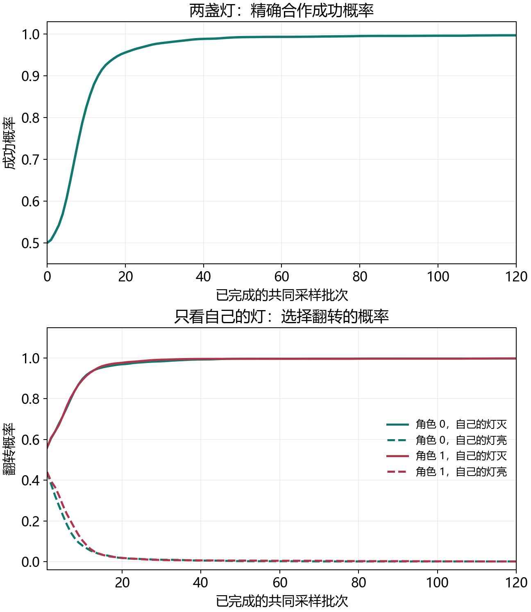

## 这一天解决的问题

Day5 的 PPO 只有一个决策者。进入多智能体以后，一次结果由多个角色共同造成：队友也在学习，每个人能看到的信息不同，团队奖励又常常只有一个。

讨论中有一句话抓住了其中的区别：“评价为负，但是不能归因为是谁失败了。”共同成绩可以用于训练双方，但要解释某个角色的动作，就得考虑队友当时做了什么。

先把信息摆上桌：两盏灯各自可见时，两人可以都约定“看到灭灯就翻转”，不必交换消息；若正确方向由发送者手中的随机提示决定，接收者眼前的画面完全一样，就需要有人把提示带过来。

集中训练、分散执行（CTDE）允许训练时的 Critic 同时看双方信息，帮助评分；实际出手时，Actor 仍只能使用它眼前的观测和送达的消息。训练能告诉它哪种选择值得学，并不会在部署时替它补上一条观测。

## 1. 联合动作：一个结果由两个人共同决定

先用一个单步协调游戏。智能体 0 和智能体 1 同时选择 A 或 B，动作编码为 `A=0`、`B=1`。两人选相同选项，团队奖励为 2；选不同选项，团队奖励为 0，然后真正终止。

| 智能体 0 | 智能体 1 | 团队奖励 |
|---|---|---:|
| A | A | 2 |
| A | B | 0 |
| B | A | 0 |
| B | B | 2 |

```python
def team_reward(action_0, action_1):
    return 2.0 if action_0 == action_1 else 0.0
```

两个动作组成联合动作 $\mathbf a=(a_0,a_1)$。同一份团队奖励可以给两人提供学习信号；环境成绩仍是 2，不因为两人都看到了这个数就变成 4。

### 队友学习为什么会改变自己的经验

固定智能体 0 选择 A。如果队友选择 A 的概率为 $0.9$，它的期望奖励是：

$$
\mathbb E[R\mid a_0=A]=0.9\times2+0.1\times0=1.8.
$$

队友后来把选择 A 的概率降到 $0.1$，相同动作 A 的期望奖励就变成 $0.2$。联合奖励表没有改，变化来自队友的策略。

从单个学习者的视角看，自己动作对应的有效收益分布在变化。这是多智能体学习中非平稳性的一个来源。集中式训练把联合信息纳入学习，有助于解释这些变化。[1]

## 2. CTDE：训练时集中评价，行动时各看各的

CTDE 是 centralized training with decentralized execution，即集中训练、分散执行。它规定训练和执行分别可以使用哪些信息，并不规定必须有几张网络、几台机器。

当前演示使用两个独立 Actor 和一个集中式状态价值 Critic：

| 模块 | 输入 | 输出 | 使用阶段 |
|---|---|---|---|
| Actor 0 | 自己的局部观测 $o_0$ | 自己的动作分布 | 训练与执行 |
| Actor 1 | 自己的局部观测 $o_1$ | 自己的动作分布 | 训练与执行 |
| 团队 Critic | 同一次交互的联合信息 | 当前联合策略的团队价值预测 | 训练 |

下面的 PyTorch 片段使用 `torch`、`from torch import nn` 和 `from torch.distributions import Categorical`。`nn.Linear` 是线性网络，`Categorical` 将动作 logits 转成离散分布。

```python
actor_0 = nn.Linear(2, 2, bias=False)
actor_1 = nn.Linear(2, 2, bias=False)
critic = nn.Linear(4, 1, bias=False)

with torch.no_grad():
    actor_0.weight.zero_()
    actor_1.weight.zero_()
    critic.weight.fill_(0.1)
```

两个 Actor 各输入两个特征，输出 A/B 的两个得分；Critic 输入四个特征，输出一个数。Actor 全零初值使动作概率各为 $0.5$，Critic 的 $0.1$ 是便于观察的手工初值。

```python
joint_features = torch.cat([obs_0, obs_1], dim=-1)
dist_0 = Categorical(logits=actor_0(obs_0))
dist_1 = Categorical(logits=actor_1(obs_1))
value = critic(joint_features).squeeze(-1)
```

`obs_0`、`obs_1` 的形状都是 `[B,2]`，`B` 是联合经历数。沿最后一维拼接后，`joint_features` 为 `[B,4]`；`squeeze(-1)` 将价值输出从 `[B,1]` 变为 `[B]`，保留样本维度。

同一行必须来自同一次交互。观测拼接在此处是联合特征；是否等于完整全局状态，要由环境的信息结构决定。

### 集中式信息怎样影响局部策略

Critic 根据联合信息估计团队价值，再参与构造 Actor 的评分。评分通过损失改变 Actor 参数；执行时 Actor 仍使用局部输入。

三条手工单步终止经历的团队奖励是 `[2,2,0]`，旧价值预测是 `[0.2,0.2,0.3]`，固定优势因此为 `[1.8,1.8,-0.3]`。两个 Actor 使用各自实际动作的 `log_prob`，Critic 拟合奖励目标。`actions_0`、`actions_1` 是这三条经历中两人各自执行的动作，`value` 是前向计算得到、仍保留梯度的预测：

```python
targets = rewards.detach().clone()
advantages = (targets - value.detach()).detach()
loss_0 = -(dist_0.log_prob(actions_0) * advantages).mean()
loss_1 = -(dist_1.log_prob(actions_1) * advantages).mean()
actor_loss = (loss_0 + loss_1) / 2
critic_loss = (value - targets).square().mean()
total_loss = actor_loss + 0.5 * critic_loss

optimizer.zero_grad()
total_loss.backward()
optimizer.step()
```

`optimizer` 是学习率为 `0.05` 的 SGD，管理两个 Actor 和 Critic 的全部参数。固定优势切断评分分支的梯度，当前 `value` 则通过平方误差训练 Critic；`step()` 才真正修改参数。

一次真实 SGD 更新后，Critic 的三个预测变为 `[0.25,0.255,0.375]`，固定目标均方误差由 $2.19$ 降至约 $2.0827$；三个网络的参数都改变了。这个实验展示输入和梯度的数据流，后面的环境训练才检验合作行为。

Actor 所需输入必须在执行时真实可得。训练期才能看到的队友观测可以供 Critic 使用；执行期收到的通信、自己的身份和历史也可以合法地进入策略。[1][2]

## 3. 联合 rollout：一行保存同一次配合

真正训练时，两名 Actor 在同一份采样策略下共同经历环境。每个人先根据自己的观测选择动作，环境再接收联合动作，返回一份团队奖励。

当前合作环境换成“两盏灯”：每人只看自己的初始灯状态，动作是保持或翻转；两盏灯最终相同，得奖励 2，否则得 0。本局只有一步，执行后真正终止。

采样核心摘录如下。`model.actors[i]` 是角色 $i$ 的局部策略，`local_input` 将自己的灯编码为两维 one-hot，`central_input` 将两盏灯的初始状态编码为四维 one-hot。

```python
# 位于 @torch.no_grad() 修饰的采样函数中。
bits = env.reset()
local = [local_input(bits[i]) for i in range(2)]
global_state = central_input(bits)
distributions = [
    Categorical(logits=model.actors[i](local[i])) for i in range(2)
]
selected = [dist.sample() for dist in distributions]
actions = tuple(int(action.item()) for action in selected)
old_log_probs = [
    dist.log_prob(action).item()
    for dist, action in zip(distributions, selected)
]
old_value = model.critic(global_state).item()
final_bits, reward, terminated, _ = env.step(actions)
fields["actions"].append(actions)
fields["old_log_probs"].append(old_log_probs)
```

这里的 `fields` 是保存本批经历的容器。实际采样还保存局部观测、集中状态、奖励、旧价值和终止标记；以上片段突出联合动作与两份旧概率的对应关系。

| 字段 | 形状 | 对应对象 |
|---|---|---|
| `obs_0`、`obs_1` | `[B,2]` | 同一局两人的局部观测 |
| `central_states` | `[B,4]` | 同一局的初始全局状态，供 Critic 使用 |
| `actions` | `[B,2]` | 两人真正执行的动作 |
| `old_log_probs` | `[B,2]` | 采样时各自实际动作的对数概率 |
| `rewards`、`old_values` | `[B]` | 一份团队奖励和团队价值快照 |
| `terminated` | `[B]` | 这次交互是否真正终止 |

`B` 是共同回合数，不再乘人数。采样一批期间不更新参数；开始训练后，各字段也必须使用同一索引一起重排。

给定各自可用的输入、且两人独立采样时，联合动作概率为两份条件概率的乘积。通信任务有先后顺序，接收端的条件输入还包含已收到的消息；条件关系必须按实际决策流程写。

## 4. 从 PPO 到合作更新：同一评分，各自概率比

两盏灯环境每条经历都真正终止，所以 Day4 的 GAE 在这里退化为：

$$
\hat A=R-V_{\mathrm{old}}(s),\qquad y=R.
$$

$\hat A$ 给 Actor 评分，$y$ 是 Critic 的固定价值目标。这两个量用途不同。

```python
@torch.no_grad()
def prepare_batch(batch):
    assert batch["terminated"].all(), "本函数只用于当前一步终止环境"
    batch["advantages"] = (batch["rewards"] - batch["old_values"]).clone()
    batch["targets"] = batch["rewards"].clone()
    return batch
```

本例使用一份团队状态价值，因此两名 Actor 使用共同优势。一般 MAPPO 可以使用包含角色信息的集中式价值输入，优势是否相同取决于具体设计。[2]

### 每个人只比较自己的实际动作

角色 $i$ 的概率比为：

$$
\rho_t^{(i)}
=\exp\left[
\log\pi_{\theta_i}(a_t^{(i)}\mid o_t^{(i)})
-\log\pi_{i,\mathrm{old}}(a_t^{(i)}\mid o_t^{(i)})
\right].
$$

假设一局实际执行 AA，两份旧概率都为 $0.5$，当前对各自 A 动作的概率分别为 $0.6$、$0.4$，则两个角色的比值分别是 $1.2$、$0.8$。联合动作的概率比为 $0.96$，它与当前采用的逐角色 PPO 比值是不同对象。

下面摘出合作训练的损失函数。`batch["actions"][:, i]` 与 `batch["old_log_probs"][:, i]` 始终属于同一个角色、同一条经历。

```python
def compute_losses(model, batch):
    actor_losses, entropies, ratios, log_ratios = [], [], [], []
    for i in range(2):
        dist = Categorical(logits=model.actors[i](batch[f"obs_{i}"]))
        log_prob = dist.log_prob(batch["actions"][:, i])
        log_ratio = log_prob - batch["old_log_probs"][:, i]
        ratio = log_ratio.exp()
        raw = ratio * batch["advantages"]
        clipped = ratio.clamp(1 - clip_eps, 1 + clip_eps) * batch["advantages"]
        actor_losses.append(-torch.minimum(raw, clipped).mean())
        entropies.append(dist.entropy().mean())
        ratios.append(ratio)
        log_ratios.append(log_ratio)
    actor_loss = torch.stack(actor_losses).mean()
    values = model.critic(batch["central_states"]).squeeze(-1)
    assert values.shape == batch["targets"].shape
    critic_loss = (values - batch["targets"]).square().mean()
    entropy = torch.stack(entropies).mean()
    total_loss = actor_loss + critic_coef * critic_loss - entropy_coef * entropy
    with torch.no_grad():
        kls = [float(((r - 1) - lr).mean()) for r, lr in zip(ratios, log_ratios)]
        clips = [float(((r - 1).abs() > clip_eps).float().mean()) for r in ratios]
    metrics = {"actor_loss": actor_loss.item(), "critic_loss": critic_loss.item(),
               "entropy": entropy.item(), "kl_0": kls[0], "kl_1": kls[1],
               "clip_0": clips[0], "clip_1": clips[1]}
    parts = {"actor_loss": actor_loss, "critic_loss": critic_loss, "ratios": ratios}
    return total_loss, metrics, parts
```

`clip_eps=0.2` 对应 $[0.8,1.2]$ 的比值参考区间。`critic_coef=0.5` 调节价值损失权重，`entropy_coef=0.01` 给策略保留探索提供小幅激励。`metrics` 是用于观察的数值，`parts` 保留分项张量，便于查看各自梯度。

两个局部策略损失先按样本平均，再按角色平均。奖励仍是一份团队奖励。Critic 的 `values` 和 `targets` 都是 `[B]`，避免 `[B,1]` 与 `[B]` 相减后广播成 `[B,B]`。

每批最多优化 4 轮，轮内重新前向并建立新图，旧概率、优势与目标保持固定。任一角色近似 KL 超过参考阈值，就停止本批后续更新，然后重新采样。逐角色观察能避免一个角色的大变化被总平均掩盖。

对应的内层更新摘录如下，`update_epochs=4`，`target_kl=0.03`，`max_grad_norm=0.5`：

```python
for epoch in range(update_epochs):
    loss, metrics, _ = compute_losses(model, batch)
    if max(metrics["kl_0"], metrics["kl_1"]) > target_kl:
        break
    optimizer.zero_grad()
    loss.backward()
    nn.utils.clip_grad_norm_(model.parameters(), max_grad_norm)
    optimizer.step()
```

PPO 裁剪作用于策略目标，`clip_grad_norm_` 作用于已经算出的参数梯度。KL 检查发生在更新前，超过阈值后停止后续更新；一次更新仍可能跨过阈值，因此它是停止参考。

## 5. 真正学会合作：结果相同，动作可以不同

两盏灯的状态编码为 `0=灭、1=亮`，动作编码为 `0=保持、1=翻转`。状态更新用 XOR：$b_i'=b_i\oplus a_i$。

当前训练使用两个独立局部线性 Actor 和一个集中式线性 V，全部从零权重开始。初始动作概率均匀，真实团队期望为 1；未训练 Critic 的输出为 0。

| 配置 | 数值 |
|---|---:|
| 训练种子 | 7 |
| 每批共同回合数 / 采样批数 | 64 / 120 |
| 每批最多优化轮数 | 4 |
| Actor / Critic 学习率 | 0.03 / 0.08 |
| PPO 裁剪幅度 | 0.2 |
| 梯度范数上限 / KL 参考阈值 | 0.5 / 0.03 |
| 优势标准化 | 关闭 |

外层训练每次收集新的一批共同经历，再训练这批数据：

```python
for update in range(num_updates):
    batch = prepare_batch(collect_batch(model, train_env))
    epoch_logs, metrics, stopped = update_batch(model, optimizer, batch)
```

`collect_batch` 是第 3 节的联合采样，`prepare_batch` 固定本批目标，`update_batch` 执行有限轮更新。`epoch_logs` 记录实际优化轮数，`stopped` 表示是否触发 KL 停止。

本次从干净内核重跑使用 Python 3.13.5、PyTorch 2.11.0+cpu。实际计数为：

| 计数 | 结果 |
|---|---:|
| 共同环境回合 | 7680 |
| 共同环境步 | 7680 |
| 两名智能体动作总数 | 15360 |
| 参数更新次数 | 480 |

一局一步，所以共同环境步等于回合数；每步两人各执行一个动作，动作总数才乘 2。本配置每批实际完成 4 轮更新，$120\times4=480$，不再乘网络数量。



精确合作概率由 $0.5$ 提高到约 $0.9969121$，精确期望团队回报为 $1.9938243$。图中两人都学到“自己的灯灭就翻转，亮就保持”的规则。

| 初始两灯 | 两人动作 | 最终两灯 | 团队奖励 |
|---|---|---|---:|
| 灭、灭 | 翻转、翻转 | 亮、亮 | 2 |
| 灭、亮 | 翻转、保持 | 亮、亮 | 2 |
| 亮、灭 | 保持、翻转 | 亮、亮 | 2 |
| 亮、亮 | 保持、保持 | 亮、亮 | 2 |

初始“灭、亮”时，第一个人翻转，第二个人保持，最终都是亮。目标要求最终状态相同，动作编号可以不同；双方共同变灭也是合法的合作约定。

执行函数只接收自己的 Actor 和自己的灯：

```python
@torch.no_grad()
def choose_local_action(actor, own_bit, greedy=False):
    logits = actor(local_input(own_bit))
    action = (logits.argmax(dim=-1) if greedy else
              Categorical(logits=logits).sample())
    return int(action.item())
```

独立种子下的冻结采样评估成功 $496/500$，平均奖励为 $1.984$。四种初始状态的贪心执行全部成功；采样评估按概率抽动作，仍可能失败。执行中 Critic 调用为 0，评估前后参数保持不变。

四种状态的 Critic 预测与当前真实策略价值最大差约为 $0.02375$。本实验展示 MAPPO 风格的采样、更新与分散执行闭环；集中式 V 给的是团队评分，个体动作的条件贡献要另作比较。

## 6. 信用分配：固定队友，再比较自己的动作

用单步协调游戏说明共同评分的含义。假设旧团队价值参照为 1，一局实际执行 AB，奖励为 0，共同优势就是 $-1$。

Actor 0 使用这个评分评价自己执行的 A，Actor 1 评价自己执行的 B。它说明联合结果低于参照；要进一步评价一个人的选择，需要回答“队友保持刚才的动作，我如果换另一种动作，会怎样”。

COMA 使用集中式联合动作价值 Q，并对当前被评价者的动作做策略加权的反事实比较：[3]

$$
A_i(s,\mathbf a)
=Q(s,\mathbf a)
-\sum_{a_i'}\pi_i(a_i'\mid o_i)
Q\!\left(s,(\mathbf a_{-i},a_i')\right).
$$

这里 $\mathbf a_{-i}$ 是其他人的实际动作，保持固定；$a_i'$ 是自己的候选动作。Q 评价当前与未来的团队回报，和只输入状态的 V 不同。

### 一个能完整手算的例子

仍设 AA/BB 奖励 2、AB/BA 奖励 0。另设 Actor 0 选择 A/B 的概率为 $0.9/0.1$，Actor 1 为 $0.5/0.5$，本次实际动作是 AB。由于一步终止，精确 Q 就是奖励表。

| 评价对象 | 固定队友动作 | 自己 A/B 的 Q | 策略加权 baseline | 实际动作的优势 |
|---|---|---|---:|---:|
| Actor 0 | 队友选 B | 0 / 2 | $0.9\times0+0.1\times2=0.2$ | $0-0.2=-0.2$ |
| Actor 1 | 队友选 A | 2 / 0 | $0.5\times2+0.5\times0=1$ | $0-1=-1$ |

```python
q = [[2.0, 0.0], [0.0, 2.0]]  # 行是角色 0，列是角色 1。
pi_0 = [0.9, 0.1]              # A、B 的概率。
pi_1 = [0.5, 0.5]
a_0, a_1 = 0, 1               # 本局真正执行 A、B。
baseline_0 = sum(pi_0[a] * q[a][a_1] for a in range(2))
baseline_1 = sum(pi_1[a] * q[a_0][a] for a in range(2))
advantage_0 = q[a_0][a_1] - baseline_0
advantage_1 = q[a_0][a_1] - baseline_1
print(advantage_0, advantage_1)  # -0.2 -1.0
```

固定队友让比较只围绕自己的动作展开。同时改变两人的动作，会把队友变化也混入参照。按自己的策略加权得到期望，只有策略均匀时才等于普通算术平均。

这里两个优势不同，是因为条件参照不同；它们不是客观责任比例，也不要求相加等于团队奖励。这个表是教学假设，实际 COMA 用学习的 Q 估计反事实价值，不需要为每个候选动作重新运行一遍环境。

## 7. 参数共享：共享规则，不等于共享输入

多个智能体可以共用同一个 Actor。每个人仍把自己的局部观测送进去，样本梯度汇入同一套参数。

下面用手工权重展示共享策略的输入依赖。输入 one-hot 的两行分别表示自己的灯灭、亮，输出顺序是保持、翻转。

```python
shared_actor = nn.Linear(2, 2, bias=False)
with torch.no_grad():
    shared_actor.weight.copy_(torch.tensor([[-2., 2.], [2., -2.]]))
own_observations = torch.eye(2)
probs = Categorical(logits=shared_actor(own_observations)).probs
print(probs)
```

对应概率约为：

```text
自己的灯灭：[保持 0.018，翻转 0.982]
自己的灯亮：[保持 0.982，翻转 0.018]
```

同一套参数遇到不同输入，可以输出不同分布。完整输入和前向计算相同时，分布相同；两个角色独立随机抽样，实际动作仍可能不同。

如果两人的观测完全相同，却需要固定不同职责，例如一个开门、一个看守，只看观测的无记忆共享 Actor 缺少角色区分条件。加入自己在执行时可得的 `agent_id` 或 `role_id`，可以让策略根据身份选择职责。[4]

参数共享减少重复参数，让不同角色的经验训练共同规则。它适用于哪些角色、是否需要身份条件，要结合观测与职责设计；共享参数并不会让队友的私人观测自动进入自己的输入。

## 多智能体通信：一位发消息，另一位选动作

发送者知道正确提示，接收者负责行动。实验给双方一个只能发 0 或 1 的通道，用团队奖励一起学发什么、收到后怎么做；随后只改消息，比较接收者还答得对多少题。

[阅读全文](/2026/10/08/rl-day6-multi-agent-learning/communication/)

<ul>
<li id="8-局部记忆当前画面相同历史仍可能不同"><a href="/2026/10/08/rl-day6-multi-agent-learning/communication/#8-局部记忆当前画面相同历史仍可能不同">8. 局部记忆：当前画面相同，历史仍可能不同</a></li>
<li id="9-从奖励中学通信消息本身也是动作"><a href="/2026/10/08/rl-day6-multi-agent-learning/communication/#9-从奖励中学通信消息本身也是动作">9. 从奖励中学通信：消息本身也是动作</a></li>
<li id="两个策略都需要自己的学习信号"><a href="/2026/10/08/rl-day6-multi-agent-learning/communication/#两个策略都需要自己的学习信号">两个策略都需要自己的学习信号</a></li>
<li id="实际训练出的协议"><a href="/2026/10/08/rl-day6-multi-agent-learning/communication/#实际训练出的协议">实际训练出的协议</a></li>
<li id="10-消息干预它真的依赖通信吗"><a href="/2026/10/08/rl-day6-multi-agent-learning/communication/#10-消息干预它真的依赖通信吗">10. 消息干预：它真的依赖通信吗</a></li>
<li id="采样成绩与精确成功率"><a href="/2026/10/08/rl-day6-multi-agent-learning/communication/#采样成绩与精确成功率">采样成绩与精确成功率</a></li>
<li id="改一边的协议与双方重命名"><a href="/2026/10/08/rl-day6-multi-agent-learning/communication/#改一边的协议与双方重命名">改一边的协议与双方重命名</a></li>
</ul>

## 参考与继续阅读

1. Lowe 等：[Multi-Agent Actor-Critic for Mixed Cooperative-Competitive Environments](https://arxiv.org/abs/1706.02275)，2017。用于理解非平稳性与集中训练、分散执行。
2. Yu 等：[The Surprising Effectiveness of PPO in Cooperative Multi-Agent Games](https://arxiv.org/abs/2103.01955)，2021；[作者实现](https://github.com/marlbenchmark/on-policy)。对应集中式价值、局部策略及 PPO 更新。
3. Foerster 等：[Counterfactual Multi-Agent Policy Gradients](https://arxiv.org/abs/1705.08926)，2018。对应固定队友动作、策略加权的反事实 baseline。
4. Terry 等：[Revisiting Parameter Sharing in Multi-Agent Deep Reinforcement Learning](https://arxiv.org/abs/2005.13625)。对应参数共享与智能体身份条件。
5. Hausknecht 与 Stone：[Deep Recurrent Q-Learning for Partially Observable MDPs](https://arxiv.org/abs/1507.06527)，2015。对应局部历史与循环表示。
6. Foerster 等：[Learning to Communicate with Deep Multi-Agent Reinforcement Learning](https://arxiv.org/abs/1605.06676)，2016。对应通信决策及离散、可微通道的区别。
7. [PyTorch 2.11：概率分布](https://docs.pytorch.org/docs/2.11/distributions.html)、[GRUCell](https://docs.pytorch.org/docs/2.11/generated/torch.nn.GRUCell.html) 与 [no_grad](https://docs.pytorch.org/docs/2.11/generated/torch.no_grad.html)。对应实际动作的 `log_prob`、隐藏状态和梯度模式。

上一篇：[Day5 · PPO：从概率比到训练闭环](/2026/10/07/rl-day5-ppo-training/)；系列入口：[强化学习](/practice/reinforcement-learning/)。
