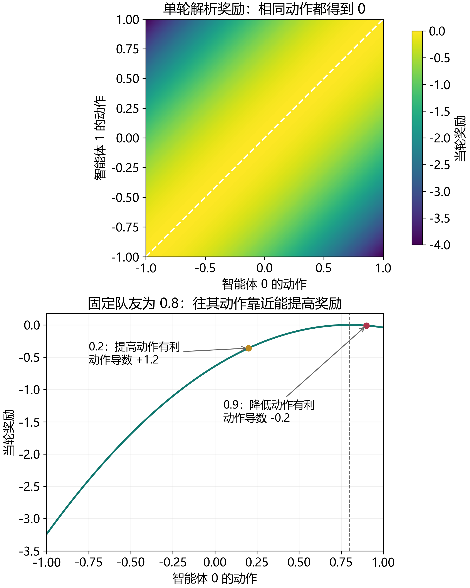
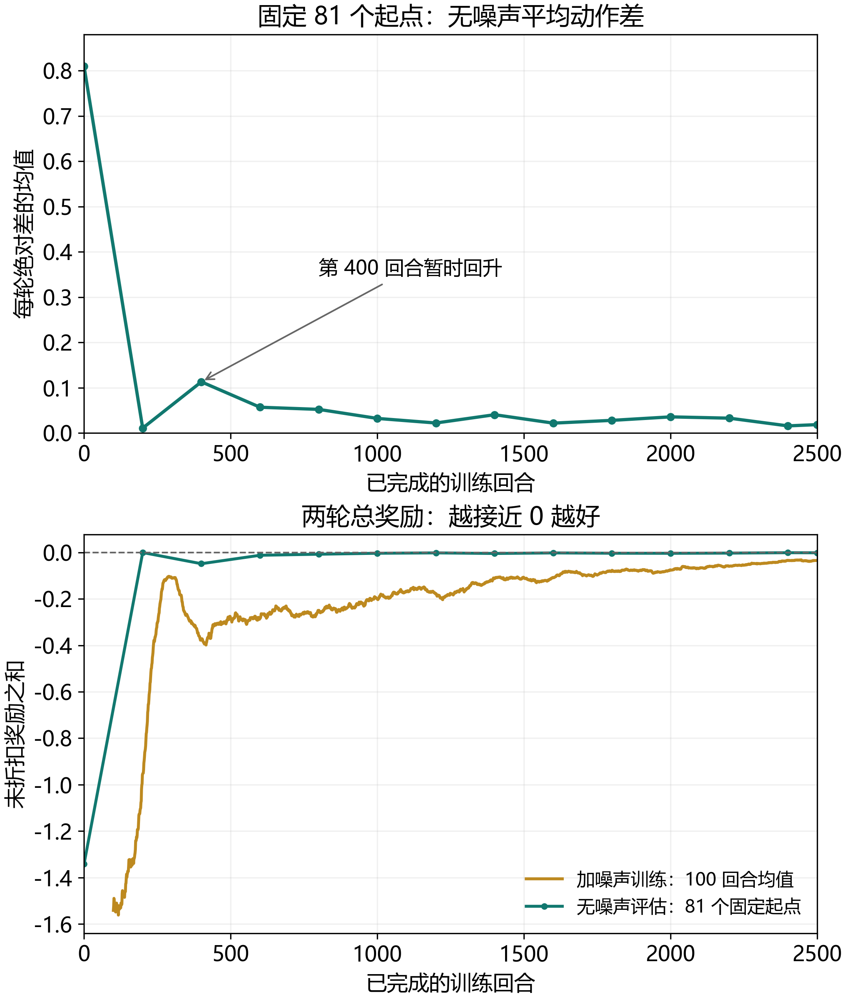
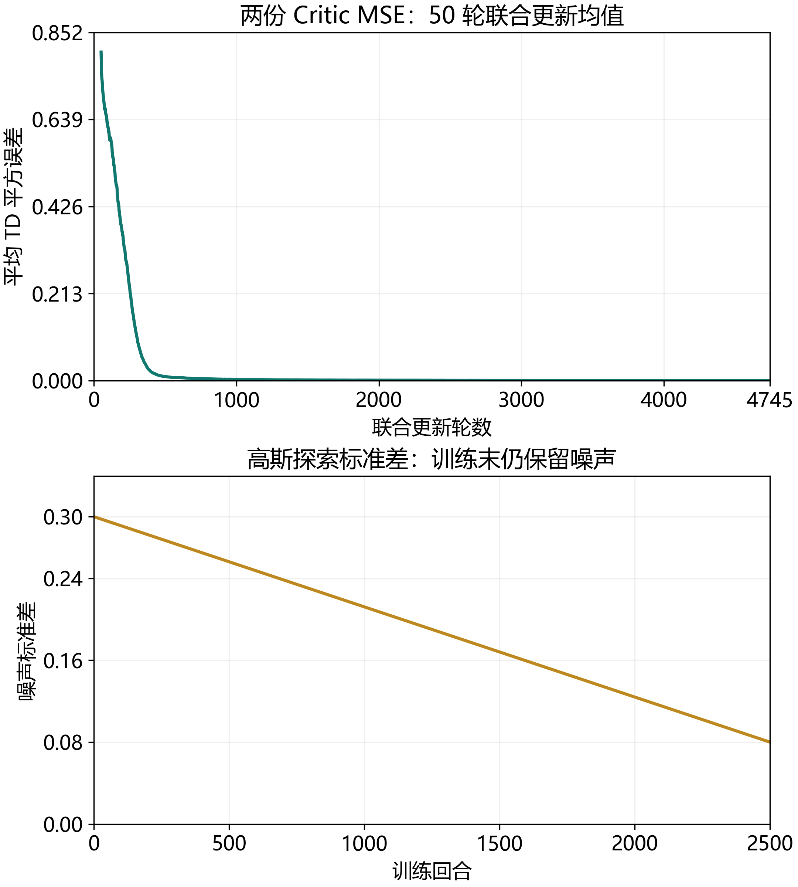
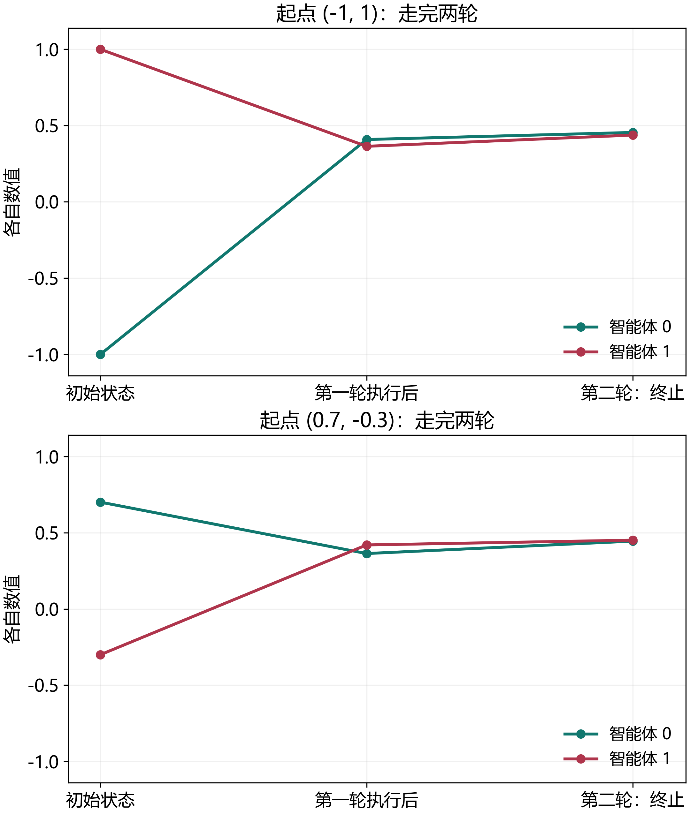

## 这一天解决的问题

[Day7](/2026/10/11/rl-day7-value-decomposition-qmix/) 用局部动作评分和单调 Mixer 训练合作策略。Day8 改用连续动作：每人直接输出一个数，训练时由 Critic 观察双方信息和动作，告诉各自的 Actor 怎样调整。

学习中最关键的疑问是：Critic 知道队友这次选了什么，Actor 却不知道。假如队友选择变了，同一个动作可能从好变坏，Actor 到底在学什么？

把数值对齐想成两个人在各自纸上写数，写得越近越好。如果队友总写 `0.8`，学着写 `0.8` 就管用；如果队友独立地各以一半概率写 `0.2` 或 `0.8`，而我看不到他的抽签结果，按平方距离评分时，写 `0.5` 的平均损失是 `0.09`，写 `0.8` 的平均损失是 `0.18`。`0.5` 是针对两种可能性的最好固定选择，不是猜出了这一次队友写什么。

共同训练还能改变队友的行为分布，让双方逐渐采用同一约定。集中式 Critic 能在训练时对这次联合动作评分，执行时仍由两份只读局部观测的 Actor 出手。

下文用“两轮连续数值对齐”实验把这条思路落实到代码：联合回放 → 目标动作与 TD → Critic 拟合 → 本人动作梯度 → 四个目标副本软同步 → 完整分散评估。正文给出关键代码和张量含义；教学算例与实际训练结果分别标明。

## 1. Critic 看见队友，Actor 为什么仍然不能猜到秘密

先用一个离散的单步例子说明。两人各选 0 或 1，相同得奖励 2，不同得 0。记队友选择 0 的概率为 $p$：

$$
\mathbb E[r\mid a_0=0]=2p,\qquad
\mathbb E[r\mid a_0=1]=2(1-p).
$$

队友经常选 0 时，自己选 0 的平均收益更高；队友经常选 1 时，方向相反。Critic 可以分别评价 `(0,0)`、`(0,1)` 等具体组合，Actor 的多次更新则综合这些不同经历。

```python
def expected_rewards(teammate_p0):
    choose_0 = 2 * teammate_p0
    choose_1 = 2 * (1 - teammate_p0)
    return choose_0, choose_1

print(expected_rewards(0.8))  # (1.6, 0.4)
print(expected_rewards(0.5))  # (1.0, 1.0)
```

`teammate_p0` 表示队友的行为分布，不是自己执行时知道的“本轮队友动作”。若队友每次独立、均匀随机选择，自己得不到提示，选择 0 和选择 1 的期望完全相同。

即使自己以任意概率 $q$ 选择 0，匹配概率仍然是：

$$
P(\text{匹配})=q\times0.5+(1-q)\times0.5=0.5.
$$

这时无法只靠训练突破 50% 的匹配上限。Critic 事后看到了联合动作，不会给 Actor 增加本轮尚未看见的信息。

局部 Critic 也可以拟合队友策略下的平均价值。集中式 Critic 多看联合动作，能够区分具体匹配与失配的条件结果；它改变的是训练时的评价依据。队友策略持续变化时，平均价值也会变化，联合信息有助于描述这种变化，但训练仍需要持续更新。

如果两人的策略都参与训练，情况就不同了：队友的选择分布也会变化。双方可能逐渐偏向同一个动作，形成约定。但这不应解释成“某个组合出现得多，它的真实 Q 就必然变大”。在刚才一步结束的对称游戏中，正确的两种匹配 `Q(0,0)` 和 `Q(1,1)` 都是 2；变化的是队友策略下的平均收益，以及网络对它们的近似。

“雪崩式越选越多”可以形容某些训练现象，却不能替代上述机制，也不能保证每次训练一定形成好约定。

## 2. 连续动作：从选哪个，变成怎样调整这个数

Day6 的离散 Actor 输出动作概率，再从分布中采样。今天的确定性 Actor 直接输出一个连续动作：

$$
a_i=\mu_i(o_i).
$$

$o_i$ 是本人能获得的观测，$\mu_i$ 是自己的策略网络。同一组参数和相同输入在当前 MLP 中产生同一个动作；训练探索由网络输出之外的噪声提供。

用一个单步解析算例观察调整方向：

$$
Q(a_0,a_1)=-(a_0-a_1)^2,\qquad
\frac{\partial Q}{\partial a_0}=-2(a_0-a_1).
$$

固定队友为 0.8，自己输出 0.2，动作导数是 +1.2，提高自己的动作能提高评分；自己已经输出 0.9 时，导数变成 -0.2，应该稍微降低。

```python
import torch

own_action = torch.tensor(0.2, requires_grad=True)
teammate_action = torch.tensor(0.8)
q = -(own_action - teammate_action).square()
q.backward()
print(own_action.grad.item())  # 约 +1.2
```

这里的 `own_action` 是用于手算验证的可微标量。实际训练更新的是 Actor 参数，梯度要经过“参数 → 动作 → Critic 评分”的链式法则：[1]

$$
\nabla_{\theta_i}J_i
\approx
\mathbb E_{\mathcal D}\left[
\nabla_{\theta_i}\mu_i(o_i)\,
\nabla_{a_i}Q_i(o_0,o_1,a_0,a_1)
\right]_{a_i=\mu_i(o_i)}.
$$

$\theta_i$ 表示 Actor 参数，$\mathcal D$ 是回放数据。第一部分描述参数怎样影响动作，第二部分描述动作怎样影响评分。两者接起来，才是网络参数的更新方向。



热力图的整条对角线都得到最高奖励 0，所以双方选 0、0.5 或 -0.7 都可以成功。下方曲线展示固定队友后的调整方向；它使用解析单步奖励，帮助理解梯度，并非两轮神经 Critic 的实测价值曲面。

## 3. 两轮实验：动作直接设置数值，共同奖励来自差距

环境有两名智能体，每人输出一个 `[-1,1]` 的连续数值。动作直接设置自己的新数值，双方同时行动。每轮共同奖励是：

$$
r_t=-(a_{0,t}-a_{1,t})^2.
$$

差距越小，奖励越接近 0。两轮之后真正终止，整局总奖励为两轮奖励相加。每轮奖励在 `[-4,0]` 内，整局总奖励在 `[-8,0]` 内；0 是最高奖励。

全局状态为 `[x0, x1, phase]`。`x0/x1` 是上一次执行后各自的数值，`phase` 是已经完成的轮数：开始为 0，第一轮后为 1，第二轮后为 2。

```python
import random

class TwoRoundAgreementEnv:
    def __init__(self, seed):
        self.rng = random.Random(seed)
        self.finished = True

    def reset(self, initial=None):
        self.positions = (
            tuple(float(x) for x in initial) if initial is not None else
            (self.rng.uniform(-1, 1), self.rng.uniform(-1, 1))
        )
        self.phase, self.finished = 0, False
        return (*self.positions, self.phase)

    def step(self, actions):
        if self.finished:
            raise RuntimeError("本局已经终止，请先 reset")
        assert len(actions) == 2 and all(-1 <= a <= 1 for a in actions)
        self.positions = tuple(float(a) for a in actions)
        reward = -(self.positions[0] - self.positions[1]) ** 2
        self.phase += 1
        self.finished = self.phase == 2
        return (*self.positions, self.phase), reward, self.finished
```

`reset()` 开始新局，`step()` 执行一次共同动作。这里摘取环境主体，省略原练习的统计计数器，不改变任务规则。

观测转换固定了信息边界：

```python
device = torch.device("cpu")

def local_observations(state):
    x0, x1, phase = state
    return torch.tensor(
        [[x0, phase], [x1, phase]],
        dtype=torch.float32, device=device,
    )
```

返回形状是 `[2,2]`：第一行给智能体 0，第二行给智能体 1。每人只看自己的数值和公共阶段，不看队友数值。训练系统可以保留两行供 Critic 使用，但执行时不能把第二行悄悄送给第一个 Actor。

这个任务没有隐藏随机目标，也没有消息通道。双方学会输出相近的共同值即可完成；一个固定共同约定就足以解题，当前使用 MLP。它承接 Day7 的合作训练思想，通信的作用则要回到 Day6 那个“另一人必须知道随机提示”的任务中观察。

例如从 `[0.8, -0.6, 0]` 开局，两人的输入分别是 `[0.8, 0]` 和 `[-0.6, 0]`。若双方约定每轮都输出 `0.25`，第一轮把状态改为 `[0.25, 0.25, 1]`，第二轮仍输出同一个数，两个奖励都是 `0`，到 `[0.25, 0.25, 2]` 结束。这里的 `0.25` 是手设策略；下文实测轨迹则保留了各自网络输出的差距。

## MADDPG 实作：从一条联合经历到一次网络更新

两人各写一个连续数值，写得越近，共同奖励越高。将同一步的两人观测、动作、奖励和下一观测一起存下来。这里沿一批这样的记录，分清 Critic 用哪组动作评分，Actor 又拿哪组动作求梯度。

[阅读全文](/2026/10/12/rl-day8-maddpg-training/training-update/)

<ul>
<li id="4-网络分工两个局部-actor两份集中式-q四个目标副本"><a href="/2026/10/12/rl-day8-maddpg-training/training-update/#4-网络分工两个局部-actor两份集中式-q四个目标副本">4. 网络分工：两个局部 Actor、两份集中式 Q、四个目标副本</a></li>
<li id="5-联合回放同一局同一步的双方数据必须配对"><a href="/2026/10/12/rl-day8-maddpg-training/training-update/#5-联合回放同一局同一步的双方数据必须配对">5. 联合回放：同一局、同一步的双方数据必须配对</a></li>
<li id="6-td-目标下一步先生成联合动作再评价"><a href="/2026/10/12/rl-day8-maddpg-training/training-update/#6-td-目标下一步先生成联合动作再评价">6. TD 目标：下一步先生成联合动作，再评价</a></li>
<li id="7-一次联合更新先训练-critic再替换本人的动作"><a href="/2026/10/12/rl-day8-maddpg-training/training-update/#7-一次联合更新先训练-critic再替换本人的动作">7. 一次联合更新：先训练 Critic，再替换本人的动作</a></li>
<li id="8-主训练循环随机预热带噪声动作每步回放更新"><a href="/2026/10/12/rl-day8-maddpg-training/training-update/#8-主训练循环随机预热带噪声动作每步回放更新">8. 主训练循环：随机预热、带噪声动作、每步回放更新</a></li>
</ul>

## 9. 冻结评估：只用在线局部 Actor，完整走到第二轮

训练每 200 回合和最后一回合，在固定 `9×9=81` 个起点上评估，便于比较不同训练时刻。结束后另采 500 个连续随机起点。

```python
import itertools

grid = torch.linspace(-1, 1, 9).tolist()
grid_initials = list(itertools.product(grid, repeat=2))
eval_rng = random.Random(seed + 200)
random_initials = [
    (eval_rng.uniform(-1, 1), eval_rng.uniform(-1, 1))
    for _ in range(500)
]
```

`product` 枚举两个数的全部网格组合；另一次随机采样让评估不局限在这 81 个离散起点。每次都运行完整两轮，成功定义为两轮动作差都不超过 0.1。

```python
@torch.no_grad()
def evaluate(actor_models, initials):
    for actor in actor_models:
        actor.eval()
    eval_env = TwoRoundAgreementEnv(seed + 100)
    gaps, totals, discounted, successes = [], [], [], []
    for initial in initials:
        state = eval_env.reset(initial)
        finished, step = False, 0
        total, g0, success = 0.0, 0.0, True
        while not finished:
            actions = local_actions(actor_models, state)
            next_state, reward, finished = eval_env.step(actions)
            gap = abs(actions[0] - actions[1])
            gaps.append(gap)
            total += reward
            g0 += gamma ** step * reward
            success = success and gap <= 0.1
            state, step = next_state, step + 1
        assert step == 2
        totals.append(total)
        discounted.append(g0)
        successes.append(success)
    return {
        "mean_gap": sum(gaps) / len(gaps),
        "max_gap": max(gaps),
        "mean_reward": sum(totals) / len(totals),
        "mean_discounted": sum(discounted) / len(discounted),
        "success_rate": sum(successes) / len(successes),
    }
```

这是评估主体，省略原练习的调用统计和轨迹保存。`mean_gap` 平均所有评估局的每一轮差距；`mean_reward` 先求各局两轮奖励之和，再对局取平均；`mean_discounted` 用 `r0+0.9*r1`；`success_rate` 要求整局两轮都达标。

三个开关要区分：

| 做法 | 实际作用 |
|---|---|
| `actor.eval()` | 切换 Dropout、BatchNorm 等层的行为，本 MLP 没有这些层 |
| `torch.no_grad()` | 不记录反向计算图 |
| 评估中不加高斯噪声 | 真正关闭本例的探索 |

`eval()` 和 `no_grad()` 都不会自动删除代码里显式添加的噪声。[3] 这里的评估函数没有加噪声，也没有任何优化器调用。

传入的只有两个在线 Actor。对所有在线及目标网络进行参数快照、给 Critic 和目标 Actor 注册调用计数后，实际检查结果是：评估参数不变，Critic 调用 0，目标 Actor 调用 0。这使“训练集中评价，执行局部行动”的信息边界能在代码中验证。

## 10. 实际结果：奖励趋近 0，双方形成稳定约定

本节数值来自当前保存输出：CPU，PyTorch `2.10.0+cu128`，随机种子 7；图中的训练历史由同源代码重新执行取得，关键结果与保存输出一致。

| 指标 | 训练前 | 训练后 |
|---|---:|---:|
| 固定 81 起点的每轮平均差 | 0.809328 | 0.018731 |
| 固定 81 起点的两轮平均总奖励 | -1.341871 | -0.001405 |
| 固定 81 起点的整局成功率 | 0/81 | 81/81 |
| 另采 500 起点的每轮平均差 | — | 0.016863 |
| 另采 500 起点的所有轮次最大差 | — | 0.079457 |
| 另采 500 起点的两轮平均总奖励 | — | -0.001142 |
| 另采 500 起点的整局成功率 | — | 500/500 |

成功率使用差距阈值 0.1，表示这 500 局的两轮都达标，不表示动作精确相等，也不表示所有可能起点已经被穷尽。奖励仍略为负，正是因为双方还有小差距。



第 200 回合冻结平均差约 0.0110，第 400 回合约 0.1131，随后再次下降。训练中双方策略、回放批次和目标网络持续变化，不能要求每个评估点单调改善；这条曲线本身也不能单独确定某次回升由哪一个因素造成。

训练最后 100 局平均奖励约 -0.034447，低于最终无噪声评估的 -0.001405。训练末仍有约 0.08 的探索标准差，双方实际动作会被噪声拉开，起点集合也不同。比较两个策略的质量，应在相同起点分布、噪声、奖励与终止条件下分别冻结评估。



最后 50 轮联合更新的平均 Critic MSE 约 0.00019963。这个值表示抽到的批次上，预测接近当前 TD 目标；目标和批次仍在变化，低 loss 不能替代真实环境中的成功证据。

两条实际轨迹展示了第二轮如何真正结束：

| 初始数值 | 轮次 | 智能体 0 动作 | 智能体 1 动作 | 共同奖励 | 真正终止 |
|---|---:|---:|---:|---:|---|
| `(-1,1)` | 1 | 0.408557 | 0.363995 | -0.001986 | 否 |
| `(-1,1)` | 2 | 0.454844 | 0.437522 | -0.000300 | 是 |
| `(0.7,-0.3)` | 1 | 0.362993 | 0.419413 | -0.003183 | 否 |
| `(0.7,-0.3)` | 2 | 0.444480 | 0.450764 | -0.000039 | 是 |



这里学出的共同值接近 0.4～0.45。奖励没有指定它必须等于多少；双方接近就获得较高回报。它说明当前训练形成了相容的局部策略，而不是 Actor 在执行时直接看见队友动作。

把 Day6–Day8 放在一起，三条路线的区别更清楚：

| 学习内容 | 训练时怎样评价 | 执行时怎样行动 | 本次任务中的重点 |
|---|---|---|---|
| Day6 合作训练 | 集中式状态价值与共同优势 | 各自局部概率 Actor | 联合采样与团队反馈 |
| Day6 消息通道 | 发送、接收动作都获得任务学习信号 | 先发消息，再依据消息行动 | 将随机提示送到缺信息的一方 |
| Day7 QMIX | 局部 utility 经单调 Mixer 形成团队 Q | 局部网络选离散贪心动作 | 价值分解与分散选择 |
| Day8 MADDPG 风格 | 每个集中式 Q 看联合观测和动作 | 各自局部连续 Actor | 从动作梯度学习配合 |

集中式训练使用更多信息，分散执行遵守本人的可见信息。通信是执行时增加可用信息的一种机制；当前连续对齐任务用固定约定就能成功。联合 Critic 帮助评价具体动作组合，是否需要消息仍由任务的信息需求决定。

## 参考资料

1. Lowe et al. *Multi-Agent Actor-Critic for Mixed Cooperative-Competitive Environments*. NeurIPS 2017，重点对应第 4.1 节的集中式 Q、确定性策略梯度和目标策略：[论文](https://arxiv.org/abs/1706.02275)。
2. 作者实现中 Q 输入联合观测和动作，策略更新只替换本人动作，目标 Actor 与目标 Critic 分别同步：[MADDPG 源码](https://github.com/openai/maddpg/blob/master/maddpg/trainer/maddpg.py)。
3. PyTorch 官方关于 `requires_grad`、`no_grad` 和 evaluation mode 的说明：[Autograd mechanics](https://docs.pytorch.org/docs/stable/notes/autograd.html)。
