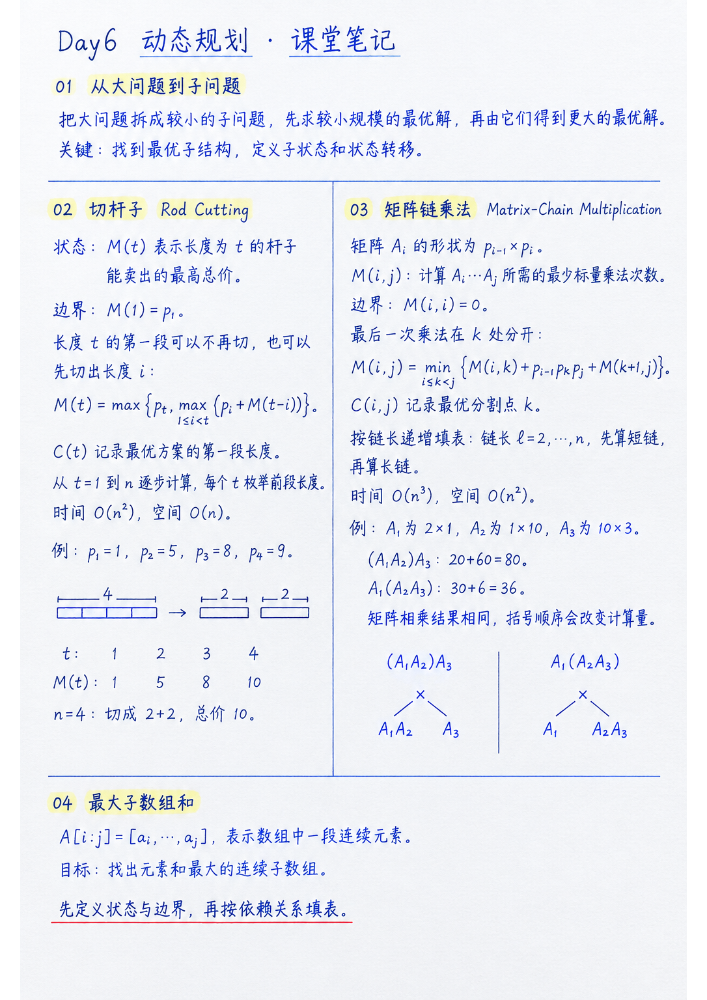

> RedMoon · 2026-10-29 · 课堂阅读笔记



本次课先回看区间合并和旋转数组查找，再从爬楼梯问题观察重复子问题，逐步进入动态规划。钢条切割展示了如何用较短长度的最优解求更长长度的收益；矩阵链乘法则把状态扩展到任意连续区间，说明动态规划不只处理从起点开始的前缀。

贯穿这些例子的思路是：先把问题说清楚，试着列出小规模情况，再定义状态、找出最后一步的选择，并按依赖关系计算。动态规划不是背一条转移公式，而是把“哪些小问题足以组成大问题”表达准确。

## 一、课前回顾：排序与二分的结构

### 1. 区间合并

给定若干闭区间，先按左端点升序排序，再从左向右扫描。维护已经合并的最后一个区间 $[L,R]$：

- 若新区间 $[l,r]$ 满足 $l\le R$，二者相交或相接，更新 $R\leftarrow\max(R,r)$；
- 若 $l>R$，新区间与当前结果分离，直接开始一个新区间。

```text
按左端点升序排列 intervals
merged = []
for [l, r] in intervals:
    if merged 为空 or l > merged[-1].right:
        将 [l, r] 加入 merged
    else:
        merged[-1].right = max(merged[-1].right, r)
```

扫描不变量是：每处理完一个区间，`merged` 恰好表示已处理区间的并集，且按左端点有序、相邻结果彼此分离。由于输入已按左端点排序，新区间只可能与结果中的最后一个区间相交或相接；合并或追加都保持这个不变量。

排序花费 $O(n\log n)$，扫描花费 $O(n)$，所以总时间为 $O(n\log n)$。如果题目把“端点相接”定义为不重叠，判断式需相应改成 $l<R$；比较符号取决于区间端点约定。

### 2. 旋转有序数组中的二分查找

假设原数组严格递增、元素互异，旋转后仍至少有一半保持有序。每轮比较左右边界与中点：

1. 若 $A[left]\le A[mid]$，左半段有序。目标 $x$ 落在 $[A[left],A[mid])$ 时继续查左半段，否则查右半段。
2. 否则右半段有序。目标 $x$ 落在 $(A[mid],A[right]]$ 时查右半段，否则查左半段。

每轮把搜索区间缩小一半，时间为 $O(\log n)$，额外空间为 $O(1)$。若数组允许大量重复值，边界相等时可能无法判断哪一半有序，最坏时间会退化到 $O(n)$；上面的简单判断针对互异元素。

## 二、动态规划从哪里开始

### 1. 先从爬楼梯看重复子问题

每次可以走 1 阶或 2 阶。令 $F(n)$ 表示走到第 $n$ 阶的不同走法数。最后一步只能从 $n-1$ 阶走 1 阶，或从 $n-2$ 阶走 2 阶，因此：

$$
F(0)=1,\qquad F(1)=1,
$$

$$
F(n)=F(n-1)+F(n-2)\quad(n\ge2).
$$

前几项为 $1,1,2,3,5,8,\ldots$。直接递归会反复计算相同的 $F(k)$；用表保存结果后，每个状态只计算一次，时间为 $O(n)$。保存整张表需要 $O(n)$ 空间；由于每次只依赖前两项，也可以滚动变量把额外空间降为 $O(1)$。

这是计数问题，不是求最大值的优化问题。它说明动态规划可以用于不同类型的目标，只要状态之间存在可复用的依赖关系。

### 2. 状态、转移与计算顺序

- **状态**要明确表示一个子问题的答案，例如 $F(n)$ 表示“到达第 $n$ 阶的方法数”。
- **状态转移**说明当前状态如何由更小状态得到，例如 $F(n)=F(n-1)+F(n-2)$。
- **边界条件**给出不再分解的最小问题。
- **计算顺序**必须保证转移依赖的状态已经有值。自底向上填表从小规模开始；自顶向下递归则可用记忆化缓存已经求出的状态。

动态规划常见的两个线索是重叠子问题和最优子结构。前者意味着多个递归路径会遇到同一子问题；后者意味着在某个最优决策下，组成整体的子问题也应取相应的最优解。状态还必须保留足够信息：若两个子问题之间有会影响组合结果的交互，就要把相关信息纳入状态，不能仅凭“分别最优”就认定可以拼出全局最优。

动态规划和分治都把原问题拆成较小子问题再组合。典型分治会分别求解相对独立的子问题；动态规划的典型场景则有重叠子问题，并通过记忆化或表格避免重复计算。若递归过程中没有重复状态，单纯缓存通常不会减少计算量。

粗略估算时间时，可以先数状态数量，再乘以每个状态需要检查的转移数。动态规划减少重复计算，但实际复杂度仍由状态规模和转移枚举共同决定。

## 三、钢条切割：一维状态的最优收益

### 1. 定义状态并枚举第一段

长度为 $i$ 的钢条售价为 $p_i$。令 $M(t)$ 表示长度为 $t$ 的钢条能够获得的最高总价，$M(0)=0$。

对长度 $t$，第一段可以取长度 $i$，其中 $1\le i\le t$；剩余部分长度为 $t-i$，直接使用其最优收益。于是：

$$
M(t)=\max_{1\le i\le t}\bigl(p_i+M(t-i)\bigr).
$$

当 $i=t$ 时表示整段直接出售，不再切割。因此它也可写成：

$$
M(t)=\max\left(p_t,\ \max_{1\le i<t}\bigl(p_i+M(t-i)\bigr)\right).
$$

自底向上填表时，先算较短长度，再用它们得到较长长度：

```text
best[0] = 0
for t = 1..n:
    best[t] = -∞
    for i = 1..t:
        candidate = price[i] + best[t - i]
        if candidate > best[t]:
            best[t] = candidate
            first_piece[t] = i
```

如果还要输出切法，可令 $C(t)$ 记录使收益最大的第一段长度 $i$。反复读取 $C(t)$ 并令 $t\leftarrow t-C(t)$，即可还原整套方案。

### 2. 例子：局部性价比不等于全局最优

设 $p_1=1,\ p_2=5,\ p_3=8,\ p_4=9$。逐个计算：

| 长度 $t$ | 最高收益 $M(t)$ | 一个最优方案 |
|---:|---:|---|
| 1 | 1 | 1 |
| 2 | 5 | 2 |
| 3 | 8 | 3 |
| 4 | 10 | 2+2 |

长度 4 若按单位长度售价最高的长度 3 先切，会得到 $8+1=9$；切成 $2+2$ 则得到 $5+5=10$。因此，单次切割的局部指标不能替代对整体方案的比较。

外层依次计算长度 $1$ 到 $n$，长度 $t$ 的状态枚举 $t$ 种第一段长度，候选总数为

$$
\sum_{t=1}^{n}t=\frac{n(n+1)}{2}.
$$

因此总时间为 $O(n^2)$；收益表和第一段选择表各需 $O(n)$ 空间。

## 四、矩阵链乘法：把子状态扩展成区间

### 1. 计算次序会改变代价

给定矩阵链 $A_1A_2\cdots A_n$，矩阵乘法满足结合律，所以改变括号不会改变最终矩阵；但中间结果的维度不同，标量乘法次数可能差很多。

若 $A_1$ 为 $2\times1$，$A_2$ 为 $1\times10$，$A_3$ 为 $10\times3$：

$$
(A_1A_2)A_3:\quad 2\cdot1\cdot10+2\cdot10\cdot3=80,
$$

$$
A_1(A_2A_3):\quad 1\cdot10\cdot3+2\cdot1\cdot3=36.
$$

两种顺序的结果维度相同，但后者的计算量更小。

### 2. 区间状态与最后一次乘法

用维度数组 $p_0,p_1,\ldots,p_n$ 表示矩阵形状，其中 $A_i$ 为 $p_{i-1}\times p_i$。令 $M(i,j)$ 表示计算 $A_i\cdots A_j$ 所需的最少标量乘法次数。

单个矩阵不需要相乘：

$$
M(i,i)=0.
$$

对区间 $[i,j]$，考虑最后一次乘法在 $k$ 处分开。左侧结果的形状是 $p_{i-1}\times p_k$，右侧结果的形状是 $p_k\times p_j$，最后合并的代价为 $p_{i-1}p_kp_j$。因此：

$$
M(i,j)=
\min_{i\le k<j}
\left(
M(i,k)+M(k+1,j)+p_{i-1}p_kp_j
\right).
$$

令 $S(i,j)$ 记录取得最小值的分割点 $k$，便可在求出最小代价后递归还原括号结构。对于固定的最后分割点，左右区间的最优代价可以独立相加；枚举所有 $k$ 就覆盖了每一种可能的最后乘法。

转移正确性可以按区间长度归纳。长度为 1 时，单个矩阵的乘法代价为 0，边界成立。对于更长的区间，任何一种完整括号方案都有唯一的最后一次乘法分割点 $k$；其左右两侧分别是两个更短区间。按归纳假设，这两个子区间的最优代价由 $M(i,k)$ 和 $M(k+1,j)$ 给出，因此该方案的代价不小于对应的转移候选值。反过来，取使转移式最小的 $k$，并分别使用左右区间的最优方案，就能构造出达到该候选值的合法括号方案。故取所有 $k$ 的最小值恰好得到 $M(i,j)$。

### 3. 按链长填表

状态是任意连续子链 $[i,j]$，不是只有前缀 $A_1\cdots A_j$。计算长度为 $\ell$ 的区间时，需要的左右子区间长度都小于 $\ell$，所以按 $\ell=2,3,\ldots,n$ 递增填表即可。

共有 $O(n^2)$ 个区间状态。所有状态实际枚举的分割点总数为

$$
\sum_{\ell=2}^{n}(n-\ell+1)(\ell-1)
=\binom{n+1}{3}
=\frac{n^3-n}{6}.
$$

因此：

$$
\text{时间复杂度 }O(n^3),\qquad
\text{空间复杂度 }O(n^2).
$$

这里的空间包括最优代价表 $M$ 和还原切分所需的 $S$。矩阵链乘法展示了区间动态规划的常见结构：状态由左右端点定义，转移枚举区间内部的分割位置。

## 五、把动态规划写出来的检查顺序

面对新的优化或计数问题，可以按以下顺序推导，而不是先猜代码：

1. 明确要返回的是最优值、最优方案数量，还是具体方案。
2. 定义状态，并写清它对应的子问题。
3. 观察最后一步或第一步的决策，把所有可能选择列全。
4. 说明每种选择如何组合更小状态，以及这些状态是否包含了足够信息。
5. 给出最小状态的边界值。
6. 按依赖顺序计算，并用状态数乘以单状态转移数估算复杂度。
7. 若需要具体方案，额外记录最优决策，再沿记录回溯。

### 最大子数组和：问题入口

最大子数组和关注数组中的连续一段。记

$$
A[i:j]=[a_i,a_{i+1},\ldots,a_j],
$$

目标是找到元素和最大的连续子数组。课堂手写速览将它列作后续问题入口；本次资料只呈现定义和目标，没有展开该问题的状态与转移。

## 六、本次课的主线

- 区间合并先排序再扫描；旋转数组查找利用“至少一半有序”继续二分。
- 动态规划从小规模例子出发，靠明确状态和依赖关系复用已求结果。
- 钢条切割的状态按长度 $t$ 定义，转移枚举第一段长度。
- 矩阵链乘法的状态按区间 $[i,j]$ 定义，转移枚举最后一次乘法的分割点。
- 写转移前，先确认状态完整、边界正确、所有决策都已覆盖；如果子问题间存在未表达的交互，需要重新设计状态。

## 七、课后作业：题目与解答

### 1. 钢条切割：每次切割有固定成本

**题目（课件习题 15.1-3）**

> Consider a modification of the rod-cutting problem in which, in addition to a price $p_i$ for each rod, each cut incurs a fixed cost of $c$. The revenue associated with a solution is now the sum of the prices of the pieces minus the costs of making the cuts. Give a dynamic-programming algorithm to solve this modified problem.

也就是说，长度为 $i$ 的钢条售价为 $p_i$，每切一刀要支付固定成本 $c$。一套切法的收益是各段售价之和减去切割成本之和；设计动态规划算法求最大收益。

**解答**

令 $R(t)$ 表示长度为 $t$ 的钢条在计入切割成本后的最大收益。$R(0)=0$；长度为 1 时不能再切，$R(1)=p_1$。当 $t\ge2$ 时，分别考虑不切和切下第一段：

$$
R(t)=\max\left(
  p_t,\;
  \max_{1\le i<t}\left\{p_i+R(t-i)-c\right\}
\right).
$$

不切时直接得到 $p_t$，不扣成本；切下长度为 $i$ 的一段时，需要支付一次成本 $c$，剩余部分的后续切割成本已包含在 $R(t-i)$ 中。枚举第一段长度即可覆盖所有切法。

```text
CutRodWithCost(price, n, c):
    best[0] = 0
    for t = 1..n:
        best[t] = price[t]       // 整段出售，不发生切割
        first_piece[t] = t
        for i = 1..t-1:
            candidate = price[i] + best[t - i] - c
            if candidate > best[t]:
                best[t] = candidate
                first_piece[t] = i
    return best[n], first_piece
```

`first_piece[t]` 记录最优方案的第一段长度，反复取出这一长度并从 $t$ 中减去，即可还原一种最优切法。

例如，取 $p_1=1,p_2=5,p_3=8,p_4=9$，每次切割成本 $c=1$，得到 $R(1),R(2),R(3),R(4)=1,5,8,9$。长度为 4 时，整段出售收益为 $9$；切成 $2+2$ 的收益为 $5+5-1=9$，两种方案同为最优。

共计算 $n$ 个长度，每个长度最多枚举 $n-1$ 个切割位置，时间复杂度为 $O(n^2)$；收益表和方案表各占 $O(n)$ 空间。

### 2. House Robber：相邻房屋不能同时选择

**题目（LeetCode 198）**

> You are a professional robber planning to rob houses along a street. Each house has a certain amount of money stashed, the only constraint stopping you from robbing each of them is that adjacent houses have security systems connected and it will automatically contact the police if two adjacent houses were broken into on the same night.
>
> Given an integer array `nums` representing the amount of money of each house, return the maximum amount of money you can rob tonight without alerting the police.

给定数组 `nums`，其中每个元素是对应房屋里的金额。不能同时选择相邻房屋，求能取得的最大金额。课件中的两个例子是：

- 输入 `[1,2,3,1]`，输出 `4`：选择第 1、3 间，金额为 $1+3=4$。
- 输入 `[2,7,9,3,1]`，输出 `12`：选择第 1、3、5 间，金额为 $2+9+1=12$。

**解答**

令 $F(i)$ 表示前 $i$ 间房屋能取得的最大金额，第 $i$ 间的金额为 $a_i$。对第 $i$ 间，只有两种选择：

- 不选第 $i$ 间，收益为 $F(i-1)$；
- 选择第 $i$ 间，就不能选第 $i-1$ 间，收益为 $F(i-2)+a_i$。

因此边界和转移为：

$$
F(0)=0,\qquad F(1)=\max(0,a_1),
$$

$$
F(i)=\max\bigl(F(i-1),\,F(i-2)+a_i\bigr)
\quad(i\ge2).
$$

每次只依赖前两个状态，可以用两个变量滚动更新：

```text
HouseRobber(nums):
    prev2 = 0
    prev1 = 0
    for amount in nums:
        current = max(prev1, prev2 + amount)
        prev2 = prev1
        prev1 = current
    return prev1
```

对于 `[2,7,9,3,1]`，依次得到的最优值为 $2,7,11,11,12$。遍历数组一次，时间复杂度为 $O(n)$；只保存常数个变量，额外空间为 $O(1)$。若要还原具体选择的房屋，可保存完整状态表再回溯。

### 3. 矩阵链乘法的递归实现

**题目**

> 课程中讲的矩阵链乘法算法也可以用递归的方式进行实现。请用伪代码写出递归版本，并分析其时间复杂度。

**解答**

直接递归时，函数返回区间 $A_i\cdots A_j$ 的最少标量乘法次数；每一种最后分割点都要重新递归计算左右子区间。用 `split` 记录各区间的最优分割点，便可同时还原计算方式：

```text
MatrixChainRecursive(p, i, j, split):
    if i == j:
        return 0

    best = +∞
    for k = i..j-1:
        left_cost = MatrixChainRecursive(p, i, k, split)
        right_cost = MatrixChainRecursive(p, k + 1, j, split)
        multiply_cost = p[i - 1] * p[k] * p[j]
        candidate = left_cost + right_cost + multiply_cost
        if candidate < best:
            best = candidate
            split[i][j] = k

    return best

PrintParenthesization(split, i, j):
    if i == j:
        输出 A_i
        return
    k = split[i][j]
    输出 "("
    PrintParenthesization(split, i, k)
    输出 " × "
    PrintParenthesization(split, k + 1, j)
    输出 ")"
```

其中，$A_r$ 的维度为 $p_{r-1}\times p_r$。递归边界 $i=j$ 表示只有一个矩阵，不需要进行乘法；$k$ 表示最后一次乘法将区间分成 $[i,k]$ 和 $[k+1,j]$。调用 `MatrixChainRecursive(p, 1, n, split)` 求得最小代价，再调用 `PrintParenthesization(split, 1, n)` 输出括号方案。

以前文的 $p=[2,1,10,3]$ 为例，在 $k=1$ 处分割的代价为 $36$，在 $k=2$ 处分割的代价为 $80$，因此返回 $36$，对应方案为 $A_1(A_2A_3)$。

**复杂度分析**

设 $C(n)$ 为处理长度为 $n$ 的矩阵链时的递归调用次数。每个分割点都产生左右两个递归调用，因此：

$$
C(1)=1,\qquad
C(n)=1+2\sum_{r=1}^{n-1}C(r)\quad(n\ge2).
$$

相邻两项相减得 $C(n)=3C(n-1)$，所以 $C(n)=3^{n-1}$。每次循环恰好产生两个子调用，循环迭代总次数为 $(C(n)-1)/2$，故在基本算术运算按常数时间计算时，直接递归的时间复杂度为 $\Theta(3^n)$。递归栈最多深 $n$ 层，`split` 表占 $O(n^2)$ 空间，因此上述算法的额外空间为 $O(n^2)$；若只求代价、不保存方案，额外空间为 $O(n)$。

如果为每个区间 $[i,j]$ 增加缓存，首次计算仍枚举全部分割点，之后直接复用结果，就得到自顶向下的记忆化动态规划：时间复杂度为 $O(n^3)$，缓存空间为 $O(n^2)$。
