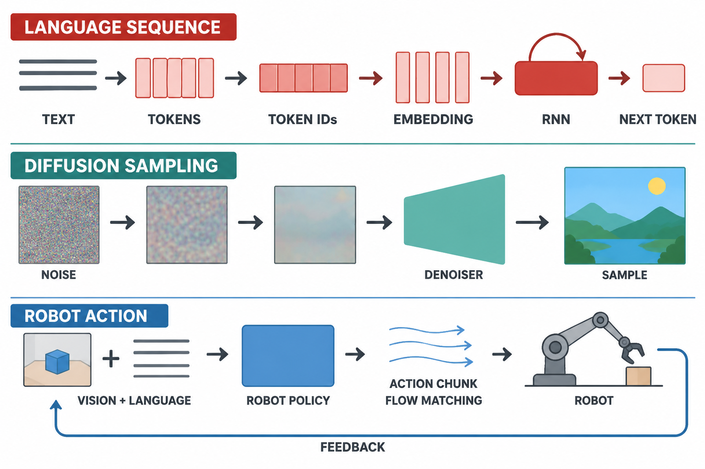

> RedMoon · 2026-11-03 · 课堂笔记

| 项目 | 内容 |
| --- | --- |
| 课程 | 智能计算系统 |
| 课次 | Day7 |
| 整理日期 | 2026-11-03 |
| 授课日期 | 现有资料未注明 |
| 本次主线 | 视觉语言动作模型、扩散生成、Token 与循环神经网络 |

上节课从图像分类、目标检测和生成模型切入计算机视觉。本次课先讨论机器人如何把视觉和语言转成可执行动作，再讲扩散模型的加噪与去噪，最后回到文本序列，梳理 Token、Embedding 和 RNN。三个部分处理的数据不同，但都绕不开同一个问题：模型如何把输入表示成可计算的状态，再据此生成下一步输出。

> 图 1：三条路径用于对比数据表示和输出形式。它们不是同一网络的三个模块；图中的扩散过程为概念示意，不表示逐样本复原。

## 一、VLA：让语言模型进入动作闭环

视觉语言动作模型（Vision-Language-Action, VLA）把图像、语言指令和动作放进一个任务流程中。机器人先从摄像头获得环境观测，再结合指令生成动作；执行后的新观测成为下一轮输入。动作因此处于闭环里，必须持续根据环境变化调整。

课堂用“理解指令”和“实际操作”之间的差异解释 VLA 的动机。语言模型可以理解“把杯子放进柜子”，但仅凭文字理解并不能控制机械臂避开障碍、调整夹爪并确认物体是否放稳。VLA 需要处理视觉感知、任务语义和连续控制之间的衔接。

### 1. RT-2：把动作纳入序列模型的输出

RT-2 的一个关键做法，是把机器人动作量化为离散符号，再以类似语言 Token 的形式输出。这样，视觉语言模型原有的序列预测框架可以承担动作预测任务。模型在机器人演示数据与网页图文数据上共同微调（co-fine-tuning），使动作学习继续利用视觉语言预训练获得的语义知识。[1]

课堂分享将这一点概括为“动作文本符号化”。它的重点是建立统一的输入输出接口：环境图像与语言指令进入模型，模型输出动作符号序列，再由机器人控制系统把符号还原成可执行控制量。随后根据新的摄像头画面继续预测，形成感知—动作闭环。

离散化便于接入自回归序列模型，但动作预测也受到逐 Token 解码方式的影响。动作维度和时间步不断增加时，串行生成会带来控制延迟；若采用平方误差等确定性回归目标压缩多个可行动作模式，平均结果还可能落在不可行的位置。例如，机器人可以从障碍物上方或下方绕行，两个轨迹的坐标平均值却可能穿过障碍物。这是特定回归方式处理多峰动作分布时的风险，不是所有离散策略都会出现的必然问题。

### 2. π0：用连续动作块与 Flow Matching 建模控制

π0 将通用视觉语言模型与动作专家结合，使用 Flow Matching 生成连续动作。与一次只预测一个动作符号相比，策略可输出一段连续动作块；动作生成也可以表示为从简单噪声分布向机器人动作分布的连续变换。[2]

Flow Matching 学习的是把样本从起始分布输送到目标分布的向量场。可以把它理解为模型学习“当前状态该往哪个方向移动”，然后沿着学到的场逐步求解，得到目标动作。π0 用这种方式表示连续控制，也让模型能表达动作分布中的多种可能性。它与 DDPM 都可从噪声出发生成样本，但训练目标、生成路径和采样方式不同，不能简单视为同一种扩散算法。

π0 的动作块仍需与机器人控制频率和反馈机制配合。模型生成一段未来动作，并不意味着可以忽略执行中的新观测；闭环系统仍要根据机器人状态判断动作何时继续、修正或重新规划。

### 3. π0.5：扩大数据与环境范围

π0.5 把重点推进到开放环境泛化。Physical Intelligence 的介绍强调模型在陌生家庭环境中的操作能力，并使用不同来源、不同形态的机器人数据训练，以覆盖实验室之外更复杂的场景。[3]

课堂分享还把长程任务拆成高层子任务和底层动作来讲解：高层负责组织任务步骤，底层策略负责在当前观测下产生动作。面对“整理卧室”之类任务，执行过程涉及多个局部操作，单一动作预测器需要在任务规划与精细控制之间协调。数据范围扩大和层级任务结构共同服务于更广泛的环境适应。

不同数据的采集成本和标注方式并不相同，任务成功率也必须结合具体环境、任务集和统计口径理解。因此，这里不把课堂摘要中缺少原始图表与评测说明的百分比当成可比较的通用指标。

### 4. π0.7：让策略更容易被条件化

Physical Intelligence 于 2026 年 4 月 16 日发布的技术介绍将 π0.7 称为可引导、呈现涌现能力的模型。除了语言任务指令，模型还可以接收期望策略等信息，以及由轻量世界模型生成的视觉子目标。视觉子目标为“最终环境应呈现什么状态”提供更具体的空间约束。[4]

训练数据也可以附带如何完成任务的标注，例如执行质量或速度。官方介绍提到，带有低质量、低速度等元数据的次优自主评测数据可以纳入训练，用标注信息区分不同水平的行为。这样，模型接收到的不止是“做什么”，还包括目标状态或行为偏好等条件。

课堂分享将这些信息概括为任务描述、目标图像、执行表现和控制方式。应把这一概括理解为对演讲内容的归纳，而非固定的统一输入格式。更可靠的技术主线是：更丰富的条件信息可以减少动作生成中的歧义，世界模型提供的视觉子目标也能帮助策略面向预期状态作出动作。

| 模型 | 动作或任务表示 | 课堂讨论的关注点 |
| --- | --- | --- |
| RT-2 | 离散动作符号，按序列生成 | 复用视觉语言模型的语义知识 |
| π0 | 连续动作块，Flow Matching | 连续控制与多种动作模式 |
| π0.5 | 复合任务与开放环境泛化 | 扩展数据范围、组织长程任务 |
| π0.7 | 语言、策略及视觉子目标等条件 | 用额外上下文引导行为 |

这条演进线索展示了 VLA 研究关注点的变化：动作如何接入语言模型输出、连续控制如何表示、系统如何适应新环境，以及如何用更多上下文指定预期行为。落到真实机器人上，生成策略仍要和观测频率、控制器、动作安全及反馈回路共同工作。

## 二、扩散模型：从噪声分布逐步生成样本

扩散模型把训练数据逐步扰动成噪声，再训练神经网络学习反向生成过程。正向过程通常根据预设噪声日程向数据加入高斯噪声；它不是由神经网络临时“猜出”要加的噪声。反向过程则由模型估计噪声或等价参数，并按采样规则逐步得到样本。[5]

### 1. 正向加噪可以直接采样

离散扩散过程在每个时间步按噪声方差 $\beta_t$ 对当前样本加噪。令 $\alpha_t=1-\beta_t$，并定义 $\bar{\alpha}_t=\prod_{s=1}^{t}\alpha_s$，则可以直接从干净样本 $x_0$ 得到任意时间步的 $x_t$：

$$
x_t=\sqrt{\bar{\alpha}_t}x_0+\sqrt{1-\bar{\alpha}_t}\,\epsilon,
\qquad \epsilon\sim\mathcal{N}(0,I).
$$

这条式子把累计加噪写成一次采样形式，因此训练时不必真的从第 1 步逐帧模拟到第 $t$ 步。随着 $\bar{\alpha}_t$ 变小，原始信号所占比例降低，噪声所占比例上升。

**手算例子。** 假设标量像素 $x_0=0.5$，取 $\bar{\alpha}_t=0.64$，本次随机噪声样本为 $\epsilon=-1$。则信号系数为 $0.8$，噪声系数为 $0.6$：

$$
x_t=0.8\times0.5+0.6\times(-1)=-0.2.
$$

这里的 $\bar{\alpha}_t$ 和噪声值只用于演示代入过程，不是某个模型的真实噪声日程或评测数据。

### 2. 训练噪声预测器，推理时迭代去噪

常见 DDPM 训练方式把带噪样本 $x_t$、时间步 $t$ 和可选条件 $c$ 输入网络，要求网络预测当初加入的噪声：

$$
\epsilon_\theta(x_t,t,c)\approx\epsilon.
$$

简化的训练目标是：

$$
\mathcal{L}_{\mathrm{simple}}
=\mathbb{E}_{x_0,t,\epsilon}
\left[
\left\|\epsilon-\epsilon_\theta(x_t,t,c)\right\|_2^2
\right].
$$

训练时既然从 $x_0$ 采样并生成了 $\epsilon$，就知道监督目标是什么。采样时则从随机噪声开始，网络根据当前 $x_t$ 与时间步估计噪声，再依照反向转移规则计算较少噪声的下一状态。重复多步后得到生成样本。

因此，反向生成并不是把网络输出不加处理地直接从图像上减掉，也不是反向传播的过程。前者要遵循所选扩散模型的参数化和采样方程；后者是训练神经网络时计算梯度、更新参数的算法。两者的“反向”含义不同。

### 3. 文本条件怎样控制生成

文本到图像生成会把提示词编码为条件表示，再通过交叉注意力等结构让去噪网络在生成过程中使用这些信息。不同模型的条件注入位置和实现并不完全相同，不能概括为“把一句话拼到每个像素上”。当条件发生变化时，网络每一步预测噪声的结果也随之变化，从而影响最终样本。

视频生成还要处理帧与帧之间的时序关系。如果把每一帧当成互不相关的图片独立生成，不能自动保证主体身份、位置和运动连续；模型需要在时间维度上学习一致性。

### 4. 潜空间扩散减少高分辨率计算

Latent Diffusion Models（LDM）先用编码器把图像映射到较低维的潜变量，再在潜空间中执行扩散去噪，最后用解码器还原图像。[6] 这保留了“在潜表示上建模”的压缩步骤，计算量更低；它不是取消编码压缩。Stable Diffusion 系列采用潜空间扩散路线，但“Stable”这一名称不能作为模型数值稳定性的证据。

把生成过程放在潜空间，降低的是去噪网络直接处理的空间尺寸；编码器和解码器本身仍参与训练或推理流程。文本条件也可以注入潜空间去噪网络，控制合成结果。扩散模型的关键是拟合数据分布并逐步采样，不能把它描述成“每张图像与某一个固定噪声一一绑定”。

## 三、Token、Embedding 与 RNN：序列信息怎样传递

图像或动作可以用矩阵、时间序列等表示；文本则先经过 Tokenization，把字符流切分为模型词表里的 Token。Token 可以是字、词、子词或其他符号单元，具体粒度取决于分词器。BPE 通过反复合并高频相邻符号来构造子词词表，是常见方法之一。[7]

分词完成后，每个 Token 映射到词表索引（Token ID），再通过 Embedding 矩阵查到一个固定维度向量。若词表大小为 $V$、向量维度为 $d$，Embedding 矩阵可写为 $E\in\mathbb{R}^{V\times d}$，序列中的 Token ID $i_t$ 对应向量 $e_t=E[i_t]$。

这里的“固定维度”指每个 Token 的向量维数相同，并不表示整段序列被压缩成一个固定长度向量。输入序列仍有多个位置，Embedding 把离散索引转换成神经网络可处理的连续向量。

### 1. RNN 用循环隐藏状态处理序列

循环神经网络（RNN）在每个时间步接收当前输入向量 $x_t$，并将前一时刻的隐藏状态 $h_{t-1}$ 带入当前计算：

$$
h_t=\phi(W_{xh}x_t+W_{hh}h_{t-1}+b_h),
\qquad
y_t=g(W_{hy}h_t+b_y).
$$

其中 $W_{xh}$ 连接输入与隐藏层，$W_{hh}$ 连接前一隐藏状态与当前状态，$W_{hy}$ 把隐藏状态映射到输出。$\phi$ 可以是 $\tanh$ 等非线性函数；$g$ 可按任务取 Softmax 或其他输出形式。

每个时间步重复使用同一组参数，信息通过隐藏状态向后传递。序列可以有不同长度，网络按实际时间步递归计算。隐藏状态承载此前信息，但“能递归处理任意长度”不等于“能无损记住任意长度”；很早的输入需要经过多次状态变换才能影响当前输出。

### 2. BPTT 与梯度消失、爆炸

训练 RNN 时，可把循环结构沿时间展开成一串共享参数的计算步骤，再用时间反向传播（Backpropagation Through Time, BPTT）累积各时间步对损失的梯度。远处时间步的梯度要经过多个局部导数连乘。

若许多局部导数的模小于 1，乘积会快速变小，早期输入难以通过梯度更新影响参数，这就是梯度消失；若多个局部导数的模持续大于 1，乘积可能迅速增大，形成梯度爆炸。用一个固定标量作直觉例子，$0.9^{50}\approx0.0052$，而 $1.1^{50}\approx117.4$。真实网络是矩阵与激活导数连乘，这两个数字只展示连乘放大或衰减的趋势。

梯度裁剪可以限制过大的梯度范数，主要缓解梯度爆炸；它不能把已经衰减到很小的梯度恢复回来。LSTM 与 GRU 通过门控和更合适的信息通路帮助模型保留、更新或遗忘状态，改善长距离依赖学习，但不意味着所有长序列问题都已解决。[8]

RNN 对照中英文翻译可以看出逐步对齐为何不总是简单的一对一：英语和中文的词序不同，最终输出需要利用前文关系重新组织成目标语言序列。RNN 的隐藏状态提供了序列上下文，但长距离依赖会受到反复递归与梯度传播的影响。Transformer 后续用注意力直接建立不同位置之间的联系，是课堂预告的下一部分内容。[9]

## 四、把三条主线放在一起

文本序列模型把符号转换成 Token ID 和向量，按时间步处理上下文；扩散模型从噪声状态开始，学习如何逐步生成样本；VLA 则把视觉语言条件映射到连续动作或动作片段，并让执行结果通过观测反馈回来。表示形式和输出对象不同，设计时都要考虑条件如何进入模型、生成步骤怎样组织，以及误差如何影响后续状态。

本次课的三个重点可以压缩为：

- VLA 的动作表示从离散符号扩展到连续动作块，任务条件和反馈共同影响机器人行为。
- 扩散模型将加噪过程变成可控的训练目标，通过反向采样逐步生成样本；潜扩散在压缩后的潜空间完成去噪计算。
- Token 化把文本变成索引，Embedding 把索引变成向量，RNN 再用循环隐藏状态处理这些序列表示。

## 参考资料

[1] Brohan et al. *RT-2: Vision-Language-Action Models Transfer Web Knowledge to Robotic Control*. 2023. [arXiv:2307.15818](https://arxiv.org/abs/2307.15818)

[2] Black et al. *π0: A Vision-Language-Action Flow Model for General Robot Control*. 2024. [arXiv:2410.24164](https://arxiv.org/abs/2410.24164)

[3] Physical Intelligence. *A VLA with Open-World Generalization*. [π0.5 技术介绍](https://www.pi.website/blog/pi05)

[4] Physical Intelligence. *π0.7: A Steerable Model with Emergent Capabilities*. 2026-04-16. [官方技术介绍](https://www.pi.website/blog/pi07)

[5] Ho, Jain, and Abbeel. *Denoising Diffusion Probabilistic Models*. 2020. [arXiv:2006.11239](https://arxiv.org/abs/2006.11239)

[6] Rombach et al. *High-Resolution Image Synthesis with Latent Diffusion Models*. 2022. [arXiv:2112.10752](https://arxiv.org/abs/2112.10752)

[7] Sennrich, Haddow, and Birch. *Neural Machine Translation of Rare Words with Subword Units*. 2016. [arXiv:1508.07909](https://arxiv.org/abs/1508.07909)

[8] Cho et al. *Learning Phrase Representations using RNN Encoder-Decoder for Statistical Machine Translation*. 2014. [arXiv:1406.1078](https://arxiv.org/abs/1406.1078)

[9] Vaswani et al. *Attention Is All You Need*. 2017. [arXiv:1706.03762](https://arxiv.org/abs/1706.03762)
