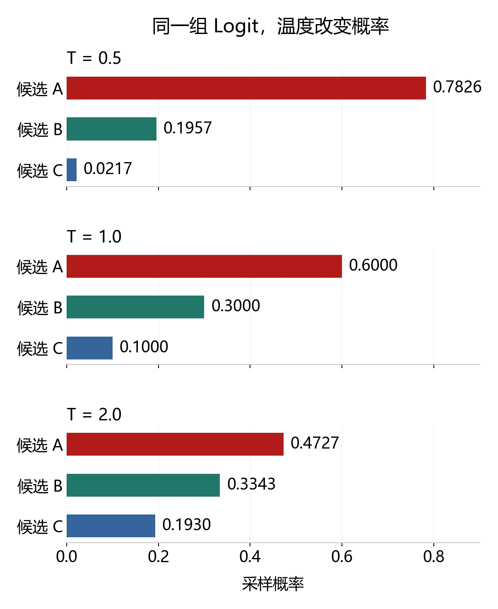
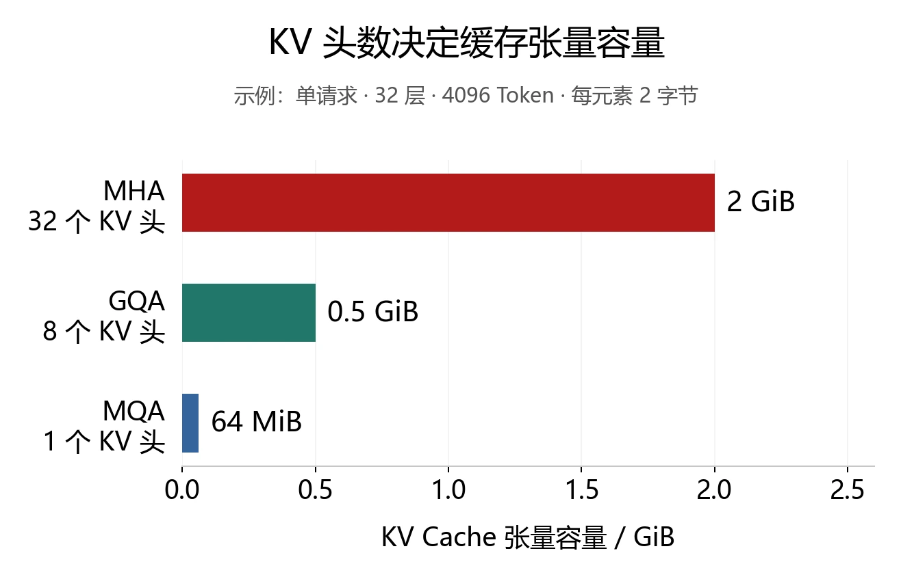

> RedMoon · 整理于 2026-11-04 · 课堂阅读笔记

## 一、这节课的主线

Day4 讨论指令微调和提示工程，Day5 继续回答两个问题：模型怎样按人的期望完成任务，训练好的模型又怎样高效地生成回答。

预训练模型学习的是文本中的统计规律。真实用户还会要求它理解意图、承认不知道、避免危险操作。例如，“让程序更快”通常隐含“保持功能正确”；把代码删空虽然能缩短运行时间，却没有完成任务。**对齐需要把这些实际要求转化为数据、评价标准和优化目标。**

部署时，模型每一步先给出下一个 Token 的分布，解码策略再决定选哪个 Token。生成同一段内容还涉及显存、缓存和硬件调度。三层问题可以分开理解：

| 层次 | 核心问题 | 代表方法 |
| --- | --- | --- |
| 行为对齐 | 什么样的回答符合任务与人的期望 | SFT、RLHF、DPO |
| 输出选择 | 根据概率分布怎样选出回答 | 贪心、束搜索、温度、Top-k、Top-p |
| 推理执行 | 怎样减少生成时的计算和访存开销 | KV Cache、PagedAttention、投机解码 |

提高偏好评分、提高序列概率和缩短响应时间，分别对应不同目标，评价时需要分别观察。

## 二、人类对齐的三个标准

### 1. 有用性：把用户的任务做成

有用性（Helpfulness）要求回答能推进任务，并尽量简洁、高效。用户要求修改代码时，直接交付可用的修改结果，比泛泛列出修改建议更符合需求。

这还包括两种判断能力：

- 缺少会影响结果的关键信息时，提出具体问题，例如任务报告的格式、输入数据和目标读者。
- 容忍无关的输入变化，例如错别字、口语表达和语序调整，保持对核心需求的理解。

难点在于，用户不一定能事先完整描述自己想要什么。有时只能比较两个结果后判断更喜欢哪个。这也是偏好比较具有实际价值的原因。

### 2. 诚实性：让答案与依据相符

诚实性（Honesty）包括事实准确，以及对不确定性的恰当表达。模型需要在有依据时作答，在依据不足时说明未知，并纠正会影响结论的错误前提。

课堂用“用户坚持说 $1+1=3$，模型随即改口附和”的例子说明：迎合用户和诚实回答之间可能发生冲突。对齐若过度奖励“让用户满意”，就可能强化这种附和。

事实问答可以借助参考答案、知识库和程序检查，但诚实性还涉及出处、上下文和置信程度。语言流畅、语气肯定都不能充当事实依据。

### 3. 无害性：结合用途和后果判断

无害性（Harmlessness）关注冒犯、歧视、危险帮助，以及执行操作可能造成的损失。对具有实际影响的操作，需要识别权限、代价和用户的真实授权范围。

判断还依赖使用者与情境。教育助手面向儿童时，需要采用适龄的表达；情感陪伴和心理支持产品需要考虑依赖、隐私及服务中断的影响。课堂中的这些例子用于说明产品设计风险，不能据此对某个用户作心理诊断。

三个标准之间需要协调。例如，信息充分时应直接帮助，信息不足且后果重大时应澄清；拒绝危险操作时仍可解释原因、提供合适的替代帮助。

课件把对齐后部分通用能力指标下降的现象称为 **Alignment Tax（对齐代价）**。是否出现、影响哪些任务，要由具体数据与训练设置检验；“做了对齐，所有能力都会下降”不是这一概念的含义。[1]

## 三、怎样收集可训练的人类反馈

### 1. 先把评价标准说清楚

高质量反馈需要共同理解标准。课件提出先让研究人员和标注者对少量样本分别标注，比较分歧，再用边界案例校准。

例如，评价代码回答时，“解释清楚”“代码能运行”“满足功能要求”是不同维度。只问“这个回答好不好”，很难知道一个低分究竟来自哪里。

标注者的语言能力、任务经验和背景会影响结果。筛选与培训有助于提高一致性，同时也要关注样本是否过度集中于某一人群。**与研究人员一致，说明标注者理解了这套标准；这并不自动等于代表所有用户。**

### 2. 排序、问题式评价与规则式评价

| 反馈方式 | 标注者做什么 | 适合提供的信息 |
| --- | --- | --- |
| 成对比较或排序 | 比较同一问题的多个回答，选出更好者或排出顺序 | 相对偏好 |
| 问题式评价 | 分别回答是否正确、是否有帮助、是否含危险内容等问题 | 具体质量维度 |
| 规则式评价 | 根据明确规则加减分，或由模型按规则评价 | 可说明的行为约束 |

课件还介绍了 Elo 排名：根据对手水平和对局结果更新评分。它用于汇总多次比较，避免只统计胜场而忽略对手差异。课件第 12 页明确标注该页不考核，复习时理解其用途即可。[1]

成对比较能减轻“每个人给分松紧不同”的影响，但仍会受到候选顺序、回答长度和表达风格的影响。多收集数据不能自动消除系统性偏差。

### 3. 间接行为属于辅助信号

重新生成、修改提示词、中断对话和手动编辑结果，都可能反映用户的评价。一次“重新生成”也可能只是想看另一种写法，因此这些行为需要结合任务背景解释。

课堂强调可以借此降低主动反馈的负担。实际收集时，应明确告知用途和数据范围，按需要保存信息，并保留独立评测，避免把某一种交互行为直接当成正确答案。

## 四、RLHF：把偏好变成策略更新

### 1. 三个阶段各自做什么

经典 RLHF（Reinforcement Learning from Human Feedback）通常包含以下阶段：[1][2]

1. **监督微调 SFT**：用高质量示范回答建立能遵循指令的初始策略。
2. **奖励模型训练**：利用人类比较或评分数据，学习评价回答的质量。
3. **强化学习微调**：由策略生成回答，奖励模型提供分数，再用强化学习更新策略。

课件总览把 SFT 标为可选，是因为策略也可以从已经具备相应能力的检查点开始；后续页面仍强调，良好的初始任务能力有利于训练。

奖励模型训练阶段更新评价模型，强化学习阶段通常固定奖励模型、更新策略模型。两者承担不同工作。

### 2. 奖励模型怎样学会比较回答

奖励模型输入问题 $x$ 和回答 $y$，输出一个标量：

$$
r_\phi(x,y)\in\mathbb{R}.
$$

一种实现是在语言模型的表示上增加评分头，把向量映射为分数。直接评分数据可以用回归目标；成对偏好数据则可以学习两个回答的分数差。

设人类偏好 $y_w$ 胜过 $y_l$，常见的成对损失为：

$$
\mathcal{L}_{\mathrm{RM}}
=-\mathbb{E}\log\sigma\bigl(r_\phi(x,y_w)-r_\phi(x,y_l)\bigr).
$$

其中 $\sigma$ 是 Sigmoid。偏好回答分数越高、分数差越大，这一对样本的损失越小。它学习的是相对顺序，分数本身不等同于真实世界里的正确率。[3]

课件还提到两种改进：

- 在奖励模型训练中加入偏好回答的语言建模损失，作为辅助正则，缓解过拟合。
- 为有用性、安全性等维度分别训练奖励模型，再通过加权和等方式组合评分。

多奖励模型便于调整不同目标的权重，但需要注意各模型的分数尺度。一个量级较大的分数可能在加权后支配总奖励。

### 3. 把文本生成看成强化学习

| 强化学习要素 | 文本生成中的对应 |
| --- | --- |
| 状态 | 用户输入和已经生成的前缀 |
| 动作 | 选择下一个 Token |
| 策略 | 模型给出的下一 Token 概率分布 |
| 轨迹 | 从开始到结束的一次生成 |
| 奖励 | 整体回答或中间步骤获得的评价 |

模型优化的是给定的奖励。若“更快”只由运行时间衡量，删掉功能可能得到高分；若奖励偏爱长回答，模型可能增加冗余内容。这种利用评分规则获取高分、偏离实际目标的现象称为 **Reward Hacking（奖励投机）**。

应对办法包括补全功能约束、独立测试任务结果、改进评价样本，以及限制工具执行的权限。沙箱可以约束外部影响，奖励设计和任务验证则负责判断行为是否真正完成目标。

### 4. KL 正则控制与参考模型的偏离

一个常见的 RLHF 目标是：

$$
J(\theta)=
\mathbb{E}_{x,y\sim\pi_\theta}[r_\phi(x,y)]
-\beta\,\mathbb{E}_x
D_{\mathrm{KL}}\!\left(
\pi_\theta(\cdot\mid x)\,\Vert\,\pi_{\mathrm{ref}}(\cdot\mid x)
\right).
$$

这里，$\pi_\theta$ 是正在训练的策略，$\pi_{\mathrm{ref}}$ 是固定参考策略，通常来自初始 SFT 模型；$x$ 从提示数据分布中抽取，$y$ 由当前策略生成。$\beta$ 控制奖励提升与分布偏移之间的权衡。[3]

这与前面“奖励模型上的语言建模正则”要分开：前者约束策略行为，后者辅助训练评价模型。KL 惩罚也不能代替事实检查，它主要限制策略远离参考分布。

### 5. TRPO 和 PPO 怎样避免更新过猛

TRPO（Trust Region Policy Optimization）在提升策略目标时，对新旧策略的 KL 散度施加约束，利用可信域控制一次更新的幅度。

PPO（Proximal Policy Optimization）采用更容易实现的一阶优化。常见的 PPO-Clip 先计算概率比：

$$
\rho_t(\theta)=
\frac{\pi_\theta(a_t\mid s_t)}
{\pi_{\mathrm{old}}(a_t\mid s_t)}.
$$

再最大化裁剪代理目标：

$$
L^{\mathrm{clip}}=
\mathbb{E}_t\left[
\min\left(
\rho_t A_t,\,
\operatorname{clip}(\rho_t,1-\epsilon,1+\epsilon)A_t
\right)
\right].
$$

$A_t$ 是优势估计，表示这个动作相对基线有多好。若 $A_t=2$、$\epsilon=0.2$，概率比从 $1.2$ 增长到 $1.6$，未裁剪收益从 $2.4$ 增至 $3.2$，但此样本的代理目标仍取 $2.4$。继续扩大这一方向的变化不会继续增加该项收益。[4]

PPO 的裁剪约束更新的激励，并不把全部实际概率变化硬性锁在一个区间内，也不保证每次更新后的评测分数都上升。

这里有两个容易混淆的比较对象：

- $\pi_{\mathrm{old}}$：产生这一批采样轨迹的旧策略，随训练批次更新。
- $\pi_{\mathrm{ref}}$：用于 RLHF 的固定参考策略，提供较长期的行为锚点。

课件第 20 页的伪代码展示了外层采样、计算优势、内层多轮优化，再更新旧策略的循环。奖励模型给分后，还需要优势估计与策略优化，才能完成一次 PPO 训练。

## 五、对齐方法怎样扩展

### 1. 结果监督与过程监督

结果监督对完整回答评分；过程监督对推理步骤、句子或其他中间单元提供细粒度评价。

数学题最后答案错误时，一个总分无法指出错误出在哪一步。过程反馈能提供更具体的训练信号，但也需要可靠的步骤评价标准，标注成本和判定难度随之变化。

课件同时提到 Expert Iteration（专家迭代）：先通过搜索、评价或其他改进过程获得更好的候选策略，再把这些较好行为蒸馏回模型。它描述的是“改进策略、学习改进结果”的循环；具体反馈是否覆盖每一步，需要看实现。[1]

### 2. RLAIF 改变反馈的来源

RLAIF 使用 AI 评价替代部分人工评价。课件介绍的 Constitutional AI 路径包含两个阶段：[1][5]

1. 依据人写的原则，对初始回答进行批评和修订，用修订结果做监督微调。
2. 让模型比较候选回答，生成偏好数据，训练奖励模型，再进行强化学习。

课件还列出自反馈路径：模型生成多个回答，通过提示评价自己的输出，构造正负样本，再用于偏好训练。

这些方法仍需要人定义原则、检查评价质量。评价模型的偏差也可能进入训练数据，所以 AI 反馈的价值取决于评价者在目标任务上的可靠性。

### 3. 监督式对齐与 DPO

对齐也可以直接使用筛选后的高质量回答做监督学习。课件给出的数据构造方式包括奖励模型筛选、强模型按原则生成，以及多个智能体互动后产生反馈。训练可采用交叉熵，并按需要加入排序目标。[1]

DPO（Direct Preference Optimization）直接用“问题、偏好回答、非偏好回答”训练策略。它通过奖励与策略之间的关系，把偏好学习写成分类损失，省去了显式奖励模型训练和 PPO 采样优化循环。[3]

为理解这一点，可把相对参考模型的对数概率比写成：

$$
u_\theta(x,y)=
\log\frac{\pi_\theta(y\mid x)}
{\pi_{\mathrm{ref}}(y\mid x)}.
$$

标准 DPO 损失可简写为：

$$
\mathcal{L}_{\mathrm{DPO}}
=-\mathbb{E}\log\sigma\left(
\beta[u_\theta(x,y_w)-u_\theta(x,y_l)]
\right).
$$

它鼓励模型相对参考策略更偏向人类选中的回答。上述公式是理解课件提到的 DPO 的补充，**DPO 属于直接偏好优化，不应记成“PPO 的简化版”。**

| 方法 | 主要学习信号 | 训练中的关键工作 |
| --- | --- | --- |
| SFT | 示范回答 | 学习目标回答的 Token |
| PPO 式 RLHF | 奖励模型对当前生成结果的评价 | 采样、评分、估计优势、更新策略 |
| 标准离线 DPO | 已有的成对偏好 | 比较偏好对相对于参考策略的概率 |

SFT 的优势在于能直接利用可靠示范；RLHF 能进一步利用相对偏好；DPO 简化了标准偏好训练流程。它们的效果都取决于数据覆盖、初始能力和评价目标，不能只按方法名称判断优劣。

### 4. 对齐训练中的效率问题

策略、参考模型、奖励模型，以及 PPO 中可能使用的价值模型，会带来计算和显存开销。课件提出把奖励模型放到独立服务器，通过接口评分；这样能分担单机压力，同时增加通信和调度成本。

另一条思路是先生成多个候选、选择较好的回答做微调，再进入强化学习。课件也以束搜索说明多候选生成。束搜索的候选依赖共享前缀，不能直接当作相互独立的策略采样；实际用于哪种训练目标，需要与数据采集方式相匹配。

## 六、用户研究：反馈质量背后的设计

课件第 30 页明确说明，用户研究作为背景知识，期末不考核；它仍能帮助理解标注和产品评价怎样开展。[1]

这部分包含六项工作：

1. **明确目标与分析方式**：先决定要回答什么问题，再决定收集哪些信息。
2. **识别参与者**：参与者背景和人数应符合目标用户与研究目的。
3. **保持专业关系**：说明任务和预期，减少参与者为了迎合研究者而改变回答。
4. **处理伦理与存储问题**：知情参与、保护身份和数据，并关注接触负面内容给标注者带来的负担。
5. **三角测量**：结合不同来源、方法或研究者的结果，交叉理解同一现象。
6. **先做小规模试点**：检查问题是否容易理解、流程是否可行、评价标准是否有歧义。

数据可以包括操作与决策、完成时间、成功率、错误、自述态度，以及必要的人口统计背景。课堂还提到用标注耗时发现异常，但耗时过短只能触发检查，不能单独认定结果无效。

问卷应说明目的、控制长度，并先试填。面向儿童可以采用更直观的量表表达；不同参与者需要不同的交互方式。课件中的回复率数字属于经验示例，不能代替对样本代表性和未回复人群的分析。

## 七、解码策略：从分布到一段回答

### 1. 模型输出什么

自回归模型把整段回答的概率分解为：

$$
P(y\mid x)=\prod_{t=1}^{T}P(y_t\mid x,y_{<t}).
$$

每一步产生一个词表上的分布，选出 Token、加入前缀，再继续预测。解码策略决定怎样选择，通常不更新模型参数。[1]

### 2. 贪心、采样与束搜索

**贪心搜索**每一步选概率最大的 Token。实现简单，但局部最大不能保证整条序列最优。例如，第一个分支概率为 $0.6$、之后最高续写概率为 $0.4$，两步路径概率为 $0.24$；另一分支为 $0.4$、之后续写为 $0.9$，路径概率为 $0.36$。贪心第一步就会丢掉后者。这是用于说明局部选择的简化例子。

**随机采样**按分布抽取 Token，能产生不同回答，也可能抽中不合适的低概率候选。

**束搜索（Beam Search）**保留固定数量的高分前缀，扩展后再筛选，最后选出较高分的完整候选。束宽为 1 时接近贪心搜索。束宽增大会增加成本，也不保证开放式生成的质量持续提升。

### 3. 长度与重复惩罚

序列概率是多个小于等于 1 的条件概率的乘积，直接比较时会产生长度偏差。常见的长度归一化可写成：

$$
\operatorname{score}(y)=
\frac{\sum_t\log P(y_t\mid x,y_{<t})}{|y|^\alpha}.
$$

这里用的是对数概率。不同系统可能采用不同的归一化公式，$\alpha$ 的效果也要结合公式判断，不能把课件中的示例范围当作固定最优值。

重复控制还包括：

- Presence Penalty：对已经出现过的 Token 施加惩罚。
- Frequency Penalty：按出现次数增加惩罚。
- N-gram 约束：例如阻止再次生成已经出现过的某个 N-gram。

按整段历史阻止重复 N-gram，与禁止连续出现多个相同 Token，是两种不同约束。过强的惩罚也可能妨碍术语、变量名或必要的语言重复。

### 4. 温度改变分布的尖锐程度

设词表中第 $i$ 个 Token 的 Logit 为 $z_i$，温度 $T>0$：

$$
p_i(T)=\frac{\exp(z_i/T)}{\sum_j\exp(z_j/T)}.
$$

降低温度会放大 Logit 的相对差异，提高高概率候选的集中程度；升高温度使分布更平缓。

下面固定 $T=1$ 时的概率为 $(0.6,0.3,0.1)$，取 $z_i=\log p_i$ 计算：

| 温度 | 候选 A | 候选 B | 候选 C |
| --- | ---: | ---: | ---: |
| $T=0.5$ | 0.7826 | 0.1957 | 0.0217 |
| $T=1.0$ | 0.6000 | 0.3000 | 0.1000 |
| $T=2.0$ | 0.4727 | 0.3343 | 0.1930 |



图中数值由温度公式计算，是教学示例。它说明温度如何改变概率分布，不表示候选答案的事实正确率。

当 $T$ 趋近于零且最大 Logit 唯一时，分布集中到最大项。很多接口把 `temperature=0` 作为特殊设置处理，不能直接在公式中除以零；具体接口的重复运行是否一致，还取决于服务实现。

### 5. Top-k 与 Top-p 控制候选集合

Top-k 固定保留概率最高的 $k$ 个候选，再重新归一化采样。Top-p 按概率从高到低，保留累计概率至少达到阈值 $p$ 的最小前缀集合，再归一化。

例如，候选概率为 $(0.50,0.25,0.15,0.10)$：

- Top-k，$k=2$：保留前两个，采样概率变为 $(2/3,1/3)$。
- Top-p，$p=0.8$：前两个累计为 $0.75$，还需要第三个；保留前三个后，概率约为 $(0.5556,0.2778,0.1667)$。

Top-p 的候选数量会随当前分布变化。温度与截断还可以组合使用，参数和处理顺序共同影响最终分布。

### 6. 对比解码比较大、小模型

对比解码（Contrastive Decoding）利用大模型和小模型的差异给候选打分。一种核心形式是：

$$
s(v)=
\log p_{\mathrm{expert}}(v\mid h)
-\log p_{\mathrm{amateur}}(v\mid h).
$$

它突出大模型相对小模型更支持的候选。原方法还使用大模型的合理性约束，防止某个候选只因小模型概率极小而获得异常高分。[6]

课件用两个模型对同一候选赋予不同概率的表格说明这种作用。这是下一 Token 概率比较，不能直接解释为大模型已证明该候选事实正确。对比解码还需要额外模型计算，其主要目标是改善选择质量。

## 八、推理部署：把开销拆开看

### 1. Prefill 与 Decode

| 阶段 | 主要计算 | 与响应体验的关系 |
| --- | --- | --- |
| Prefill | 并行处理输入序列，建立各层表示和 KV Cache | 影响首个 Token 出现前的等待 |
| Decode | 利用缓存逐步生成新 Token | 影响后续 Token 的生成速度 |

Prefill 的矩阵运算通常有更高的算术强度。小批量 Decode 每步只处理少量新 Token，却仍需要读取权重和历史 KV，容易受到显存带宽限制。具体瓶颈会随批量、上下文长度、模型结构和硬件改变。[1][8]

### 2. KV Cache 复用哪些结果

因果注意力中，已生成前缀的 K、V 可以保存。下一步计算新位置的 Q、K、V，并让新 Q 访问缓存中的历史 K、V，就能避免重新为整个前缀执行全部计算。

缓存后，当前 Token 仍需要对历史位置做注意力计算；上下文越长，读取的 KV 越多。因此，缓存节省重复计算，同时也占用随序列长度增长的显存。

作为容量估算，设批量 $B$、层数 $L$、缓存长度 $S$、KV 头数 $H_{\mathrm{KV}}$、每头维度 $d_h$，每个元素占 $b$ 字节：

$$
M_{\mathrm{KV}}=2BLSH_{\mathrm{KV}}d_hb.
$$

系数 2 对应 Key 和 Value。以一个**假设配置**为例：$B=1$、$L=32$、$S=4096$、$d_h=128$，采用每元素 2 字节的存储格式：

| 注意力形式 | KV 头数 | KV 张量容量 |
| --- | ---: | ---: |
| MHA | 32 | 2 GiB |
| GQA | 8 | 0.5 GiB |
| MQA | 1 | 64 MiB |



图中仅计算 KV 张量，未计入模型权重、临时张量和内存分配开销。MQA 让多个 Query 头共享一组 K/V，GQA 则按组共享，从而减少需要保存和读取的 KV。

### 3. PagedAttention 与 Flash-Decoding

PagedAttention 借鉴分页内存管理，把逻辑上的 KV 序列映射到固定大小的物理块。这些块可以位于不连续的物理位置，通过映射表访问，从而减少预留空间和碎片带来的浪费，并支持共享。[7]

“每个块内部连续”和“整个请求的 KV 必须连续分配”要区分。课件对此采用了简写，理解其机制时，应抓住按块管理和逻辑到物理的映射。

Flash-Decoding 进一步利用 KV 序列维度的并行性：把长历史切成多个部分，分别计算注意力，再根据归一化信息合并结果。它针对的是解码阶段 Query 很短、但历史 KV 很长时的注意力计算。[8]

这两种方法解决的问题不同：PagedAttention 侧重缓存管理，Flash-Decoding 侧重注意力计算的并行执行。

### 4. 投机解码怎样减少大模型调用

投机解码（Speculative Decoding）通常由便宜的草稿模型先生成若干 Token，再由目标大模型对这一段并行验证，接受合适的前缀，并在拒绝处按算法修正。

标准的精确投机采样包含接受概率和残差采样校正，可以在理论上保持目标模型的输出分布。只让小模型先写、再让大模型粗略检查，并不足以获得这一性质。[9]

加速取决于草稿成本、接受率、草稿长度和硬件。课件提到的 2 至 3 倍是特定实验设置中的结果，不是每次部署的固定收益。

对比解码和投机解码都可能使用大、小模型，但用途不同：前者通过模型差异改变候选选择分数，后者以草稿和验证减少目标模型逐步执行的开销。

课件还列出级联模型、多个小模型组合和 Token 级提前退出等思路。它们分别调整路由、计算分工或实际执行深度，效果需要结合任务质量与延迟共同衡量。

## 九、实验操作提醒

课堂最后补充了 Notebook 状态和环境问题。这些问题很容易影响提示词实验结果的解释。

### 1. 以执行状态为准

Notebook 共享同一个内核状态。上方单元格写着新代码，不代表内存中的变量和函数已经更新。修改提示词后，要重跑提示词构造、请求发送及结果分析等依赖单元，才能检查新版本的效果。

状态混乱时，可以重启内核，再从头运行全部单元，确认结果不依赖先前残留状态。

### 2. 外部模块修改后需要重新加载

Python 已导入的模块会被缓存。修改磁盘上的 `.py` 后，可以重新启动进程，或在适合的情况下用 `importlib.reload(module)`。

若此前使用 `from module import func`，已有的 `func` 名称可能仍指向旧对象，重载模块后还需要重新绑定。长时间运行的实验应记录代码版本，避免文件内容和实际执行版本不一致。

### 3. 安装库时核对解释器

终端的 `pip` 和 Notebook 内核可能属于不同环境。补充排查时，可以先在内核中查看：

```python
import sys
print(sys.executable)
```

再使用该解释器对应的安装方式，或使用 Notebook 的 `%pip`。库版本、服务端版本和网络连接也要分别核查。

课堂说明实验报告重视设计理由和尝试过程。比较提示词或解码参数时，应保存实际输入、参数、原始响应、评分依据和运行次数，才能判断变化来自哪里。下一次数据库相关实验的具体依赖与提交要求，应以正式实验材料为准。

## 十、复习问答

1. **为什么预训练之后还需要对齐？**

   预训练学习文本分布，任务意图、诚实表达和危险操作边界还需要通过示范、反馈及行为约束进一步学习。

2. **人类偏好为什么常用成对比较？**

   比较两个回答通常比制定统一的绝对分数容易，也便于学习相对顺序；候选和标注者偏差仍需要检查。

3. **奖励模型输出高分，是否说明答案正确？**

   高分表示模型预测它符合所学的评价标准。事实正确性取决于标准、训练数据和具体任务，需要独立证据支持。

4. **PPO 的旧策略和 RLHF 的参考策略有什么区别？**

   旧策略用于计算当前采样批次的概率比，参考策略用于限制相对初始模型的长期偏离。

5. **PPO 裁剪和 KL 正则为什么可以同时存在？**

   裁剪调节单轮策略更新的激励；KL 正则约束当前策略相对固定参考模型的偏移，二者比较对象和作用不同。

6. **DPO 与 PPO 式 RLHF 的训练流程差在哪里？**

   标准离线 DPO 直接在偏好对上优化策略，不需要单独训练显式奖励模型，也不在更新循环中进行 PPO 式在线生成和优势估计。

7. **Top-k 与 Top-p 的根本区别是什么？**

   Top-k 固定候选数量；Top-p 固定累计概率阈值，候选数量随分布变化。

8. **降低温度为什么不能保证回答正确？**

   它只会集中到模型已经赋予高概率的候选，模型也可能对错误答案给出高概率。

9. **KV Cache 为什么既加速又占显存？**

   保存历史 K/V 避免重复计算，但每层、每个位置都需要缓存，容量随批量、序列长度、KV 头数和精度变化。

10. **投机解码为什么能够保持目标分布？**

    依靠严格的接受与校正采样机制。加速来自以一次目标模型计算验证多个草稿位置，而分布保持来自算法本身。

## 参考材料

- [1] 课程课件《04 人类对齐与部署》：第 3—29 页为对齐，第 30—34 页为用户研究，第 36—46 页为解码与部署；课堂转写《大模型人类对齐与解码优化详解》及 Day5 课堂摘要用于补充讲解。
- [2] Ouyang et al. *Training language models to follow instructions with human feedback*. 2022，[arXiv:2203.02155](https://arxiv.org/abs/2203.02155)。
- [3] Rafailov et al. *Direct Preference Optimization: Your Language Model is Secretly a Reward Model*. 2023，[arXiv:2305.18290](https://arxiv.org/abs/2305.18290)，第 3—4 节。
- [4] Schulman et al. *Proximal Policy Optimization Algorithms*. 2017，[arXiv:1707.06347](https://arxiv.org/abs/1707.06347)。
- [5] Bai et al. *Constitutional AI: Harmlessness from AI Feedback*. 2022，[arXiv:2212.08073](https://arxiv.org/abs/2212.08073)。
- [6] Li et al. *Contrastive Decoding: Open-ended Text Generation as Optimization*. 2023，[arXiv:2210.15097](https://arxiv.org/abs/2210.15097)。
- [7] Kwon et al. *Efficient Memory Management for Large Language Model Serving with PagedAttention*. 2023，[arXiv:2309.06180](https://arxiv.org/abs/2309.06180)。
- [8] Dao et al. *Flash-Decoding for long-context inference*. Stanford CRFM，2023-10-12，[技术说明](https://crfm.stanford.edu/2023/10/12/flashdecoding.html)。
- [9] Leviathan et al. *Fast Inference from Transformers via Speculative Decoding*. ICML 2023，[arXiv:2211.17192](https://arxiv.org/abs/2211.17192)。
