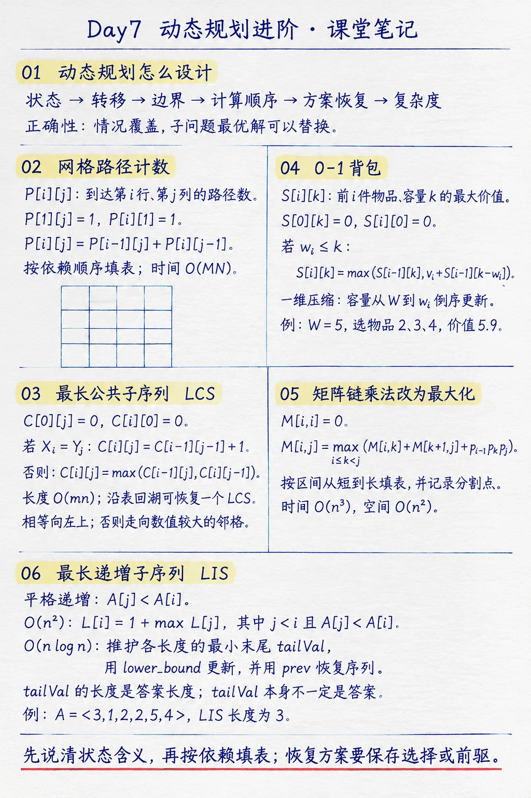

> RedMoon · 2026-11-05 · 课堂阅读笔记



本次课围绕动态规划的状态设计与转移展开：从网格路径计数进入二维状态，再用最长公共子序列（LCS）和 0-1 背包说明如何处理序列匹配与受容量约束的选择问题。课后作业继续沿着这条主线，分别把矩阵链乘法的目标改为最大化，并设计 $O(n^2)$ 与 $O(n\log n)$ 的最长递增子序列算法。

动态规划的关键不是套用某条公式，而是准确说明每个状态回答什么问题、当前答案依赖哪些更小状态，以及如何按依赖顺序计算。若还要输出具体方案，就需要保存足够的决策或前驱信息。

## 一、动态规划的设计顺序

分治和动态规划都将原问题拆成子问题再组合。典型动态规划中，同一子问题会被多次用到，因此把已经求出的状态保存下来，可以避免重复计算。状态设计要保留组合答案所需的信息；只要遗漏了影响后续选择的条件，转移式即使形式正确，也可能无法表达原问题。

设计时依次回答以下问题：

1. **状态是什么**：明确状态所代表的子问题，例如“前 $i$ 个元素的答案”或“区间 $[i,j]$ 的答案”。
2. **如何转移**：观察最后一步或当前元素的选择，把所有可能情况写全。
3. **边界是什么**：给出最小子问题的答案，避免转移引用未定义状态。
4. **按什么顺序计算**：确保每个状态依赖的子状态已经有值。
5. **怎样恢复方案**：若只求最优值，状态表通常够用；若要输出具体解，还需记录选择或前驱。
6. **复杂度是多少**：统计状态数量，并乘以每个状态枚举的转移数；再检查能否滚动保存状态。

证明递推正确时，可以说明两件事：每个可行解都对应转移中枚举的一种情况；转移采用的子状态确实能组成该情况下的最优解。这样既解释了“没有漏解”，也解释了“不会得到不可行或非最优的结果”。

## 二、机器人网格路径计数

设网格有 $M$ 行、$N$ 列，机器人从左上角出发，只能向右或向下移动，求到达右下角的路径数。这里没有障碍格。

令 $P[i][j]$ 表示从左上角到第 $i$ 行、第 $j$ 列的路径数。第一行只能一直向右，第一列只能一直向下，因此：

$$
P[1][j]=1,\qquad P[i][1]=1.
$$

其他格子只能从上方或左方进入：

$$
P[i][j]=P[i-1][j]+P[i][j-1].
$$

按行、按列从小到大填表即可，因为上方和左方状态都已计算。共有 $MN$ 个状态，每个状态只做常数次运算，时间复杂度为 $O(MN)$。若只需要路径总数，可以把较短的一维作为滚动数组，空间降为 $O(\min(M,N))$；若需要逐格查看结果，则保留完整表格。

这个例子体现了状态设计的起点：先观察到达当前格的最后一步可能来自哪里，再把这些互斥来源的路径数相加。

## 三、最长公共子序列

### 1. 子序列与子数组

子序列保留原有相对顺序，但允许跳过元素；子数组则要求元素连续。因此，子数组是子序列的一种特殊情况。LCS（Longest Common Subsequence）给定序列 $X$ 和 $Y$，要求找出同时是两者子序列、且长度最大的序列。

课件用“相同元素之间连线且连线不交叉”作直观解释：不交叉保证所选元素在两个原序列中的相对顺序一致。

### 2. 状态与递推

令 $C[i][j]$ 表示 $X$ 的前 $i$ 个元素与 $Y$ 的前 $j$ 个元素的 LCS 长度。空前缀没有非空公共子序列：

$$
C[0][j]=0,\qquad C[i][0]=0.
$$

观察两个前缀的末尾元素：

- 若 $X_i=Y_j$，这两个相同元素可以匹配，长度在两个更短前缀的答案上增加 1。
- 若 $X_i\ne Y_j$，两者不可能同时作为同一条公共子序列的末尾，至少要舍弃一个末尾元素，分别比较两个方向。

于是：

$$
C[i][j]=
\begin{cases}
C[i-1][j-1]+1, & X_i=Y_j,\\
\max(C[i-1][j],C[i][j-1]), & X_i\ne Y_j.
\end{cases}
$$

按 $i=1,\ldots,m$、$j=1,\ldots,n$ 逐行填表，当前状态依赖上方、左方和左上方。表格有 $mn$ 个非边界状态，每个状态只检查常数个候选，所以求长度的时间为 $O(mn)$，完整表格的空间为 $O(mn)$。

从表格右下角回溯可恢复一个 LCS：若 $X_i=Y_j$，记录该元素并向左上移动；否则沿着数值较大的上方或左方移动。若两侧相等，任取一侧都能得到一个最长解，但具体序列可能不同。若只求长度，可以用两行滚动数组，把空间降至 $O(\min(m,n))$；若还要恢复序列，则需要保留回溯信息，或采用线性空间的专门算法。

## 四、0-1 背包

### 1. 状态和选择

有 $n$ 个物品，第 $i$ 个物品的重量为 $w_i$、价值为 $v_i$；背包容量为 $W$。每件物品只能整件取或不取，求不超过容量时的最大总价值。

令 $S[i][k]$ 表示只考虑前 $i$ 件物品、背包容量为 $k$ 时能够取得的最大价值。边界为：

$$
S[0][k]=0,\qquad S[i][0]=0.
$$

处理第 $i$ 件物品时：

- 若 $w_i>k$，装不下，只能沿用 $S[i-1][k]$。
- 若 $w_i\le k$，比较不装与装入两种情况。装入后，剩余容量为 $k-w_i$，且只能从前 $i-1$ 件物品中继续选择。

因此：

$$
S[i][k]=
\begin{cases}
S[i-1][k], & w_i>k,\\
\max\left(S[i-1][k],v_i+S[i-1][k-w_i]\right), & w_i\le k.
\end{cases}
$$

这个定义中的“前 $i$ 件物品”很重要：选入第 $i$ 件后，子问题仍只用前 $i-1$ 件，保证同一件物品不会重复使用。

### 2. 课件算例

容量 $W=5$，物品按顺序为：

| 物品 $i$ | 重量 $w_i$ | 价值 $v_i$ |
|---:|---:|---:|
| 1 | 3 | 2.5 |
| 2 | 1 | 1.9 |
| 3 | 2 | 3 |
| 4 | 1 | 1 |
| 5 | 4 | 3 |

下表列出每个物品前缀、各容量下的最优价值：

| 已考虑物品 | $k=0$ | $k=1$ | $k=2$ | $k=3$ | $k=4$ | $k=5$ |
|---|---:|---:|---:|---:|---:|---:|
| 无 | 0 | 0 | 0 | 0 | 0 | 0 |
| 1 | 0 | 0 | 0 | 2.5 | 2.5 | 2.5 |
| 1–2 | 0 | 1.9 | 1.9 | 2.5 | 4.4 | 4.4 |
| 1–3 | 0 | 1.9 | 3 | 4.9 | 4.9 | 5.5 |
| 1–4 | 0 | 1.9 | 3 | 4.9 | 5.9 | 5.9 |
| 1–5 | 0 | 1.9 | 3 | 4.9 | 5.9 | 5.9 |

最终 $S[5][5]=5.9$。回溯时，第 5 件不选，因为 $S[5][5]=S[4][5]$；第 4 件选入后容量变成 4；第 3 件选入后容量变成 2；第 2 件选入后容量变成 1；第 1 件不选。因此一个最优方案是选择物品 2、3、4，总重量为 $1+2+1=4$，总价值为 $1.9+3+1=5.9$。

状态数为 $nW$，每个状态的转移为常数时间，因此时间复杂度为 $O(nW)$。由于 $W$ 是容量的数值而非其二进制输入长度，这属于伪多项式时间。若压缩为一维数组，容量必须从大到小遍历：

```text
best[0..W] = 0
for each item i:
    for k = W down to w[i]:
        best[k] = max(best[k], value[i] + best[k - w[i]])
```

逆序更新使 `best[k - w[i]]` 仍代表上一件物品处理完后的结果；若从小到大更新，同一件物品可能被本轮重复使用，问题就会变成完全背包。

## 五、课后作业详解

### 1. 矩阵链乘法改为最大化（CLRS 15.3-3）

**题意**：矩阵链乘法通常通过选择括号化顺序，使标量乘法次数最少。若目标改成让标量乘法次数尽可能多，是否仍有最优子结构？

**结论**：仍具有最优子结构，可以用区间动态规划求最大代价。

设矩阵 $A_i$ 的维度为 $p_{i-1}\times p_i$。令 $M[i,j]$ 表示矩阵链 $A_iA_{i+1}\cdots A_j$ 的所有合法括号化中，最大的标量乘法次数。单个矩阵不需要相乘：

$$
M[i,i]=0.
$$

对长度大于 1 的链，最后一次乘法必然在某个 $k$ 处分割成两条子链。左链结果维度为 $p_{i-1}\times p_k$，右链结果维度为 $p_k\times p_j$，最后相乘固定需要 $p_{i-1}p_kp_j$ 次标量乘法。因此：

$$
M[i,j]=\max_{i\le k<j}
\left(M[i,k]+M[k+1,j]+p_{i-1}p_kp_j\right).
$$

**最优子结构证明**：取一条整体最大代价的括号化方案，并固定其最后分割点 $k$。最后一次矩阵乘法的代价只由矩阵维度与 $k$ 决定，不受左右子链内部的括号化方式影响。假设左子链没有达到 $M[i,k]$，就可以用一条代价更大的左侧括号化替换它，右侧和最后一次乘法保持不变，整体代价随之增大，这与原方案已经最大矛盾。右子链同理。因此，固定 $k$ 时，左右子链都必须分别取最大代价；再枚举所有 $k$ 并取最大值，便覆盖了所有合法括号化方案。

**数值例子**：令 $A_1$ 为 $3\times5$、$A_2$ 为 $5\times2$、$A_3$ 为 $2\times7$。

$$
(A_1A_2)A_3:\quad 3\cdot5\cdot2+3\cdot2\cdot7=30+42=72,
$$

$$
A_1(A_2A_3):\quad 5\cdot2\cdot7+3\cdot5\cdot7=70+105=175.
$$

所以最大化问题选择 $A_1(A_2A_3)$，代价为 175。算法按区间长度从短到长填表，并记录达到最大值的分割点：

```text
for i = 1..n:
    M[i][i] = 0
for length = 2..n:
    for i = 1..n-length+1:
        j = i+length-1
        M[i][j] = -infinity
        for k = i..j-1:
            candidate = M[i][k] + M[k+1][j] + p[i-1]*p[k]*p[j]
            if candidate > M[i][j]:
                M[i][j] = candidate
                split[i][j] = k
```

状态数为 $O(n^2)$，每个区间最多枚举 $O(n)$ 个分割点，时间为 $O(n^3)$；代价表和分割表共需 $O(n^2)$ 空间。沿 `split` 表递归即可还原最大代价的括号化方案。

### 2. 求给定序列的一个 LCS（CLRS 15.4-1）

**题目**：

$$
X=\langle1,0,0,1,0,1,0,1\rangle,\qquad
Y=\langle0,1,0,1,1,0,1,1,0\rangle.
$$

求 $X$ 与 $Y$ 的一个最长公共子序列。

令 $C[i][j]$ 为两个前缀的 LCS 长度，并使用上一节的递推式。完整 DP 表如下，首行和首列对应空前缀：

| $i\backslash j$ | 0 | 1 | 2 | 3 | 4 | 5 | 6 | 7 | 8 | 9 |
|---|---:|---:|---:|---:|---:|---:|---:|---:|---:|---:|
| $Y_j$ | 空 | 0 | 1 | 0 | 1 | 1 | 0 | 1 | 1 | 0 |
| 0（空） | 0 | 0 | 0 | 0 | 0 | 0 | 0 | 0 | 0 | 0 |
| 1（1） | 0 | 0 | 1 | 1 | 1 | 1 | 1 | 1 | 1 | 1 |
| 2（0） | 0 | 1 | 1 | 2 | 2 | 2 | 2 | 2 | 2 | 2 |
| 3（0） | 0 | 1 | 1 | 2 | 2 | 2 | 3 | 3 | 3 | 3 |
| 4（1） | 0 | 1 | 2 | 2 | 3 | 3 | 3 | 4 | 4 | 4 |
| 5（0） | 0 | 1 | 2 | 3 | 3 | 3 | 4 | 4 | 4 | 5 |
| 6（1） | 0 | 1 | 2 | 3 | 4 | 4 | 4 | 5 | 5 | 5 |
| 7（0） | 0 | 1 | 2 | 3 | 4 | 4 | 5 | 5 | 5 | 6 |
| 8（1） | 0 | 1 | 2 | 3 | 4 | 5 | 5 | 6 | 6 | 6 |

右下角 $C[8][9]=6$，所以最长公共子序列长度为 6。沿 DP 表回溯，可得到一个匹配位置序列：

$$
(X_1,Y_2),(X_2,Y_3),(X_3,Y_6),(X_4,Y_7),(X_6,Y_8),(X_7,Y_9).
$$

对应的元素为：

$$
\boxed{\langle1,0,0,1,1,0\rangle}.
$$

核对：它在 $X$ 中依次位于位置 $1,2,3,4,6,7$，在 $Y$ 中依次位于位置 $2,3,6,7,8,9$，因此确实是公共子序列。DP 表证明公共子序列长度不超过 6，而构造出的序列长度恰好为 6，所以它是一个 LCS。时间复杂度为 $O(mn)$，回溯为 $O(m+n)$。

### 3. 用 $O(n^2)$ 时间求最长递增子序列（CLRS 15.4-5）

**题意**：给定长度为 $n$ 的数字序列，设计 $O(n^2)$ 时间算法，找出最长单调递增子序列。

以下按“严格递增”解释，即相邻保留元素满足 $A[j]<A[i]$。如果课程采用“非递减”定义、允许相等元素，则把条件改为 $A[j]\le A[i]$。

令 $L[i]$ 表示**必须以 $A[i]$ 结尾**的最长严格递增子序列长度；令 `prev[i]` 保存该解中 $A[i]$ 的前驱位置。若某个子序列以 $A[i]$ 结尾，其前一个元素只能来自 $j<i$ 且 $A[j]<A[i]$，因此：

$$
L[i]=
\begin{cases}
1+\max\limits_{\substack{j<i\\A[j]<A[i]}}L[j],
& \text{存在符合条件的 }j,\\
1,& \text{否则}.
\end{cases}
$$

计算顺序为从左到右，因为状态 $L[i]$ 只依赖更早位置。算法如下：

```text
for i = 1..n:
    L[i] = 1
    prev[i] = NIL
    for j = 1..i-1:
        if A[j] < A[i] and L[j] + 1 > L[i]:
            L[i] = L[j] + 1
            prev[i] = j

end = 任意一个使 L[end] 最大的位置
从 end 开始沿 prev 回溯并收集元素，最后反转
```

**正确性说明**：任意一个以 $A[i]$ 结尾、长度大于 1 的递增子序列，都有一个倒数第二个元素 $A[j]$，其中 $j<i$ 且 $A[j]<A[i]$。枚举所有这样的 $j$，取其中最大的 $L[j]$，就得到以 $A[i]$ 结尾的最长解。若该前缀不是以 $A[j]$ 结尾的最长递增子序列，就能用更长的同末尾子序列替换它，并在末尾接上 $A[i]$，得到更长解，矛盾。因此转移完整且不会遗漏最优解。最后在所有结尾位置中取最大的 $L[i]$，即为全局最长长度。

**手算示例**：对 $A=\langle3,1,2,2,5,4\rangle$，严格递增的状态为：

| 位置 $i$ | $A[i]$ | 一个最佳前驱 | $L[i]$ |
|---:|---:|---|---:|
| 1 | 3 | 无 | 1 |
| 2 | 1 | 无 | 1 |
| 3 | 2 | 位置 2（值 1） | 2 |
| 4 | 2 | 位置 2（值 1） | 2 |
| 5 | 5 | 位置 3 或 4（值 2） | 3 |
| 6 | 4 | 位置 3 或 4（值 2） | 3 |

最大长度为 3，可恢复 $\langle1,2,5\rangle$ 或 $\langle1,2,4\rangle$。若允许相等，则 $\langle1,2,2,4\rangle$ 长度为 4。双层循环检查 $O(n^2)$ 对位置，时间复杂度为 $O(n^2)$；长度、前驱和输出数组使用 $O(n)$ 空间。

### 4. 用 $O(n\log n)$ 时间求最长递增子序列（CLRS 15.4-6）

**题意**：把上一题的时间降至 $O(n\log n)$。核心是维护各长度候选子序列的末尾，并通过输入位置之间的链接恢复答案。

直接枚举所有前驱需要 $O(n^2)$。加速的关键是：对同一长度，末尾值越小，后续能接上的元素只会越多，因此只保留该长度下最小的末尾值。

维护三个数组：

- `tailVal[k]`：已扫描前缀中，长度为 $k+1$ 的递增子序列可能达到的最小末尾值。
- `tailIdx[k]`：实现 `tailVal[k]` 的输入位置。
- `prev[i]`：以位置 $i$ 结尾的候选序列的前驱位置。

严格递增时，`tailVal` 保持递增。处理新值 $x=A[i]$，用二分查找找出第一个满足 `tailVal[p] >= x` 的位置，即 `lower_bound(x)`：

- 若 $p>0$，则 `tailVal[p-1]<x`，可把当前位置接到 `tailIdx[p-1]` 所代表的序列之后，令 `prev[i]=tailIdx[p-1]`。
- 若 $p$ 恰好等于当前 `tailVal` 长度，说明 $x$ 能延长目前最长候选，把它追加到末尾。
- 否则用 $x$ 替换 `tailVal[p]`。同长度候选中更小的末尾给未来留下更多扩展空间。

```text
tailVal = 空数组
tailIdx = 空数组
prev[1..n] = NIL

for i = 1..n:
    p = lower_bound(tailVal, A[i])  // 第一个 >= A[i] 的下标
    if p > 0:
        prev[i] = tailIdx[p-1]
    if p == length(tailVal):
        append A[i] to tailVal
        append i to tailIdx
    else:
        tailVal[p] = A[i]
        tailIdx[p] = i

end = tailIdx[length(tailIdx)-1]
从 end 开始沿 prev 回溯并收集 A[end]，最后反转
```

**为什么二分位置对应最长可接前缀**：对长度 $1,2,\ldots$ 的候选，`tailVal` 记录的是各长度的最小末尾。若 `tailVal[p-1]<x`，长度 $p$ 的候选可以接上 $x$；而 `tailVal[p]>=x`（若存在）说明当前末尾还不能严格接上 $x$。由于末尾值有序，第一个不小于 $x$ 的位置恰好分隔了可扩展和不可扩展的长度。更新后，每个长度的最小末尾不增，数组仍保持有序。逐个处理完输入后，`tailVal` 的长度就是 LIS 长度。`prev` 链记录真实输入位置，保证输出的元素来自原序列且顺序正确。

用相等元素测试边界很重要。若要求非递减子序列（允许相等），二分位置应改为第一个严格大于 $x$ 的位置，即 `upper_bound(x)`；只将严格条件换为非严格条件，而继续使用 `lower_bound`，就不会让相等元素延长答案。

仍以 $\langle3,1,2,2,5,4\rangle$ 为例，严格递增版本的 `tailVal` 变化如下：

| 处理位置和值 | 二分位置 $p$ | 更新后的 `tailVal` |
|---|---:|---|
| $1:3$ | 0 | $[3]$ |
| $2:1$ | 0 | $[1]$ |
| $3:2$ | 1 | $[1,2]$ |
| $4:2$ | 1 | $[1,2]$，以新位置替换同值末尾 |
| $5:5$ | 2 | $[1,2,5]$ |
| $6:4$ | 2 | $[1,2,4]$ |

最后 `tailVal` 长度为 3。沿 `tailIdx` 和 `prev` 可恢复 $\langle1,2,4\rangle$。注意，其他输入下 `tailVal` 只表示各长度的最小尾值，它整体不一定对应一条真实子序列；因此题目要求输出具体序列时，不能只返回 `tailVal`，还必须保存位置链接。

每个元素做一次 $O(\log n)$ 二分与常数次更新，总时间为 $O(n\log n)$；`tailVal`、`tailIdx`、`prev` 和输出共需 $O(n)$ 空间。

## 六、本次课的主线

- 网格路径通过“从哪里到达当前格”构造计数转移。
- LCS 将两个前缀作为状态，按末尾元素是否相同决定匹配或跳过。
- 0-1 背包将“已考虑物品数”和“当前容量”作为状态维度，装与不装分别对应两个子问题。
- 矩阵链乘法即使从最小化改为最大化，仍保留同一套子链分解结构，只需改变聚合操作。
- LIS 的 $O(n^2)$ 解法枚举前驱；$O(n\log n)$ 解法压缩为每种长度一个最小末尾，再用二分查找和前驱链接恢复序列。
- 每次空间优化都必须根据依赖关系确定更新方向；0-1 背包的一维压缩需要容量逆序，避免重复使用当前物品。
