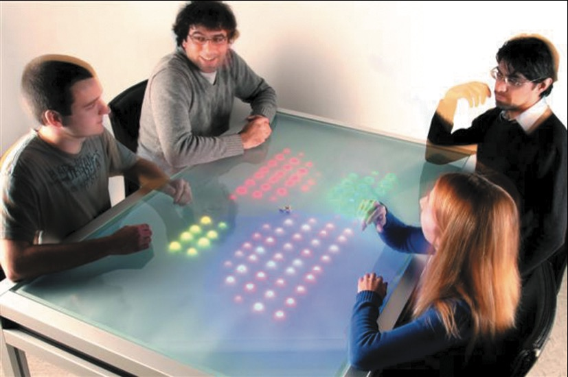

社交交互不只传递文字和信息，也依赖轮流发言、回应、澄清、告别等规则。数字产品让相隔的人继续联系，也会改变人们分配注意力和维持谈话的方式。设计得当，用户更容易理解彼此的意图，也能看清系统做了什么。（课件第 3-5 页）

本课从日常对话的组织方式讲起，讨论软件通知与 AI 助手如何借用社交规则，再转向远程会议、共在协作和社交游戏。贯穿这些内容的问题是：技术怎样支持人们协调行动，同时保留用户对交互的理解和控制。

## 一、把对话规则转成界面支持

面对面交谈时，人们会打招呼、判断轮到谁发言、用简短回应表示正在听，并在误解时要求重说或澄清。谈话结束也有信号：有人直接告别，也有人看时间、拿起外套。对话规则帮助参与者判断何时加入、何时继续、何时结束。（课件第 7-11 页）

课件引用 Sacks 等人（1978）提出的三条基本规则：当前说话者可以通过提问、询问意见或提出请求来指定下一位说话者；其他人也可以自行开始发言；如果没人接话，当前说话者可以继续。（课件第 8 页）多人讨论中的点名、举手和主持人安排发言顺序，都在减少“现在轮到谁”的不确定性。开场可以正式，也可以随意；语气要适合关系和场景，有时也会提示接下来的内容是否重要。

| 对话机制 | 在线交互中的设计对应 |
| --- | --- |
| 打招呼、建立注意 | 清楚标出消息来自谁、面向谁，避免突然出现没有上下文的指令 |
| 轮次转换 | 会议提供举手、发言队列或主持控制；多人聊天明确回复对象 |
| 倾听反馈 | 用简短回应或反应标记表示已收到信息，同时避免把沉默直接判定为同意 |
| 修复误解 | 允许重述、确认和修改；错误提示说明问题并给出恢复路径 |
| 结束谈话 | 提供完成、关闭或结束协作的信号，减少流程悬而未决 |

线上交流缺少语调、表情和身体动作，文字沟通也常常异步。表情符号可以补充情绪信息，却不能代替完整的语境。视频会议逐渐形成了静音、举手和短暂表情回应等新约定；这些功能是在界面上表达话轮和反馈。（课件第 17-20 页）课堂对双人对话的例子还显示，谈话可能暂时转到别的主题；交互工具需要保留未完成的上下文，让用户能回到刚才的事情。

对话中的误解可以通过重述和确认来修复。课件特别提醒避免抱怨和责备；放到软件里，错误提示应让用户知道发生了什么、接下来能做什么，而不是只把问题归到用户身上。（课件第 11-13 页）

课堂还讨论了操作行为作为用户兴趣线索的用法，例如反复加入或移除购物车商品。行为记录能帮助系统提出更相关的选项，但单次点击不能证明用户的真实意图；交互应保留修改、拒绝和关闭推荐的入口。

## 二、通知与 AI 助手：情绪表达不能替代控制权

软件通知像一种特殊的对话：它既报告状态，也表达系统如何回应用户。语气友好可能缓和小问题，但如果系统已经造成损失，却继续安慰用户或反复要求尝试无效步骤，用户会更难判断问题是否得到处理。此时，系统需要清楚承认错误、说明已知影响，并给出实际可用的恢复选项。（课件第 12-16 页；课堂案例）

卸载确认界面展示了不同的说服方式：面向普通用户的界面可能用情感化文案和修复建议挽留；专业软件会直接列出卸载会带来的后果。目标用户的知识背景不同，说明方式可以不同，但后果、取消和继续操作都应看得清楚。拟人化语气不应遮住退出选项，也不应靠内疚感拖住用户。（课堂案例）

聊天机器人需要让用户掌握任务的发起和执行：

- 由用户提出任务，并能在执行前修改、取消或确认。
- 遇到含糊指令或难以撤销的操作时，先确认对象、时间、数量等关键字段。
- 区分“把信息记下来”和“据此执行下单”等动作，不能把描述当成授权。
- 用列表、卡片和明确状态呈现选项，减少用户对长段文字的记忆负担。
- 出错后给出可执行的恢复说明；无法恢复时及时说明，不用空泛安慰拖延。

这组原则也延续了前几课关于识别优于回忆的讨论：商品图片、价格和购买入口放在同一张卡片里，比让用户从长段描述里拼出信息更容易比较。（课件第 14-16 页、课堂案例）

课堂还提出，聊天机器人可以作为多个后端系统的统一入口，减少用户在界面之间切换的步骤。由此延伸出的设计要求是把当前连接的服务、待执行操作和执行结果说清楚，避免“一个对话框”让系统边界变得不可见。

### 拟人化 AI 的边界

课件提出一个伦理情境：失去亲友的人收集逝者曾发送的消息，制作聊天机器人，继续与其对话。有人可能把它看作安慰，也有人会觉得不妥。设计者需要考虑数据是否得到授权、使用者是否知道对话对象是 AI、模拟身份会不会造成误认，以及产品是否增加了使用者的心理依赖。涉及公众人物或商业宣传时，也需进一步审查数据来源、授权和误导风险；这些问题的法律边界取决于具体情境。（课件第 21-23 页、课堂讨论）

## 三、远程交互追求的是合适的临场感

课件区分了几个相近概念：

| 概念 | 本课中的含义 |
| --- | --- |
| 临场感（telepresence） | 远程参与者借助技术，像是与身处实体空间的人一起交流 |
| 社会临场感（social presence） | 在虚拟环境中感到自己正在与真实的人共同在场 |
| 共在（co-presence） | 多人在同一空间中，希望借助桌面、白板或公共显示器共同活动 |

早期 VideoWindow 项目由 Bellcore 于 1989 年开发，用约 3×8 英尺的视听窗口连接相距约 50 英里的两处空间。课件列出的使用观察包括：参与者常谈论系统本身；人们仍更多与同一房间的人交谈；试图靠近远端参与者时，反而可能走出摄像头和麦克风范围；系统也缺少对这种状态的监测。（课件第 24-25 页）

后来的视频会议、远程临场会议室和 Gather.town 等虚拟办公室，分别用多屏显示、空间化虚拟形象或距离触发语音等方式支持远程交流。它们借用现实中的空间线索，让参与者看见谁在附近、当前有哪些小组，减少加入谈话的步骤。（课件第 26-30 页；课堂案例）

临场感并非越强越好。课件引用 Bailenson（2021）讨论 Zoom fatigue，并列出近距离凝视、较高的认知负荷、长时间看见自己的画面、长时间固定在同一地点等因素。会议设计还要考虑摄像头范围、屏幕注意力和分组讨论时的移动空间。技术应服务于会议任务，不能把所有细节都堆到参与者眼前。（课件第 27-32 页）

课件还展示了“盒中 3D 人像”原型：远端亲人的立体影像出现在实体装置里，装置顶部的摄像头让远端亲人实时看到、听到母亲和孩子。这个例子把人物影像、摄像头和实体空间呈现在一起，用更直接的视觉线索支持亲人交流。（课件第 33-34 页）

## 四、共在协作需要共同线索

共同完成任务时，人们会结合三类协调机制：语言和非语言沟通，日程、规则与约定，以及共享的外部表征。点头、手势、日程表、会议议程和共享文档都能帮助参与者对齐进度。（课件第 35-40 页）

**外围觉察**是留意视野边缘或环境中发生的事情；**情境觉察**则是理解周围正在发生什么，以及当前信息和行动会怎样影响后续活动。课件用空中交通管制和手术室说明，在复杂协作中，知道谁在场、谁正在和谁交流、任务进行到哪一步，都关系到接下来的判断。（课件第 40-41 页）

课件对可共享界面研究的概括是，参与可能更均衡，围绕界面工作更自然，围桌坐着也比站在大屏前更舒服。共享界面的摆放方式会影响谁能看清信息、怎样加入讨论。（课件第 42 页）

*图 1：Reflect Table 用桌面灯光呈现组员的发言量。课件报告称，发言较多者的行为变化更明显，发言较少者没有相同变化。来源：课程课件第 43 页。*

Reflect Table 的研究提示，可见反馈会影响部分参与者，但显示发言时长并不会自动让所有人都获得同等参与机会。发言次数或时长也不能直接代表观点质量。共享界面还可以给不擅长口头表达的人提供可编辑对象、草图和评论入口。课件以 Miro 海报展示、AR 沙箱和 PeopleLens 为例，分别展示共同创作、空间协作和对盲童空间觉察的辅助。（课件第 35-45 页）

设计这类协作空间时，可以检查：谁看得到当前状态，谁能修改共享内容，如何知道他人正在做什么，以及不同表达方式是否都能被纳入讨论。线上会议的自动纪要、共享日历和同步编辑也属于外部协调工具；系统提供记录后，用户仍需要看懂内容并能更正。

## 五、社交游戏中的关系设计

社交游戏通过竞争、合作、同伴压力等关系安排玩家互动。课件引用 Matt Richetti（2022）的三项分析问题：（课件第 46-47 页）

| 维度 | 要问的问题 |
| --- | --- |
| 同步与异步 | 玩家同时交流，还是轮流完成任务？ |
| 对称与非对称 | 建立关系是否需要双方参与，还是一方就能发起？ |
| 强关系与弱关系 | 玩家关系是长期深入，还是短暂、一次性的联系？ |

把这些维度与游戏目标放在一起看，才能判断设计支持的是组队、竞争、临时匹配还是长期社区。玩家还会与规则、环境和计算机控制角色互动；游戏的社交体验由这些人际和人机关系共同构成。

## 六、作业示范：以 Minecraft 多人模式为例

### 题目

选择一款自己熟悉的多人电子游戏，分析其中人们如何交互，并回答以下问题。（课件第 49 页，中文转述）

1. 游戏支持哪些交互类型？同时考虑人与人、人与计算机的交互。
2. 交互过程中涉及哪些认知过程？
3. 人们如何相互交流、沟通？在面对面活动中，他们也会采用相同的方式吗？
4. 对交互设计有什么改进建议？

如果不熟悉电子游戏，可以改为分析社交媒体或多人编辑工具。

### 示范解答

以下是基于课件所举游戏编写的示范分析，不代表个人游玩经历。正式提交时，可以替换成自己熟悉的游戏。

1. **交互类型**：玩家之间通过游戏内文字聊天或配套语音工具沟通、分工采集资源、共同建造或竞争；玩家也通过键鼠或手柄操作角色，选择物品、放置或破坏方块、探索地图，与游戏规则和电脑控制的生物交互。这同时包含人与人的交流协作，以及指令、直接操纵和探索等人机交互。
2. **涉及的认知过程**：玩家要观察环境与队友位置，注意资源和危险提示；记住地图位置、合成规则和分工；计划采集路线，比较装备与资源，并根据队伍情况调整行动。
3. **沟通方式与线下差异**：多人模式可以用游戏内文字聊天、配套语音工具和共享世界状态协调行动。线下合作也能共同规划和分工，但面对面的表情、手势和周边环境线索更直接；线上玩家则要依赖角色位置、文字、语音和共同建造的地标来补足这些信息。
4. **改进建议**：提供清楚的队伍目标、队友状态和可选标记；让玩家控制语音和文字信息的可见范围，并保留静音、屏蔽和退出选项；为不使用语音的玩家提供同样有效的文字或视觉协作入口。

## 参考资料

1. 课程课件《Human Computer Interaction: 05 Social Interaction》，第 2-49 页。
2. 课堂讲授与自动转写《人机交互中的社交规则与AI设计原则》。术语和课件观点以课件为准。
