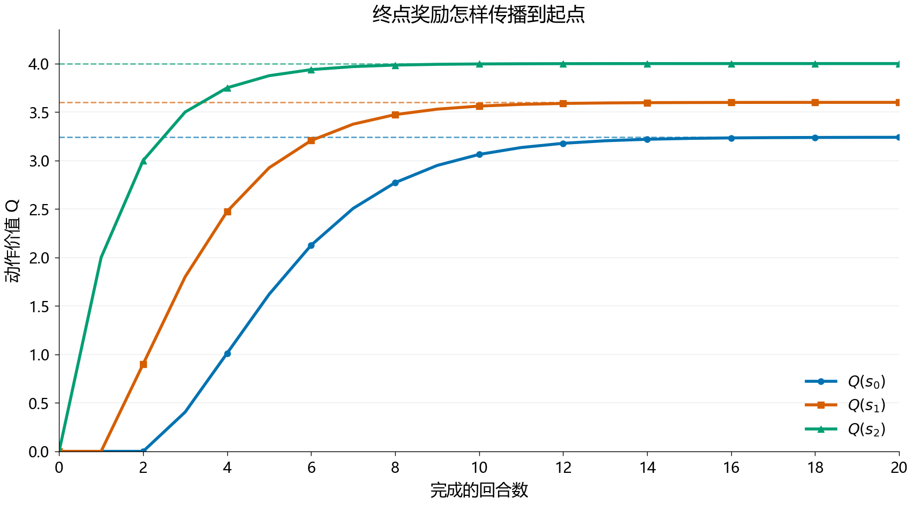

> RedMoon · 2026-11-10 整理 · 课堂笔记

机器人在岔路口该往哪里走，和模型怎样从没有人工类别标签的图片中学习特征，使用的是两种不同的训练信号。前半节课通过路径选择讲强化学习：用奖励评价行动的长期后果，再改进策略。后半节课转向自监督：从数据自身构造预测、重建或匹配任务，学习可迁移的表示。连接两部分的线索是，训练目标怎样转化为模型可以利用的反馈。

## 一、从路径选择认识强化学习

### 1. 一次交互里发生什么

在网格路径例子里，智能体的位置可以作为状态 $s_t$，上下左右等可行移动构成动作集合。策略 $\pi(a\mid s)$ 规定处于状态 $s$ 时怎样选择动作：既可以始终选择一个动作，也可以给多个动作分配概率。[1]

执行 $a_t$ 后，环境产生下一状态 $s_{t+1}$ 和奖励 $r_{t+1}$。一次经历包含：

$$
(s_t,a_t,r_{t+1},s_{t+1}).
$$

还需要记录任务是否真正结束。例如，到达终点、掉入失败区域，都可能结束一局；运行程序暂时达到采样步数上限，则未必意味着任务已经结束。

| 概念 | 路径例子中的含义 | 需要分清的问题 |
| --- | --- | --- |
| 状态 $s$ | 当前位置，以及决策所需的环境信息 | 有移动障碍时，坐标可能不足以描述环境 |
| 动作 $a$ | 当前允许的移动 | 应在合法动作中选择 |
| 策略 $\pi$ | 在各状态选择方向的规则 | 随机策略也是策略 |
| 转移 $p(s',r\mid s,a)$ | 执行动作后到哪里、得到什么奖励 | 环境转移概率与策略概率不同 |
| 奖励 $r$ | 当前一步得到的评价 | 奖励由任务设计，不是状态价值 |

### 2. 奖励要与任务目标对应

如果任务是尽快到达终点，可以设置到达奖励、每步代价和失败惩罚。若每走一步都无条件加分，智能体可能偏向绕圈；若把“正确方向”逐步标好，又已经注入了额外的路径知识。因此，奖励定义直接影响模型学到的行为。[1]

课堂给“有些动作加一、有些动作不给分”的例子，主要用于说明反馈怎样影响选择。实际建模时，需要先说清楚什么算成功、什么算代价，再判断奖励是否表达了这些要求。

## 二、即时奖励、回报与价值函数

### 1. 回报把后续奖励放在一起

从时刻 $t$ 出发，一条在 $T$ 时刻结束的轨迹，其折扣回报为：

$$
G_t=\sum_{k=0}^{T-t-1}\gamma^k r_{t+k+1},
\qquad 0\leq\gamma\leq1.
$$

$r_{t+1}$ 是下一步收到的奖励，$G_t$ 汇总此后多步的奖励。$\gamma$ 是折扣因子；在有界奖励的无限时域问题中，取 $\gamma<1$ 可以使折扣和有界，有限回合也常使用 $\gamma=1$。[1]

考虑两个教学选项：A 立刻得到奖励 1 并结束；B 连走三步，奖励依次为 $0,0,3$。它们的回报为：

$$
G_A=1,\qquad G_B=3\gamma^2.
$$

$\gamma=0.9$ 时，B 的回报为 $2.43$；$\gamma=0.5$ 时为 $0.75$。改变折扣相当于改变对远期奖励的重视程度。即使两条路径的实际奖励相同，优化目标也可能因此改变。

### 2. 状态价值评价“从这里继续怎么样”

给定策略 $\pi$：

$$
V_\pi(s)=\mathbb E_\pi[G_t\mid s_t=s].
$$

状态价值是沿这套策略继续行动的期望回报。它依赖策略，也对环境和动作采样的随机性取平均。一次走得好或走得差，只是一条回报样本。[1]

### 3. 动作价值评价“先做这个动作怎么样”

$$
Q_\pi(s,a)=\mathbb E_\pi[G_t\mid s_t=s,a_t=a].
$$

它固定当前第一步为 $a$，后续仍遵循 $\pi$。两种价值之间满足：

$$
V_\pi(s)=\sum_{a\in\mathcal A(s)}\pi(a\mid s)Q_\pi(s,a).
$$

例如，某状态的两个动作价值为 4 和 1，策略分别以 $0.25$ 和 $0.75$ 的概率选择它们，则状态价值为 $1.75$。换成各以 $0.5$ 的概率选择，价值变为 $2.5$。**策略下的加权平均，与所有动作中的最大值，是两个不同的量。**

## 三、贝尔曼方程与动态规划

### 1. 把长期问题递推成一步问题

回报可以递推为 $G_t=r_{t+1}+\gamma G_{t+1}$，因此：

$$
Q_\pi(s,a)=\sum_{s',r}p(s',r\mid s,a)
\left[r+\gamma V_\pi(s')\right].
$$

当前动作的好坏，取决于即时奖励，以及执行后进入状态的未来价值。随机环境中需要对可能的转移取期望；确定性环境可以简化成一次转移。[1]

### 2. 最优价值多了一次动作选择

定义 $V^*(s)=\max_\pi V_\pi(s)$，贝尔曼最优方程为：

$$
V^*(s)=\max_{a\in\mathcal A(s)}
\sum_{s',r}p(s',r\mid s,a)
\left[r+\gamma V^*(s')\right].
$$

相应地，$V^*(s)=\max_a Q^*(s,a)$。这里的“最大化”已经考虑后续回报，不能理解为每次只挑当前奖励最大的动作。若多个动作具有相同的最优价值，就可能存在多条最优路径或多种最优策略。

### 3. 已知模型时做价值迭代

知道转移和奖励模型时，可以初始化 $V_0$，再重复：

$$
V_{k+1}(s)=\max_a\sum_{s',r}p(s',r\mid s,a)
\left[r+\gamma V_k(s')\right].
$$

这里的 $k$ 是价值迭代次数，和智能体在环境里的时间步 $t$ 不同。每轮扫描状态，根据已有估值计算新的估值，再检查变化是否足够小。在标准有限折扣 MDP 中，这种更新有收敛保证；若模型未知，就需要从交互样本中学习。[1]

## 四、Q-learning：用真实转移更新 Q 表

### 1. 从一步样本构造学习目标

Q-learning 直接维护 $Q(s,a)$，观察一次实际转移后更新：

$$
y_t=r_{t+1}+\gamma\max_{a'\in\mathcal A(s_{t+1})}Q(s_{t+1},a'),
$$

$$
Q(s_t,a_t)\leftarrow Q(s_t,a_t)
+\alpha_t\left[y_t-Q(s_t,a_t)\right].
$$

$\alpha_t$ 是学习率，控制这次修正的幅度；$\gamma$ 控制远期奖励的折扣。二者作用不同。方括号里的差是 TD 误差：当前估值与一步自举目标之间的差。[1][2]

假设 $Q(s,a)=1$，本步奖励为 0，下一状态最大的估值为 3，$\gamma=0.9$、$\alpha=0.5$，则目标为 $2.7$，更新后：

$$
Q_{\mathrm{new}}(s,a)=1+0.5(2.7-1)=1.85.
$$

这个目标使用了当前的下一状态估计，因此它也会随着后续学习变化。

### 2. 真正终止时不再接未来价值

如果这一步已经到达任务终点，则目标直接是 $y_t=r_{t+1}$。仍按上一例的当前估值 1、学习率 0.5，若终止奖励为 4，更新后为 $2.5$。

程序因外部采样上限停止时，应按环境语义判断是否继续自举。若任务实际还可以继续，就保留最后真实状态的价值估计；任务本身的有限时域终点则按真正终止处理。不能仅凭循环退出，就把两种情况都当作终点。[1]

下面是对照公式的更新片段，假设 `next_values` 只含下一状态的合法动作：

```python
def q_update(old_q, reward, next_values, terminated, alpha=0.5, gamma=0.9):
    target = reward
    if not terminated:
        target += gamma * max(next_values)
    return old_q + alpha * (target - old_q)

print(q_update(1.0, 0.0, [2.0, 3.0], False))  # 1.85
print(q_update(1.0, 4.0, [], True))             # 2.5
```

### 3. 终点奖励怎样传到更早状态

设置一条确定性路径 $s_0\to s_1\to s_2\to\mathrm{terminal}$，各步奖励为 $0,0,4$；每个非终止状态只有一个合法动作。所有 Q 值初始化为 0，每轮都从头到尾访问这条路径，取 $\alpha=0.5$、$\gamma=0.9$。

| 完成的回合数 | $Q(s_0)$ | $Q(s_1)$ | $Q(s_2)$ |
| --- | ---: | ---: | ---: |
| 0 | 0 | 0 | 0 |
| 1 | 0 | 0 | 2 |
| 2 | 0 | 0.9 | 3 |
| 3 | 0.405 | 1.8 | 3.5 |
| 充分更新后的极限 | 3.24 | 3.6 | 4 |



> 图 1：按上述固定路径和更新顺序直接计算的教学数据。第一个回合只更新出终点前的正价值，后续回合才把信息传到更早状态；不包含动作探索或神经网络训练。虚线分别表示 $4\gamma^2$、$4\gamma$ 和 $4$。

## 五、探索、利用与表格法的适用范围

### 1. 为什么还要尝试低估值动作

训练早期的 Q 值来自有限经历。只沿当前最高估值行动，可能一直不访问实际更好的路径。课堂的“南边几个门都走不通，北门更远却能出去”说明了探索的意义：补充现有估计没有覆盖的经历。

对于唯一贪心动作、$m$ 个合法动作的状态，常见 $\epsilon$-greedy 规则是以 $1-\epsilon$ 的概率选择贪心动作，以 $\epsilon$ 的概率在全部合法动作中均匀采样。因此贪心动作实际被选中的概率为：

$$
P(a_{\mathrm{greedy}})=1-\epsilon+\frac{\epsilon}{m}.
$$

取 $m=4$、$\epsilon=0.2$，这个概率是 $0.85$，其余三个动作各为 $0.05$。随机分支也可能抽到贪心动作。[1]

逐渐减小 $\epsilon$ 是常见安排，但“减小探索率”本身不足以保证收敛。经典表格 Q-learning 的结果还依赖有限状态动作空间、充分访问以及合适的学习率条件；不能把这个保证直接推广到任意神经网络训练。[2]

### 2. Q-learning 的目标策略与采样策略

采样时可以使用带探索的策略，更新目标却使用下一状态的最大 Q 值。这种目标和行为的分离，使 Q-learning 成为离策略方法。SARSA 则用下一步实际选中动作的价值构造目标，是理解两者差别的直接对照。[1]

状态和动作可枚举时，Q 表很直观。输入变成高维图像或大量连续状态后，存储和覆盖全部表项很难，可以用神经网络近似 Q 值。DQN 还配合经验回放与目标网络改善训练组织；标准 DQN 通常仍针对离散动作，连续控制需要进一步选择合适的方法。[1]

课堂提到的 PPO、机器人足球及多智能体协作，是强化学习的进一步应用。团队奖励怎样分配、训练时能看见哪些信息、执行时每个机器人能获得什么，都需要另外建模，不能靠共享一张 Q 表概括。

## 六、监督、无监督与自监督：训练信号从哪里来

课堂转向大模型时，关心的是人工标注能否跟上数据规模。先把几种训练信号分开：

| 方式 | 信号来源 | 本课中的例子 |
| --- | --- | --- |
| 有监督学习 | 已给定的输入与任务目标 | 图片与类别、题目与参考答案 |
| 无监督学习 | 数据结构和算法定义的目标 | 聚类、降维、频繁模式 |
| 自监督学习 | 从样本自身构造输入与目标 | 遮挡重建、下一个 Token 预测、视图对比 |
| 强化学习 | 行动后的奖励及其长期后果 | 路径决策、机器人协作 |

自监督减少的是逐条人工制作目标标签的需求。目标、数据处理和评价仍由设计者选择；数据也会带有采样偏差、重复和噪声。机器人遥操作记录同样需要采集、时间同步、动作表示及质量控制，记录中的动作还可以直接作为模仿学习目标，不能一概归为自监督。[1][3]

### 经典无监督方法仍有明确目标

课堂回顾的 K-means 最小化样本到所属中心的平方距离：

$$
\min_{\{c_i\},\{\mu_k\}}\sum_i\|x_i-\mu_{c_i}\|_2^2.
$$

固定中心时分配到最近中心，固定分配时把中心更新为均值；初始化会影响结果。PCA 在给定维数下寻找保留较大方差的线性投影，自编码器通过编码和解码最小化重建误差。这些方法的关键差别在目标与结构，而不是“有没有可计算的优化目标”。[1][7]

t-SNE 常用于呈现局部邻域关系，其二维图不能直接证明高维数据存在同样大小、同样间隔的类别。FP-Growth 则挖掘频繁共现模式，处理的是另一类数据关系。课堂同时提及的线性判别分析（LDA）若指分类降维，通常使用类别标签，应和 PCA 区分。[7]

## 七、从代理任务到预训练与迁移

自监督的代理任务把原始数据变成训练对。模型为了降低这些任务的损失，需要保留预测所需的信息。任务设计得是否合适，要看学到的表示能否帮助下游任务。[3][6]

| 代理任务 | 输入 | 目标 |
| --- | --- | --- |
| 自回归语言建模 | 文本已有前缀 | 下一个 Token |
| 掩码预测 | 经过遮挡的文本或图像 | 被选中位置的原内容或目标表示 |
| 图像上色 | 灰度信息 | 原始颜色 |
| 旋转或拼图任务 | 被旋转或重新排列的图像 | 旋转类别或空间关系 |
| 视图对比 | 同一样本的不同增强，以及其他候选 | 正样本对应关系 |

掩码重建与自回归预测都能从数据产生目标，但可见信息不同：自回归预测只读取允许的前缀，掩码任务可根据任务设置读取缺失位置两边的上下文。对比学习则直接约束表示间的匹配关系，不能把下一个 Token 预测统称为对比学习。

常见训练组织是先用大规模数据学习通用表示，再用任务数据微调。还可以冻结编码器，只训练线性分类器，以观察原有表示的可用性。微调结果受表示质量、下游数据与更新范围共同影响；预训练任务损失下降，不等于所有下游任务都自动提高。[3]

## 八、对比学习：把关系写进表示空间

### 1. 正样本与负样本怎样产生

实例级视觉对比常对同一张图片分别做裁剪、颜色扰动等增强，得到两个正样本视图；批次里的其他图片提供负样本。正样本关系由构造方式决定，同类但不同图片也可能成为负样本。

编码器 $f_\theta$ 把图像转换为表示 $h$，投影头 $g_\theta$ 再产生用于对比损失的向量 $z$。SimCLR 研究了增强组合和非线性投影头的作用。用于下游任务的表示，与训练对比目标的投影向量应分别辨认。[3]

增强规定了哪些变化应保留语义。裁剪若把主体完全去掉，或旋转改变了数字类别，构造出的正样本就可能违背任务要求。颜色、背景、细节也是否该被忽略，都取决于任务。

### 2. InfoNCE 比较的是正样本在候选中的位置

设 $q$ 是查询，$k^+$ 是正样本，$k_j^-$ 是负样本，$\tau>0$ 为温度，一种常见目标为：

$$
\mathcal L_q=-\log
\frac{\exp(\operatorname{sim}(q,k^+)/\tau)}
{\exp(\operatorname{sim}(q,k^+)/\tau)
+\sum_{j=1}^{K}\exp(\operatorname{sim}(q,k_j^-)/\tau)}.
$$

分母包含正样本与所有负样本。降低损失需要提高正样本相对其他候选的分数；同时提高全部分数，并不能改变归一化后的匹配概率。[5]

取正样本分数为 2、两个负样本分数为 1 和 0，温度为 1。正样本概率为 $e^2/(e^2+e+1)\approx0.6652$，损失约为 $0.4076$。把所有分数都加 5，结果不变。温度降低会使分布更集中，同时改变优化时的梯度；具体参数应结合数据和表示归一化选择。

### 3. SimCLR 和 MoCo 怎样提供比较对象

| 方法 | 负样本组织 | 需要抓住的机制 |
| --- | --- | --- |
| SimCLR | 主要利用当前批次的其他增强视图 | 同一编码器、增强组合与非线性投影头 |
| MoCo | 用队列保留先前批次的 Key | 较大的字典与缓慢变化的 Key 编码器 |

MoCo 的查询编码器通过梯度更新，Key 编码器用动量方式更新参数：

$$
\theta_k\leftarrow m\theta_k+(1-m)\theta_q.
$$

队列扩大候选集合，动量更新减少编码器快速变化造成的表示不一致。这里的队列存储对比表示，与强化学习保存状态转移的经验回放不是同一种数据用途。[4]

## 九、把两类学习信号放回大模型训练

语言模型可以先通过预测文本学习参数，再通过示范、偏好或交互反馈调整行为。自监督与强化学习因此可以出现在同一个系统的不同阶段；Transformer 则描述网络结构，是另外一个维度。[1][3]

课堂把大规模无标注数据视为扩展模型能力的重要资源。更准确的表述是，自动构造监督目标扩大了可利用的数据规模，架构、计算预算、数据质量和后续训练共同决定效果。不能从“利用了海量数据”直接推出通用正确性，也不能以某一年为界认定其他学习方式已经退出。

对于机器人，把互联网图文表示迁移到控制任务，还需连接真实观测、动作接口、时序反馈和任务数据。语言里知道怎样描述动作，与能在变化环境中完成动作，是需要分别检验的能力。

## 十、复习问答

1. **奖励和回报有什么区别？**

   奖励是一步环境反馈，回报汇总此后的折扣奖励。策略优化通常面向期望回报。

2. **为什么 $V_\pi(s)$ 通常不等于 $\max_a Q_\pi(s,a)$？**

   前者按当前策略对动作价值求平均。只有策略将概率集中到最大价值动作等特定条件下，两者才相同。

3. **价值迭代与 Q-learning 的信息来源有什么不同？**

   价值迭代利用已知转移和奖励模型计算期望；Q-learning 用采到的转移与下一状态估计更新 Q 值。

4. **终止奖励为 4，为什么目标直接是 4？**

   该奖励已经在当前转移获得，任务终止后没有未来价值项。折扣只作用于更晚的奖励。

5. **学习率与折扣因子分别控制什么？**

   学习率控制估计每次修正多少；折扣因子控制目标中远期奖励的权重。

6. **四个动作、$\epsilon=0.2$ 时，唯一贪心动作概率是多少？**

   $0.8+0.2/4=0.85$，因为随机探索也包含这个动作。

7. **自监督没有人工标签，为什么仍能计算损失？**

   原始数据可以生成目标，如被遮挡的内容、下一个 Token 或增强视图的对应关系。

8. **同类别的两张图一定是对比学习的正样本吗？**

   不一定。实例级对比常把同一张原图的不同增强视图作为正样本，其他图片仍可能是负样本。

9. **MoCo 的队列和动量编码器各解决什么？**

   队列提供较多候选 Key，动量编码器让跨批次 Key 的表示变化更平缓。

## 参考资料

课堂范围依据《强化学习与自监督学习核心原理及大模型演进》课堂转写。价值、更新公式和学习目标按下列资料核对；路径、数值和代码是为解释机制构造的教学算例。

1. Sutton、Barto，*Reinforcement Learning: An Introduction*，第二版，2018，第 2、3、4、6 章。[作者教材主页](http://incompleteideas.net/book/the-book-2nd.html)。
2. Watkins、Dayan，*Q-learning*，1992。[原论文](https://doi.org/10.1007/BF00992698)。
3. Chen 等，*A Simple Framework for Contrastive Learning of Visual Representations*，ICML 2020。[论文与正文](https://proceedings.mlr.press/v119/chen20j.html)。
4. He 等，*Momentum Contrast for Unsupervised Visual Representation Learning*，CVPR 2020。[原论文](https://arxiv.org/abs/1911.05722)。
5. van den Oord、Li、Vinyals，*Representation Learning with Contrastive Predictive Coding*，2018。[原论文](https://arxiv.org/abs/1807.03748)。
6. He 等，*Masked Autoencoders Are Scalable Vision Learners*，CVPR 2022。[原论文](https://arxiv.org/abs/2111.06377)。
7. scikit-learn 官方文档：[K-means](https://scikit-learn.org/stable/modules/clustering.html#k-means)、[PCA](https://scikit-learn.org/stable/modules/decomposition.html#pca)、[线性与二次判别分析](https://scikit-learn.org/stable/modules/lda_qda.html)，用于核对聚类目标、方差投影及标签使用。
