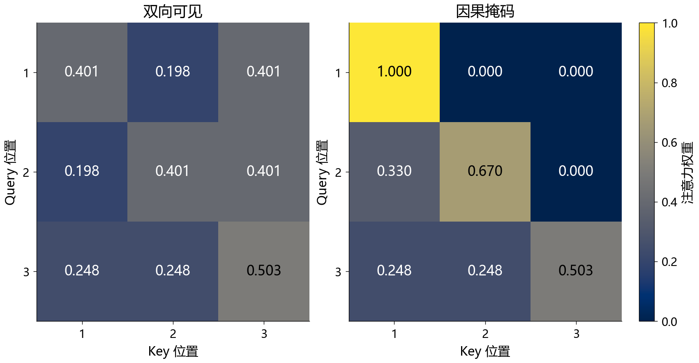

> RedMoon · 2026-11-10 整理 · 课堂笔记

上节课讨论 RNN 怎样逐步传递序列信息，本节进入 Transformer：让各位置根据内容选择要读取的信息，再把这种计算方式用于语言、图像和动作。课程后半段将视角扩展到系统，讨论图文对齐、机器人策略，以及通过工具和环境交互的智能体。阅读这些模型时，可以依次检查输入表示、信息可见范围、训练目标和实际输出。

## 一、自注意力：按内容汇集信息

### 1. Q、K、V 来自同一输入，但投影不同

设一段输入的表示为 $X\in\mathbb R^{n\times d}$，其中 $n$ 是 Token 数，$d$ 是模型维度。自注意力用三组参数产生查询、键和值：

$$
Q=XW_Q,\qquad K=XW_K,\qquad V=XW_V.
$$

Query 表达当前位置需要读取什么，Key 用于匹配，Value 是按匹配结果汇集的内容。三者来自同一段输入，并不意味着数值相同；差异来自独立学习的投影参数。[1]

单头缩放点积注意力为：

$$
A=\operatorname{softmax}\left(\frac{QK^{\mathsf T}}{\sqrt{d_k}}+M\right),
\qquad O=AV.
$$

$QK^{\mathsf T}$ 形成位置之间的分数矩阵，Softmax 按行归一化，每行权重再对 Value 求加权和。一个位置因此可以结合上下文重新表示自己。例如，“苹果是水果”与“苹果发布手机”中，相同字面的含义需要由上下文区分。

### 2. 缩放、掩码和 Dropout 各有作用

在一个简化假设下，Query 与 Key 的各维分量独立、均值为 0、方差为 1，点积方差随 $d_k$ 增长。除以 $\sqrt{d_k}$ 可以控制分数尺度，减少 Softmax 过于饱和的情况。这是缩放设计的解释，不要求训练中的所有 Q、K 都严格满足该分布。[1]

掩码 $M$ 规定哪些位置允许被读取：允许项通常加 0，禁止项在 Softmax 前加负无穷或相应的极小值。因果掩码阻止读取未来目标 Token，填充掩码屏蔽补齐位置。

Dropout 则在训练中随机丢弃部分计算结果以正则化。它与表达结构约束的掩码不同，不能把“随机丢弃”和“防止看到答案”合成一个机制。

### 3. 算一次注意力，并观察因果约束

构造三个位置：

$$
Q=K=\begin{bmatrix}1&0\\0&1\\1&1\end{bmatrix},
\qquad
V=\begin{bmatrix}1&0\\0&2\\3&1\end{bmatrix}.
$$

这里为方便计算，刻意让 $Q=K$，不代表实际网络的投影必然相同。第一行缩放分数为 $[1/\sqrt2,0,1/\sqrt2]$，不加掩码时，权重约为 $[0.4011,0.1978,0.4011]$，输出约为 $[1.6044,0.7967]$。

加入因果掩码后，第一行只能读取自身，权重变为 $[1,0,0]$，输出为 $[1,0]$。末行没有未来位置可屏蔽，因此在这个例子里保持不变。

> 图 1：按上式直接计算的教学热力图。行表示 Query 位置，列表示被读取的 Key 位置；两图使用相同色标。右图的上三角为掩码导致的零，不是模型训练后学出的稀疏关系。

## 二、多头、位置编码和 Transformer 层

### 1. 多头拆分特征子空间

多头注意力使用多组投影分别计算，再拼接输出：

$$
\operatorname{head}_i=
\operatorname{Attention}(XW_Q^{(i)},XW_K^{(i)},XW_V^{(i)}),
$$

$$
\operatorname{MultiHead}(X)=
\operatorname{Concat}(\operatorname{head}_1,\ldots,\operatorname{head}_h)W_O.
$$

常见配置保持总维度 $d$ 不变，每头维度约为 $d/h$。每个头仍然覆盖它允许读取的整个序列。多个头提供不同的关系子空间，具体关系由训练决定。[1]

**多头不等于把图片切成互不联系的小块。** 图像分块是输入 Token 的构造方式；窗口注意力规定局部连接；多头则在特征维度分组。这三种设计可以组合，但不能互相替代。

固定 $d$ 时，各头注意力乘法的总计算量大致为：

$$
h\cdot O\left(n^2\frac dh\right)=O(n^2d).
$$

朴素实现里，分数矩阵共有 $hn^2$ 个元素。增加头数不会自动消掉序列长度的平方项。实际性能还取决于投影、访存和实现。

若 $n=256$、$d=512$、$h=8$，每头维度为 64，各头共有 $8\times256^2=524{,}288$ 个分数。把序列加长到 512，在其他配置不变时，分数数量变成 $2{,}097{,}152$，是原来的四倍。

### 2. 位置编码补充顺序信息

纯自注意力仅根据内容匹配，模型还需要知道 Token 的顺序。原始 Transformer 使用正弦余弦位置编码，与输入嵌入相加：

$$
\operatorname{PE}(p,2i)=\sin\left(\frac p{10000^{2i/d}}\right),
\qquad
\operatorname{PE}(p,2i+1)=\cos\left(\frac p{10000^{2i/d}}\right).
$$

$p$ 是位置索引，$i$ 标记不同频率通道。一个位置对应一个向量，不是仅给每个词附加一个任意编号。[1]

RoPE 使用另一种做法：按位置旋转 Query 和 Key 的成对维度，使点积中包含相对位移信息。它和原始的加法位置编码是不同的实现路径，也不能单凭使用 RoPE 就保证任意长度外推。[4]

### 3. 前馈网络、残差与归一化

逐位置前馈网络对每个位置使用同一组参数，常见形式为：

$$
\operatorname{FFN}(x)=\sigma(xW_1+b_1)W_2+b_2.
$$

它沿特征维度做非线性变换。注意力负责位置间的信息交互，FFN 则进一步处理每个位置已有的表示。

残差连接把子层输入加回输出，提供信息和梯度通路。LayerNorm 沿单个位置的特征维度计算统计量，再进行归一化和可学习的仿射变换；输出不因此被强制变成高斯分布。

原始 Transformer 常写为 $\operatorname{LN}(x+\operatorname{Sublayer}(x))$；许多后续模型把归一化放到子层之前。结构中的先后顺序需要按具体模型确认。[1][4]

## 三、编码器与解码器怎样完成翻译

原始 Transformer 是编码器—解码器模型。编码器处理源句，解码器根据源句表示和已有目标前缀生成译文。三种注意力的信息来源如下：[1]

| 模块 | Query 来自 | Key、Value 来自 | 可见范围 |
| --- | --- | --- | --- |
| 编码器自注意力 | 源序列 | 源序列 | 可读取未被填充掩码屏蔽的源位置 |
| 解码器自注意力 | 目标序列已有表示 | 目标序列已有表示 | 遮挡未来目标位置 |
| 解码器交叉注意力 | 当前解码器表示 | 编码器输出 | 根据生成需要读取源序列 |

### 1. 训练时右移目标，避免复制答案

假设目标句是“我 爱 学习”，输入解码器的是起始标记与目标前缀：

| 位置 | 解码器输入 | 本位置预测目标 |
| --- | --- | --- |
| 1 | 起始标记 | 我 |
| 2 | 我 | 爱 |
| 3 | 爱 | 学习 |
| 4 | 学习 | 结束标记 |

右移处理输入与目标的对应关系，因果掩码限制同层里能读取的位置。两者配合，才能在训练中同时计算多位置损失而不泄露未来目标。[1]

典型训练目标是：

$$
\mathcal L=-\sum_t\log p_\theta(y_t\mid y_{<t},x).
$$

推理时没有完整目标句，从起始标记出发逐步生成，再把新 Token 放回前缀。并行训练与逐步生成分别描述不同阶段。

### 2. 三种架构适应不同任务接口

| 架构 | 代表模型 | 常见信息组织与用途 |
| --- | --- | --- |
| Encoder-only | BERT | 双向表示，接分类、抽取或匹配等任务头 |
| Encoder-decoder | 原始 Transformer、T5 | 编码输入，再根据输入表示生成目标序列 |
| Decoder-only | GPT、Llama 等 | 用因果序列建模，把提示和输出放进连续序列 |

这是组织计算与信息可见性的分类。Decoder-only 通常去掉了原始翻译模型中的独立源编码器及对应交叉注意力；它仍然沿用 Transformer 的注意力、FFN 等计算结构。[1][2][3][4]

## 四、从预训练到现代语言模型的效率设计

### 1. BERT 与 GPT 的预测条件不同

BERT 用双向上下文学习表示，原始预训练包含掩码语言建模和下一句预测。原始 BERT-Large 配置是 24 层、隐藏维度 1024、16 个注意力头，约 3.4 亿参数；这些数字是一组具体配置。[2]

GPT 路线通过前缀预测后续 Token。模型参数由大规模文本目标训练，再按任务需要接续微调。自回归语言建模可写为：

$$
p_\theta(x_{1:T})=\prod_{t=1}^{T}p_\theta(x_t\mid x_{<t}).
$$

架构、训练数据和目标要一起看。参数规模、预训练语料字节数、训练 Token 数、上下文长度是不同的统计量，不能直接混在同一数量轴上。[3]

### 2. 人类反馈调整任务行为

课堂概述的 InstructGPT 训练包括监督微调、偏好数据与奖励模型，以及利用奖励进行 PPO 优化。预训练提供语言建模基础，后续训练进一步影响模型遵循指令的方式。[5]

奖励分数反映所学评价目标；任务事实是否正确还需要证据。聊天效果、参数规模与上下文容量，也要分别评价。

### 3. 区分几种节省开销的机制

| 设计 | 主要改变什么 |
| --- | --- |
| RoPE | 将位置信息引入注意力的 Q、K 计算 |
| RMSNorm | 用均方根尺度归一化，省去减均值步骤 |
| SwiGLU | 前馈模块使用带门控的非线性结构 |
| KV Cache | 保存前缀的 Key、Value，减少生成时的重复计算 |
| GQA / MQA | 多个 Query 头共享部分或全部 KV 头 |
| MoE | 路由到部分专家，控制每个 Token 激活的计算 |
| MLA | 通过压缩的潜在表示处理注意力缓存等开销 |

这些机制分别作用于位置、特征变换、存储或稀疏计算，不能统称为“多头减少计算”。Llama 论文介绍了 RMSNorm、SwiGLU 和 RoPE 等选择；DeepSeek-V3 则结合 MLA 与 MoE。[4][6]

### 4. MoE 的总参数与激活参数

常见稀疏 MoE 用路由器按 Token 选择若干专家，再组合输出。专家通常位于前馈子层，注意力和其他计算仍需执行。不同 Token 可能被送往不同专家，训练还需处理负载分配与通信。[6]

DeepSeek-V3 报告给出的配置是总参数 671B、每个 Token 激活约 37B。37B 约为总量的 5.5%，这是参数激活口径，不能直接当作总 FLOPs、显存或延迟的同等比例。完整权重仍要有存储位置，批次内也可能用到多组专家。[6]

在标准稀疏路由实现中，未被当前 Token 选择的专家不承担该 Token 的专家前馈计算；这不表示它们在其他 Token、其他批次或其他训练步骤中永久冻结。

## 五、同一种计算框架进入视觉任务

### 1. ViT：把图像块组织成序列

ViT 将图像切成固定大小的 Patch，把每块展平并线性投影为 Token，加入位置信息后交给 Transformer。分类时再根据汇总表示预测类别。[7]

假设输入为 $224\times224$ RGB 图像，Patch 为 $16\times16$，则共有 $14\times14=196$ 个图像块；每块有 $16\times16\times3=768$ 个数值。投影到 $d$ 维之后，图像序列形状为 $196\times d$，若额外使用分类 Token，则长度为 197。

Patch 大小改变序列长度，因此会影响全注意力开销。头数改变的是特征子空间组织，这两项需要分别计算。

### 2. DETR：直接预测目标集合

DETR 把目标检测建模为集合预测：图像特征进入编码器，解码器使用一组 Object Query，输出类别和边界框。训练时通过二分图匹配把预测项与真实目标对应，未对应项学习无目标类别。[8]

原始 DETR 使用卷积骨干提取图像特征，因此不能把它简化成“把原始像素直接交给 ViT”。它减少了锚框和非极大值抑制等手工部件，但仍有特征提取、匹配与损失设计。

## 六、图文对齐与条件生成

### 1. CLIP：图像和文字进入共同空间

CLIP 分别用图像编码器与文本编码器获得表示，让配对图文在表示空间里得分更高。原论文使用约 4 亿对互联网图文作为训练数据。[9]

对批次内 $N$ 对图文，计算相似度矩阵：

$$
S_{ij}=\frac{\operatorname{sim}(v_i,t_j)}{\tau}.
$$

第 $i$ 张图片对应第 $i$ 段文字。训练分别沿“图片找文字”和“文字找图片”两个方向提高正确配对的概率，再组合两个方向的损失。这里的双编码器架构，与 BERT 中“双向读取上下文”的含义不同。

零样本分类可以把各类别写成文本描述，比较图片与这些描述的相似度。CLIP 本身的这套匹配机制不负责逐 Token 生成图像说明，也不是图像生成器。[9]

### 2. 生成图像、视频时还需要生成机制

文本条件可以通过编码表示和交叉注意力等方式进入生成模型。潜空间扩散先把图像压缩为潜变量，在潜空间中学习去噪，再解码为图像；Transformer 也可以用于组织生成过程的计算。[10]

视频还要处理跨帧身份、空间位置、遮挡和运动变化。画面流畅、主体稳定，与因果或物理规律正确是不同的要求。课堂讨论物体接触、形变等例子，指向的是生成模型对现实约束的建模能力；不能据此认定所有视频模型都内置了显式物理引擎。

## 七、VLA：从视觉语言条件生成机器人动作

视觉语言动作模型把环境图像和语言指令转成控制输出。机器人执行后获得新观测，策略再据此更新动作，形成闭环。动作输出既要表达任务含义，也要匹配具体机器人的控制接口。

OpenVLA 使用视觉编码器与语言模型连接动作预测，原论文模型建立在 Llama 2 语言模型及融合的视觉特征之上。它的动作可以表示为离散 Token，再映射回机器人控制量。[11]

一个常见机械臂接口可包含三维位移、三维旋转和夹爪，共七个分量。关节数量、笛卡尔动作维度与输出 Token 数是不同的概念，具体语义要按控制器确认，不能把所有机器人的输出统一说成七个关节。

π0 等模型使用动作专家和 Flow Matching 生成连续动作块。一次预测一段未来动作，与逐 Token 生成离散动作，体现了不同的输出表示与执行安排。策略仍需与控制频率、新观测和机器人状态配合。[12]

课堂的“所见即所动”强调感知与动作的紧密联系。落实到系统里，坐标变换、动作归一化、执行器限制和反馈都参与结果；从一张画面直接预测动作向量，并不等于可以跳过这些接口。

## 八、Agent：让模型与工具形成执行循环

### 1. 从回答文本到执行任务

以语言模型为控制器的智能体，可以结合任务规划、上下文或外部记忆、工具调用及执行反馈。模型先根据目标和当前观察选择下一步，运行工具后得到新结果，再决定继续、修正或结束。ReAct 就研究了推理与行动交替的组织方式。[13]

课堂用试卷任务解释分解：把整份试卷拆成填空、选择和问答，再汇总结果。这里需要的首先是明确子任务、输入输出和依赖关系，既可以由一个模型分多轮完成，也可以交给不同模型或固定程序。多模型分工是实现选项，不能当作所有 Agent 的定义。

### 2. 计划、记忆与工具分别保存什么

| 组成 | 作用 | 具体例子 |
| --- | --- | --- |
| 规划 | 决定步骤与执行顺序 | 先提取题目，再求解，再校验格式 |
| 工作上下文 | 保存本轮可直接读取的信息 | 用户要求、已有结果、当前工具返回 |
| 外部记忆 | 跨请求保存可检索记录 | 文档库、任务历史、用户确认过的信息 |
| 工具 | 提供外部数据或执行能力 | 计算器、数据库、检索器、文件操作接口 |
| 反馈 | 判断执行结果并调整下一步 | 工具报错、输出校验、任务进度 |

外部记忆只有在检索结果被送入模型上下文后，才影响当次推理。RAG 是获取外部信息的一种方式；它和模型参数中的知识、当前提示里的信息分别处于不同位置。

### 3. 上海天气问题中的信息流

以“查询上海某日天气”为系统例子：先解析地点和日期，调用对应天气服务，再读取结构化结果，组织回答并保留来源。即时天气信息来自工具，语言模型负责理解要求、安排调用和表达结果。

工具调用需要执行器实际运行。模型输出了一段“已查询”的文字，不等于查询已经发生；生成函数名也不意味着调用参数有效。系统应校验输入字段、工具返回和任务结果，涉及修改外部数据的步骤还需要匹配授权范围。

### 4. 反思不等于更新模型参数

模型可以根据错误信息修改计划、重试或记录经验。这类推理时反馈通常先改变后续上下文与行为，不会自动执行梯度更新。若另外收集结果用于微调或强化学习，则又进入了训练流程。[13]

评估智能体时，可以看最终任务是否完成、工具是否成功、结果能否核验，以及花费的时间和调用次数。分解了多少步骤、写了多长的推理过程，都不能代替任务结果。

## 九、复习问答

1. **自注意力中 Q、K、V 为什么可以不同？**

   它们由同一输入分别经过不同投影得到，承担查询、匹配和信息汇集的职责。

2. **增加注意力头数能否直接去掉 $n^2$ 开销？**

   不能。固定总维度时，各头仍处理全序列，汇总后的核心乘法仍约为 $O(n^2d)$。

3. **因果掩码与 Dropout 的差别是什么？**

   因果掩码规定不能读取未来目标；Dropout 主要在训练时随机丢弃部分结果以正则化。

4. **为什么训练能并行预测，生成却常常逐步进行？**

   训练已有目标序列，可以右移输入并同时计算各位置损失；生成时未来 Token 尚未确定，需要根据已生成前缀继续预测。

5. **MoE 的激活参数占比能否直接换成显存节省比例？**

   不能。激活比例描述每个 Token 使用哪些参数，存储完整权重、注意力、缓存和通信是另外的开销。

6. **CLIP、图像生成模型和 VLA 分别输出什么？**

   CLIP 主要输出用于匹配的表示或分数，图像生成模型输出图像，VLA 输出与控制接口对应的动作或动作块。

7. **Agent 调用工具后得到更好的答案，是否代表模型刚完成训练？**

   不代表。工具结果进入了当前上下文；只有额外的优化流程才会改变模型参数。

## 参考资料

课堂范围依据《大模型技术演进与具身智能应用解析》转写。注意力矩阵、序列规模及 Patch 数为补充计算；模型结构和命名按以下一手资料核对。

1. Vaswani 等，*Attention Is All You Need*，2017，第 3—4 节。[原论文](https://arxiv.org/abs/1706.03762)。
2. Devlin 等，*BERT: Pre-training of Deep Bidirectional Transformers for Language Understanding*，2018 / NAACL 2019。[原论文](https://arxiv.org/abs/1810.04805)。
3. Radford 等，*Improving Language Understanding by Generative Pre-Training*，2018。[原论文](https://cdn.openai.com/research-covers/language-unsupervised/language_understanding_paper.pdf)。
4. Touvron 等，*LLaMA: Open and Efficient Foundation Language Models*，2023。[原论文](https://arxiv.org/abs/2302.13971)。
5. Ouyang 等，*Training language models to follow instructions with human feedback*，2022。[原论文](https://arxiv.org/abs/2203.02155)。
6. DeepSeek-AI，*DeepSeek-V3 Technical Report*，2024。[技术报告](https://arxiv.org/abs/2412.19437)。
7. Dosovitskiy 等，*An Image is Worth 16x16 Words: Transformers for Image Recognition at Scale*，2020 / ICLR 2021。[原论文](https://arxiv.org/abs/2010.11929)。
8. Carion 等，*End-to-End Object Detection with Transformers*，ECCV 2020。[原论文](https://arxiv.org/abs/2005.12872)。
9. Radford 等，*Learning Transferable Visual Models From Natural Language Supervision*，ICML 2021。[原论文](https://arxiv.org/abs/2103.00020)。
10. Rombach 等，*High-Resolution Image Synthesis with Latent Diffusion Models*，CVPR 2022。[原论文](https://arxiv.org/abs/2112.10752)。
11. Kim 等，*OpenVLA: An Open-Source Vision-Language-Action Model*，2024。[原论文](https://arxiv.org/abs/2406.09246)。
12. Black 等，*π0: A Vision-Language-Action Flow Model for General Robot Control*，2024。[原论文](https://arxiv.org/abs/2410.24164)。
13. Yao 等，*ReAct: Synergizing Reasoning and Acting in Language Models*，2022 / ICLR 2023。[原论文](https://arxiv.org/abs/2210.03629)。
