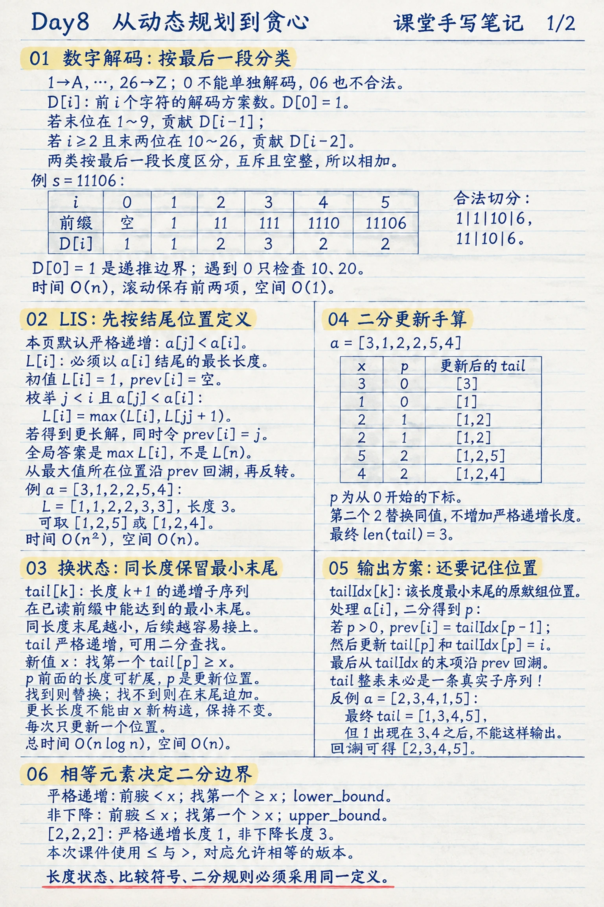
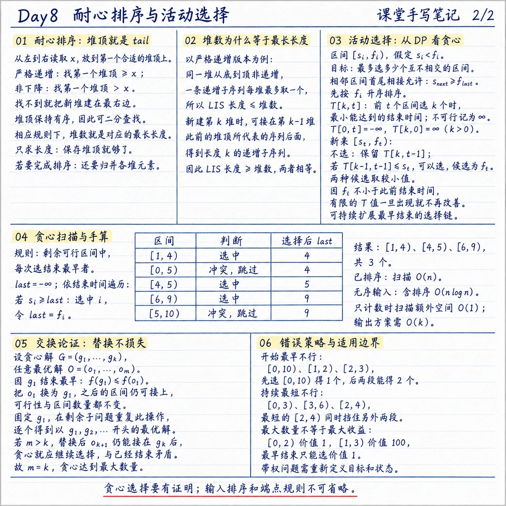

> RedMoon · 2026-11-12 · 课堂阅读笔记

本次课先用数字解码复习动态规划，再讲解上次作业中的两种最长上升子序列算法，随后通过耐心排序和活动选择进入贪心。贯穿其中的问题是：处理一个新元素时，哪些历史信息必须保存，哪些候选可以由一个更有利的状态代表？

课末明确说明本次不布置新作业。下面保留课件中的题目与完整解答：数字解码属于课堂例题，CLRS 15.4-5、15.4-6 属于上次作业的课堂讲解；活动选择的算例、证明和最后的配套练习分别注明来源。

## 一、课堂手写笔记



*第一张：数字解码的分类计数，以及 LIS 从枚举前驱到最小末尾状态的优化。*



*第二张：耐心排序与最小末尾状态的联系，活动选择的 DP 推导、贪心扫描和交换证明。两张图为根据课堂内容生成的手写风格复习页，完整解答见下文。*

## 二、课堂例题：数字解码

### 1. 题目与合法编码

课件第 2 页给出“91. 解码方法”。字母 `A` 到 `Z` 依次对应整数 1 到 26。输入一个只含数字的非空字符串，求把整个字符串划分成合法编码的方案数；无法完整解码时返回 0。

例如：

| 输入 | 合法切分 | 方案数 |
| --- | --- | ---: |
| `12` | （1，2）、（12） | 2 |
| `226` | （2，2，6）、（22，6）、（2，26） | 3 |
| `06` | 没有合法切分 | 0 |
| `11106` | （1，1，10，6）、（11，10，6） | 2 |

`0` 没有单独对应的字母，`06` 也不能当作 `6` 使用。合法的两位编码必须在 10 到 26 之间，所以包含零的合法编码只有 `10` 和 `20`。

### 2. 状态、边界和转移

设 $D\lbrack i\rbrack $ 表示前 $i$ 个字符的合法解码数。将空前缀定义为一种空划分：

$$
D\lbrack 0\rbrack =1.
$$

这个 1 是递推的组合单位。例如前两位为 `12` 时，整体作为一个编码的贡献应是 $D\lbrack 0\rbrack =1$。它不表示题目要求对空字符串返回 1；题目输入约定是非空字符串。

以 0 开始的程序下标表示字符串，计算 $D\lbrack i\rbrack $ 时观察最后一段：

- 如果 `s[i-1]` 在 `'1'` 到 `'9'` 之间，最后一个字符可以独立解码，贡献 $D\lbrack i-1\rbrack $。
- 如果 $i\ge2$，且 `s[i-2:i]` 的数值在 10 到 26 之间，末两位可以合并解码，贡献 $D\lbrack i-2\rbrack $。

用指示函数 $\mathbf{1}\lbrack P\rbrack $ 表示条件 $P$ 成立时取 1，否则取 0，则对 $i\ge2$：

$$
D\lbrack i\rbrack =
\mathbf{1}\lbrack s_{i-1}\ne\texttt{0}\rbrack D\lbrack i-1\rbrack
+\mathbf{1}\lbrack 10\le\operatorname{int}(s_{i-2}s_{i-1})\le26\rbrack D\lbrack i-2\rbrack .
$$

首位单独处理：首位是 `0` 则 $D\lbrack 1\rbrack =0$，否则 $D\lbrack 1\rbrack =1$。

**为什么可以相加？** 每种合法解码的最后一段长度只能是 1 或 2。两类不会重叠，也覆盖了所有可能。删除最后一段后，分别得到前 $i-1$ 或前 $i-2$ 个字符的合法划分；反过来，每个合法前缀都能接上符合条件的最后一段，因此转移既不重复也不遗漏。

### 3. 手算 `11106`

| $i$ | 已处理前缀 | 单独解码的贡献 | 两位合并的贡献 | $D\lbrack i\rbrack $ |
| ---: | --- | ---: | ---: | ---: |
| 0 | 空 | 不适用 | 不适用 | 1 |
| 1 | `1` | $D\lbrack 0\rbrack =1$ | 不适用 | 1 |
| 2 | `11` | $D\lbrack 1\rbrack =1$ | $D\lbrack 0\rbrack =1$ | 2 |
| 3 | `111` | $D\lbrack 2\rbrack =2$ | $D\lbrack 1\rbrack =1$ | 3 |
| 4 | `1110` | 0，末位是 `0` | $D\lbrack 2\rbrack =2$，`10` 合法 | 2 |
| 5 | `11106` | $D\lbrack 4\rbrack =2$ | 0，`06` 不合法 | 2 |

出现零时不能直接把整段判成无解。`10` 有一种解码，`100` 才会因为最后一个零无法归入合法编码而得到 0。

### 4. 完整实现与复杂度

只需要保存前两个状态：

```python
def num_decodings(s):
    if not s:
        return 0

    prev2 = 1
    prev1 = int(s[0] != "0")
    for i in range(1, len(s)):
        current = prev1 if s[i] != "0" else 0
        if 10 <= int(s[i - 1:i + 1]) <= 26:
            current += prev2
        prev2, prev1 = prev1, current
    return prev1
```

每个字符进行常数次判断，时间复杂度为 $O(n)$，额外空间为 $O(1)$。这里按课堂常用的基本算术操作模型计数。

## 三、作业回顾：用平方时间求最长上升子序列

### 1. 题目与“递增”的定义

课件第 3 页回顾 CLRS 15.4-5：给定 $n$ 个数，设计 $O(n^2)$ 时间算法，找出最长单调递增子序列。

子序列保留输入中的先后次序，允许跳过元素。相等元素是否允许必须先明确：

| 版本 | 相邻选中元素的条件 | $\lbrack 2,2,2\rbrack $ 的答案长度 |
| --- | --- | ---: |
| 严格递增，通常记为 LIS | 前一个数小于后一个数 | 1 |
| 非下降，允许相等 | 前一个数小于或等于后一个数 | 3 |

本次课件写的是 $a_j\le a_i$，并在二分版本中查找第一个严格大于新值的位置，因此对应非下降版本。以下先给出严格递增解法，再明确写出非下降所需的修改，两种规则分别保持一致。

### 2. 状态与递推

令 $L\lbrack i\rbrack $ 表示**必须以 $a_i$ 结尾**的最长严格递增子序列长度。每个元素自己就能构成长度为 1 的子序列：

$$
L\lbrack i\rbrack =1+\max\left(\{L\lbrack j\rbrack :j\lt i,\ a_j\lt a_i\}\cup\{0\}\right).
$$

这里必须保留“以 $a_i$ 结尾”的条件。若只说“前 $i$ 个元素的最长长度”，就不知道该最优序列以什么数结束，也无法判断新值能否接上。

计算顺序是从左到右，枚举当前元素之前的所有合法前驱。全局答案为 $\max_i L\lbrack i\rbrack $，不一定是最后一个位置的状态。例如 $\lbrack 1,2,3,0\rbrack $ 的答案长度是 3，而以最后一个 0 结尾的状态只有 1。

### 3. 正确性与方案恢复

任意以 $a_i$ 结尾、长度超过 1 的递增子序列都有倒数第二个元素 $a_j$，且 $j\lt i$、$a_j\lt a_i$。转移枚举了所有这样的 $j$。

固定前驱 $j$ 后，前面部分应采用以 $a_j$ 结尾的最长解。若采用更短的同末尾序列，可以用更长者替换，再接上 $a_i$，合法性不变而长度增加。因此每个状态取到该结尾下的最优长度。

同时保存 `prev[i]`，记录取得更长状态时的前驱位置。从最大状态所在位置沿前驱回溯，最后反转，即可输出具体子序列。

```python
def longest_subsequence_quadratic(a, nondecreasing=False):
    n = len(a)
    if n == 0:
        return []

    length = [1] * n
    previous = [-1] * n
    for i in range(n):
        for j in range(i):
            can_extend = a[j] <= a[i] if nondecreasing else a[j] < a[i]
            if can_extend and length[j] + 1 > length[i]:
                length[i] = length[j] + 1
                previous[i] = j

    end = max(range(n), key=lambda i: length[i])
    answer = []
    while end != -1:
        answer.append(a[end])
        end = previous[end]
    return answer[::-1]
```

对 $a=\lbrack 3,1,2,2,5,4\rbrack $，两种定义的结果如下：

| 位置（从 1 起） | 1 | 2 | 3 | 4 | 5 | 6 |
| --- | ---: | ---: | ---: | ---: | ---: | ---: |
| 元素 | 3 | 1 | 2 | 2 | 5 | 4 |
| 严格递增 $L\lbrack i\rbrack $ | 1 | 1 | 2 | 2 | 3 | 3 |
| 非下降 $L\lbrack i\rbrack $ | 1 | 1 | 2 | 3 | 4 | 4 |

严格递增可取 $\lbrack 1,2,5\rbrack $ 或 $\lbrack 1,2,4\rbrack $，长度 3；非下降可取 $\lbrack 1,2,2,5\rbrack $ 或 $\lbrack 1,2,2,4\rbrack $，长度 4。共有 $O(n)$ 个状态，每个检查至多 $O(n)$ 个前驱，时间为 $O(n^2)$，状态和回溯信息的空间为 $O(n)$。

## 四、作业回顾：用最小末尾和二分降到对数转移

### 1. 题目与新的状态

课件第 4—6 页回顾 CLRS 15.4-6：把最长单调递增子序列的求解时间降为 $O(n\log n)$，并利用元素之间的链接恢复序列。

考虑两个长度相同的递增子序列。如果一个末尾为 4，另一个末尾为 7，后续凡是能接在 7 后的数，也能接在 4 后；还有一些数只能接在 4 后。因此在同一长度下，保存最小末尾就能代表最有利的扩展条件。

课件先定义二维状态：

$$
S\lbrack k,t\rbrack =\text{前 }t\text{ 个数中，长度为 }k
\text{ 的递增子序列可能达到的最小末尾}.
$$

不存在长度为 $k$ 的候选时记为 $+\infty$。处理第 $t$ 个数时，只需要上一列，所以实际实现压缩为 `tail`：

`tail[k]` 表示已处理前缀中，长度为 `k+1` 的子序列的最小末尾。这里代码用从 0 开始的下标，数学状态用长度 $k$，两者相差 1。

### 2. 为什么末尾状态有序

严格递增时，取一条长度为 $k+1$、末尾达到最小值的序列，去掉最后一个元素后，就有一条长度为 $k$ 的递增序列。其末尾严格小于原末尾，而所有长度为 $k$ 的候选的最小末尾只会更小，所以：

$$
S\lbrack k,t\rbrack \lt S\lbrack k+1,t\rbrack
$$

对已经存在的长度成立。允许相等时，相同论证得到 $\le$，所以 `tail` 为非下降数组。

这说明有序性来自状态定义，不需要额外对 `tail` 排序。对它重新排序或把原数组排序，都会丢失原问题中的顺序约束。

### 3. 一次更新为何只改一个位置

严格递增版本中，处理新值 $x$，找出第一个 `tail[p] >= x` 的位置：

- `p` 之前的末尾都小于 $x$，因此存在长度为 `p` 的候选可以接上 $x$，构成长度 `p+1` 的候选。
- 若 `p` 已存在，用 $x$ 替换 `tail[p]`，该长度的最小末尾不增；若不存在，则追加一项，最长长度增加 1。
- 更短长度原有的末尾已经更小，接入 $x$ 无法改善它们；更长长度的最小末尾不小于 $x$，无法严格接上 $x$，因而本轮没有新的更长候选。

非下降版本将“可接上”改成 $\le x$，于是二分查找要找第一个 `tail[p] > x` 的位置。

| 目标 | 合法前驱 | 更新位置 | Python 对应操作 |
| --- | --- | --- | --- |
| 严格递增 | $a_j\lt x$ | 第一个 $\ge x$ | `bisect_left` |
| 非下降 | $a_j\le x$ | 第一个 $\gt x$ | `bisect_right` |

### 4. 手算更新与实际序列的区别

对 $\lbrack 3,1,2,2,5,4\rbrack $：

| 新值 | 严格递增 `tail` | 非下降 `tail` |
| ---: | --- | --- |
| 3 | `[3]` | `[3]` |
| 1 | `[1]` | `[1]` |
| 2 | `[1,2]` | `[1,2]` |
| 2 | `[1,2]` | `[1,2,2]` |
| 5 | `[1,2,5]` | `[1,2,2,5]` |
| 4 | `[1,2,4]` | `[1,2,2,4]` |

`tail` 的长度给出答案长度，但整个 `tail` 不保证是一条来自原数组的子序列。不同长度的最小末尾可以由不同候选实现。

例如输入 $\lbrack 2,3,4,1,5\rbrack $，严格版本最终得到 `tail=[1,3,4,5]`。其中 1 在原数组里位于 3、4 之后，所以不能按该顺序输出。真正的最长解可以是 $\lbrack 2,3,4,5\rbrack $。

### 5. 保存前驱，恢复一个最优解

维护 `tail_index[k]` 表示当前长度 `k+1` 的最小末尾所处的输入位置，`previous[i]` 表示位置 $i$ 的前驱。

处理 $a_i$、二分得到位置 `p` 后，先把 `previous[i]` 指向 `tail_index[p-1]`（若 `p>0`），再更新当前长度的末尾位置。前驱保存的是当时已经出现的原数组位置，后续替换 `tail_index` 不会改变既有前驱链。

```python
from bisect import bisect_left, bisect_right


def longest_subsequence_fast(a, nondecreasing=False):
    tail = []
    tail_index = []
    previous = [-1] * len(a)
    locate = bisect_right if nondecreasing else bisect_left

    for i, x in enumerate(a):
        p = locate(tail, x)
        if p > 0:
            previous[i] = tail_index[p - 1]

        if p == len(tail):
            tail.append(x)
            tail_index.append(i)
        else:
            tail[p] = x
            tail_index[p] = i

    if not tail:
        return []

    end = tail_index[-1]
    answer = []
    while end != -1:
        answer.append(a[end])
        end = previous[end]
    return answer[::-1]
```

**正确性不变量**：处理完任意前缀后，每个有效长度的 `tail` 都是该长度的最小可达末尾，且对应位置存在一条真实的前驱链。上面的更新保留已有候选，并在新值能够改善或扩展的唯一位置加入新候选，因此不变量从空前缀逐步成立。处理完整个数组后，有效长度数就是最长长度，前驱链则给出实现该长度的一条序列。

每个元素进行一次 $O(\log n)$ 的二分，后续更新为常数次操作；最终回溯至多 $n$ 次。时间为 $O(n\log n)$，空间为 $O(n)$。课堂代码若每次复制整条候选序列，可能引入额外开销；保存前驱可以避免这一步。

## 五、耐心排序：把末尾数组看成一排牌堆

课件第 7—9 页用耐心排序（Patience Sort）把状态数组变成直观操作：按输入顺序处理每个数，将其放在左起第一个合适的堆上，使新数成为新堆顶；没有合适的堆就最右边新建一个。

“合适”的规则与目标一致：

- 严格递增：放到第一个堆顶 $\ge x$ 的堆上。
- 非下降：放到第一个堆顶 $\gt x$ 的堆上，课件采用这一版本。

堆顶从左到右保持有序，正对应 `tail`，因此可以用二分找到位置。课件把这些容器称作堆；只求子序列长度时，实际只需保存堆顶数组。若保存每堆的全部元素，由于新元素放在满足条件的堆顶上，可用栈式结构保存这种单调顺序，不必为每次放置重新构建通用二叉堆。

### 为什么堆数等于最长长度

以严格递增规则为例，每一堆按元素进入的先后次序是非递增的，因此一条严格递增子序列在每堆中最多选一个元素。若一共有 $p$ 堆，就有：

$$
\text{LIS 长度}\le p.
$$

另一方面，当一个元素被放到第 $k$ 堆时，它比左边第 $k-1$ 堆当时的堆顶大。可以将它接到那个堆顶对应的长度 $k-1$ 候选后面。因此出现第 $k$ 堆时，一定存在长度为 $k$ 的递增子序列；从前驱链接也能把它恢复出来，于是：

$$
\text{LIS 长度}\ge p.
$$

两者结合得到等号。非下降规则下，每堆按到达顺序严格递减，一条非下降子序列也至多从每堆取一个，另一方向使用 $\le$ 的前驱关系，同样成立。

如果题目只问最长长度，建堆阶段到此即可。如果题目要求对所有数排序，还需从各堆顶反复取最小值，归并输出全部元素。把每堆当作有序流，再维护当前堆顶的最小优先队列，可以在 $O(n\log p)$ 时间完成归并。

## 六、活动选择：从两种 DP 推到一个贪心选择

### 1. 题目与区间端点

给定 $n$ 个活动，第 $i$ 个活动占用左闭右开区间 $I_i=\lbrack s_i,f_i)$，假设 $s_i\lt f_i$。一个场地同一时刻只能安排一个活动，要求选出最多个互不相交的区间，并给出选择方案。

左闭右开意味着前一个活动在时刻 $f_i$ 结束后，下一个可以在同一时刻开始，所以兼容条件是：

$$
s_{\text{next}}\ge f_{\text{last}}.
$$

课件输入已经满足 $f_1\le f_2\le\cdots\le f_n$。一般输入若无此保证，需要先按结束时间排序。

### 2. 借鉴背包：以截止时间为状态

假设端点为非负整数，最大结束时间是 $F$。令 $C\lbrack i,t\rbrack $ 表示前 $i$ 个区间中，全部在时刻 $t$ 前结束的兼容活动最多有多少个。

第 $i$ 个区间只有在 $f_i\le t$ 时才允许选择。状态为：

$$
C\lbrack i,t\rbrack =
\begin{cases}
C\lbrack i-1,t\rbrack , & f_i\gt t,\\
\max(C\lbrack i-1,t\rbrack ,\,1+C\lbrack i-1,s_i\rbrack ), & f_i\le t.
\end{cases}
$$

边界为 $C\lbrack 0,t\rbrack =0$。由于活动按结束时间排序，选择第 $i$ 个活动后，之前选取的活动必须在 $s_i$ 前完成。课件用“选或不选”说明与 0-1 背包的联系，完整递推还要保留 $f_i\le t$ 这一可行性条件。

直接枚举整数时间的成本为 $O(nF)$，取决于时间数值大小。课程随后改用“想选多少个活动”作状态，避免沿整条时间轴逐格计算。

### 3. 借鉴 LIS：每种数量保存最早结束时间

令：

$$
T\lbrack k,t\rbrack =\text{前 }t\text{ 个区间中，选出 }k
\text{ 个兼容活动时的最小结束时间}.
$$

不可行记为 $+\infty$；空集合用 $-\infty$ 表示不占用起始时间：

$$
T\lbrack 0,t\rbrack =-\infty,\qquad T\lbrack k,0\rbrack =+\infty\quad(k\gt 0).
$$

考虑第 $t$ 个区间 $\lbrack s_t,f_t)$，有两种候选：不选时保留 $T\lbrack k,t-1\rbrack $；若 $T\lbrack k-1,t-1\rbrack \le s_t$，则可以接在一个含 $k-1$ 个活动的方案后，新的结束时间为 $f_t$。

$$
T\lbrack k,t\rbrack =\min\left(
T\lbrack k,t-1\rbrack ,
\begin{cases}
f_t, & T\lbrack k-1,t-1\rbrack \le s_t,\\
+\infty, & \text{否则}.
\end{cases}
\right).
$$

它与 LIS 的最小末尾状态很接近，但这里输入的 $f_t$ 已经按升序到来。只要某个 $T\lbrack k,t-1\rbrack $ 有限，它就是之前某个活动的结束时间，必然满足：

$$
T\lbrack k,t-1\rbrack \le f_t.
$$

因此新活动无法改善任何已经有限的状态。每种数量的最小结束时间一旦首次出现，就不再变化。为这些首次出现的状态选择代表方案时，可以沿同一条选择链逐步扩展；不需要保存所有不同的最优集合。

于是，若当前已经选了 $k$ 个活动，只需检查下一个是否能接在这条最早结束的链后面。可以接就选，不能接就继续扫描。

### 4. 贪心算法

规则是：**每次在剩余可行活动中选择结束最早的那个。**

```python
def select_activities(intervals):
    ordered = sorted(
        enumerate(intervals),
        key=lambda item: (item[1][1], item[1][0], item[0]),
    )
    chosen = []
    last_finish = float("-inf")
    for index, (start, finish) in ordered:
        if start >= last_finish:
            chosen.append(index)
            last_finish = finish
    return chosen
```

函数返回原输入中的下标。结束时间相同的活动按开始时间与原下标处理，使输出可重复；对于这里的正长度区间，正确性并不依赖这两个次级排序条件。

课件第 11 页的第二组输入：

| 活动编号 | 区间 | 扫描判断 | 已选数量 | 最近结束时间 |
| ---: | --- | --- | ---: | ---: |
| 1 | $\lbrack 1,4)$ | 选入 | 1 | 4 |
| 2 | $\lbrack 0,5)$ | $0\lt 4$，冲突 | 1 | 4 |
| 3 | $\lbrack 4,5)$ | $4\ge4$，选入 | 2 | 5 |
| 4 | $\lbrack 6,9)$ | $6\ge5$，选入 | 3 | 9 |
| 5 | $\lbrack 5,10)$ | $5\lt 9$，冲突 | 3 | 9 |

得到 $\lbrack 1,4),\lbrack 4,5),\lbrack 6,9)$，共 3 个。第一组输入只把第三个区间改为 $\lbrack 2,5)$，它便无法接在 $\lbrack 1,4)$ 后，最终可取 $\lbrack 1,4),\lbrack 6,9)$，共 2 个。

已按结束时间排序时，扫描为 $O(n)$；无序输入的整体时间为 $O(n\log n)$。仅计数时扫描额外空间为 $O(1)$，输出 $k$ 个活动需要 $O(k)$ 空间。上面的 Python 实现还创建排序副本，整体额外空间为 $O(n)$。

### 5. 完整的交换证明

设贪心方案为 $G=(g_1,\ldots,g_k)$，任取一个按时间排列的最优方案 $O=(o_1,\ldots,o_m)$。

第一步，$g_1$ 是所有活动中结束最早的，因此 $f(g_1)\le f(o_1)$。把 $O$ 的第一个活动换成 $g_1$，活动数量仍为 $m$。原先后续活动都从 $f(o_1)$ 之后开始，现在前一个结束得更早，所以它们仍然可行。于是至少存在一个以 $g_1$ 开头的最优方案。

第二步，固定已经选入的 $g_1$，只考虑从 $f(g_1)$ 起仍然可行的活动。$g_2$ 在这些候选中结束最早。对上一步的最优方案，第二个活动也属于这些候选，所以同样可以用 $g_2$ 替换，不改变数量和可行性。

重复这一过程，得到一个以 $g_1,\ldots,g_k$ 开头的最优方案。若 $m\gt k$，该方案中还有下一个活动 $o_{k+1}$，且它可以接在 $g_k$ 后面。贪心扫描既然会选择每个遇到的可行活动，就不可能在仍有这种候选时停止，产生矛盾。

所以 $m=k$，贪心方案达到最大数量。证明依靠的是“更早结束可以替换更晚结束，并保留后续可行性”，不能仅以“给后面留时间”作为完整正确性论证。

### 6. 为什么其他直觉不能直接代替证明

“开始最早”会失败。例如 $\lbrack 0,10),\lbrack 1,2),\lbrack 2,3)$，先选最早开始的长区间只能得到 1 个；后两个短区间可以得到 2 个。

“持续时间最短”也会失败。例如 $\lbrack 0,3),\lbrack 3,6),\lbrack 2,4)$，最短的 $\lbrack 2,4)$ 与另外两个都冲突，选它只能得到 1 个；选前两个可以得到 2 个。

目标改变时也需要重新建模。若 $\lbrack 0,2)$ 价值 1、$\lbrack 1,3)$ 价值 100，最早结束规则会选择价值 1 的活动。它解决的是最大数量问题，不保证最大收益。作为延伸，带权区间调度可以令 $p(i)$ 为第 $i$ 个活动前最后一个兼容活动的下标，并用：

$$
OPT\lbrack i\rbrack =\max(OPT\lbrack i-1\rbrack ,\,w_i+OPT\lbrack p(i)\rbrack ),\qquad OPT\lbrack 0\rbrack =0.
$$

这里比较的是总权重，不能再把每个活动都简单记作贡献 1。

## 七、配套练习与详细解答

以下三题根据课堂内容整理，用于检查边界、状态与证明，不是本次新增的教师布置作业。

### 练习 1：解码中的零会怎样改变答案

**题目**：分别计算 `2101`、`100`、`27` 的解码方案数，并说明转移过程。

**解答**：

`2101` 的前缀状态依次是 $D\lbrack 0..4\rbrack =\lbrack 1,1,2,1,1\rbrack $。读到 `21` 时，有 `2|1` 和 `21` 两种；读到 `210` 时，零只能与前面的 1 合成 `10`，剩下前缀 `2`，所以只保留一种；最后的 1 可以独立解码，`01` 不合法。因此唯一完整切分为 `2|10|1`，答案是 1。

`100` 的状态为 $\lbrack 1,1,1,0\rbrack $。`10` 合法，但最后一个零既不能单独解码，也不能与前一个零组成 `00`，答案是 0。

`27` 的状态为 $\lbrack 1,1,1\rbrack $。两个字符可以分别解码成 `2|7`，但 27 超出字母编码范围，因此答案是 1。

### 练习 2：为什么必须保存前驱

**题目**：对 $\lbrack 2,3,4,1,5\rbrack $ 运行严格递增的二分算法，写出每次 `tail`，再恢复一个 LIS。

**解答**：`tail` 依次变为：

```text
[2]
[2,3]
[2,3,4]
[1,3,4]
[1,3,4,5]
```

按从 1 开始的位置编号，处理位置 2 的 3 时，前驱是位置 1 的 2；处理位置 3 的 4 时，前驱是位置 2；处理位置 4 的 1 只替换长度为 1 的末尾；处理位置 5 的 5 时，前驱是长度为 3 的末尾位置 3。

因此从位置 5 回溯得到位置 $5\to3\to2\to1$，反转后是位置 $1,2,3,5$，对应 $\lbrack 2,3,4,5\rbrack $。长度为 4，且严格递增。后来出现的 1 没有改写已经保存的前驱链，所以不会被错误地接到 3、4 前面。

### 练习 3：端点相接时活动能否同时选

**题目**：给定 $\lbrack 0,2),\lbrack 2,3),\lbrack 1,4),\lbrack 3,5),\lbrack 5,6)$，写出贪心方案并说明它为什么最优。

**解答**：区间已经按结束时间排序。依次选入 $\lbrack 0,2)$、$\lbrack 2,3)$，跳过与它们冲突的 $\lbrack 1,4)$，再选入 $\lbrack 3,5)$、$\lbrack 5,6)$，共 4 个。

相接端点可兼容，因为区间右端不包含在活动占用时间中。如果把判断误写成 `start > last_finish`，第二个和第五个这样的首尾相接活动就会被错误跳过。

这组输入一共 5 个活动，而 $\lbrack 1,4)$ 与 $\lbrack 0,2)$ 冲突，所以不可能全部选入，最多为 4。贪心已经构造出 4 个兼容区间，因此最优。对任意输入的最优性则由上一节的交换证明保证。

## 八、复习时要连起来理解的几件事

数字解码按最后一段的长度分类，将互斥方案相加；最长子序列先按结尾位置定义状态，再把同长度候选压缩为最小末尾。最小末尾数组的有序性使二分成为可能，前驱则负责保存真实方案。

活动选择同样保存“给后面留出更多空间”的结束状态。由于输入已按结束时间排序，有限状态不再改善，选择过程可以缩成一次扫描。交换论证进一步说明，每次最早结束的选择都能够放进某个最优方案。遇到新的问题时，应分别检查状态含义、比较边界、输入顺序和目标函数，不能只套用相似的代码。

## 参考资料

1. 课程课件《08-greedy》：第 2 页数字解码；第 3—6 页最长子序列；第 7—9 页耐心排序；第 11—20 页活动选择与 DP；第 21—24 页贪心算法和交换证明。
2. 课堂转写《动态规划算法课 - 数字解码与最长上升子…》与《算法课 - 贪心策略与活动选择》。
3. 同目录 `Day8.md` 自动摘要。CLRS 题号与题意取自本次课件；严格与非下降的边界区分、实现、反例及配套练习为随课整理补充。
