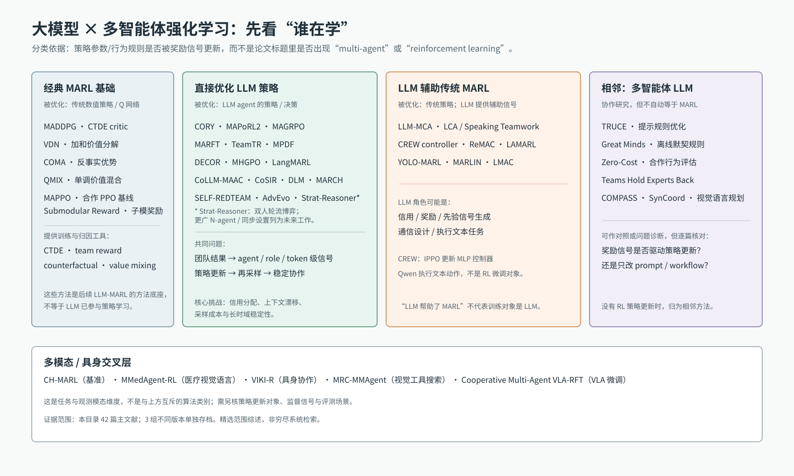
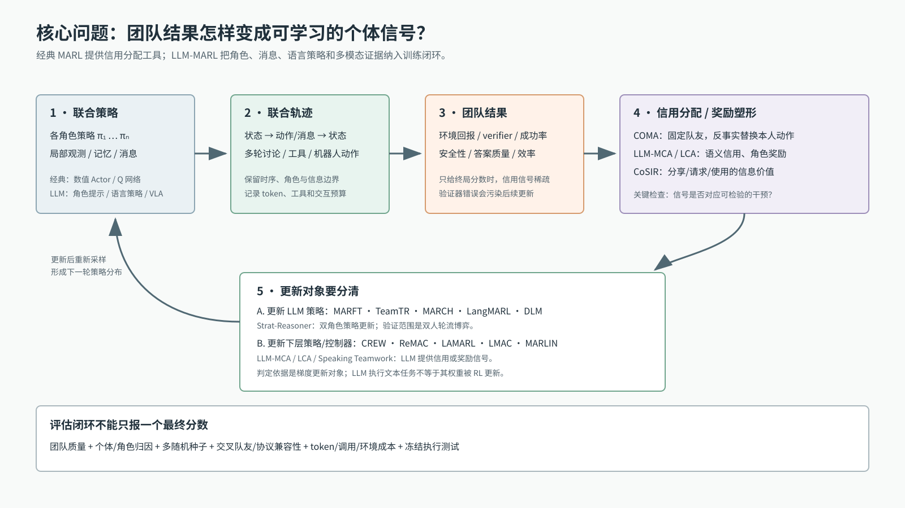

两套系统都能用大语言模型合作派单，却可以训练完全不同的东西。读这类研究时，先找三个位置：谁选动作，谁给训练反馈，最后优化器改了谁的参数。

这张地图来自 2026 年 11 月 14 日归拢的 42 篇研究。先看一个分得清角色的例子：Qwen 把订单写成结构化工单，小型策略决定把活派给谁，完成后环境打分。如果分数只更新派单策略，这属于“用 LLM 搭系统，训练小策略”。如果 Qwen 本身决定派单，按它实际选中动作的概率做梯度更新，才是在训练语言模型的策略。两张系统图可以长得很像，辨认它们要看最后这一条更新路径。

后续材料已整理为[论文线](/papers/llm-rl/)与[实践线](/practice/llm-rl/)两条系列。首次阅读从 [P1：谁在学习](/2026/11/23/llm-rl-p1-learning-object/) 开始，按专题页的统一顺序交叉阅读；当前研究仍处于前期探索与切口选择阶段。

图 1：多模态是与算法路线交叉的任务维度；判断一篇工作属于哪条路线，先检查策略是否由奖励信号更新。

## 1. 先问“谁在学习”

强化学习中的策略可以是小型数值网络，也可以是 LLM 的生成分布。系统里出现了 LLM，并不自动说明它的权重正在接受强化学习更新。

| 系统设计 | 策略 / 执行关系 | 典型判断 |
|---|---|---|
| LLM 直接作为策略 | LLM 生成动作、消息或文本决策；奖励经策略梯度进入模型参数或适配器 | 这是直接优化 LLM 策略 |
| LLM 提供训练信号 | LLM 读取轨迹、评价贡献、生成奖励或先验；下层策略另行学习 | LLM 可能被冻结，更新对象是下层策略 |
| LLM 执行、控制器学习 | 小型 Actor 选择检索、分享、写作等动作；LLM 执行文本任务 | 优化器更新控制器，不一定更新 LLM |
| LLM 生成教师轨迹 | 大模型提供任务分配或协作示范，轻量策略以监督学习模仿 | 属于蒸馏，不等于奖励驱动的 MARL |

图 2：团队分数需要经过某种信用或奖励机制，才能成为具体策略的更新信号；信号设计不同，回答的问题也不同。

## 2. 经典 MARL 是方法底座

经典方法解决的是多智能体训练中的不同环节，不能把它们统称为“奖励分配算法”。

| 方法 | 主要解决的问题 | 与 LLM 协作研究的联系 |
|---|---|---|
| MADDPG | 训练期使用集中式 Critic，执行期由局部 Actor 决策 | 展示 CTDE 如何在训练中利用联合信息 |
| VDN | 将联合价值表示为各智能体局部价值之和 | 提供简单的团队价值分解基线 |
| QMIX | 用状态条件的单调混合网络表示联合价值 | 在表达力和局部贪心执行之间折中 |
| COMA | 固定队友实际动作，只反事实替换本人动作来构造优势 | 直接比较个体动作对团队价值的相对作用 |
| MAPPO | 用 PPO 优化合作策略，并系统评估实现选择 | 提供强策略优化基线；本身不等于显式反事实归因 |

[MADDPG](https://arxiv.org/abs/1706.02275)、[VDN](https://arxiv.org/abs/1706.05296)、[QMIX](https://proceedings.mlr.press/v80/rashid18a.html)、[COMA](https://arxiv.org/abs/1705.08926) 与 [MAPPO](https://proceedings.neurips.cc/paper_files/paper/2022/hash/9c1535a02f0ce079433344e14d910597-Abstract-Datasets_and_Benchmarks.html) 关注的模块不同。比较论文时，需要说明差异发生在策略优化、价值表示、信用估计还是训练信息边界。

## 3. 直接优化 LLM 策略

这类方法把 LLM 的输出行为当成策略的一部分。模型产生答案、消息、工具调用或角色动作；训练信号经策略优化目标改变这些输出的概率。

- [MAPoRL2](https://aclanthology.org/2025.acl-long.1459/) 让多个 LLM 先独立回答，再进行多轮讨论。Verifier 评价最终答案，并对讨论中的纠正与说服行为提供激励，多个模型共同接受强化学习后训练。
- [MARFT](https://arxiv.org/abs/2504.16129) 关注传统 MARL 假设与 LLM 智能体系统之间的错配，重点讨论异步交互、不同角色和异构模型下的强化微调框架。它更适合理解为框架与问题建模，而不是一个可替代所有算法的单一更新公式。
- [TeamTR](https://proceedings.mlr.press/v306/xie26o.html) 关注顺序更新多个共享上下文角色时的分布漂移：一个角色更新后，其他角色面对的上下文分布也随之改变。方法在角色更新后重采样，并限制策略变化幅度。
- [MARCH](https://aclanthology.org/2026.acl-long.1828/) 让多角色共同参与求解、提出核查意见和证据检查，并对角色条件下的 LLM 行为进行策略训练。

这些论文都涉及 LLM 策略学习，但训练目标、角色交互顺序、奖励来源和模型共享方式并不相同。只看到“多个 LLM + PPO/GRPO”不足以判定方法等价。

## 4. LLM 辅助传统 MARL

另一条路线让 LLM 设计或改善训练信号，再由传统强化学习策略学习动作。此时 LLM 的作用可能是评估器、奖励设计者、先验提供者或文本执行器。

### 4.1 用 LLM 产生角色信用

[LLM-MCA](https://arxiv.org/abs/2502.16863) 将多智能体轨迹交给集中式 LLM Critic，要求它分析角色行为并生成个体信用或任务改进信号，再把这些信号接入下层 MARL。它提供的是可读的轨迹判断；语言解释本身不等于已经验证的因果贡献。

### 4.2 用 LLM 设计奖励

[ReMAC](https://openreview.net/forum?id=CWYWhLho0a) 在上层迭代生成团队级和智能体级奖励函数候选，下层多智能体策略根据候选奖励训练，训练表现再反馈给 LLM 改进奖励设计。LLM 不是每一步都替机器人选动作，关键学习对象仍是下层策略。

这两种方法都试图缓解团队回报难以指导个体学习的问题，但改变的位置不同：LLM-MCA 从轨迹中生成信用判断；ReMAC 改变训练策略所使用的奖励函数。

### 4.3 用信息价值训练协作

[CoSIR](https://arxiv.org/abs/2610.17893) 研究分享、请求和使用队友证据的行为。其核心思路是用团队对正确答案的惊讶程度表示不确定性：

$$
\Phi(\mathcal{K})=-\sum_i \log_2 P_i(y^\*\mid \mathcal{K}_i)
$$

其中 $\mathcal{K}_i$ 表示智能体 $i$ 当前掌握的证据，$P_i(y^\*\mid\mathcal{K}_i)$ 是其证据下正确答案的概率。一次交流的信息奖励可理解为交流前后的 surprisal 差：

$$
R_{\text{info}}=\Phi(\mathcal{K}_{\text{before}})-\Phi(\mathcal{K}_{\text{after}})
$$

用选桥手算：B 收到限重后，给正确答案「北桥」的概率从 `0.25` 提到 `0.50`；A 的判断没变。B 这一项从 `−log₂(0.25)=2` 降到 `−log₂(0.50)=1`，所以团队的信息奖励为 `2−1=1`（用二进制对数，单位为比特）。如果转发一条已经知道的消息，双方对正确答案的概率都不动，这一项奖励为 0。CoSIR 用这类信号更新的是会发送、请求和使用证据的语言策略。

## 5. LLM 执行、控制器学习

判断训练对象时，一个清楚的对照是 [CREW](https://aclanthology.org/2026.emnlp-main.2052/)：小型数值 Actor-Critic 根据局部状态选择检索、传播知识、撰写或批评；Qwen 执行具体文本任务。IPPO 更新的是动作控制器，而不是因为系统使用了 Qwen，就自动更新 Qwen 的模型权重。

要复核这种分工，可以从一条训练样本往下查：动作是「检索」还是具体生成的查询文字？策略损失用的是选中「检索」的对数概率，还是 Qwen 写出这条文字的对数概率？最后检查优化器持有的参数，并用更新前后的权重确认哪组数值变了。

## 6. 相邻方法：协作不必然是 MARL

[SynCoord](https://proceedings.mlr.press/v306/zhai26c.html) 让高能力教师生成任务级协作轨迹，再用监督学习训练轻量执行策略。它可以降低部署时的推理成本，也可以作为协作策略对照；但学生策略主要通过模仿教师标签训练，不是由环境奖励直接更新。

提示规则搜索、离线协作记忆和固定工作流也可能改善多智能体表现。它们可与 MARL 比较，但要依据参数更新和反馈来源分类，不能只凭多智能体对话或论文标题中的 “reinforcement” 下结论。

## 7. 多模态与具身协作

多模态方向至少涉及三种不同问题：

1. **多模态输入基准**：智能体接收图像、语言或不同视角，研究环境本身支持什么样的合作评估。
2. **多模态推理与角色协作**：例如 [MMedAgent-RL](https://arxiv.org/abs/2506.00555)，结合医疗影像与不同专科角色进行推理。
3. **具身或视觉语言动作策略训练**：例如 [VIKI-R](https://proceedings.neurips.cc/paper_files/paper/2025/hash/ab16cc8f472cf94b282dbff7b99f5f8e-Abstract-Datasets_and_Benchmarks_Track.html)、[MRC-MMAgent](https://arxiv.org/abs/2610.39324) 和 [多智能体 VLA 强化微调](https://arxiv.org/abs/2609.36588)，研究视觉信息、动作决策、角色分工和协同控制如何共同进入训练。

多模态不仅增加输入种类，也会改变状态编码、动作空间、数据采集、模型延迟和不同角色的信息边界。因而实验除了报告成功率，还应交代训练预算、工具或视觉调用、时延、团队规模与测试分布。

## 8. 跨论文共同难题

| 难题 | 核心问题 | 可检验的证据 |
|---|---|---|
| 团队信用 | 团队成功后，某个角色或动作真的起了作用吗？ | 反事实替换、成员移除、角色替换及归因误差 |
| 策略非平稳 | 一个角色更新后，队友面对的上下文是否变了？ | 更新前后重采样、上下文分布和 KL 变化 |
| 奖励与评估器偏差 | 策略是在完成任务，还是只学会让评估器给高分？ | 独立评估、奖励置换、异常轨迹与人工抽查 |
| 通信成本与兼容性 | 消息带来的收益是否超过 token、延迟和协调开销？ | 等预算比较、消息消融、不同队友交叉配对 |
| 多模态泛化 | 视觉证据、角色能力或环境分布改变后，合作是否仍成立？ | 未见场景、角色互换、多随机种子与成本报告 |

对于复杂系统，一个最终准确率无法单独证明信用估计正确、通信不可替代、训练稳定或能够迁移。每种结论都要对应相应的干预和评估条件。

## 9. 可以继续追问的研究问题

一个可检验的起点是：在部分可观测的多模态协作任务中，能否用可验证的信息价值或反事实信号，让智能体只在确有增益时分享证据，并降低无效通信成本？

可以先设计小型视觉证据协作任务，再逐步比较单体模型、固定提示多智能体、共享团队奖励、COMA 式反事实信用和信息价值奖励。关键是固定模型、训练数据和总预算，并同时报告答题质量、信息来源准确率、消息 token、工具调用、多种子波动及不同队友之间的协议兼容性。

例如两位智能体各看到一张不同角度的照片，只有一张拍到了决定答案的标记。可以让接收者在同样场景下分别收到真实证据、有格式但没信息的消息，记录答对数和消息长度。这个对照先回答「传来的内容有没有用」，再为训练怎样奖励分享提供依据。

## 代表论文

- [The Surprising Effectiveness of PPO in Cooperative Multi-Agent Games（MAPPO）](https://proceedings.neurips.cc/paper_files/paper/2022/hash/9c1535a02f0ce079433344e14d910597-Abstract-Datasets_and_Benchmarks.html)
- [Counterfactual Multi-Agent Policy Gradients（COMA）](https://arxiv.org/abs/1705.08926)
- [MAPoRL2](https://aclanthology.org/2025.acl-long.1459/) · [MARFT](https://arxiv.org/abs/2504.16129) · [TeamTR](https://proceedings.mlr.press/v306/xie26o.html)
- [LLM-MCA](https://arxiv.org/abs/2502.16863) · [ReMAC](https://openreview.net/forum?id=CWYWhLho0a) · [CoSIR](https://arxiv.org/abs/2610.17893)
- [CREW](https://aclanthology.org/2026.emnlp-main.2052/) · [SynCoord](https://proceedings.mlr.press/v306/zhai26c.html)
- [MMedAgent-RL](https://arxiv.org/abs/2506.00555) · [VIKI-R](https://proceedings.neurips.cc/paper_files/paper/2025/hash/ab16cc8f472cf94b282dbff7b99f5f8e-Abstract-Datasets_and_Benchmarks_Track.html) · [MRC-MMAgent](https://arxiv.org/abs/2610.39324)
