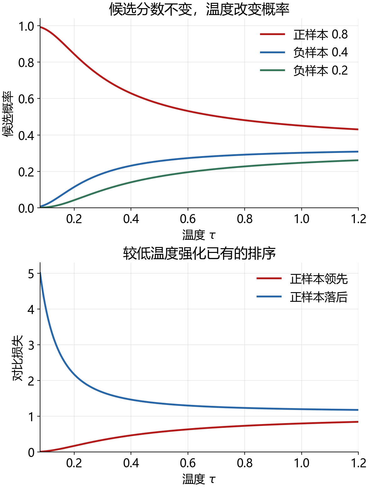

> RedMoon · 2026-11-17 整理 · 课堂笔记

同一张照片经过裁剪、调色之后，模型应当保留什么信息？一张图片怎样与一句描述对应？遮住大部分图像后，剩下的内容能提供多少预测线索？本课围绕这些问题继续讨论自监督学习：用增强视图构造对应关系，用教师网络产生目标分布，或直接预测被遮挡的内容，再把学到的表示迁移到具体任务。开场的增量路径规划分享，则说明了另一个计算思路：环境改变后，怎样复用已有结果。

## 一、开场分享：D* Lite 怎样复用搜索结果

### 1. 在未知地图里，最短路依赖当前已知信息

机器人出发时可能只知道部分地图。尚未观察的格子暂按可通行处理，靠近后发现障碍，再更新边的代价。此时求得的是当前地图上的最短路径；机器人已经走过的路无法撤销，因此整段实际行程未必等于预先知道完整地图时的最短路。[1]

每次发现障碍都从头运行 A*，会重复处理很多没有变化的信息。增量搜索保留上一轮的距离估计，优先修复受边代价变化影响的部分。D* Lite 将 LPA* 的增量机制用于移动机器人的重规划，并通过启发式把计算集中到当前决策需要的区域。[1]

### 2. 一致性检查比较的是 g 与 rhs

以 D* Lite 从目标向当前位置搜索的写法为例，$g(s)$ 估计从节点 $s$ 到目标的代价，$\operatorname{rhs}(s)$ 是根据后继节点计算的一步前瞻值：

$$
\operatorname{rhs}(s)=
\begin{cases}
0, & s=s_{\mathrm{goal}},\\
\displaystyle\min_{s'\in\operatorname{Succ}(s)}
\left[c(s,s')+g(s')\right], & s\ne s_{\mathrm{goal}}.
\end{cases}
$$

当 $g(s)=\operatorname{rhs}(s)$ 时，节点局部一致。边代价变化后，两者可能不相等，相关节点进入优先队列等待处理。$g(s)>\operatorname{rhs}(s)$ 表示当前距离估计可以降低；$g(s)<\operatorname{rhs}(s)$ 表示原估计可能依赖已经失效的路径，需要撤销并继续传播变化。[1]

把地图缩成两条路：`S → A → G` 每条边代价 1，`S → B → G` 两条边代价分别为 1 和 4。机器人原本走 A，总代价为 2。若发现 `A → G` 的代价已涨到 9，A 保存的旧值 $g(A)=1$ 与现在的一步前瞻 $\operatorname{rhs}(A)=9+g(G)=9$ 对不上。旧值撤销后，S 可以复用另一侧仍有效的 $g(B)=4$；现在经 B 到终点花 5，比经 A 的 10 便宜。

$h$ 用来排修复顺序，$\operatorname{rhs}$ 用来判断某个旧估值是否需要修。算法还查看队首优先级，确认没有尚未处理的变化会影响机器人当前所需的路径。

### 3. 反向搜索便于处理移动的起点

机器人不断移动，目标相对固定。D* Lite 从目标向机器人当前位置传播代价信息，再按边代价加后继估值选择实际前进方向。搜索方向反转，机器人仍然朝目标运动。算法还用键值修正处理起点移动，避免每移动一步就重排整个队列。[1]

分享中比较了节点扩展、节点访问和堆操作等计算量，也讨论了地图分辨率与传感器范围。评价这些指标时，需要结合任务和实现：更少的某一种操作不自动等于更短的总运行时间。

## 二、对比学习：训练信号来自样本之间的关系

### 1. 从图像空间进入表示空间

图像的像素距离不一定符合语义。狗的头部与腿部外观不同，猫头与狗头却可能在局部纹理上相似。表示学习希望得到适合任务的特征，使同一对象的不同有效视图仍能对应起来。

设图像为 $x$，编码器为 $f_\theta$，表示为：

$$
h=f_\theta(x).
$$

编码器可以使用 CNN 或 ViT；对比学习描述的是训练目标，可以配合不同网络结构。损失约束表示之间的相对关系，通过反向传播更新编码器参数。[2][3]

常见相似度是余弦相似度：

$$
\operatorname{sim}(u,v)=\frac{u^\mathsf T v}{\|u\|_2\|v\|_2}.
$$

相似度越大通常表示越接近；欧氏距离则是越小越接近。对单位向量有：

$$
\|u-v\|_2^2=2-2u^\mathsf T v.
$$

所以在单位球面上，提高点积与减小平方距离方向一致。阅读损失函数时，先确认使用的是距离还是相似度，才能判断优化方向。

### 2. 正样本关系由构造规则决定

实例级视觉对比通常独立采样两种增强：

$$
v_1=t_1(x),\qquad v_2=t_2(x).
$$

同一张原图的两个视图构成正样本，其他原图的视图提供负样本。模型不需要人工给每张图标“猫”或“狗”，但需要知道两个视图来自同一个原始样本。[2]

这也解释了两个容易混淆的情况：

- 两张不同的猫图，在实例级对比里仍可能互为负样本。这样的“假负样本”来自实例关系与类别语义之间的差别。
- 裁剪可能只留下背景，旋转也可能改变某些数字或符号的类别。增强是否合理，要看它是否保留目标任务所需的信息。

课堂用人脸识别说明特征提取与相似度检索：先为登记图像提取特征，再把查询图像的特征与库中记录比较。增强训练可以改善部分光照、姿态和遮挡条件下的稳定性，实际识别性能仍要在对应条件下测量。

### 3. InfoNCE 把对应关系变成分类问题

设查询为 $q$，正样本为 $k^+$，另有 $K$ 个负样本 $k_j^-$，温度系数为 $\tau>0$：

$$
\mathcal L_q=-\log
\frac{\exp\left(\operatorname{sim}(q,k^+)/\tau\right)}
{\exp\left(\operatorname{sim}(q,k^+)/\tau\right)
+\sum_{j=1}^{K}\exp\left(\operatorname{sim}(q,k_j^-)/\tau\right)}.
$$

分母包含正样本和全部负样本。训练要求在这些候选中找出正样本，因此损失取决于正样本的相对分数。给全部分数加同一个常数，Softmax 概率保持不变。[2][3]

下面固定正样本相似度为 $0.8$，两个负样本为 $0.4$、$0.2$，直接代入公式：

| 温度 $\tau$ | 正样本概率 | 第一个负样本概率 | 第二个负样本概率 | 损失 |
| --- | ---: | ---: | ---: | ---: |
| 1.0 | 0.4506 | 0.3021 | 0.2473 | 0.7971 |
| 0.5 | 0.5713 | 0.2567 | 0.1721 | 0.5599 |
| 0.1 | 0.9796 | 0.0179 | 0.0024 | 0.0206 |



> 图 1：根据 Softmax 和负对数概率直接计算的教学曲线。上图使用相似度 $[0.8,0.4,0.2]$；下图另加入正样本为 $0.4$、负样本为 $0.8$ 和 $0.2$ 的情况。较低温度会强化已有排序：正样本领先时损失变小，落后时损失反而增大。这些曲线没有进行模型训练。

将相似度记为 $s_j$，其 Softmax 概率记为 $p_j$，则：

$$
\frac{\partial\mathcal L}{\partial s_j}
=\frac{p_j-\mathbb 1[j=+]}{\tau}.
$$

这个式子说明温度还会改变分数梯度的尺度及其分配。因此，不能仅凭固定分数下的低损失选择训练温度，也不能把降低温度当作已经学出了更好的表示。

## 三、SimCLR：用批内视图完成对比

### 1. 一个批次怎样组织

取 $N$ 张原图，每张生成两个增强视图，共得到 $2N$ 个输入。两个分支共用编码器，再经过非线性投影头：

$$
h_i=f_\theta(v_i),\qquad z_i=g_\theta(h_i).
$$

对某个锚点而言，另一个同源视图是正样本，其他 $2N-2$ 个视图是负样本。排除锚点自身后，分母共有 $2N-1$ 个候选。每个视图都轮流作为锚点，最后对这些损失求平均。[2]

SimCLR 强调增强组合、非线性投影头以及较大批次的作用。$h$ 是编码器表示，$z$ 是为对比目标进一步变换后的向量；原论文的下游评估使用编码器表示，不能默认把投影头输出直接当作所有下游任务的最佳特征。[2]

### 2. 最小损失计算

下面只实现损失。约定 `z1[i]` 与 `z2[i]` 来自同一张图，两个张量的行顺序必须对应：

```python
import torch
import torch.nn.functional as F

def simclr_loss(z1, z2, tau=0.5):
    n = z1.shape[0]
    z = F.normalize(torch.cat([z1, z2], dim=0), dim=1)
    logits = z @ z.T / tau
    diagonal = torch.eye(2 * n, device=z.device, dtype=torch.bool)
    logits = logits.masked_fill(diagonal, float("-inf"))
    labels = (torch.arange(2 * n, device=z.device) + n) % (2 * n)
    return F.cross_entropy(logits, labels)

z1 = torch.eye(2, requires_grad=True)
z2 = torch.eye(2, requires_grad=True)
loss = simclr_loss(z1, z2)
loss.backward()
print(round(loss.item(), 6))  # 0.239545
```

拼接后的正样本索引依次为 $[2,3,0,1]$。示例中正样本相似度为 1，其余两个候选为 0，温度为 $0.5$，每个锚点的损失都等于：

$$
-\log\frac{e^2}{e^2+2}\approx0.239545.
$$

实际训练还要在前面加入图像增强、编码器和投影头，在后面加入优化器更新。这里的单位向量是为核对索引和公式构造的输入。

## 四、MoCo：队列扩大字典，动量更新维持一致性

### 1. 历史特征为什么会过时

如果把先前批次的特征保存下来，就能在较小当前批次之外使用更多候选。但编码器每轮都在更新：旧特征来自旧参数，新查询来自新参数，二者可能不在足够一致的表示空间中。

MoCo 将对比学习看成字典查询。当前查询编码器产生 $q$，键编码器产生 $k$；队列保存近期批次的键，新键入队、较早的键出队。字典大小因此与当前小批次大小解耦。[3]

这个训练队列与实际人脸检索中的身份特征库用途不同。前者为优化目标提供候选键，后者保存部署系统的登记记录；它们都存向量，但更新规则和评价目标不同。

### 2. 两个编码器怎样更新

查询编码器参数 $\theta_q$ 通过损失反向传播更新；键编码器采用指数移动平均：

$$
\theta_k\leftarrow m\theta_k+(1-m)\theta_q,\qquad 0\leq m<1.
$$

较大的 $m$ 让键编码器变化更平缓，从而减轻跨批次特征不一致。原始 MoCo 中，键分支不按普通损失梯度直接更新参数。[3]

一个标量示例：旧键参数为 1，更新后的查询参数为 2，若 $m=0.9$，新键参数为 $1.1$。这是对参数做移动平均，与把队列中的所有旧向量重新编码不同。

### 3. 与 SimCLR 对照

| 问题 | SimCLR | 原始 MoCo |
| --- | --- | --- |
| 候选特征主要来自哪里 | 当前批次的增强视图 | 当前正样本与近期键队列 |
| 怎样获得较多负样本 | 增大批次会增加批内候选 | 通过队列维护较大字典 |
| 分支参数怎样变化 | 共用可训练编码器 | 查询梯度更新、键动量更新 |
| 主要实现关注点 | 增强、批次与正样本索引 | 队列进出、键的梯度隔离与一致性 |

两者都依赖正样本构造。队列解决候选组织问题，无法修复把语义不同的视图错误配为正样本的问题。

## 五、ViT：把图像转换为带位置的 Patch 序列

### 1. 切块改变输入组织方式

ViT 把图像切成固定大小的块，将每块展平并映射为 Token，再加入位置嵌入，交给 Transformer。若图像大小为 $H\times W$、Patch 边长为 $P$，且能够整除，则 Patch 数量为：

$$
N=\frac{HW}{P^2}.
$$

对于 $224\times224$ 的 RGB 图像与 $16\times16$ 的 Patch：

$$
N=14\times14=196,\qquad P^2C=16\times16\times3=768.
$$

768 是每块展开后的原始维度；映射后的 Token 维度由模型设计决定，并非总是 768。采用分类 Token 的配置还会额外加入一个 Token。[4]

### 2. 序列不等于时间

图像块排成序列，是为了使用 Transformer 的输入形式。原始图像仍是二维空间数据，位置嵌入负责保留各块的空间身份。

CNN 的卷积层通常通过局部邻域与参数共享处理图像，多层叠加后也能形成大范围感受野。全局自注意力则允许一个 Patch 直接与其他可见 Patch 交换信息。两类结构的归纳偏置和计算方式不同，效果还取决于训练数据、规模及任务。[4]

ViT 原论文于 2020 年公开，并发表于 ICLR 2021；不能把它引入视觉的时间统一写成 2022 年。[4] 自监督训练可以用于 ViT，有监督分类也可以用于 ViT，网络结构与监督方式需要分开辨认。

## 六、DINO：用自蒸馏学习视觉表示

### 1. 教师目标由训练过程形成

DINO 对同一图像生成不同视图，分别输入学生和教师网络。学生通过梯度更新，教师参数由学生参数的指数移动平均得到。教师输出提供目标分布，学生学习在另一视图上给出相符的分布。[5]

这类自蒸馏中的教师可以与学生采用相同架构；教师身份来自更新方式，并不要求预先训练好一个更大、更强的模型。这与先训练大模型、再把能力蒸馏到小模型的常见压缩流程有所不同。

若教师与学生分布分别为 $p_t$、$p_s$，一个跨视图匹配项可写成：

$$
\mathcal L_{\mathrm{DINO}}
=-\sum_k\operatorname{sg}\!\left[p_t^{(k)}(v_1)\right]
\log p_s^{(k)}(v_2).
$$

$\operatorname{sg}$ 表示停止梯度。索引 $k$ 对应输出分布的维度，不必解释成人工标注的类别。实际目标会组合多个有效视图对。[5]

### 2. 一致性训练需要防止表示坍塌

如果所有图像都输出同一个分布，视图之间也能看起来很一致，却没有留下区分图像的信息。DINO 结合教师输出居中、温度锐化、教师动量更新和多裁剪训练来组织学习，不能只保留“两个输出做交叉熵”就认为复现了完整方法。[5]

课堂展示的自监督 ViT 注意力和特征，说明在不使用对应人工像素标签的训练中，也能出现与对象区域相关的结构。这类可视化展示特征中的信息；要完成语义分割等任务，还需相应的预测与评估流程。

DINOv2 进一步强调大规模、多样且经过筛选的数据，以及训练稳定性和模型蒸馏。它将学习通用视觉特征作为目标，研究图像级和像素级表示的可迁移性。[6]

把教师和学生的输出各缩成两格。教师看完整视图，给出分布 $(0.8,0.2)$；学生看裁剪图，给出 $(0.5,0.5)$。按教师给的权重算交叉熵，约为 $0.693$。若学生把自己的输出改成 $(0.8,0.2)$，损失约为 $0.500$。这里的 0.8 权重来自教师当时的输出，学生学习的是分布，给它写一条「第一类」的人工标签反而丢掉了第二格的信息。

## 七、CLIP：让图像和文本在同一空间中匹配

### 1. 从同模态视图到跨模态对应

SimCLR 比较同一图像的不同视图。CLIP 使用图像—文本对，让图像编码器与文本编码器分别产生向量，再在共同空间中比较相似度。原论文使用约 4 亿个互联网图文对进行训练，文本提供了自然语言监督。[7]

一个包含 $N$ 个匹配图文对的批次，可以得到 $N\times N$ 的相似度矩阵：

$$
S_{ij}=\frac{\hat u_i^\mathsf T\hat v_j}{\tau}.
$$

$\hat u_i$、$\hat v_j$ 分别是归一化后的图像和文本表示。在标准配对约定下，对角线 $(i,i)$ 是正确匹配。图到文方向按行找对应文本，文到图方向按列找对应图像，再对两个方向的交叉熵取平均：[7]

$$
\mathcal L_{\mathrm{CLIP}}
=-\frac{1}{2N}\sum_{i=1}^{N}
\left[
\log\frac{e^{S_{ii}}}{\sum_j e^{S_{ij}}}
+
\log\frac{e^{S_{ii}}}{\sum_j e^{S_{ji}}}
\right].
$$

图文配对也会有噪声：一段描述可能只覆盖图片的一部分，同批次中也可能有语义相近的其他图片或文本。数据规模与清洗会影响这种对应信号的质量。

### 2. 零样本分类怎样实现

给定候选类别，为每一类写一条文本提示，例如“一张猫的照片”“一张狗的照片”。先编码这些文本，再把待分类图像与它们比较：

$$
\hat c=\arg\max_c\operatorname{sim}
\left(f_{\mathrm{image}}(x),f_{\mathrm{text}}(t_c)\right).
$$

这样就把分类改写为图文匹配。这里的零样本指对目标数据集不再使用其训练样本进行任务专门训练，并不表示模型此前没有见过相关视觉概念或语言描述。候选类别、提示写法和数据分布都会影响结果。[7]

原始 CLIP 双塔输出匹配表示与分数。自动生成图像描述或给每个像素分配类别，需要进一步的模型结构和任务处理；课堂提到的视觉语言模型应用不能全部等同于原始 CLIP 的直接输出。

## 八、掩码建模：从已有数据中产生预测目标

### 1. 自回归预测与掩码预测的可见信息不同

自回归语言建模利用已有前缀预测下一个 Token：

$$
\mathcal L_{\mathrm{AR}}
=-\sum_t\log p_\theta(x_t\mid x_{\lt t}).
$$

目标 Token 已经包含在原始文本中，因此可以自动构造训练对。训练时要通过因果掩码限制可见范围，避免当前位置读取未来答案。预测结果再与真实 Token 比较，梯度由预测概率回到网络参数。

BERT 的掩码语言建模则允许利用被选中位置两侧的上下文。原始方案选取约 15% 的 Token 参与预测，其中约 80% 替换为 `[MASK]`，10% 替换为随机 Token，10% 保持原样；预测目标始终是原 Token。15% 表示被选中的预测位置比例，不等于全部直接换成 `[MASK]`。[8]

输入内容遮挡、注意力的可见性限制，以及权重或激活的随机丢弃，作用位置不同。它们都可能被口头称作“掩码”，阅读实现时需要看掩码具体施加在哪里。

### 2. BEiT：预测离散视觉 Token

语言有离散词表，图像块原本是连续像素。BEiT 借助视觉 Tokenizer 把原图转换为离散视觉 Token，再根据受遮挡的图像块预测对应位置的 Token 编号。目标因此是离散预测，而不是直接把全部像素值作为回归目标。[9]

课堂提到的“图像块输入模型，同时用离散编码器提供目标”，可以沿这一思路理解。图像输入与预测目标的表示可以不同，关键是保留位置对应关系。

### 3. MAE：重编码器只看可见块

MAE 采用非对称编码器—解码器：[10]

1. 把图像切成 Patch，随机遮挡其中较大一部分。
2. 编码器只接收可见 Patch 及其位置，不把全部 Mask Token 送入重编码器。
3. 将可见块的编码结果映射到解码器维度，再补入可学习的 Mask Token。
4. 恢复完整序列的位置顺序，加入解码器位置嵌入，预测像素。
5. 主要在被遮挡位置计算重建误差；预训练后使用编码器适配下游任务。

原始 MAE 的典型图像配置使用 75% 掩码率。以 196 个 Patch 为例：

$$
N_{\mathrm{visible}}=196\times0.25=49,\qquad
N_{\mathrm{masked}}=147.
$$

不计分类 Token、且保持其他条件不变时，编码器注意力分数矩阵的元素数量由 $196^2$ 降至 $49^2$，比例为：

$$
\left(\frac{49}{196}\right)^2=\frac{1}{16}.
$$

这是注意力矩阵规模的比较。完整训练仍包含线性投影、前馈层和处理完整序列的轻量解码器，不能据此把整套训练速度写成提高 16 倍。MAE 的计算节省来自可见 Token 编码和非对称设计，也不应直接改称一般意义上的“稀疏注意力”。[10]

### 4. 重建损失计算在哪些位置

设被遮挡位置集合为 $\mathcal M$，每块含 $d$ 个像素通道数值，则可写为：

$$
\mathcal L_{\mathrm{MAE}}
=\frac{1}{|\mathcal M|}
\sum_{i\in\mathcal M}
\frac{1}{d}\|\hat x_i-x_i\|_2^2.
$$

原始实现也提供按 Patch 归一化像素目标的配置。下面对应未归一化的像素均方误差，假设至少遮挡一个 Patch：

```python
def masked_patch_mse(pred, target, mask):
    # pred、target: [batch, patches, pixel_values]
    # mask: [batch, patches]，1 表示被遮挡
    per_patch = (pred - target).square().mean(dim=-1)
    return (per_patch * mask).sum() / mask.sum()

pred = torch.tensor([[[1.0, 3.0], [100.0, 100.0]]])
target = torch.tensor([[[0.0, 1.0], [0.0, 0.0]]])
mask = torch.tensor([[1.0, 0.0]])
print(masked_patch_mse(pred, target, mask).item())  # 2.5
```

第二个 Patch 虽然误差很大，但它没有被选入掩码损失；第一个 Patch 的平均平方误差为 $(1+4)/2=2.5$。如果把可见位置也一起平均，优化的目标就改变了。

图像局部有较强冗余，这为高比例遮挡后的预测提供了线索。重建图像合理，并不意味着模型恢复了所有真实细节；迁移价值仍需通过下游分类、检测或其他具体任务评价。

## 九、预训练之后：怎样使用已有表示

### 1. 冻结、全量更新与参数高效适配

预训练得到可复用的参数，下游任务再决定如何利用它们：

| 方式 | 哪些参数参与学习 | 适合观察什么 |
| --- | --- | --- |
| 特征提取与检索 | 编码器冻结，建立或更新特征索引 | 现有表示是否支持匹配与检索 |
| 线性探测 | 编码器冻结，只训练线性任务头 | 固定表示对目标类别的线性可分性 |
| 全量微调 | 编码器及任务相关参数共同更新 | 在指定数据和预算下适配目标任务 |
| LoRA 等参数高效方法 | 主干通常冻结，训练新增的适配参数 | 用较少可训练参数调整模型行为 |

线性探测成绩、全量微调成绩和零样本迁移成绩对应不同条件。比较结果时应同时说明训练数据、更新范围及评价任务，才能判断表示或适配方法的贡献。

### 2. LoRA 学习低秩更新

对于原权重 $W_0\in\mathbb R^{d_{\mathrm{out}}\times d_{\mathrm{in}}}$，LoRA 使用：

$$
W=W_0+\frac{\alpha}{r}BA,
$$

$$
B\in\mathbb R^{d_{\mathrm{out}}\times r},\qquad
A\in\mathbb R^{r\times d_{\mathrm{in}}}.
$$

训练时冻结 $W_0$，更新 $A$ 和 $B$。新增可训练参数数目为 $r(d_{\mathrm{in}}+d_{\mathrm{out}})$，低于直接训练完整矩阵的 $d_{\mathrm{in}}d_{\mathrm{out}}$。[11]

例如，单个 $4096\times4096$ 矩阵有 $16{,}777{,}216$ 个参数；取 $r=8$ 时，两个低秩矩阵共含 $65{,}536$ 个参数，是前者的约 $0.3906\%$。这个比例针对该权重矩阵，不等于整个模型的总可训练参数比例。

看一个秩为 1 的更新：取 $A=[1,-1]$、$B=[2,3]^\mathsf{T}$，并令 $\alpha/r=1$。乘出来的两行是 $[2,-2]$ 和 $[3,-3]$：四个位置都改了，只是两行都由同一组数字乘上不同系数得到。这就是低秩的约束。矩阵维度足够大时，用小维度的 $A$、$B$ 可以省下可训练参数、梯度和优化器状态；冻结的原权重仍要存放，序列较长时还要为激活留出空间。[11]

### 3. 把架构、目标和适配方式分开

ViT 描述网络如何处理图像；SimCLR、MoCo、DINO、CLIP、BEiT 和 MAE 描述不同的训练组织与目标；线性探测、全量微调和 LoRA 则决定下游如何使用参数。这些维度可以组合。

| 方法 | 输入关系 | 主要预测目标 |
| --- | --- | --- |
| SimCLR | 同一图像的两个增强视图 | 在批内候选中找到同源视图 |
| MoCo | 查询、当前正样本与近期键队列 | 在较大动态字典中完成对比 |
| DINO | 同一图像的不同裁剪 | 匹配动量教师的目标分布 |
| CLIP | 配对图像与文本 | 双向找到匹配的另一模态 |
| BEiT | 受遮挡图像与离散视觉目标 | 预测被遮挡位置的视觉 Token |
| MAE | 少量可见图像块 | 重建被遮挡位置的像素 |

自动构造目标扩大了可用于训练的数据范围。增强保留什么、图文是否对应、遮挡哪些位置，都会改变模型受到的学习信号。

## 十、复习问答

1. **对比学习需要人工类别标签吗？**

   实例级自监督对比可以根据同一原图的增强关系构造正样本，无需逐张提供类别。但训练仍依赖明确的正负样本构造规则。

2. **为什么不能只说“拉近正样本，推远负样本”？**

   还要说明表示是否归一化、使用何种相似度、比较哪些候选，以及损失如何归一化。InfoNCE 约束的是正样本在候选集合中的相对分数。

3. **SimCLR 每个锚点为什么只有 $2N-2$ 个负样本？**

   $2N$ 个视图中，要排除锚点自身和一个同源正样本；分母仍包含正样本，因此有 $2N-1$ 个候选。

4. **MoCo 为什么同时需要队列和动量编码器？**

   队列扩大字典，动量编码器减缓跨批次表示变化。单独保存旧特征，可能遇到旧键与新查询不一致的问题。

5. **DINO 的教师一定比学生大吗？**

   不一定。其教师可以采用同样架构，通过学生参数的移动平均形成。教师分布停止梯度，学生按损失更新。

6. **CLIP 的零样本分类为什么还需要类别文本？**

   文本为候选类别提供表示，图像通过与这些文本匹配完成选择。更换类别集合或提示，会改变分类问题。

7. **MAE 遮挡 75%，为什么编码器只接收 25% 的 Patch？**

   它将 Mask Token 放在较轻的解码阶段补入。重编码器省去被遮挡位置的处理，是非对称设计的重要部分。

8. **LoRA 参数很少，为什么仍可能放不进显存？**

   主干权重、激活与运行开销仍然存在。可训练参数少，不能替代对整套模型资源需求的估计。

## 参考资料

课堂范围依据本次计算机视觉自监督学习转写及配套摘要。下列原始资料用于核对算法定义和实现；文中的概率表、单位向量、掩码误差和参数数量是解释机制的教学算例。

1. Koenig、Likhachev，D* Lite，AAAI 2002。[作者提供的论文](https://idm-lab.org/bib/abstracts/papers/aaai02b.pdf)。重点核对 LPA*、局部一致性与反向增量搜索。
2. Chen 等，*A Simple Framework for Contrastive Learning of Visual Representations*，ICML 2020。[论文页面](https://proceedings.mlr.press/v119/chen20j.html)。
3. He 等，*Momentum Contrast for Unsupervised Visual Representation Learning*，CVPR 2020。[论文页面](https://arxiv.org/abs/1911.05722)。
4. Dosovitskiy 等，*An Image Is Worth 16×16 Words: Transformers for Image Recognition at Scale*，ICLR 2021。[论文页面](https://arxiv.org/abs/2010.11929)。
5. Caron 等，*Emerging Properties in Self-Supervised Vision Transformers*，ICCV 2021。[论文](https://arxiv.org/abs/2104.14294)、[作者实现](https://github.com/facebookresearch/dino/blob/main/main_dino.py)。
6. Oquab 等，*DINOv2: Learning Robust Visual Features without Supervision*，2023。[论文页面](https://arxiv.org/abs/2304.07193)。
7. Radford 等，*Learning Transferable Visual Models From Natural Language Supervision*，ICML 2021。[论文页面](https://proceedings.mlr.press/v139/radford21a.html)。
8. Devlin 等，*BERT: Pre-training of Deep Bidirectional Transformers for Language Understanding*，NAACL 2019。[论文](https://arxiv.org/abs/1810.04805)、[作者的数据构造实现](https://github.com/google-research/bert/blob/master/create_pretraining_data.py)。
9. Bao 等，*BEiT: BERT Pre-Training of Image Transformers*，ICLR 2022。[论文页面](https://arxiv.org/abs/2106.08254)。
10. He 等，*Masked Autoencoders Are Scalable Vision Learners*，CVPR 2022。[论文](https://arxiv.org/abs/2111.06377)、[作者实现](https://github.com/facebookresearch/mae/blob/main/models_mae.py)。
11. Hu 等，*LoRA: Low-Rank Adaptation of Large Language Models*，ICLR 2022。[论文页面](https://arxiv.org/abs/2106.09685)；本地原文用于核对低秩分解与冻结权重。
