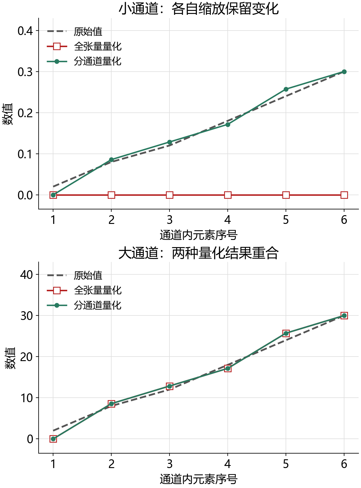

> RedMoon · 2026-11-18 整理 · 课堂笔记

上节课从 Transformer 延伸到多模态和智能体，本课把这些模型放回完整的计算系统。前半段梳理 Token、上下文、工具、MCP 与 Agent Skill，说明模型怎样获得信息并执行任务；后半段进入硬件与量化，讨论参数和激活怎样存储、搬运、参与运算。两部分连接着同一个问题：完成一次任务，除了模型生成内容，还需要哪些软件和硬件配合？

## 一、计算生态：硬件能力怎样变成可用性能

### 1. 芯片、编译器与算子库共同工作

课堂从 CUDA 生态谈起，强调硬件之外的软件积累。一个矩阵乘法从模型代码走到芯片执行，通常还要经过框架、编译器、运行时、算子实现和驱动。模型支持哪些数据类型、算子能否融合、形状是否适合并行，都会影响性能。[1]、[2]

因此，芯片峰值算力与某个模型的实际速度是不同的指标。换一种硬件后，能否直接运行、是否需要改算子、数值是否一致、性能是否稳定，都涉及软件与硬件的配合。课堂将这部分概括为中间件和开发生态。

GPU 也有通用计算、向量、标量和控制能力，矩阵计算只是深度学习中很重要的一类工作。理解 AI 加速时，应把完整工作负载拆开，再看各类运算映射到哪里。

### 2. 用模型生成算子，还需要验证循环

课堂介绍了借助大模型生成、编译和优化计算代码的思路：给定算子定义与目标硬件，生成实现，编译运行，根据错误信息和性能反馈继续修改。这个流程可以减少部分人工试错，但“成功生成代码”只是其中一步。

一个可核验的算子优化循环包括：

1. 明确输入输出、数据类型、形状和参考实现。
2. 编译并检查不同输入下的数值，覆盖边界和特殊值。
3. 在统一条件下预热、同步和计时，避免把异步提交时间当成执行时间。
4. 将优化后的算子放回模型，检查端到端收益。

如果一个算子只占原总耗时的 $p$，其速度提升到原来的 $s$ 倍，在其余部分不变的理想条件下，总加速比为：

$$
S_{\mathrm{total}}=\frac{1}{(1-p)+p/s}.
$$

例如，算子占原耗时 20%，即使加速 10 倍，总加速也只有 $1/(0.8+0.2/10)\approx1.22$ 倍。这是按给定时间占比推算的教学例子，说明局部算子收益需要经过系统占比才能转化为整体收益。

## 二、Token 与生成：从文本进入数值计算

### 1. Tokenizer 负责切分与编号

Tokenizer 将文本转换为 Token ID 序列。Token 可以对应常见词、词的一部分、字符、字节片段或特殊标记；切分取决于具体词表和算法。BPE、WordPiece、Unigram 是常见的子词方案。[3]

同一个词在不同 Tokenizer 下可能有不同的切分，部分 Unicode 字符也可能跨多个 Token。因而不能将“一 Token 等于几个汉字”作为通用换算规则。需要估计长度或费用时，应使用目标模型对应的 Tokenizer。

Token ID 只是词表索引。模型先把 ID 映射为向量，再进行注意力和前馈等计算；输出通常是词表上的分数，经归一化形成下一 Token 的条件概率：

$$
p_\theta(x_t\mid x_{\lt t},c)
=\operatorname{softmax}(\ell_t).
$$

$c$ 表示指令、已有输入及其他上下文，$\ell_t$ 是当前词表分数。选择下一个 Token 可以使用贪心或采样等解码策略，并非每次都必须取最大概率项。

### 2. 自回归依赖 Token，界面不必逐字刷新

典型自回归生成会把新 Token 接到已有前缀后，再预测后续内容，直到结束标记、输出限制或其他停止条件。Token 边界与汉字、单词边界不相同，界面也可以缓存多个 Token 后再显示。因此，“逐 Token 生成”与“屏幕逐字刷新”需要分开理解。

推理过程常分成两个阶段：

| 阶段 | 主要处理什么 | 计算特点 |
| --- | --- | --- |
| Prefill | 已知的输入 Token 序列 | 同一次前向中可并行处理多个位置 |
| Decode | 继续生成后续 Token | 同一序列的下一步依赖已经确定的前缀 |

KV Cache 保存前缀的键和值，减少生成过程中的重复计算；它增加了需要管理的运行时存储。不同请求可以组成批次，但单个序列中的生成依赖仍然存在。

## 三、上下文、Prompt 与 RAG

### 1. 当前能读取什么，取决于实际送入的信息

上下文可以包括用户问题、系统或应用规则、历史对话、工具描述、检索材料与工具结果。模型表现得像记住了上一轮，通常是因为应用再次提供了相关历史，或检索了外部记录。

上下文窗口规定一次处理所支持的长度范围。它与当前实际占用长度、单次输出限制是不同的量。应用还可能截断、压缩或筛选历史，因此对话界面中的全部记录不一定都出现在当前输入里。

设上下文预算为 $C$，系统规则、历史、工具说明、检索片段和问题的 Token 数分别为 $S,H,T,R,Q$，计划保留的输出空间为 $O$，可以先检查：

$$
S+H+T+R+Q+O\leq C.
$$

这是规划输入和输出空间的教学记法；具体服务可能还有独立的输入、输出或其他预算规则。即使材料放得下，也仍要检查模型是否提取了正确证据。

### 2. Prompt 说明任务与行为规则

课堂用数学辅导机器人说明两类信息：应用规定“引导学生思考”，用户提出“求解某道题”。前者约束行为，后者给出当前任务。明确目标、可用材料和输出要求，能减少模型对任务的歧义。

这些规则通过消息或上下文影响推理，不等于更新模型参数。它们也不能代替程序中的访问控制。例如，文本里写“只读文件”，还需要执行器实际限制写入能力。

### 3. RAG 把有关证据带入当前请求

面对很长的产品手册，可以先检索相关段落，再把问题和这些段落一起交给模型。典型流程是文档解析、切分、建立索引、检索，必要时重排，再生成带依据的回答。[4]

RAG 将外部可更新的文档与模型参数中的知识结合起来。检索阶段需要找到有关材料，生成阶段需要正确使用这些材料。漏检关键条件、切断表格上下文或混入过期版本，都会影响回答。

检索后的片段仍占上下文，模型输入仍受长度预算约束。RAG 的作用是选择信息，提高相关材料的使用效率，而不是让窗口变成无限大。

## 四、工具、MCP、Agent 与 Skill 怎样配合

### 1. 工具调用需要执行器真正运行

工具可封装成有明确输入输出的函数，如文件读取、数据库查询、测试运行或天气服务。模型根据工具描述生成调用请求，宿主程序校验请求并执行，再将返回值交给模型继续处理。

一次工具交互可以拆为：

1. 应用向模型提供问题和当前可用的工具描述。
2. 模型返回工具名与结构化参数。
3. 执行器校验参数、权限及调用条件，运行对应操作。
4. 应用将工具结果加入后续上下文，模型据此继续或结束。

生成“已经查到”的文字不能作为执行证据。工具名称正确，也不保证参数、执行结果或最终回答正确。对于文件、测试等任务，可以直接检查目标文件和测试结果。

### 2. MCP 规范连接方式

MCP，即 Model Context Protocol，采用客户端—服务器架构，规范 AI 应用与外部能力之间的消息交换。官方架构区分三个角色：[5]

| 角色 | 责任 |
| --- | --- |
| Host | 宿主应用，协调客户端、模型交互和应用侧策略 |
| Client | 宿主内部的协议组件，维护与对应服务器的连接 |
| Server | 暴露工具、资源或提示模板等能力 |

工具发现与调用可以对应 `tools/list` 和 `tools/call`。Server 还可以暴露 Resources 与 Prompts，所以 MCP 的范围比单一函数列表更广。模型通常通过宿主使用这些能力，协议本身不规定模型如何规划任务。[5]

课堂用“把 $M\times N$ 个定制对接变成近似 $M+N$ 个适配”说明标准接口的收益。这个类比描述重复集成工作的减少；具体系统仍要处理协议版本、能力支持、认证、输入输出语义和访问权限。

### 3. Agent 在反馈中决定下一步

课堂的例子是：先定位，再查天气；如果下雨，再找附近可以买伞的店。前一步的结果影响后一步是否执行，这就形成了带状态的任务循环。

Agent 可以根据当前目标、已有结果和可用工具安排下一步，也可以在明确的工作流里执行。系统需要知道何时成功、何时失败、何时应补充信息或停止。多调用几次工具，不能直接证明任务完成得更好。

课堂视频中的天气、位置和店铺数据是演示用的假设返回值，适合说明控制流程。实际服务还需检查数据是否来自真实调用，以及位置、日期和查询对象是否对应。

### 4. Skill 保存可复用的操作说明

Agent Skill 将某类任务的说明、脚本或参考材料打包，以便按需使用。公开格式以技能目录中的 `SKILL.md` 为入口，文件含 YAML 元数据和 Markdown 正文；`name` 与 `description` 用于说明名称和适用条件。[6]

下面是根据课堂“出门清单”例子整理的文档片段，用于说明格式：

```markdown
---
name: departure-checklist
description: 根据已取得的天气信息整理出门物品清单。
---

先确认地点和日期，再读取天气结果。
下雨时列出雨伞，并写明判断依据。
先给一句概括，再列物品及原因。
天气查询失败时，保留失败信息，不编造结果。
```

渐进式披露先加载简短元数据，在任务匹配时读取正文，需要时再读取脚本和参考文件。这种组织减少了把全部说明长期塞进上下文的开销。[6]

Skill 提供做事规则，工具提供执行能力，MCP 规范部分能力的连接方式。写了一份 Skill，不会自动安装天气服务或赋予文件权限；技能安装位置、触发机制与执行限制仍由宿主决定。

## 五、从模型算子走向 CPU、GPU 与专用加速器

### 1. 资源要在计算、存储、控制与通信之间分配

CPU 通常强调复杂控制和单任务响应，GPU 通过大量并行工作及高吞吐执行单元处理适合并行的任务，专用加速器还可以针对特定运算和数据流安排硬件。[1]

课堂用“城市分区与道路”类比芯片：计算单元像工作区域，缓存和存储保存数据，互连负责搬运。增加计算单元之后，如果供数不足，执行单元仍会等待。面积、带宽、功耗、时序与软件利用率需要共同考虑。

不同芯片的面积构成取决于架构和实现，不能把“CPU 只有 1% 用于计算、GPU 为 30%—60%”当作普适比例。理解这段讲授时，应抓住吞吐与控制等资源取舍，不据类比推导固定的性能倍数。

### 2. 张量有多少数据，需要按形状和类型计算

一张 $2048\times2048$ RGB 图像包含：

$$
2048\times2048\times3=12{,}582{,}912
$$

个通道数值。按未压缩且无额外布局开销计算：

| 每个通道数值的类型 | 字节数 | 整张图像占用 |
| --- | ---: | ---: |
| uint8 | 1 | 12 MiB |
| FP32 | 4 | 48 MiB |
| FP64 | 8 | 96 MiB |

这里 $1\ \mathrm{MiB}=2^{20}$ 字节。图像文件压缩后的大小、原始像素值个数、模型内部激活数量与处理它们的运算次数，属于不同统计口径。

FP64 指每个值的总表示宽度为 64 位。IEEE 双精度格式由 1 位符号、11 位指数和 52 位显式小数部分组成，并不是“小数点后有 64 位”，也不需要再额外加上数百位的整数部分。[7]

### 3. 一个模型包含多种算子

| 运算 | 典型工作 | 性能关注点 |
| --- | --- | --- |
| 矩阵乘法 | QKV 投影、注意力乘法、前馈层 | 形状、并行度、数据复用、支持的数据类型 |
| Softmax | 最大值、指数、求和与归一化 | 归约、数值稳定性、访存 |
| 归一化 | 计算统计量并变换输入 | 归约与读写开销 |
| 激活函数 | 对元素做非线性变换 | 吞吐、融合与中间结果 |
| 池化 | 局部最大值或平均值等 | 局部读取与归约，取决于具体视觉网络 |

Softmax 的输出依赖一组输入的归一化，不能只看成互不相关的逐点激活。矩阵乘法、逐元素操作和归约的性能特点也不同，单一峰值乘加指标无法覆盖它们。[1]、[2]

## 六、计算量、访存量与加速瓶颈

### 1. 矩阵乘法的运算次数取决于形状

设 $A$ 的形状为 $M\times K$，$B$ 为 $K\times N$。每个输出需要长度为 $K$ 的内积，约有 $MNK$ 次乘加；按一次乘法和一次加法各记一次操作，约为：[2]

$$
F\approx2MNK.
$$

例如，$M=N=K=1024$ 时，约为 $2.147\times10^9$ 次算术操作。把 FP32 换成 INT8，矩阵形状不变，标量乘加数量也不变；变化的是每次运算使用的数据表示、相应的硬件执行方式和数据传输量。

低位宽运算可以使用吞吐更高的硬件路径，减少部分存储与搬运。但速度还取决于算子是否支持、是否需要反量化、输入形状和整个程序的瓶颈。

### 2. 算术强度连接计算与访存

算术强度是运算次数与数据搬运字节数的比值：

$$
I=\frac{F}{B}\quad\text{次操作/字节}.
$$

若计算峰值为 $P_{\mathrm{peak}}$，内存带宽为 $W_{\mathrm{mem}}$，一个简化的性能上界模型是：

$$
P_{\mathrm{effective}}
\leq\min\left(P_{\mathrm{peak}},I W_{\mathrm{mem}}\right).
$$

假设芯片峰值为每秒 8 万亿次操作，内存每秒能送 100 GB。一个算子每搬 1 字节只能做 10 次操作，带宽给出的上界就是每秒 1 万亿次，8 万亿的计算单元吃不满。若通过复用把强度提高到 100 次操作/字节，带宽一侧的上界变为 10 万亿次/秒，此时简化模型中的上界改由 8 万亿的计算峰值决定。这两项都不是实测速度；规模、同步和调度开销还要算进去。[1]

换成一笔具体的乘法账。用 FP32 的 `1024 × 1024` 权重矩阵乘一个向量。理想情况下，读权重 4 MiB、读输入约 4 KiB、写输出约 4 KiB；做约 210 万次运算，强度约为 0.5 次操作/字节。若有 16 个输入一起做，而权重从外部内存读一遍就能供全部输入复用，运算次数变为 16 倍，读写量只是权重 4 MiB 外加输入和输出各 64 KiB，强度约为 7.76 次操作/字节。这个差距来自同一份权重做了更多乘加；设备上究竟能复用多少，要看分块和缓存。

分块矩阵乘法把部分数据放入更近的存储后重复利用，算子融合减少中间结果反复写回和读取，都在改变数据复用与搬运。近存计算、存内计算则进一步探索数据存储与计算的位置安排，具体收益取决于器件、精度和系统接口。

### 3. 量化与缓存影响不同的开销

量化减少特定张量的表示位宽；KV Cache 避免重复计算已有前缀；分块和融合减少搬运与中间结果。这些方法可以组合，但要分别统计节省了什么。

同样，模型参数、KV Cache、激活和临时工作区都占存储。只把权重量化到 4 位，并不意味着全部运行时内存也变成 4 位。

## 七、量化：用较少的离散值近似原数据

### 1. 均匀仿射量化的三个动作

设原值为 $x$，正比例系数为 $s$，整数零点为 $z$，整数表示范围为 $\lbrack q_{\min},q_{\max}\rbrack$。一种常见写法是：

$$
q=\operatorname{clip}
\left(\operatorname{round}(x/s)+z,\ q_{\min},q_{\max}\right),
$$

$$
\hat x=s(q-z).
$$

先缩放，再舍入，最后裁剪到可表示范围；反量化后得到近似值 $\hat x$。比例系数和零点决定整数码与实数之间的对应关系。具体实现还要约定舍入规则和饱和范围。[8]、[9]

均匀量化表示相邻可表示实数的间隔一致。若输入在覆盖范围内、采用最近舍入且没有裁剪，绝对误差可控制在约 $s/2$；发生裁剪时，这个误差界不再适用。

### 2. 对称与非对称量化

对称量化通常围绕零点安排实数范围，使用零点为 0 的有符号码。一种常见选择是使用 $b$ 位有符号整数的对称子范围：

$$
q_{\max}=2^{b-1}-1,\qquad q_{\min}=-q_{\max},\qquad
s=\frac{\max |x|}{q_{\max}}.
$$

例如 8 位时使用 $\lbrack-127,127\rbrack$，刻意保留了对称范围，未用到可存储的 $-128$。不同实现可能采用不同范围约定。[8]、[9]

非对称量化使用可调整的零点，将偏向一侧的数据范围映射到整数区间。例如对非负且覆盖 $\lbrack0,6\rbrack$ 的数据使用 uint8，取 $s=6/255$、$z=0$；若数据范围跨越零点且不对称，可以使用非零的整数零点。对称性与“某边更重要”是不同概念，关键在于映射范围和零点。

### 3. 手算一次低位宽量化

采用教学用的 3 位对称子范围 $\lbrack-3,3\rbrack$，数据范围 $\lbrack-1,1\rbrack$，所以 $s=1/3$、$z=0$：

| 原值 $x$ | 整数码 $q$ | 反量化值 $\hat x$ | 误差 $\hat x-x$ |
| --- | ---: | ---: | ---: |
| $-1.0$ | -3 | -1.0000 | 0 |
| $-0.6$ | -2 | -0.6667 | -0.0667 |
| $-0.1$ | 0 | 0 | +0.1000 |
| $0$ | 0 | 0 | 0 |
| $0.2$ | 1 | 0.3333 | +0.1333 |
| $0.7$ | 2 | 0.6667 | -0.0333 |
| $1.0$ | 3 | 1.0000 | 0 |

如果随后输入 $1.4$ 而仍使用这套量化参数，整数码会被裁剪到 3，重建为 1，绝对误差为 0.4。这说明校准范围和运行时数据分布的匹配很重要。

下面用 NumPy 复算。整数码保存在 int32 数组中便于观察，代码用于解释量化过程，没有实现 3 位打包或硬件加速：

```python
import numpy as np

def symmetric_quantize(x, bits=3):
    x = np.asarray(x, dtype=np.float64)
    qmax = 2 ** (bits - 1) - 1
    amplitude = np.max(np.abs(x))
    scale = amplitude / qmax if amplitude > 0 else 1.0
    codes = np.clip(np.rint(x / scale), -qmax, qmax).astype(np.int32)
    return codes, scale * codes, scale

x = np.array([-1.0, -0.6, -0.1, 0.0, 0.2, 0.7, 1.0])
codes, restored, scale = symmetric_quantize(x)
print(codes.tolist())                 # [-3, -2, 0, 0, 1, 2, 3]
print(round(np.max(abs(restored - x)), 6))  # 0.133333
```

### 4. 量化后的乘法怎样对应原计算

对权重与输入分别量化后，一个内积可近似写成：

$$
\sum_i w_i x_i
\approx s_w s_x
\sum_i(q_{w,i}-z_w)(q_{x,i}-z_x).
$$

这给出了整数乘加与原实数内积之间的联系。累加器通常采用比输入更宽的类型，避免低位宽乘积不断求和时快速溢出；最后还需按输出表示进行缩放或重新量化。[8]

“权重 4 位”也可能对应权重压缩存储、运行时与较高精度激活配合计算，不能据名称推断整层全部采用 4 位整数运算。

## 八、量化策略：范围、粒度与训练阶段

### 1. 量化粒度决定哪些值共用参数

| 粒度 | 共用量化参数的范围 | 主要取舍 |
| --- | --- | --- |
| Per-tensor | 一个张量共用一组 | 元数据少，但可能受大幅值影响 |
| Per-channel | 按选定通道或轴分别设置 | 适应通道间范围差异，需额外参数 |
| Per-group / Per-block | 一组或一块元素共用 | 在范围适配、元数据和实现之间取舍 |

分通道量化通常指每个通道有自己的比例系数等参数，不必同时给不同通道分配不同位数；各层使用不同位宽，则属于混合精度设计。这些选择可以组合。[8]、[9]

例如，一个权重张量有两个输出通道，范围分别约为 $\lbrack0,0.3\rbrack$ 和 $\lbrack0,30\rbrack$。若采用 4 位对称子范围 $\lbrack-7,7\rbrack$，全张量比例系数为 $30/7$，小通道中的数可能全部舍入为零。分别量化两个通道时，小通道可以使用 $0.3/7$ 的步长，保留更多相对变化。



> 图 1：给定小通道 $\lbrack0.02,0.08,0.12,0.18,0.24,0.30\rbrack$，大通道为其 100 倍，直接计算 4 位对称量化的结果。上图的小通道在全张量量化后全部为零；下图的大通道在两种策略下使用相同的比例系数，因此重建曲线重合。图中是固定数组的数值计算，不是模型任务精度实验。

粒度更细可以改善某些权重的重建，却会增加比例系数、零点等元数据，并影响内核设计。最终仍需检查任务精度和目标平台上的性能。

### 2. 均匀性与异常值

均匀量化的步长固定，便于缩放和整数计算。非均匀量化可以用不等间隔的码本或其他表示适应数据分布，但查表、编码和计算支持也随之变化。

对于异常值，可以考虑更细粒度、裁剪范围、特殊表示或保留部分较高精度值。裁剪减少主体分布的量化步长，同时增大被裁剪值的误差；是否有利要结合模型和数据评价，不能统一认定某种方法总能提高精度。

### 3. PTQ 与 QAT

训练后量化（PTQ）在已有模型上确定量化参数并转换表示。静态激活量化通常用代表性数据校准范围；动态量化在运行时计算部分量化参数，会引入相应计算开销。[8]

量化感知训练（QAT）在训练或微调时模拟量化、反量化等影响，使参数有机会适应量化误差，部署时再转换为目标表示。模拟量化不等于整个训练过程已经完全在低位宽硬件上执行。

“训练前、中、后”是安排量化相关步骤的时间线；具体方案还要说清楚量化对象、参数如何确定、哪些值参与低精度计算。动态量化通常指运行时求参数，也不应和“自动选择每层位宽”混为一谈。

## 九、压缩与部署：从位宽算到完整开销

### 1. 权重存储按位宽线性变化

若有 $N$ 个参数，每个使用 $b$ 位，紧密存储且暂不计额外信息，权重占用为：

$$
B_{\mathrm{weights}}=\frac{Nb}{8}\quad\text{字节}.
$$

以十进制 70 亿参数为教学规模：

| 表示 | 每参数字节数 | 原始权重大小 |
| --- | ---: | ---: |
| FP32 | 4 | 28 GB |
| FP16 / BF16 | 2 | 14 GB |
| INT8 | 1 | 7 GB |
| 4 位紧密存储 | 0.5 | 3.5 GB |

这里 $1\ \mathrm{GB}=10^9$ 字节。从 32 位到 8 位，原始存储降为四分之一，表示开销按位宽线性变化；可表示码的数量则与 $2^b$ 有关。这两个关系不能混用。

分组量化还要保存元数据。例如每 128 个权重保存一个 2 字节比例系数，且不考虑零点、对齐和其他内容，4 位权重的平均存储变为：

$$
0.5+\frac{2}{128}=0.515625
\quad\text{字节/参数}.
$$

70 亿参数约占 3.609375 GB。这个例子说明为什么量化文件大小通常不会恰好等于“参数量乘位宽”。

### 2. 权重之外还有上下文缓存

作为上下文与硬件开销的补充，常规注意力的 KV Cache 可以按形状估算。设层数为 $L$、批次为 $B$、缓存长度为 $T$、KV 头数为 $h_{\mathrm{kv}}$、每头维度为 $d_h$，每值占 $a$ 字节，则键和值共约占：

$$
B_{\mathrm{KV}}=2LBT h_{\mathrm{kv}}d_h a.
$$

例如 $L=32$、$B=1$、$T=2048$、$h_{\mathrm{kv}}=8$、$d_h=128$、$a=2$，得到 $268{,}435{,}456$ 字节，即 256 MiB。这是指定缓存形状的裸数据量，未计分配器、块管理和其他运行时开销，也不直接适用于所有压缩注意力结构。

所以，缩小权重、缩短输入、共享 KV 头或改变缓存格式，分别影响不同部分的内存。

### 3. 用任务与系统指标判断收益

量化部署需要同时看结果质量、模型体积、峰值内存、时延和吞吐。首 Token 时间、后续 Token 时间、并发和输入长度还会影响测量结果；比较前应固定任务和运行条件。

如果权重量化后速度没有提高，应进一步检查低位宽内核是否实际启用、反量化或格式转换是否成为开销，以及瓶颈是否落在激活、缓存、其他算子或通信上。省下多少字节可以直接核算，快了多少则需要在目标系统上测量。

## 十、复习问答

1. **Token 为什么不能直接等同于单词或汉字？**

   Tokenizer 按具体词表和算法切分文本，一个词可拆成多个 Token，一个字符也可能跨多个字节片段。长度应使用对应 Tokenizer 计算。

2. **RAG、MCP 和 Skill 分别解决什么问题？**

   RAG 选择并提供相关材料，MCP 规范外部能力与宿主的连接，Skill 提供可复用的任务说明。三者可以配合，但功能不同。

3. **模型生成了工具调用请求，是否代表操作已经完成？**

   还需要执行器运行并返回结果，再检查目标状态。请求文本与执行证据属于不同阶段。

4. **增加 GPU 计算单元为什么可能无法同比加速？**

   存储供数、互连、并行规模及其他算子都可能限制吞吐。计算资源需要与数据供给匹配。

5. **FP64 是不是小数点后有 64 位？**

   FP64 是每值总共 64 位的浮点表示，包含符号、指数和小数部分。

6. **FP32 换成 INT8，矩阵乘加次数会降为十六分之一吗？**

   相同矩阵形状下不会。原始字节数降为四分之一，运算次数不变；硬件速度和能耗需按低位宽执行路径判断。

7. **分通道量化一定是给每个通道不同位宽吗？**

   通常是每个通道分别确定量化参数；位宽可以相同。混合位宽是另一项设计选择。

8. **为什么 4 位权重的实际内存比参数量乘半字节更大？**

   还包含量化参数、对齐、未量化部分及运行时数据；激活和 KV Cache 也需要存储。

## 参考资料

课堂范围依据《大模型底层原理与AI芯片加速技术》转写和配套摘要，包含课堂播放的概念讲解。下列官方文档和原论文用于核对术语、公式与实现含义；数值、代码和图为给定条件下的教学计算。

1. NVIDIA，*GPU Performance Background*。[官方说明](https://docs.nvidia.com/deeplearning/performance/dl-performance-gpu-background/index.html)。用于核对硬件执行、算术强度与不同算子类别。
2. NVIDIA，*Matrix Multiplication Background*。[官方说明](https://docs.nvidia.com/deeplearning/performance/dl-performance-matrix-multiplication/index.html)。用于核对矩阵乘加数量、分块与访存限制。
3. Hugging Face，*Tokenization Algorithms*。[官方说明](https://huggingface.co/docs/transformers/main/en/tokenizer_summary)。
4. Lewis 等，*Retrieval-Augmented Generation for Knowledge-Intensive NLP Tasks*，NeurIPS 2020。[原论文](https://arxiv.org/abs/2005.11401)。
5. Model Context Protocol，*Architecture Overview*。[官方说明](https://modelcontextprotocol.io/docs/learn/architecture)。用于核对 Host、Client、Server 与工具、资源和提示。
6. Agent Skills，*Specification*。[公开格式](https://agentskills.io/specification)。用于核对 `SKILL.md`、元数据及渐进式披露。
7. Oracle，*Numerical Computation Guide: IEEE Arithmetic*。[浮点格式说明](https://docs.oracle.com/cd/E19957-01/806-3568/ncg_math.html)。
8. ONNX Runtime，*Quantize ONNX Models*。[官方说明](https://onnxruntime.ai/docs/performance/model-optimizations/quantization.html)。用于核对 scale、zero point、静态/动态量化及 QAT。
9. ONNX，*QuantizeLinear*。[算子定义](https://onnx.ai/onnx/operators/onnx__QuantizeLinear.html)。用于核对舍入、饱和与量化粒度。

[1]: https://docs.nvidia.com/deeplearning/performance/dl-performance-gpu-background/index.html
[2]: https://docs.nvidia.com/deeplearning/performance/dl-performance-matrix-multiplication/index.html
[3]: https://huggingface.co/docs/transformers/main/en/tokenizer_summary
[4]: https://arxiv.org/abs/2005.11401
[5]: https://modelcontextprotocol.io/docs/learn/architecture
[6]: https://agentskills.io/specification
[7]: https://docs.oracle.com/cd/E19957-01/806-3568/ncg_math.html
[8]: https://onnxruntime.ai/docs/performance/model-optimizations/quantization.html
[9]: https://onnx.ai/onnx/operators/onnx__QuantizeLinear.html
