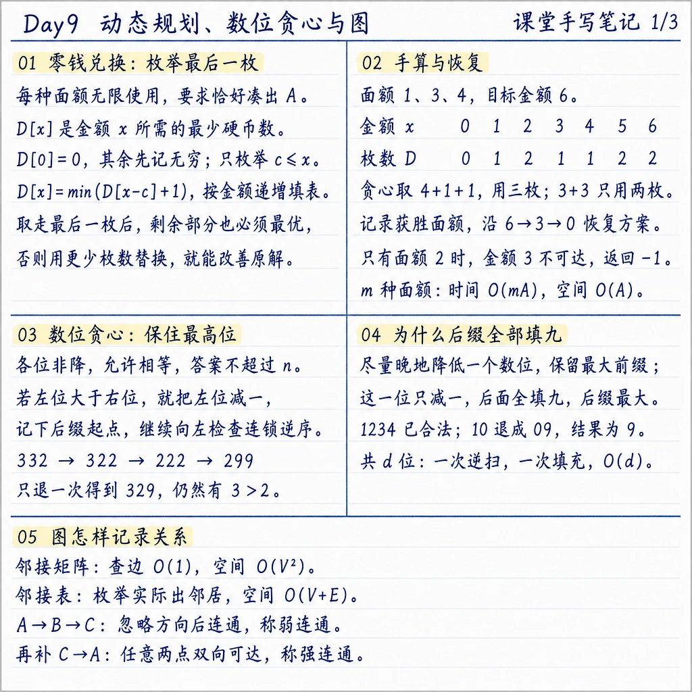
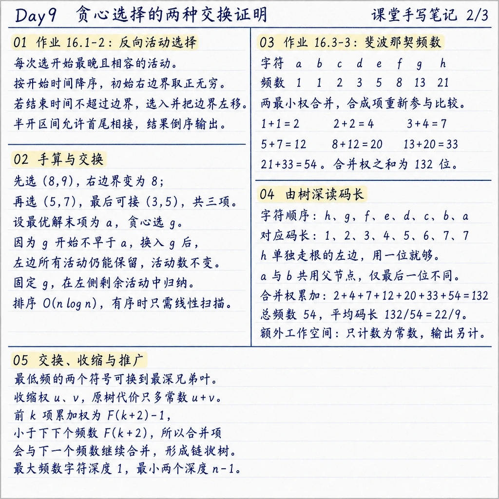
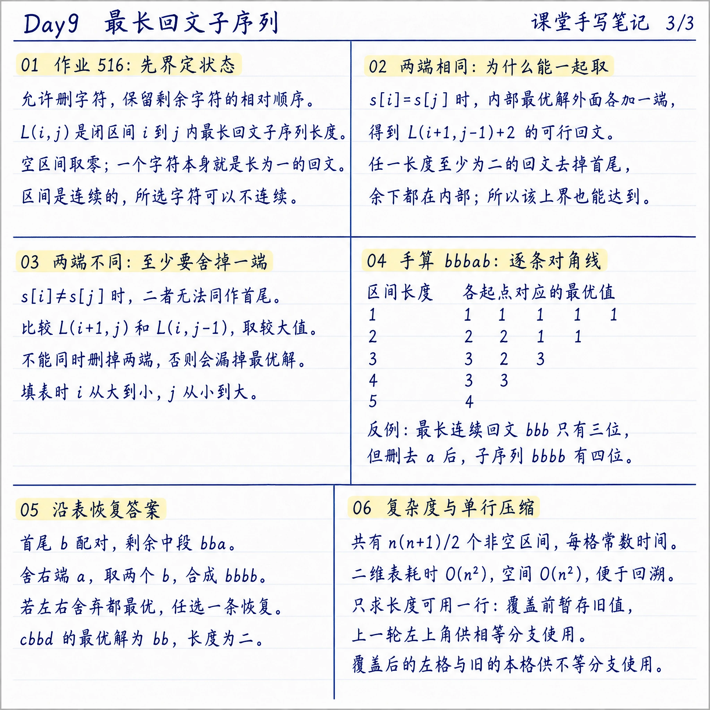

同样是“每次选一个”，凑零钱时选面值最大的硬币可能多用一枚，给符号编码时合并频数最小的两个节点却能得到全局最优解。区别在于能否证明第一步选定之后，仍有一个最优解留在手里。

## 一、课堂笔记：两道课首练习

**LeetCode 322，零钱兑换（课件第 3 页）。** 给出正整数面额，每种硬币无限枚，求恰好凑成金额所需的最少枚数。面额为 1、3、4 时，凑 6 若先拿 4，就要再拿两个 1。换成 3 加 3 只需两枚。失败的是“最大面额必选”这个假设。

令 $D(x)$ 表示凑出 $x$ 的最少枚数。取走最后一枚面额 $c$，剩余部分一定是金额 $x-c$ 的最优解，否则就能替换出更少的枚数。反过来，给任何可达的 $x-c$ 补上 $c$ 都得到可行方案。于是 $D(0)=0$，正金额先记作无穷，再取所有 $c\le x$ 的 $1+D(x-c)$ 的最小值。正面额保证按金额从小到大填表时，所需的小问题已算完。

|金额|0|1|2|3|4|5|6|
|---|---:|---:|---:|---:|---:|---:|---:|
|最少枚数（1、3、4）|0|1|2|1|1|2|2|

记录每格取最小值的硬币，就能沿 $6\to3\to0$ 还原两枚 3。课件另给了三组边界和样例：面额 1、2、5 凑 11 得 3，只有面额 2 时凑 3 返回 −1，凑 0 返回 0。设金额为 $A$、面额种数为 $m$，时间 $O(mA)$，空间 $O(A)$。输入用二进制表示时，时间依赖金额的数值大小。

**LeetCode 738，单调递增的数字（第 4 页）。** 求不超过 $n$ 的最大整数，其各位从左到右非递减，允许相等。若 $n$ 本身满足条件，就直接返回它。遇到高位大于相邻低位，必须减小该高位或更早的一位，改得越靠右对数值影响越小。该位减一后，后面每位尽量取 9。

从右向左扫描，把最后需要填 9 的后缀起点记下来。以 332 为例，比较末两位，暂存的数字变为 322；再比较前两位，变为 222；最后把后两位一并填成 9，结果是 299。只修一次得到的 329 仍有逆序。证明可以盯住第一个逆序前的相同数字段：想保留段首的原值，就得让后续同值位至少保持原值，直到在逆序处超过原数。把段首降一是允许的最大前缀，此后填满 9 得最大后缀。扫描时间和数位数组空间都是 $O(d)$，其中 $d$ 是十进制位数。10 得 9，1234 保持 1234。

## 二、课堂笔记：从前缀码到图

二进制前缀码把符号放在树的叶子上。自根读入每一位，遇到叶子就输出相应符号，再回根。一个码字若是另一个的前缀，解码器在中途遇到符号时就不能用这个规则立即切分。对于正频数 $w_i$，编码树的代价是 $\sum_i w_i d_i$，其中 $d_i$ 是叶深；除以总频数才得到每个符号的平均码长。

最优树中可以去掉只有一个孩子的内部节点，让下方所有码字缩短一位。取最深的一对兄弟叶，把两个最低频的符号换过去，代价不会增加，因为把更重的符号移浅更合算。这说明**存在**一棵最优树让这两个符号成为兄弟。将它们缩成一个权为 $u+v$ 的叶子，原树代价恰好多出常数 $u+v$。如果缩小的问题还能做得更好，展开后也能改善原问题。这个交换与收缩的证明，解释了为何每一轮可以重新从最小堆取两个权。

课件里的四个相对权重等比例放大成 7、6、5、3。先合并 3 和 5 得 8，再合并 6 和 7 得 13，最后合并 8 和 13 得 21。每个叶子都在深度 2，加权路径长度既是 $2\times21=42$，也是三次合并的权重和 $8+13+21=42$。建树共合并 $n-1$ 次，堆实现耗时 $O(n\log n)$，树和堆占 $O(n)$ 空间。

图 $G=(V,E)$ 抽去对象的外观，只留下对象和关系。图像可以把像素当成顶点，把上下左右相邻当成边。社交网络则需要先问清一条边代表互为好友还是单向关注，才能解释“相连”。

|问题|邻接矩阵|邻接表（普通列表）|
|---|---|---|
|空间|$O(V^2)$|$O(V+E)$|
|查有向边 $(u,v)$|按行列直接查，$O(1)$|扫描 $u$ 的出邻居，$O(\deg^+(u))$|
|枚举 $u$ 的出邻居|扫描整行|只访问已存的出边|

无向图里，任两点有路径就叫连通。有向链 $A\to B\to C$ 忽略方向后连通，所以是弱连通；从 $C$ 回不到 $A$，所以不是强连通。再补上一条 $C\to A$，任两点就都能沿箭头互达。判断时要说明是否保留方向。

## 三、课后作业一：反向活动选择（第 26 页，16.1-2）

**题意。** 在单个场地选择尽量多的互不冲突活动。把通常的“尽早结束”反过来，每次选与已选活动相容且开始最晚的一项。说明它为什么是贪心算法，并证明最优。

把活动写成半开区间，结束时间等于后一活动的开始时间时允许衔接。先按开始时间降序排，维护已选区间最左边的起点。候选活动结束时间不超过这条边界就选入，并把边界左移。选择只用当前信息，选完后不撤销，余下工作全部在它左侧。

~~~python
def latest_start(activities):
    boundary = float("inf")
    selected = []
    for start, finish in sorted(activities, key=lambda a: a[0], reverse=True):
        if finish <= boundary:
            selected.append((start, finish))
            boundary = start
    return selected[::-1]
~~~

**手算。** 给定 (1,4)、(3,5)、(0,6)、(5,7)、(8,9)、(5,9)。先选 (8,9)，两个起点为 5 的活动中只有 (5,7) 可以放在它左边，然后 (3,5) 又恰好接上。按时间正序输出 (3,5)、(5,7)、(8,9)。

**交换证明。** 设最晚开始的活动为 $g$，某个最优解最右端活动为 $a$。因为 $s_g\ge s_a$，其他已选活动均在 $s_a$ 前结束，换入 $g$ 后仍相容，活动数不变。因此可以固定 $g$。剩余实例只含结束时间不晚于 $s_g$ 的活动，若其选法还能增加一个，就能改进原最优解。对活动数归纳，即得整套选法最优。排序耗时 $O(n\log n)$，扫描 $O(n)$；若已按开始时间降序给定，可直接线性扫描。活动具有不同收益、目标改成收益最大时，此交换不再保证收益不变。

## 四、课后作业二：斐波那契频数的哈夫曼码（第 27 页，16.3-3）

**题意。** 字符 a 到 h 的频数依次是 1、1、2、3、5、8、13、21。给出一组最优二进制编码，并推广到前 $n$ 个斐波那契数。

|轮次|取出的两个权|合并权|
|---|---|---:|
|1|1 与 1|2|
|2|合并出的 2 与原来的 2|4|
|3|4 与 3|7|
|4|7 与 5|12|
|5|12 与 8|20|
|6|20 与 13|33|
|7|33 与 21|54|

每轮把新加入的单个字符放在左边，原来的子树放在右边，左边记 0，右边记 1，最底部 a、b 分别走 0、1。由根到叶读出一组答案：

|字符|a|b|c|d|e|f|g|h|
|---|---|---|---|---|---|---|---|---|
|码字|1111110|1111111|111110|11110|1110|110|10|0|

54 个符号合计需要 $2+4+7+12+20+33+54=132$ 位，平均 $132/54=22/9$ 位。交换任意内部节点的左右孩子只会改变具体码字，不改变长度和代价。

**推广。** 令 $F_1=F_2=1$。前 $k$ 个字符收缩后的权 $S_k=F_1+\cdots+F_k=F_{k+2}-1$，由斐波那契递推相消或归纳可得。当还有至少两个未合并的原始字符时，$S_k<F_{k+2}$ 且 $F_{k+1}\le F_{k+2}$，所以 $S_k$ 和 $F_{k+1}$ 是可以取走的两个最小权。只剩一个原始字符时直接收尾。合并树逐层延伸，最后一个字符深度是 1，倒数第二个深度是 2，最小的两个同在深度 $n-1$（$n\ge2$）。给定这种频数顺序，写出树或码长表只需 $O(n)$；若逐字写出全部码字，输出本身有 $\Theta(n^2)$ 位。

## 五、课后作业三：最长回文子序列（第 28 页，LeetCode 516）

**题意。** 删除任意多个字符、保持剩余字符的相对顺序，求能形成的最长回文长度。课件两例为 `bbbab` 得 4（`bbbb`），`cbbd` 得 2（`bb`）。第一例中的四个 b 并不连续，求最长回文子串会漏解。

记 $L(i,j)$ 为闭区间内的答案。空区间为 0，单字符为 1。若两端不同，回文无法同时保留二者，所以取舍左、舍右两种情况的最大值。若两端相同，可在内部最优解两侧各加一个字符；反过来，任何至少长 2 的回文去掉首尾后都落在内部区间，故它也不可能比内部最优值加 2 更长。

~~~python
class Solution:
    def longestPalindromeSubseq(self, s: str) -> int:
        n = len(s)
        if n == 0:
            return 0
        dp = [[0] * n for _ in range(n)]
        for i in range(n - 1, -1, -1):
            dp[i][i] = 1
            for j in range(i + 1, n):
                if s[i] == s[j]:
                    dp[i][j] = 2 + dp[i + 1][j - 1]
                else:
                    dp[i][j] = max(dp[i + 1][j], dp[i][j - 1])
        return dp[0][n - 1]
~~~

对 `bbbab` 按区间长度从短到长检查，每行是这一长度下各起点的答案。

|区间长度|各区间的最优值|
|---|---|
|1|1，1，1，1，1|
|2|2，2，1，1|
|3|3，2，3|
|4|3，3|
|5|4|

从最外层取首尾 b，内部 `bba` 舍掉右端 a，余下 `bb` 成对取走，恢复一个长度为 4 的解。共有 $n(n+1)/2$ 个非空区间，每格常数次比较，时间、空间均为 $O(n^2)$。这道作业与往年期中卷第六题共享同一个状态和填表顺序。

## 六、课堂手写笔记

第二页的常数工作空间对应已排序活动的计数扫描。用堆构建一般的哈夫曼树需要 $O(n)$ 空间。图中八个码长按 h 到 a 的顺序读作 1、2、3、4、5、6、7、7。

本课的作业题面取自《图》课件第 25 页 Homework 后的三页。期中六道题的分值、独立练习和逐题解答见[算法期中复习讲义](https://redmoon-2333.github.io/2026/11/20/algorithms-midterm-review/)。
