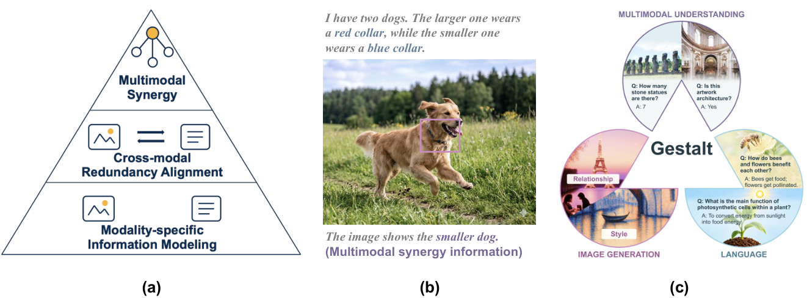
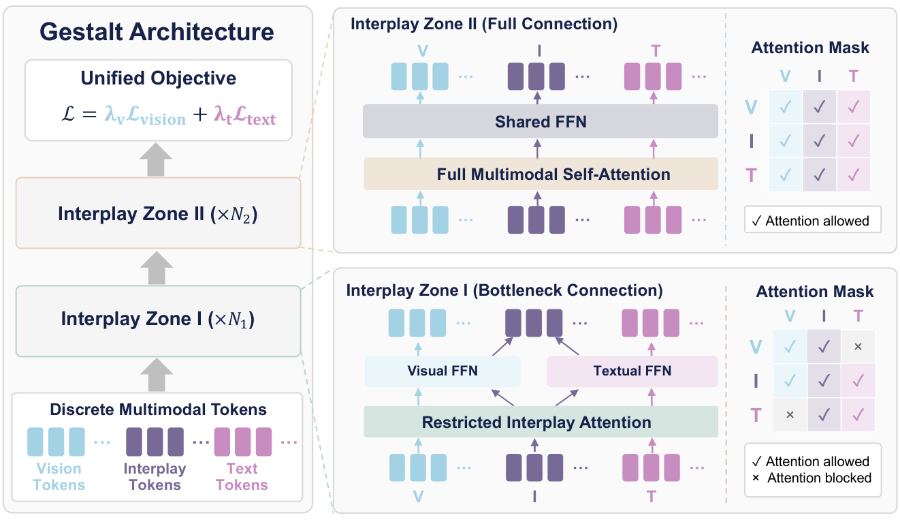
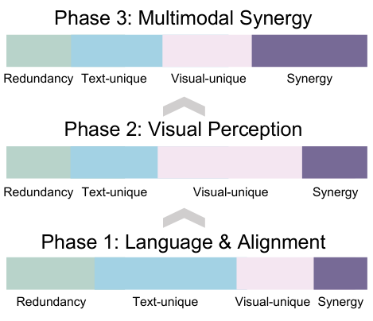

照片里有一只戴蓝项圈的狗。要回答「它是家里较大的那只，还是较小的那只？」，还需要一条文字规则：大狗戴红项圈，小狗戴蓝项圈。图像提供颜色，文字提供颜色与大小的对应关系，模型要把两者用在同一个判断里。

Gestalt 为这类图文任务加入 32 个交互 token，让两种信息在网络前几层先通过中间位置交换，后几层再直接混合。论文报告的 TIIF-Bench Long 文生图得分为 78.86，比该表次高的 BAGEL 高 7.16 分；空间视觉理解与跨模态协同结果见第六节。

本文对照 17 页的 [arXiv v2 技术报告](https://arxiv.org/abs/2610.00576v2)、[官方项目页](https://gewu-lab.github.io/Gestalt/)、固定版本的公开代码与模型卡，拆解其信息组织、架构、训练和评测。

## 一、论文与团队

论文题目为 *Gestalt: Large Multimodal Interplay Model*。第一版于 **2026 年 9 月 30 日**提交，当前版本 v2 于 **2026 年 10 月 8 日**更新。

论文首页列出 11 名作者和 6 个单位：

| 单位 | 首页所列作者 |
| --- | --- |
| 中国人民大学高瓴人工智能学院 | Zequn Yang、Yu Miao、Ziheng Chen、Ji-Rong Wen、Yake Wei、Di Hu |
| 大模型与智慧治理北京市重点实验室 | 上述六位作者同时署名该单位 |
| 北京航空航天大学 | Haotian Ni |
| 北京邮电大学 | Chengxiang Huang |
| 上海人工智能实验室 | Dongzhan Zhou、Kai Chen、Qi Zhang |
| AresoX | Di Hu 同时署名 |

首页还注明 Zequn Yang、Yu Miao、Haotian Ni、Yake Wei 的部分工作在上海 AI Lab 实习期间完成。贡献声明明确：**Di Hu 发起项目，Yake Wei 和 Di Hu 指导**；Zequn Yang、Yu Miao、Haotian Ni、Ziheng Chen、Chengxiang Huang 为共同第一作者。项目由 GeWu-Lab 官方仓库发布。

论文将 Di Hu 的单位写作 **AresoX**，本文沿用论文中的英文署名。

依据：[原论文 p.1、p.10](https://arxiv.org/pdf/2610.00576v2)与[官方项目页](https://gewu-lab.github.io/Gestalt/)。

## 二、先理解“独有、冗余、协同”

Gestalt 的 interplay 指图像与文字相对于任务的信息关系，核心输入和输出围绕这两种模态展开。

| 类型 | 判断方式 | 论文例子中的信息 |
| --- | --- | --- |
| 文本独有 | 文字提供任务所需线索 | 大狗戴红项圈，小狗戴蓝项圈 |
| 视觉独有 | 图像提供任务所需线索 | 当前照片里的狗戴蓝项圈 |
| 冗余 | 图文包含可对齐的共同内容 | 正文以“草地上的金毛犬”为例说明共享描述 |
| 协同 | 两边线索组合后才能得出结论 | 照片中是较小的那只狗 |

图 1b 的文字规定，大狗戴红项圈、小狗戴蓝项圈；照片呈现现场戴蓝项圈的狗。将规则与视觉对象对齐，答案就是较小的那只狗。

这也解释了为何“特征混合得很充分”与“正确利用互补线索”需要分别检验。对齐解决对象对应，协同解决条件组合。论文将这些关系组织成金字塔：**保留模态特有信息 → 对齐共享信息 → 整合互补信息**。



原图：Yang 等，*Gestalt: Large Multimodal Interplay Model*，Fig. 1，CC BY 4.0。

## 三、架构：32 个交互位置与前 4 层瓶颈

Gestalt 从 **LLaDA-8B-Instruct** 初始化，使用 IBQ 将图像编码为离散视觉 token。视觉码本有 **16,384** 个条目，图文共同进入扩展词表及 Transformer 序列；MRoPE 为视觉 token 保留二维位置。

共享序列中另有 **32 个可学习交互 token**。它们是参与注意力计算的表示位置，隐藏状态随样本和层数更新。其参数通过训练学习如何组织信息。



原图：Yang 等，*Gestalt: Large Multimodal Interplay Model*，Fig. 2，CC BY 4.0。V、I、T 分别表示视觉、交互和文字 token。

整个骨干有 32 层，分为前后两段：

| 层段 | 注意力 | FFN | 作用 |
| --- | --- | --- | --- |
| 区域 I：前 4 层 | 图文之间的直接注意力关闭；两边均可与交互 token 通信 | 视觉与文字分别处理 | 保留各自结构，经中介交换信息 |
| 区域 II：后 28 层 | 图像、文字、交互 token 全部直接互相注意 | 共享 FFN | 组合跨模态线索，形成任务表征 |

区域 I 的连接关系可直接列出来。行是查询位置，列是被读取的位置：

| 查询 \ 读取 | 视觉 V | 交互 I | 文字 T |
| --- | --- | --- | --- |
| 视觉 V | 开放 | 开放 | 关闭 |
| 交互 I | 开放 | 开放 | 开放 |
| 文字 T | 关闭 | 开放 | 开放 |

交互 token 因而构成受限通信接口。标准 Transformer 在同一层中同步更新各位置，另一模态的信息经交互位置传给后续层；进入区域 II 后，图文也可直接通信。

把序列暂时缩成三个位置：`V` 表示照片里的项圈，`T` 表示以后要用的颜色规则，`I` 表示交互位置。在区域 I 的第一层，`I` 可以读取本层输入中的 `V` 和 `T`；同一层的 `V` 读到的是更新前的 `I`。到下一层，`V` 才能读取刚刚融合过的 `I`。因此「图文不直接相连」仍允许信息经过交互位置传递，路径是 `T → I → V`，跨了两层。真实模型的一张照片和一句话各会占多个 token，这里用三个位置说明数据流。

**架构分区发生在一次前向传播内部。** 一个样本经过前 4 层，再经过后 28 层。训练课程则发生在参数优化的时间进程中，是另一个维度。

依据：原论文 p.3—5；公开模型配置中的 `n_layers=32`、`inter_layer_num=4`、`inter_tokens_num=32`。

## 四、离散扩散怎样统一理解与生成

图像离散化以后，图文都可用“遮住若干 token，再恢复它们”的方式训练。

原式（1）对被遮盖位置的正确 token 累加负对数概率，并对掩码集合取期望。可见条件既能来自同模态，也能来自另一模态。完整公式见[原论文第 4 页](https://arxiv.org/pdf/2610.00576v2)。

用三种任务能直观看到同一目标的用途：

| 输入中的可见信息 | 重建目标 | 对应能力 |
| --- | --- | --- |
| 部分图像、部分文字 | 两边被遮盖的 token | 联合图文建模 |
| 图像与问题 | 回答里的文字 token | 图像理解、视觉问答 |
| 文字描述 | 图像 token | 文生图 |

这里的扩散在离散 token 上进行。理解“扩散”时，应关注掩码、预测和迭代恢复过程。

公开生图代码提供了具体的解码路径：先把目标图像区域设成 MASK；模型预测当前被遮盖位置，采样视觉 token，再按置信度重新遮盖一部分位置；随着迭代推进，剩余 MASK 减少，最终得到完整视觉码本索引。脚本默认 64 个采样步骤，可使用 classifier-free guidance；论文评测设置以原文配置为准。

`run_t2i.py` 输出的是 `.npy` 码本索引，后续还要交给 IBQ 解码器还原图像。理解脚本 `run_mmu.py` 同样使用预先编码好的图像 token。

依据：原论文 p.4—5，以及固定版本源码中的 `generate_t2i` 和 `run_t2i.py`。

## 五、训练：先联合建模，再条件建模，最后调整信息配比

| 训练阶段 | 数据 | 预测方式 | 训练重点 |
| --- | --- | --- | --- |
| 联合多模态预训练 | 70M 图文对 | 图文分别遮盖，共同重建 | 模态内结构与图文联合分布 |
| 条件式 CPT | 8M 图文对 | 一边可见，预测另一边 | 图到文、文到图的条件依赖 |
| SFT | 13.7M 指令数据，另加约 2.46M 生图数据 | 条件式掩码预测 | 按信息类型组织任务学习 |

SFT 的指令数据分为：冗余 **2.8M**、文本独有 **4.2M**、视觉独有 **4.0M**、协同 **2.7M**。课程有三个阶段，分别侧重语言与对齐、视觉感知、多模态协同。四类数据始终都在，只改变采样重点。生图数据大致均匀分配到三个阶段。



原图：Yang 等，*Gestalt: Large Multimodal Interplay Model*，Fig. 3，CC BY 4.0。图中阶段顺序自下而上。

数据构建时，作者在视觉量化后再次检查题目能否作答，并按子任务的主要信息来源组织采样。

第一，**在视觉量化之后检查任务是否仍可回答**。图像进入 IBQ 之后可能丢掉小字或细节，原图能支持的标签未必仍能由 token 化图像支持。作者先用规则，再用 Qwen3-VL-32B-Instruct 核验目标所需证据，降低信息丢失造成的错误监督。

第二，信息分类采用**子任务级抽样**。每个子数据集抽 100 个样本，结合启发式与模型辅助判断主导信息需求，再组织相应子任务的数据。这让大规模课程有可操作的分类依据，类别含义是主导任务结构。

依据：原论文 p.4—5、p.14—15。

## 六、最强的实验结果说明了什么

论文的生成优势集中在关系、组合和长指令约束。下面保留与具体主张对应的比较。

| 评测方向 | Gestalt | 表列对照 | 结果 |
| --- | --- | --- | --- |
| 细粒度文生图总体效果 | UniGenBench English Long 73.30 | Lumina-DiMOO 71.81 | 高 1.49 分 |
| 复杂长指令遵循 | TIIF-Bench Long 78.86 | BAGEL 71.70 | 高 7.16 分 |
| 组合约束 | UniGenBench Comp. 81.20 | Janus-Pro 76.53 | 高 4.67 分 |
| 逻辑约束 | UniGenBench Logic 73.28 | Janus-Pro 62.62 | 高 10.66 分 |
| 空间视觉理解 | CV-Bench 2D/3D 78.9/86.1 | BAGEL 77.7/84.2 | 分别高 1.2/1.9 分 |
| 跨模态协同 | MM-IMDb 67.07 | LaViDa-O 51.54 | 高 15.53 分 |

数值来自原论文表 1、2、3、6；差值为据表计算，单位是分。表 3 中带 † 的基线结果取自各模型原论文，其他结果由作者使用官方检查点与推理脚本评测。比较对象按表列版本界定。

这一组结果的共同点是：任务要求把多个条件绑在一起。对象出现只是基础，颜色、数量、相对位置和否定要求还要同时成立。交互金字塔的应用价值在这些设置中体现得最清楚。

论文也报告纯文本评测：Gestalt 在表列扩散式统一模型中六项有五项第一。各项结果和比较范围见原论文表 5。

## 七、表征与消融分别回答什么

表征分析提供了两个有用观察。

**图文融合与语言几何保留可以同时发生。** 图 5 中 Gestalt 第 24 层图文 token 的投影分布更交错；表 4 中，它相对 LLaDA 的余弦相似度为 **0.99677**，CKA 为 **0.99494**，同时嵌入范数均值由 7.82 变为 5.29。长度改变与方向、结构相似度较高可以并存。

**交互 token 的表征随任务信息需求呈现结构。** 图 6 使用 MIBench 第 16 层交互 token，视觉独有和文字独有样本分布大体分开，协同样本部分连接两者。它描述模型内部表示与任务类型的关联。

图 5 与图 6 呈现表征结构与任务信息类别的关联；课程对照则在统一 CPT 检查点和同一份 10% SFT 子集上比较均匀混合与课程组织。

附录 B.1 的多模态评测中，最终阶段课程相对均匀混合，MMStar-P **+2.20**、MMVP **+2.00**、CVBench-2D **+0.63**。结果表明，围绕信息类别安排训练课程能够改善相关多模态能力指标。

外部成绩展示整套方案的能力，课程对照展示信息类别训练安排的影响，表示分析则描述内部表征的组织方式。

依据：原论文图 5、图 6、表 4、表 8。

## 八、从公开代码看实现细节

代码核对固定在[官方提交 `a385cfc26195480a6cd8f1ad4ef6436ce399c8e0`](https://github.com/GeWu-Lab/Gestalt/tree/a385cfc26195480a6cd8f1ad4ef6436ce399c8e0)。下面列出与架构直接相关的实现。

`flex_attention.py` 用模态掩码实现受限注意力：属于同一模态，或者查询与键中任一方为交互 token，即允许交换；再叠加文档边界和 padding 限制。这与图 2 的 V/I/T 连接表对应。

交互 token 还参与 FFN 路由。`modeling_llada.py` 的区域 I block 分别计算文本 FFN 与视觉 FFN。视觉 token 取视觉分支，文字 token 取文本分支；交互 token 的更新取两个分支输出的平均值，让共享接口同时接收两套前馈变换。

```python
# 官方实现的关键表达式；省略周边代码。
inter_out = (text_out + vision_out) / 2
```

实际层数来自检查点配置。通用配置类的默认瓶颈层数写为 8，公开检查点和 SFT YAML 均设置 `inter_layer_num: 4`，与论文一致。

“统一目标”也有损失配权。SFT YAML 写 `image_loss_weight: 0.1`、`loss_weight_mode: token`。数据处理器按片段长度和掩码比例计算权重，Trainer 对受监督 token 的交叉熵作加权归一化，以平衡 token 数量与模态任务贡献。

模型卡与检查点的序列长度为 4096，公开 SFT YAML 的 `max_length` 和 `token_budget` 为 8192，分别对应已发布模型配置和训练设置。

| 解释对象 | 对应源码 |
| --- | --- |
| 注意力掩码 | `flex_attention.py`，第 29 行起 |
| 区域 I 的 FFN 路由 | `modeling_llada.py`，第 958 行起 |
| 区域 I/II 的 block 选择 | 同文件第 1107 行起、第 1310 行起 |
| 掩码重建与损失权重 | `stage3.py`，第 55 行起；`trainer.py`，第 89 行起 |
| 生图迭代采样 | `modeling_gestalt.py`，第 349 行起 |
| SFT 配置 | `gestalt_stage_3.yaml` |

以上实现细节来自该固定版本的源码阅读；论文成绩引用原文评测表。

## 九、开放资源与检查点

截至 2026-11-20，官方材料能确认的发布状态如下。

| 材料 | 核实结果 |
| --- | --- |
| 技术报告 | arXiv v2，17 页，CC BY 4.0 |
| 代码 | 官方仓库公开模型、数据处理、Stage III SFT 与推理入口 |
| 权重 | Hugging Face `GeWu-Lab/Gestalt` 提供 `model.safetensors`，模型页标记无需申请访问 |
| 权重参数数 | API 统计 8,753,780,736 个 BF16 参数，约 8.75B |
| 检查点阶段 | 模型卡明确标记为 Continual Pretraining 检查点 |
| 模型许可 | 模型卡标记 Apache-2.0 |
| SFT 数据 | 官方 README 写 SFT data coming soon；Data 按钮为占位 |

**公开检查点属于 CPT 阶段，论文主结果则包含后续 SFT。** 查看权重与论文结果时，应区分检查点阶段。

BF16 参数本身约占 **17.51 GB，即 16.31 GiB**，尚需另计运行缓存和视觉编解码器。这个数值由公开参数数乘以每个 BF16 参数 2 字节得出，可用于判断运行资源规模。

参数规模与检查点信息来自[官方模型卡](https://huggingface.co/GeWu-Lab/Gestalt)和[官方代码仓库](https://github.com/GeWu-Lab/Gestalt)。

Gestalt 的核心设计是让多模态融合沿网络深度和训练进程逐步展开：先保留模态独有信息，再对齐共同线索，最后把互补线索用于联合推断。复杂文生图、空间视觉理解和跨模态协同评测呈现了这套设计的应用能力。

## 参考资料

1. Yang 等，[*Gestalt: Large Multimodal Interplay Model*](https://arxiv.org/abs/2610.00576v2)，arXiv:2610.00576v2。
2. [Gestalt 官方项目页](https://gewu-lab.github.io/Gestalt/)与[官方代码仓库](https://github.com/GeWu-Lab/Gestalt)。
3. [Gestalt 官方模型卡](https://huggingface.co/GeWu-Lab/Gestalt)。
