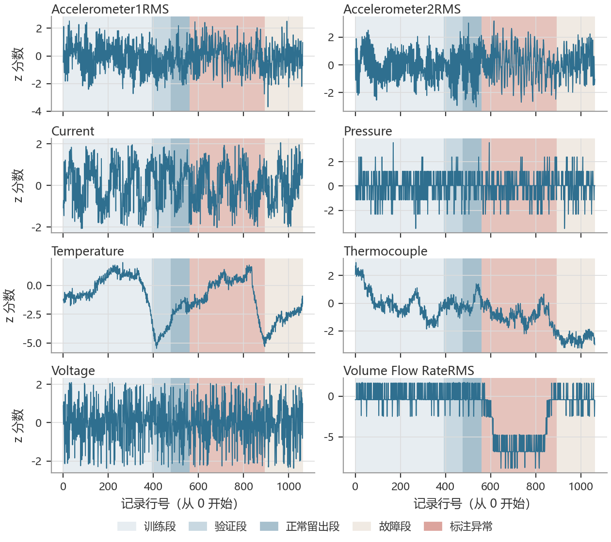
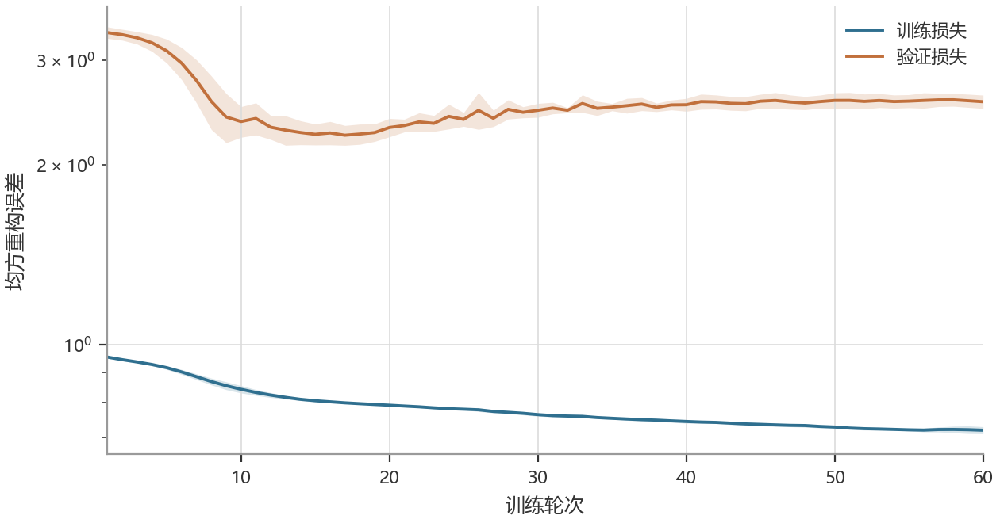
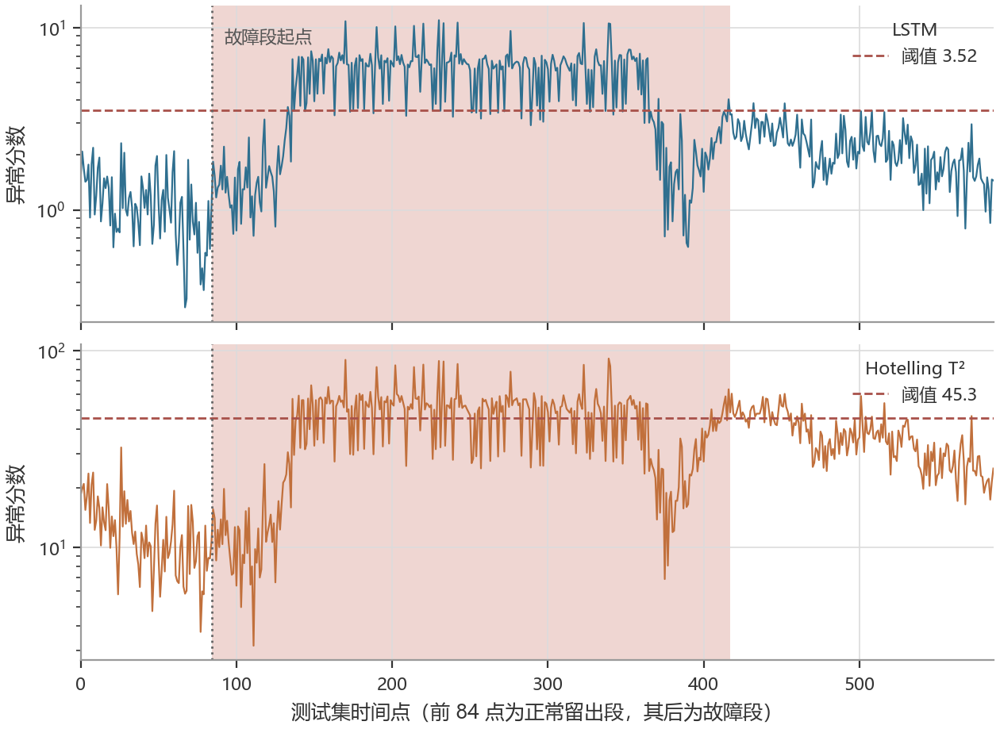
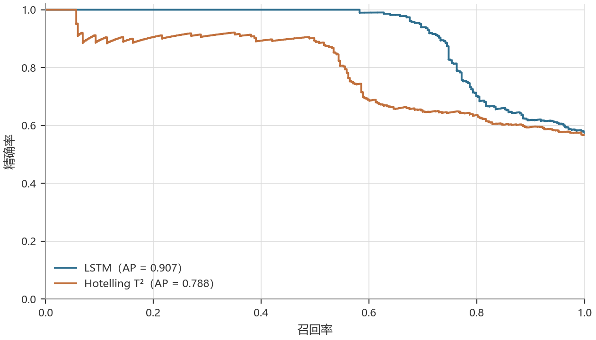
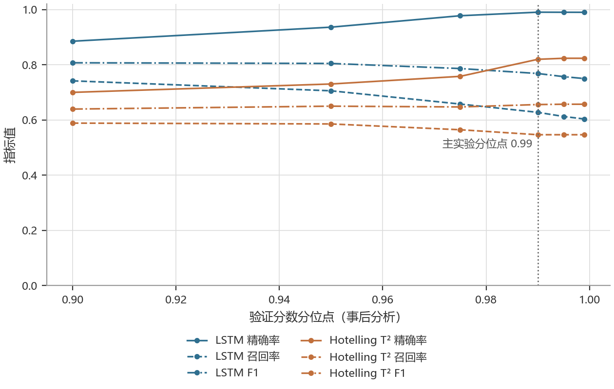

整理：RedMoon

工业异常检测经常只有正常运行记录，故障样本既少，也难以穷尽。这次实践用正常传感器序列训练 LSTM 自编码器，再用重构误差寻找偏离正常工况的片段。在 SKAB 的一份阀门实验记录上，五个随机种子的逐点 F1 为 $0.779\pm0.023$，ROC-AUC 为 $0.830\pm0.004$。沿着这组结果，可以把时间切分、窗口重构、阈值校准和异常定位串成一条完整流程。

## 一、实验任务与数据

课件的第一次实验有两个选题：图像模型微调与特征分析，或工业时序异常检测。本项目选择第二题，采用 LSTM 自编码器，数据是 SKAB 的 `valve2/1.csv`。SKAB 为多传感器记录提供逐点异常标签和变点标签，两种标签分别描述异常范围与状态变化位置。

这份记录共 1063 行、8 路传感器，包括振动、电流、压力、温度、电压和流量。异常标签覆盖 $[560,893)$，共 333 行。全文区间采用从 0 开始的行号和左闭右开写法。

原始时间戳从 16:16:30 到 16:36:30，跨越 1200 秒；相邻记录中有 986 次间隔 1 秒、75 次间隔 2 秒、1 次间隔 64 秒。因此模型的“64 步窗口”表示 64 条记录，行号差与实际秒数需要分别计算。当前实现直接按记录顺序建窗，没有重采样或额外输入时间间隔。



图 1. 八路传感器按训练段统计量标准化后的读数，横轴为记录行号。红色范围表示异常标签，背景色区分各数据段。流量的明显下降集中在异常段中部；正常段内部也能看到温度变化。

## 二、先按时间切分，再做标准化

首个异常之前共有 560 行正常数据，按时间顺序分成训练、验证和正常留出三段：

| 数据段 | 行区间 | 行数 | 用途 |
|---|---|---:|---|
| 训练段 | $[0,392)$ | 392 | 拟合标准化统计量、训练网络 |
| 验证段 | $[392,476)$ | 84 | 选择检查点、校准阈值 |
| 正常留出段 | $[476,560)$ | 84 | 检查正常数据上的误报 |
| 故障段 | $[560,1063)$ | 503 | 检测异常及恢复过程 |
| 完整测试集 | $[476,1063)$ | 587 | 84 行正常留出加 503 行故障段 |

故障段包含 333 行异常和故障结束后的 170 行正常记录。“故障段”是实验切分名称，不能把其中每一点都当作异常。

每个通道使用训练段的均值与标准差：

$$
\widetilde{x}_{t,j}=\frac{x_{t,j}-\mu_j^{\mathrm{train}}}
{\sigma_j^{\mathrm{train}}}.
$$

验证与测试都沿用这组统计量。先对整段记录标准化，再划训练集，会让未来工况进入训练预处理。标签在本实验中负责定位正常前缀边界，以及最终计算指标；网络优化和阈值取值使用正常数据。

窗口长度为 64、步长为 1，训练窗口数为 $392-64+1=329$，验证窗口数为 $84-64+1=21$。各段分别建窗，使训练窗口始终留在训练段内。验证段同时用于选模与阈值校准，进一步估计独立部署误报率时，需要另设正常校准集。

## 三、LSTM 怎样重构一个窗口

LSTM 通过门控更新细胞状态与隐藏状态：

$$
c_t=f_t\odot c_{t-1}+i_t\odot g_t,\qquad
h_t=o_t\odot\tanh(c_t).
$$

其中 $f_t$ 控制旧信息保留多少，$i_t$ 控制新信息写入多少，$o_t$ 控制当前输出。这样可以根据前面的传感器读数处理当前状态。

一个输入窗口的形状为 $B\times64\times8$。编码器读完整个窗口，取最后的 32 维隐藏状态；把它复制 64 次送入解码器，再用线性层输出 8 路重构值。以下是项目中的前向计算，省略外围输入检查：

```python
def forward(self, values: torch.Tensor) -> torch.Tensor:
    _, (hidden, _) = self.encoder(values)
    repeated_state = hidden[-1].unsqueeze(1).expand(
        -1, values.size(1), -1
    )
    decoded, _ = self.decoder(repeated_state)
    return self.output(decoded)
```

`hidden[-1]` 是最后一层编码器的末时刻隐藏状态。`expand` 让解码器各步接收同一个编码，随后由解码器自身的递推生成序列。这个网络共 14,088 个参数，将窗口内的 $64\times8=512$ 个输入数值压到 32 维表示。

训练目标是窗口内全部通道的均方重构误差：

$$
\mathcal L=\frac{1}{64\cdot8}
\sum_{\tau=0}^{63}\sum_{j=1}^{8}
\left(\widetilde x_{\tau,j}-\widehat x_{\tau,j}\right)^2.
$$

模型只学习正常窗口的重构规律，重构误差随后作为异常分数的基础。隐藏维度、网络容量和正常工况覆盖范围都会影响这项分数的区分能力。

## 四、从窗口误差得到逐点分数

模型按窗口输出，标签按记录行给出。先对每个窗口内每一步的 8 个通道求平均平方误差，再把覆盖同一点的窗口误差平均：

$$
\begin{gathered}
a_t=\frac{1}{|K_t|}\sum_{k\in K_t} e_{k,t-s_k},\\
K_t=\{k:s_k\leq t\lt s_k+64\}.
\end{gathered}
$$

这里 $s_k$ 是窗口起点。序列中部的一个点被 64 个窗口覆盖，首尾覆盖次数较少，因此每点都要除以自身计数。项目的聚合实现直接对应上式：

```python
def aggregate_window_errors(window_errors, starts, length):
    scores = np.zeros(length, dtype=np.float64)
    counts = np.zeros(length, dtype=np.int64)
    for errors, start in zip(window_errors, starts):
        end = start + len(errors)
        scores[start:end] += errors
        counts[start:end] += 1
    if np.any(counts == 0):
        raise ValueError("window errors do not cover every time point")
    return scores / counts
```

把窗口缩短到 3 行试算：从第 0 行开始的窗口误差是 `[0.1, 0.3, 0.5]`，从第 1 行开始的是 `[0.7, 0.9, 0.2]`。第二个窗口的 `0.7` 要加在原序列第 1 行。两段叠加后计数为 `[1, 2, 2, 1]`，平均分为 `[0.1, 0.5, 0.7, 0.2]`。窗口中间出现的高分是按原行号合并出来的；直接给两个窗口分别算一个均分，就找不回这四行各自的分数。

这套计算使用完整窗口的编码，再平均所有覆盖窗口。点 $t$ 的分数最多会使用到后续第 $t+63$ 行的信息，因此它适合离线定位。实时告警需要另行定义分数何时可用，例如只用已到达窗口的末点误差，或明确等待窗口完成；两种方案都需要重新评估阈值与时间表现。

阈值取正常验证分数的第 99 百分位：

$$
\theta=Q_{0.99}(a^{\mathrm{val}}),\qquad
\widehat y_t=\mathbb{1}[a_t>\theta].
$$

这个规则使用验证分数的尾部位置，测试 F1 不参与主实验的阈值选择。验证样本较少、窗口互相重叠，且工况会变化，99% 分位点对应的未来误报率仍需在独立正常记录上测量。

## 五、训练曲线与单点对照

训练设置为 Adam、学习率 $10^{-3}$、批大小 64，训练 60 轮；每个种子恢复验证损失最低轮的权重。五个种子为 42、43、44、45、46，最佳轮次分别为 17、17、9、15、14。



图 2. 五个种子的训练与验证损失均值及标准差，纵轴为对数刻度。训练损失继续下降时，验证损失已开始回升，最终选用各自的最佳检查点。

训练段温度范围约为 67.29–69.10，验证段约为 66.20–67.18。两段虽都标为正常，温度分布已经变化，这为验证重构误差偏高提供了直接的数据依据。

为了与单点统计方法比较，实验加入 Hotelling $T^2$，计算每个读数到训练均值的协方差加权距离：

$$
T^2(x)=(x-\mu)^\top\Sigma^+(x-\mu).
$$

$\Sigma^+$ 是训练协方差的伪逆。它能处理传感器尺度与相关性，不使用相邻记录。项目中的核心计算为：

```python
mean = train_values.mean(axis=0)
precision = np.linalg.pinv(np.cov(train_values, rowvar=False))
centred = test_values - mean
scores = np.einsum("ij,jk,ik->i", centred, precision, centred)
```

两种方法都用正常验证分数的同一分位规则定阈值。这个对照比较的是完整检测流程；LSTM 的序列建模与重叠窗口平均同时发生变化，若要拆开两者贡献，还需增加匹配平滑规则的对照。

## 六、结果怎样读

| 指标 | LSTM 自编码器，五种子均值 ± 样本标准差 | Hotelling $T^2$ |
|---|---:|---:|
| 精确率 | $0.963\pm0.036$ | 0.820 |
| 召回率 | $0.655\pm0.023$ | 0.547 |
| F1 | $0.779\pm0.023$ | 0.656 |
| ROC-AUC | $0.830\pm0.004$ | 0.706 |
| 平均精确率 AP | $0.903\pm0.004$ | 0.788 |
| 84 行正常留出段误报率 | 0 | 0 |

精确率回答“报出的异常中有多少是真的”，召回率回答“标注异常中找回了多少”，F1 综合二者。ROC-AUC 与 AP 衡量连续分数的排序效果，适合与某一个阈值下的告警表现一起阅读。

拿种子 42 的第七节分段表把指标算一遍。标注为异常的三段分别报出 4、201、4 个点，合计 209 个；333 个异常点还有 124 个没有报出。加上恢复段的 2 次误报，精确率是 $209/(209+2)\approx0.991$，召回率是 $209/333\approx0.628$，代入 F1 得到 $418/(418+2+124)\approx0.768$。这就解释了为什么精确率接近 1，仍有相当一部分异常没有被找到。

“正常留出段零误报”对应前面的 84 行。整个测试集内，五个种子的误报数分别为 2、9、4、23、5；$T^2$ 为 40，均出现在故障结束后的正常记录。种子 45 的误报较多，也解释了精确率比 AUC 更明显的种子波动。



图 3. 种子 42 的逐点分数。横轴是测试集内的记录索引，前 84 行为正常留出段，红色区域为标注异常；上下图分数尺度各自独立。

种子 42 的 LSTM 首次超阈值在原记录第 609 行，距离异常起点第 560 行为 49 行；$T^2$ 首次超阈值相隔 52 行。前者的原始时间戳相差 53 秒。这些值描述离线评分曲线上的首次超阈位置，实时预警延迟应按分数真正可用的时刻重新计算。

## 七、漏报主要落在哪里

异常标签从第 560 行开始，而流量明显变化集中在 $[616,838)$；第 838 行附近流量已恢复，异常标签持续到第 892 行。按这些变点拆开统计，种子 42 的结果更容易解释：

| 原记录区间 | 标签 | 行数 | LSTM 告警数 | $T^2$ 告警数 |
|---|---|---:|---:|---:|
| $[560,616)$ | 异常 | 56 | 4 | 2 |
| $[616,838)$ | 异常 | 222 | 201 | 172 |
| $[838,893)$ | 异常 | 55 | 4 | 8 |
| $[893,1063)$ | 正常 | 170 | 2 | 40 |

流量明显偏离的中间区间，LSTM 检出 $201/222\approx90.5\%$；两端共 111 行标注异常只检出 8 行。整体召回率同时反映了模型分数和标签覆盖方式，按区间阅读能看出哪些阶段更容易检测。

恢复后的温度仍偏离训练范围，单点距离持续偏高，$T^2$ 在这部分产生较多误报。LSTM 流程在该记录上的恢复段误报更少，与其重构及窗口平均后的分数形态一致。

## 八、阈值改变了什么



图 4. 种子 42 的 PR 曲线，LSTM 的 AP 为 0.907，$T^2$ 为 0.788。图中的单种子 AP 与表中的五种子均值分别报告。



图 5. 验证分位点的事后敏感性分析，竖虚线为主实验固定的 0.99。测试结果用于解释权衡，主结果仍沿用预先设定的阈值规则。

把分位点从 0.99 降到 0.90，种子 42 的召回率由 0.628 升到 0.742，精确率由 0.991 降到 0.885，F1 由 0.768 升到 0.807。降低阈值确实找回了一部分异常，也增加了正常点告警。部署时选择哪个工作点，应由独立校准数据与漏报、误报的实际代价共同决定。

这份记录把正常工况覆盖、分数排序和阈值选择的作用分开呈现：训练数据决定模型见过哪些正常变化，重构与聚合决定分数形态，阈值决定最终告警位置。当前数值对应一份记录、一段异常；五种子统计描述这份固定数据上的训练随机性。

## 参考与代码入口

本实验的入口为 `run_experiment.py`，数据切分与聚合在 `skab_ad/data.py`，网络在 `skab_ad/model.py`，训练和评估在 `skab_ad/detection.py`；配置与逐种子结果保存在项目的 `results/metrics.json`。

- [SKAB 官方数据与字段说明](https://github.com/waico/SKAB)
- Malhotra 等：[LSTM-based Encoder-Decoder for Multi-sensor Anomaly Detection](https://arxiv.org/abs/1607.00148)，2016。
- 课程第一次实验课件及本地项目实验报告，2026。
