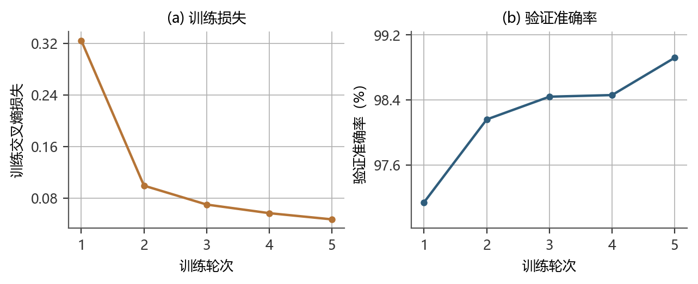
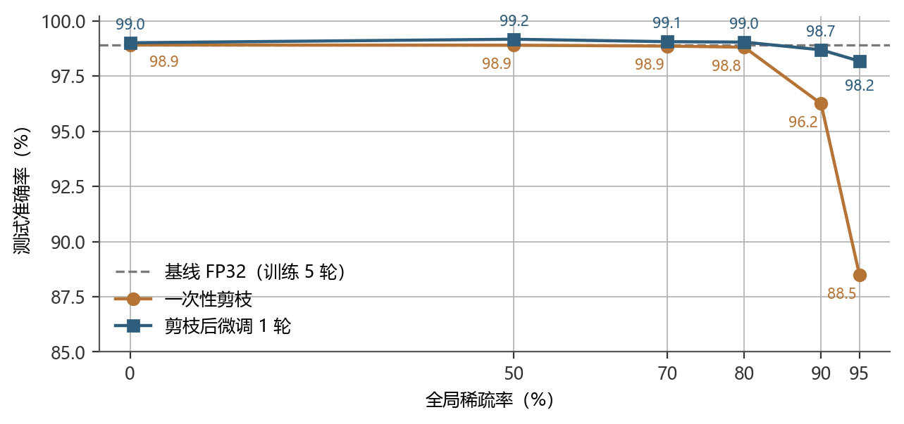
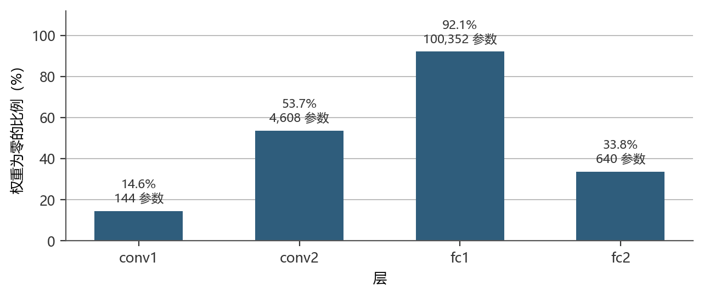
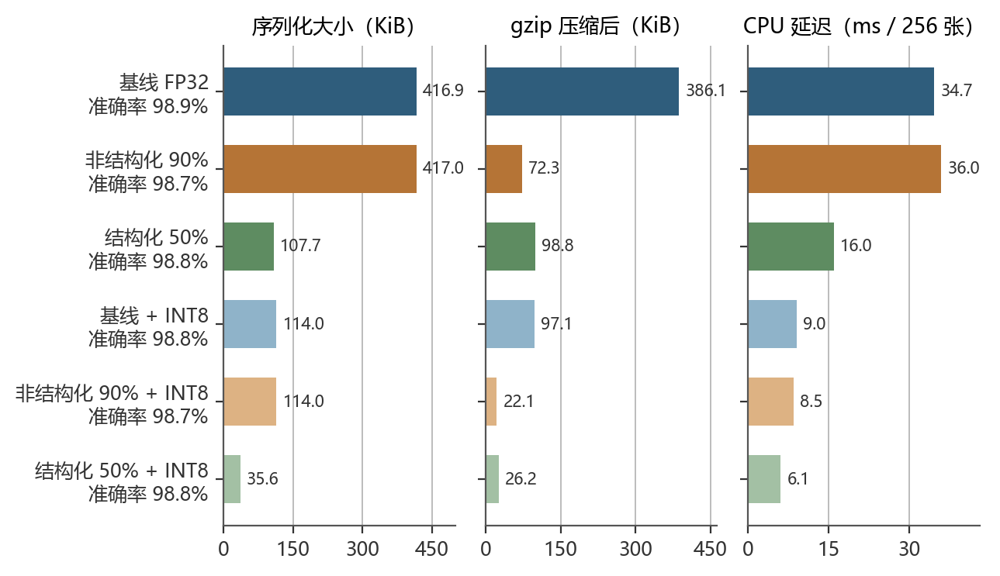

整理：RedMoon

模型压缩的收益最终要落到文件体积和推理时间上。这次实践在 MNIST 上训练双层卷积网络，再从同一份权重构建剪枝与 INT8 量化变体。结构化剪枝叠加量化后，测试准确率为 98.76%，序列化文件从 416.9 KiB 缩到 35.6 KiB；同次 CPU 单线程测量中，每批 256 张图像的延迟由 34.69 ms 降到 6.07 ms。

## 一、课件要求与实验设置

第一次实践要求选择数据集和网络，完成训练、稀疏化、量化及结果分析。课件介绍了 Keras、Torch-Pruning、Brevitas 等工具入口，本项目用 PyTorch 实现 MNIST 分类、两类剪枝与静态训练后量化。

数据按固定种子 42 划分：55,000 张训练、5,000 张验证、10,000 张测试。输入为 $1\times28\times28$ 的灰度图，标准化为 $(x-0.1307)/0.3081$。基线用 Adam 训练 5 轮，学习率 $10^{-3}$、批大小 128。

非结构化剪枝后带掩码微调 1 轮，结构化剪枝后微调 2 轮，微调学习率都是 $3\times10^{-4}$。静态量化用训练集的 20 批数据校准，每批 256 张。

结果来自项目保存的 PyTorch 2.10.0、torchvision 0.25.0 运行。训练使用 RTX 4060 Laptop GPU，下面的延迟统一是 oneDNN 后端下的 CPU 单线程测量。

## 二、参数量与计算量集中在不同层

网络包含两组 $3\times3$ 卷积、ReLU、$2\times2$ 最大池化，再接两层全连接。宽度为 `(16, 32, 64)`，分类输出为 10 类；`fc1` 后使用概率 0.25 的 Dropout。

| 层 | 输出形状 | 参数量，含偏置 | 每图 MACs |
|---|---|---:|---:|
| `conv1`，$1\to16$ | $16\times28\times28$ | 160 | 112,896 |
| 第一次池化 | $16\times14\times14$ | 0 | 不计 |
| `conv2`，$16\to32$ | $32\times14\times14$ | 4,640 | 903,168 |
| 第二次池化 | $32\times7\times7$ | 0 | 不计 |
| `fc1`，$1568\to64$ | 64 | 100,416 | 100,352 |
| `fc2`，$64\to10$ | 10 | 650 | 640 |
| 合计 | 10 | 105,866 | 1,117,056 |

一次 MAC 表示一次乘加，卷积层按下式计算：

$$
\mathrm{MACs}=H_{\mathrm{out}}W_{\mathrm{out}}
C_{\mathrm{out}}C_{\mathrm{in}}K_hK_w.
$$

`fc1` 占约 94.9% 的参数，`conv2` 占约 80.9% 的 MACs。参数多的层与计算重的层在这里分离，压缩存储和减少计算需要分别观察。

Dropout 在训练时随机屏蔽激活，帮助正则化；`eval()` 时停止随机丢弃，网络尺寸保持。所有变体沿用相同的 Dropout 设置，本实验没有单独测它的效果。



图 1. 基线训练损失从 0.3245 降至 0.0467，验证准确率由 97.14% 升至 98.92%，最终测试准确率为 98.91%。

## 三、非结构化剪枝：固定零的位置

全局 L1 剪枝把四层权重按绝对值放在一起排序，将较小权重置零。有效权重可以写为：

$$
W_{\mathrm{effective}}=W_{\mathrm{orig}}\odot M,\qquad M\in\{0,1\}^{\mathrm{shape}(W)}.
$$

微调时保留掩码，使已剪位置持续为零，存活权重继续更新。项目使用 PyTorch 的标准重参数化：

```python
parameters = [
    (module, "weight") for _, module in prunable_layers(model)
]
prune.global_unstructured(
    parameters,
    pruning_method=prune.L1Unstructured,
    amount=amount,
)
```

微调结束后，`prune.remove(module, "weight")` 将掩码折叠进普通权重。这样导出的模型仍是原尺寸的稠密张量，其中大量元素为零。

| 全局权重稀疏率 | 一次性剪枝后测试准确率 | 微调 1 轮后测试准确率 |
|---|---:|---:|
| 0%，不剪枝对照 | 98.91% | 99.01% |
| 50% | 98.90% | 99.17% |
| 70% | 98.86% | 99.06% |
| 80% | 98.81% | 99.04% |
| 90% | 96.25% | 98.69% |
| 95% | 88.49% | 98.18% |



图 2. 剪枝到 80% 时，一次性剪枝后的准确率仍接近基线；90% 和 95% 下的下降更明显，掩码微调恢复了其中大部分准确率。

稀疏率 0% 的对照组同样多训练一轮，测试准确率也提高到 99.01%。因此解释剪枝后的提升时，应与相同微调预算的对照比较。50% 剪枝组测试准确率高于该对照，验证准确率则为 98.88%，低于对照的 98.94%；这组单种子结果用于描述当前权重的表现，剪枝正则化的独立贡献需要更多重复实验判断。



图 3. 全局 90% 权重稀疏率分配到各层后，`conv1`、`conv2`、`fc1`、`fc2` 分别约为 14.6%、53.7%、92.1%、33.8%。图中参数个数为该层权重元素数，不含偏置。

全局排序主要剪掉了参数最多的 `fc1`，计算最重的 `conv2` 保留了更多连接。普通稠密卷积和矩阵乘法继续处理原形状的张量，所以高稀疏率能否加速，还取决于执行内核是否利用这些零。

## 四、结构化剪枝：把网络真正变窄

结构化剪枝按卷积核的权重绝对值之和加偏置绝对值打分，隐藏单元按 `fc1` 对应权重行打分，每组保留最高的 50%。网络宽度由 `(16, 32, 64)` 变成 `(8, 16, 32)`。

各层必须同步切片：`conv1` 删去的输出通道，对应 `conv2` 的输入通道；`conv2` 保留的输出通道，对应 `fc1` 展平输入的列。一个通道的 $7\times7$ 特征图占连续 49 列：

```python
spatial = fc1.in_features // conv2.out_channels
conv2_columns = torch.tensor([
    channel * spatial + offset
    for channel in kept_conv2
    for offset in range(spatial)
])
with torch.no_grad():
    n_conv2.weight.copy_(
        conv2.weight[kept_conv2][:, kept_conv1]
    )
    n_fc1.weight.copy_(
        fc1.weight[kept_hidden][:, conv2_columns]
    )
```

这是项目重建窄网络的核心片段；完整实现还按同样下标复制偏置、首层与输出层。保留下标按升序排列，以维持展平顺序。

每组保留一半后，参数量降至 26,698，即基线的 25.2%；每图 MACs 降至 307,648，即 27.5%。`conv2` 的输入、输出通道同时减半，该层乘加量降为四分之一。窄网络剪完时验证准确率为 93.32%，微调 2 轮后恢复到 98.52%，测试准确率为 98.77%。

## 五、INT8 量化：改变数值表示

量化用整数码和缩放系数近似浮点值。仿射量化的基本关系为：

$$
q=\operatorname{clip}\left(
\operatorname{round}\left(\frac{x}{s}\right)+z,
q_{\min},q_{\max}\right),
\qquad \widehat x=s(q-z).
$$

$s$ 是尺度，$z$ 是零点。位宽降低后，文件字节数和整数计算路径发生变化，网络的逻辑连接数量保持。

当前项目采用静态 PTQ：融合 `Conv+ReLU`、`Linear+ReLU`，插入观察器，用正常训练图像前向校准，再转换为量化算子。校准记录激活范围，不进行反向传播。下面摘录项目在 PyTorch 2.10 环境中的核心步骤，省略版本警告处理：

```python
torch.backends.quantized.engine = backend
quantized = copy.deepcopy(model).cpu().eval()
quantized.fuse_model()
quantized.qconfig = (
    torch.ao.quantization.get_default_qconfig(backend)
)
torch.ao.quantization.prepare(quantized, inplace=True)
with torch.inference_mode():
    for batch in batches:
        quantized(batch.cpu())
torch.ao.quantization.convert(quantized, inplace=True)
```

量化在深拷贝上完成，同一份剪枝权重因此可以分别评估 FP32 与 INT8。项目采用的 `torch.ao.quantization` eager 接口对应保存结果的运行环境，迁移到其他版本时应按该版本接口验证。

基线量化后的准确率为 98.82%，与原 FP32 基线的预测一致率为 99.89%。文件由 416.9 KiB 降到 114.0 KiB，约缩小 3.66 倍；量化元数据和偏置等存储使整个文件的比例与单个权重的位宽比例不同。

## 六、六个变体放在一起比较

序列化大小指 `torch.save(state_dict)` 的实际字节数，gzip 大小是同一内容经 gzip 压缩后的体积。两者分别对应模型文件与压缩传输文件。

| 变体 | 测试准确率 | 逻辑参数量 | 每图 MACs | 文件 KiB | gzip KiB | CPU ms / 256 张 |
|---|---:|---:|---:|---:|---:|---:|
| 基线 FP32 | 98.91% | 105,866 | 1,117,056 | 416.9 | 386.1 | 34.69 |
| 非结构化 90% FP32 | 98.69% | 105,866 | 1,117,056 | 417.0 | 72.3 | 35.98 |
| 结构化 50% FP32 | 98.77% | 26,698 | 307,648 | 107.7 | 98.8 | 15.98 |
| 基线 INT8 | 98.82% | 105,866 | 1,117,056 | 114.0 | 97.1 | 9.02 |
| 非结构化 90% INT8 | 98.69% | 105,866 | 1,117,056 | 114.0 | 22.1 | 8.49 |
| 结构化 50% INT8 | 98.76% | 26,698 | 307,648 | 35.6 | 26.2 | 6.07 |



图 4. 同一组变体的三个工程指标。延迟为单线程、每批 256 张图像的测量中位数，所有变体使用一致的输入批次与计时方式。

非结构化 90% FP32 的文件仍约 417 KiB，gzip 后降到 72.3 KiB：大量重复零值容易被压缩，稠密张量原本的存储槽位仍然存在。叠加 INT8 后，gzip 文件为 22.1 KiB，是六个变体中最小的压缩传输文件。

结构化 50% INT8 的直接序列化文件最小，准确率比基线低 0.15 个百分点。按未取整字节数计算：

$$
\text{文件缩小倍数}=\frac{426893}{36437}\approx11.72,
\qquad
\text{本次批延迟比}=\frac{34.69065}{6.06974}\approx5.72.
$$

表中的逻辑参数量统计权重与偏置位置数。结果文件另有“非零元素”统计：FP32 权重按数值是否为零计数，量化权重按整数码是否为零计数。整数码变零不等于网络删除了连接，因此 INT8 行的逻辑参数量与对应 FP32 网络相同。

## 七、CPU 时间怎样测

计时统一使用同一批 256 张图像、CPU 单线程、`eval()` 与 `inference_mode()`。所有模型先预热 10 次，再做 15 轮交错测量，每轮让六个变体依次各前向 20 次，最终报告每个变体 15 轮的中位数。

```python
for _ in range(LATENCY_ROUNDS):
    for name, model in prepared:
        start = time.perf_counter()
        for _ in range(LATENCY_RUNS_PER_ROUND):
            model(batch)
        elapsed = time.perf_counter() - start
        samples[name].append(
            elapsed * 1000.0 / LATENCY_RUNS_PER_ROUND
        )
```

这段循环位于固定单线程的推理上下文中，函数结束后恢复原线程设置。交错测量使各变体更接近地经历相同时间段的机器状态；笔记本温度、频率、后台负载和固定执行顺序仍会影响时间。

基线的各轮批延迟约为 32.3–44.3 ms，表中的 34.69 ms 是本次中位数。结构化剪枝将 MACs 降到 27.5%，批延迟降到约 46.1%，差异来自池化、激活、数据读写和算子调用等成本。非结构化 FP32 在当前稠密后端下没有取得批延迟收益。

6.07 ms 对应一批 256 张图像的处理时间。将它除以 256 可以得到摊销时间，批大小为 1 的请求延迟则需要单独测量。

## 八、这些结果怎样指导压缩选择

需要减少普通 CPU 上的计算和直接加载体积时，结构化剪枝加 INT8 在这组设置下给出了 35.6 KiB、6.07 ms/256 张和 98.76% 准确率的组合。需要优先减少下载文件大小时，非结构化剪枝加 INT8、再用 gzip，得到 22.1 KiB 的压缩文件。

一次压缩实验应同时记录准确率、逻辑参数量、实际文件大小、计算量和目标设备时间。这里的稀疏率扫描说明网络对大量小权重的删除有较强容忍度；六变体测量则进一步说明，存储格式与执行内核决定了哪些压缩能兑现为工程收益。

## 参考与代码入口

项目入口为 `run_experiment.py`；`mnist_compress/model.py` 定义网络，`pruning.py` 负责剪枝，`quantization.py` 负责静态 PTQ，`profiling.py` 统计参数、大小、MACs 与时间。逐轮数据和六变体结果保存在项目的 `results/metrics.json`。

- [PyTorch 剪枝教程](https://docs.pytorch.org/tutorials/intermediate/pruning_tutorial.html)
- [PyTorch 量化文档](https://docs.pytorch.org/docs/2.10/quantization.html)
- [Torch-Pruning](https://github.com/VainF/Torch-Pruning)、[Brevitas](https://github.com/Xilinx/brevitas)：课件列出的工具入口。
- 课程第一次实验课件及本地项目实验报告，2026。
