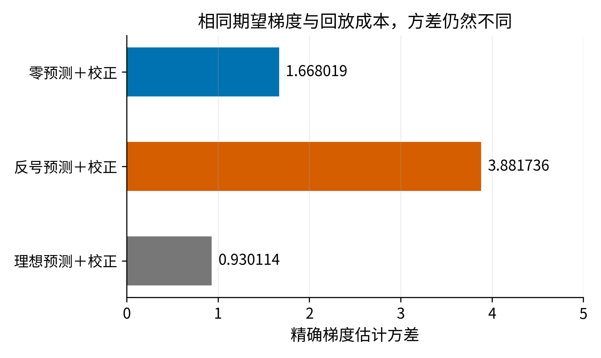

反馈有两个需要分别检查的性质：长期平均是否朝对方向，有限数据下是否足够稳定。语言表达是否合理，还需要另一层独立验证。

本篇对应 CREDO 数值复算、本机裁判、语言反馈与独立复核四组材料。公式背景见[论文 P3](/2026/11/23/llm-rl-p3-credit-assignment/)。

## 1. CREDO 复算的对象很小，也很明确

环境只有两次二元决策、一个中间二元状态与终点奖励。16 种原轨迹及回放结果都可枚举，因此可以直接计算期望和方差。

参数固定在 $\theta=0.3$，本轮没有训练语言模型或小策略。作者脚本产出的六行结果与论文第 8 页表 1 的 24 个数值单元格一致；独立差分核算也匹配解析梯度。

| 预测与处理 | 期望梯度 | 绝对偏差 | 方差 |
|---|---:|---:|---:|
| 零预测＋均匀回放校正 | 0.112751 | 0 | 1.668019 |
| 反号预测＋均匀校正 | 0.112751 | 0 | 3.881736 |
| 理想预测＋均匀校正 | 0.112751 | 0 | 0.930114 |
| 零预测＋理想预算分配校正 | 0.112751 | 0 | 1.319479 |
| 零预测，不校正 | 0 | 0.112751 | 0 |
| 反号预测，不校正 | −0.112751 | 0.225503 | 0.073210 |

六行期望额外环境动作都为 0.80。均匀抽样时，两个位置各以 0.1 被抽中，分别花 6、2 个动作，期望成本为 `0.1×6+0.1×2=0.8`。



图中为有限模型的精确枚举方差，没有抽样误差棒；预测错误主要表现为校正后的波动增大。

零预测且不校正的方差为零，因为每次都输出零；它依然错过了真实正梯度。因此低方差要和偏差一起看。

## 2. 校正怎样在平均意义上生效

```python
prediction = 0.2
replay_difference = 0.6
probability = 0.25

selected_value = prediction + (
    replay_difference - prediction
) / probability
not_selected_value = prediction
expected_value = (
    probability * selected_value
    + (1 - probability) * not_selected_value
)
print(selected_value, not_selected_value, expected_value)
# 1.8 0.2 0.6
```

抽中的时候放大残差，没抽中的时候保留预测，两种情形平均后抵消预测误差。预测越离谱，少量被抽中的样本就越容易出现大摆动。

后续小批量补充每条件生成 4,096 个批次。反号预测加校正时，批量 8 的负梯度批有 2,131 个，批量 128 时仍有 1,087 个。这是固定参数估计量的抽样诊断，显示无偏与小批稳定性不同；它没有测策略训练的成功率。

## 3. 本机裁判：换个顺序，判断是否还一致

对同一对状态，先问“A 与 B 哪个更好”，再交换为“B 与 A”。若模型依据状态内容判断，换序后应该选同一个真实状态。

Qwen2.5-3B 的一个量化配置在 24 对网格状态、48 次回答中全部选择 A。正序和反序各有 12/24 答对，但换序后保持同一真实选择的只有 0/24。

字母回显对照为 4/4，说明接口能输出指定字母；主要问题出现在这组坐标判断任务。用“换序稳定才保留”的筛选规则，覆盖率会变成零，筛后准确率没有定义。

只报告两次各 50% 会看不出这个问题。保留逐条响应，才能发现位置偏好。

## 4. 一致仍然可能错

扩展语言反馈实验换了自然语言、固定名称与显式距离等表达。协作工序的 48 题中，换序稳定的有 9 题，其中 6 对、3 错。

一致性测试能过滤某类位置不稳定，却不能保证内容正确。若模型稳定地误解一个前置条件，重复询问会稳定重现同一个错误。

这组实验的下游训练标记为 `not_run`。可报告标签诊断，不能写成“生成这些偏好后，团队策略已经改善”。

## 5. 独立复核增加的是可信度

另一个实现重建 LCA 环境与评分，回放保存策略，主批 2,400 局与追加 9,600 局均一致。这说明原结果能由独立代码解释，不会把独立复核多算成 12,000 份新的训练数据。

从这些材料可以得到一条具体工作方式：先用可枚举问题验证估计量，再用换序和已知答案诊断语言接口，最后才决定是否把反馈接入策略训练。

下一篇 [E3](/2026/11/23/llm-rl-e3-reward/) 将解释 LCA 偏好怎样变成奖励，以及合成标签为什么要与真实 LLM 标签分开。

## 原文与数据口径

- [CREDO，v1](https://arxiv.org/abs/2609.24174v1)，第 8 页表 1、第 13 页附录模型。
- [LCA，v2](https://arxiv.org/abs/2502.03723v2)，成员状态排序与奖励构造。
- 本地结果为既有枚举输出、逐批估计及冻结模型响应的整理；本次写作未发起新模型调用。
