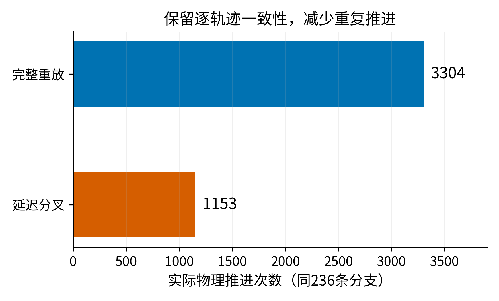

收到「改走右边」时，接收者还在直道上。它可以先记住消息，到路口再右转。检查消息有没有用，要让两路走到能做不同选择的地方。

想比较“走左边”和“走右边”两条报告，可以先运行到发消息的前一刻，保存这个共同前缀。两条支路从同一个存档出发，一条照常发消息，另一条换报告；两边都让接收者行动到本局结束。节省的是重复执行的前缀，后面发生的不同决策和分数仍要分别算。

## 1. 自己队内能说通，陌生队友未必懂

单比特协作任务中，12 支训练队自配成功率 75%，132 个陌生配对均值 50.57%。用四个探针对齐正反协议后为 65.34%，公开固定协议为 75%。

把消息缩成一位编码。甲队约定 `0` 表示北桥可用，乙队约定 `1` 表示北桥可用。甲发送 `0` 给自己的队友，队友选北桥。换成乙队接收，同一位会被理解成南桥。公开协议固定编码，探针则先发已知含义的测试消息来推断现有队伍的约定。

`12×11=132`：每支队伍的发送者分别搭 11 支陌生队伍的接收者。一次训练产出的模型会进入多个配对，因此 132 是配对数。四探针条件让接收者先根据少量已知信号对齐协议。

## 2. 报告重复，与独立证据

三份「北桥限重 6 吨」可能是三次独立测量，也可能是同一条消息转发三次。若系统保留可靠的原始来源编号 `source_id`，接收者可以去重：`[甲,甲,甲]` 算一个来源，`[甲,乙,丙]` 算三个来源。来源数还要和测量记录一起看；三个人引用同一本台账，依然是同一份测量。

来源判断准备了固定的 120 个请求。CPU 规则先检查结构化、模板和遮蔽三类输入，满分表示规则从这批可辨输入提取到正确标签。语言模型回答属于下一阶段的数据。

这样的检查能在昂贵调用前发现任务设计是否给了模型足够信息。

## 3. 有桥接历史时，同一条证据会变得更有用

受控 MuSiQue 实验把一部分桥接证据放进历史，再比较发消息与不发消息的正确率。可以先算「有历史时，转发提高多少」，再减去「没有历史时，转发提高多少」。例如两种增益分别是 20 和 5 个百分点，交互就是 15 个百分点。实际 40 道留出题的交互为 +16.25 个百分点，95% 区间 `[3.75, 28.75]`。

候选段落按支持标注选出，因此这里测的是“有用证据已找到后怎样作用”。后续只用发件人可见分片、BM25 选候选的另一组实验，30 题留出没有两个重复块同方向翻转的实例。

第一组衡量有用段落已知时，转发能带来多少收益。第二组还要由发送者在自己的资料中找到合适段落。不同候选生成方式使用不同留出题，两个读数分别解读。

## 4. 共享反事实需要共享的结构真的不变

已知执行结构的模拟把 1,833 种接收者状态压缩成 73 个签名，用于复用动作效果。一些预算下胜过接收者树，但同表示的岭回归在更高预算下更好。

签名是把不同状态归为同一类的短表示。改掉接收者的隐藏规则后，73 类里有 71 类出现混叠，同一类的状态在续跑时产生不同效果。复用标签之前，可以先从每类抽一些状态验证结果是否一致。

## 5. MASBench：只在动作开始不同的时候复制环境

在固定脚本策略、单次消息投递、窗口内无后续发送的设置中，每个候选接收者维护独立影子记忆，先共享相同物理环境。

```text
共同物理状态＋各分支自己的记忆
        ↓
分别计算完整联合动作
        ↓
动作相同：共同推进，并更新各自记忆
动作首次不同：在推进前复制物理状态与随机状态，继续分支
```

用三轮纸上轨迹读这个流程。原分支没有收到改道报告，变化分支提前收到并记住报告。两路执行的是同一套策略。

| 时刻 | 原分支 | 变化分支 | 模拟器操作 |
|---|---|---|---|
| 第 1 轮 | 向前走 | 向前走，记住报告 | 推进一步，保留两份各自的记忆 |
| 第 2 轮 | 继续前进 | 继续前进 | 继续共享物理位置 |
| 第 3 轮到路口 | 左转 | 按报告右转 | 转弯前复制物理状态与随机状态，两路分别推进 |

相同的状态、随机源和完整联合动作会得到相同的下一物理状态。设两名成员都往前走，但变化分支的第二人还按了开关，联合动作就不同，必须在开关生效前分叉。两路一直保留各自的记忆和策略状态；物理环境还没分开时，也要分别求一遍动作。

52 张地图、236 条分支与完整重放逐轨迹一致，物理推进从 3,304 降为 1,153，减少 65.10%。结果衡量冻结脚本策略下生成同一批回放标签的效率。



两根柱子对应同一批分支，少推进 `3,304−1,153=2,151` 次。把省下的次数除以旧成本，得到约 `65.10%`。这个成本单位是模拟器推进次数。

## 6. 为什么不能只看消息后的第一步

剔除测试夹具后，11 个改变团队得分的转发分支中，8 个第一轮动作相同，首次分歧在第 2–10 轮。消息可能先改变记忆，等条件出现后才影响行动。

按「收到后第一轮已经改变动作」来筛这 11 条，只有 3 条会留下；另外 8 条要往后走才看得见。第 5 节的做法省去这段共同的物理推进，同时保留两条策略历史，等第一个不同动作真正出现再分开执行。

## 7. 后续四条检验，分别留下什么

回放里的路径搜索可以先查缓存。BFS（广度优先搜索）按离起点由近到远找路径；同一个搜索输入已经算过，就可以直接用缓存结果。这样省下一次 BFS，但物理模拟器是否还要推进，要看候选分支的联合动作是否相同。这里分别计两种开销。

| 检验 | 观察结果 | 当前用途 |
|---|---|---|
| 单事实触发＋缓存 | 同样缓存下新增 BFS 节省为 0 | 保留缓存和延迟分叉 |
| 固定收件人的读取时点 | 留出 0/24 达门槛，事后上限约 +0.0417 分/图 | 当前不扩展读取策略训练 |
| 路由证书剪枝 | 最优接收者保持，逐图等权相对强对照省 14.06%，未达 20% | 保留最优标签工具 |
| 新时点回放 | 延迟分叉使推进 1,008→328；触发法的 BFS 与缓存对照相同 | 区分分叉收益与触发收益 |

证书剪枝保留最优接收者标签。需要每个候选的完整回报差时，用逐分支结果计算信用。

接下来读[论文 P6](/2026/11/23/llm-rl-p6-memory/)与 P7，再进入 [E8：压缩任务的实际代码](/2026/11/23/llm-rl-e8-compaction-code/)。

## 原文与环境入口

- [反事实重模拟，IJCAI 2018](https://doi.org/10.24963/ijcai.2018/260)：共享未改变前缀的背景。
- MASBench 数据来自原生模拟器在冻结脚本策略下的分叉记录。
