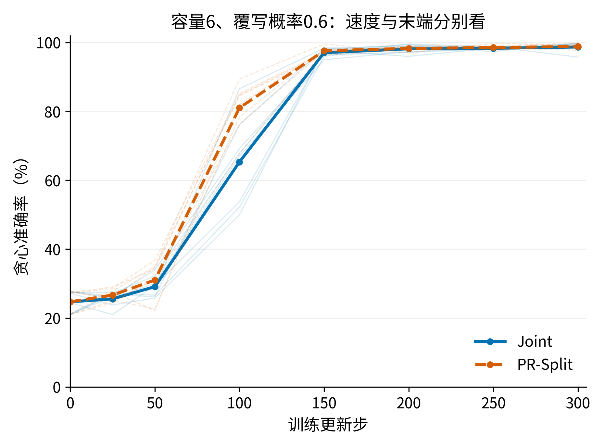

只有 4 个槽、事实经常被刷新时，共享优势的 Joint 答对率为 97.075%，按记忆来源增加正权重的 Pos-Route 为 85.475%。把容量加到 6，差距就小了。另一条值得分开看的曲线来自 PR-Split：它有时先学会，最后的成绩却没有越过晋级门槛。

图表按保存的逐种子结果计算。先看事实怎样进入槽位和四种更新规则如何加权，可回看 [E8](/2026/11/23/llm-rl-e8-compaction-code/)。

## 1. 160 次运行怎样组成

容量为 4 或 6，覆写概率为 0.2 或 0.6，得到四个条件。每条件运行 8 个训练种子，每种子包括四个压缩方法及一个单独训练的全历史参照：

$$
2\times2\times8\times5=160.
$$

每次 300 步，每步 16 任务×8 采样；每次使用 38,400 条训练轨迹。压缩方法在同种子下共享初始化与任务流，采样行为会随方法分化。

每个条件固定 500 个留出任务，各种子在同一批任务上评价。每种方法训练 8 次，估计种子间波动时按 8 组配对差计算。

## 2. 末端准确率

| 容量 / 覆写概率 | Joint | Pos-Route | Random-Split | PR-Split |
|---|---:|---:|---:|---:|
| 4 / 0.6 | 97.075% | 85.475% | 97.275% | 96.775% |
| 4 / 0.2 | 97.600% | 91.700% | 97.600% | 97.100% |
| 6 / 0.6 | 98.725% | 98.425% | 98.725% | 98.875% |
| 6 / 0.2 | 96.275% | 98.350% | 98.650% | 98.775% |

表中是 8 个种子的贪心准确率均值。「贪心」指评估时都选概率最大的动作。全历史参照分别为 98.100%、98.725%、98.675%、98.825%。这个执行器额外获得完整事实流，也要学习怎样读取和回答。

## 3. 看每个种子，差异怎样出现

取最难条件 `4 槽 / 0.6 覆写概率` 的 seed 100。第 300 步，Joint 答对 `486/500=97.2%`，Pos-Route 答对 `421/500=84.2%`。在同一个种子内相减得到 `84.2−97.2=−13.0` 个百分点。图上的每个点都用同样方法算。点在零线下方，表示该次 Pos-Route 成绩较低。

八个配对差全部为负，均值 −11.60 个百分点，95% 配对 t 区间 `[-15.74,-7.46]`，未校正双侧配对检验 $p=0.000296$。这项差异属于观察到数据后的机制分析。

容量 4、覆写 0.2 的均值差为 −5.90 个百分点，区间跨零。容量 6 的两条件差分别为 −0.30 和 +2.075，区间也跨零。单看均值容易把少量训练不稳定当作普遍排序。

## 4. 与哪些机制解释相容

最难条件下，Pos-Route 的当前目标值可见率为 82.35%，Joint 为 97.225%。「可见」是最后存留的槽里有没有正确值；「答对」是执行器实际选了什么。值不在槽里也可能猜对，存在槽里则可能读错。读这两列，可以先查记忆端是否丢了信息，再查执行端有没有读出来。

一种解释是：正确丢弃干扰保护了旧内容，却没有写入最终被注意的槽，因此相对正权重较小。源码仍给这类动作 0.25 底座；现有数据没有隔离底座、总权重分布、读取器适应和动作类别的贡献。

下一组有区分力的比较是提高底座、随机打乱同样权重、补偿保护动作、保持其他项不变。原 ECHO 的来源记录、正部掩码和本地代理不同，也需要忠实基线后再迁移结论。

## 5. 早期快，与最后好分开看

在容量 6、覆写 0.6 条件，step 100 的 PR-Split 均值 81.05%，Joint 为 65.35%，差 +15.70 个百分点。到 step 300，二者为 98.875% 与 98.725%。

图中粗线是八个种子的同检查点均值，细线展示每个种子的学习过程。第 100 步的 `+15.70` 个百分点用来描述旧硬拆分的早中期表现，第 300 步的差是 `+0.15` 个百分点。原协议用末端指标决定晋级。退火方案是后续拟比较的方法。

## 6. 原门槛为什么仍为 NO_GO

协议要求至少三个条件、且包含最难条件，相对最强非特权基线多于 3 个百分点，并满足配对区间和检验要求。

PR-Split 对各条件最强基线的末端差分别为 −0.50、−0.50、+0.15、+0.125 个百分点，四个区间都跨零，0/4 通过。

这里要找每行的最强非特权基线。例如容量 4、覆写 0.6 条件中，Random-Split 为 `97.275%`，高于 Joint 的 `97.075%`。PR-Split 对最强基线只能取 `96.775−97.275=−0.50` 个百分点。图上的虚线是预先约定的 3 个百分点，原版末端判定为 `NO_GO`。

## 7. 这些数据怎样指导下一步

下一组可以固定同一批事实流，只改变 `drop` 的权重，分别记录正确丢弃率、目标可见率和最后的答对率。三个数的变化能看出加权先影响了哪一步。

接着读 [E10：旧轨迹与原生环境预试](/2026/11/23/llm-rl-e10-stale-data/)，最后到 E11 看候选比较。
