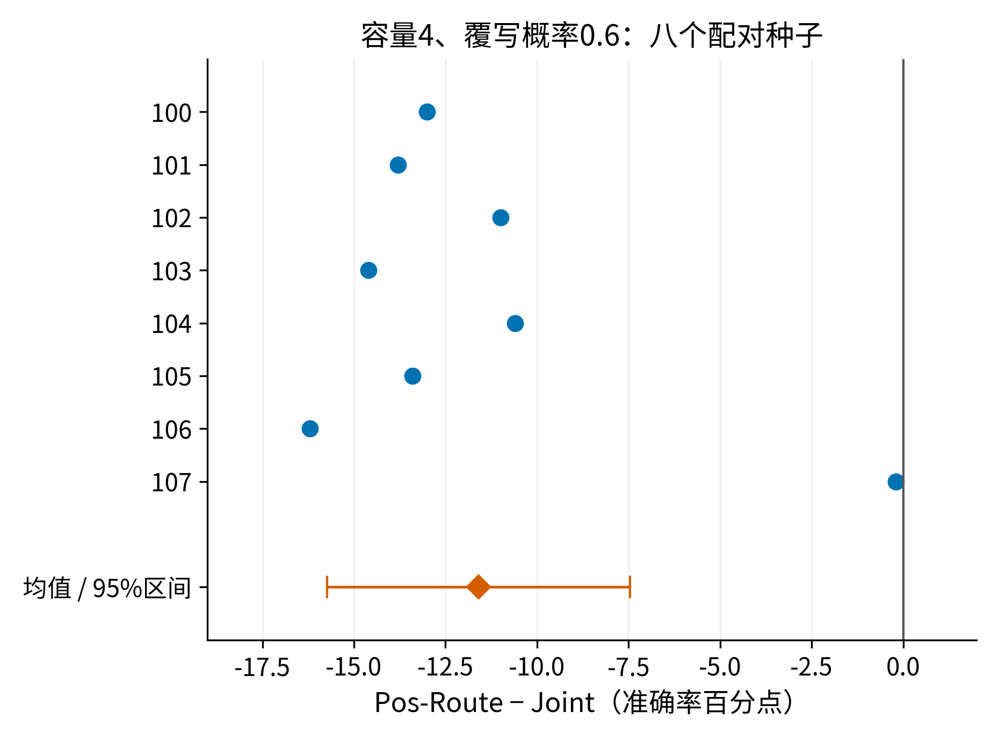
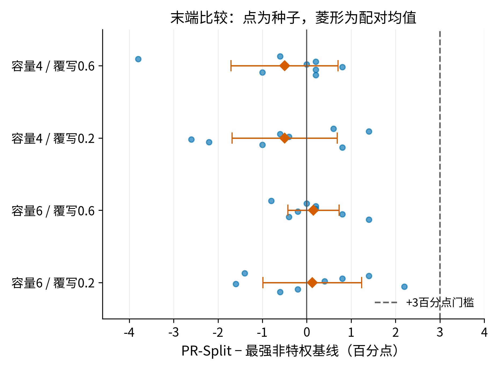

在 4 个槽、事实常更新的设置里，共享优势的 Joint 答对率是 97.075%，按记忆来源增加正权重的 Pos-Route 是 85.475%。容量加到 6、更新概率仍为 0.6 时，两者来到 98.725% 和 98.425%。容量变化对应的是两行独立训练结果；想找出差距从哪里来，要把「存没存到正确值」和「读没读出来」分开测。

图表按保存的逐种子结果计算。先看事实怎样进入槽位和四种更新规则如何加权，可回看 [E8](/2026/11/23/llm-rl-e8-compaction-code/)。

读配对结果时，先让两种方法在同一种子和配置下比较，再看差了多少。比如教学数据中三对成绩差为 `+8、−2、+3` 个百分点，平均是 `+3`，但同时有一个种子下降。均值描述总体方向，逐种子差值保留波动；早期第几步达到某分数则是另一项指标。

## 1. 160 次运行怎样组成

容量为 4 或 6，覆写概率为 0.2 或 0.6，得到四个条件。每条件运行 8 个训练种子，每种子包括四个压缩方法及一个单独训练的全历史参照：

$$
2\times2\times8\times5=160.
$$

先认清表里的四个名字。Joint 让两个模块共用同一份终局优势。Pos-Route 遇到正优势时，看执行器给每个槽多少注意力，把这份权重分给写入该槽的步骤。另两种方法只在优势为负时调整：PR-Split 根据补回完整历史后是否答对，决定哪个模块不使用这条样本的负优势，Random-Split 则随机选。两组对比，看的是根据恢复结果选模块有没有好过随机选。

每次 300 步，每步 16 任务×8 采样；每次使用 38,400 条训练轨迹。压缩方法在同种子下共享初始化与任务流，采样行为会随方法分化。

每个条件固定 500 个留出任务，各种子在同一批任务上评价。每种方法训练 8 次，估计种子间波动时按 8 组配对差计算。

一次运行的 38,400 条轨迹用于更新一份策略。评价时把权重冻结，用另外的 500 道题打分；换种子后从头练出另一份策略再评。于是表里每个均值有 `8×500` 个答对或答错的记录，训练稳定性的重复单位是那 8 份策略。

## 2. 末端准确率

| 容量 / 覆写概率 | Joint | Pos-Route | Random-Split | PR-Split |
|---|---:|---:|---:|---:|
| 4 / 0.6 | 97.075% | 85.475% | 97.275% | 96.775% |
| 4 / 0.2 | 97.600% | 91.700% | 97.600% | 97.100% |
| 6 / 0.6 | 98.725% | 98.425% | 98.725% | 98.875% |
| 6 / 0.2 | 96.275% | 98.350% | 98.650% | 98.775% |

表中是 8 个种子的贪心准确率均值。「贪心」指评估时都选概率最大的动作。全历史参照分别为 98.100%、98.725%、98.675%、98.825%。这个执行器额外获得完整事实流，也要学习怎样读取和回答。

## 3. 看每个种子，差异怎样出现

取最难条件 `4 槽 / 0.6 覆写概率` 的 seed 100。第 300 步，Joint 答对 `486/500=97.2%`，Pos-Route 答对 `421/500=84.2%`。在同一个种子内相减得到 `84.2−97.2=−13.0` 个百分点。图上的每个点都用同样方法算。点在零线下方，表示该次 Pos-Route 成绩较低。

八个配对差全部为负，均值 −11.60 个百分点，95% 配对 t 区间 `[-15.74,-7.46]`，未校正双侧配对检验 $p=0.000296$。这项差异属于观察到数据后的机制分析。

容量 4、覆写 0.2 的均值差为 −5.90 个百分点，区间跨零。容量 6 的两条件差分别为 −0.30 和 +2.075，区间也跨零。单看均值容易把少量训练不稳定当作普遍排序。

## 4. 与哪些机制解释相容

最难条件下，Pos-Route 的当前目标值可见率为 82.35%，Joint 为 97.225%。「可见」是最后存留的槽里有没有正确值；「答对」是执行器实际选了什么。值不在槽里也可能猜对，存在槽里则可能读错。读这两列，可以先查记忆端是否丢了信息，再查执行端有没有读出来。

两列都是总比例，相减不能直接得出读错多少次。拿 10 局手算：若 8 局可见、7 局答对，其中 6 局既可见又答对，就有 `8−6=2` 局看得到却没答对，`7−6=1` 局值不在槽里却答对了。逐局把两个布尔值记在同一行，才能数出这两类。想检验是不是读错，再给同一执行器单条正确事实，看回答是否改变。

例如四格已经装满相关信息，下一条消息却说「干扰实体更新为 2」。正确 `drop` 让原事实活到结尾，却不会出现在「最后由谁写入」的记录中，在 Pos-Route 中只拿到 `0.25` 的未归一化底座。这个例子解释为什么要单独测丢弃动作。现有结果同时改变了动作权重分布和读取器看到的材料，不能把差距全部归给 `drop`。

下一组有区分力的比较是提高底座、随机打乱同样权重、补偿保护动作、保持其他项不变。原 ECHO 的来源记录、正部掩码和本地代理不同，也需要忠实基线后再迁移结论。

## 5. 早期快，与最后好分开看

在容量 6、覆写 0.6 条件，step 100 的 PR-Split 均值 81.05%，Joint 为 65.35%，差 +15.70 个百分点。到 step 300，二者为 98.875% 与 98.725%。

粗线把八个种子在同一步的成绩取均值，细线是各自的学习过程。第 100 步的差回答「预算到这里为止，谁已经学得更好」；原协议按第 300 步判定，该行差值为 `98.875−98.725=+0.15` 个百分点。要比较少预算时的表现，可以事先定一个早期检查点，再用新的种子跑同样的预算。

## 6. 原门槛为什么仍为 NO_GO

协议要求至少三个条件、且包含最难条件，相对最强非特权基线多于 3 个百分点，并满足配对区间和检验要求。

PR-Split 对各条件最强基线的末端差分别为 −0.50、−0.50、+0.15、+0.125 个百分点，四个区间都跨零，0/4 通过。

这里要找每行的最强非特权基线。例如容量 4、覆写 0.6 条件中，Random-Split 为 `97.275%`，高于 Joint 的 `97.075%`。PR-Split 对最强基线只能取 `96.775−97.275=−0.50` 个百分点。图上的虚线是预先约定的 3 个百分点，原版末端判定为 `NO_GO`。

## 7. 这些数据怎样指导下一步

下一组可以固定同一批事实流，只改变 `drop` 的权重，分别记录正确丢弃率、目标可见率和最后的答对率。三个数的变化能看出加权先影响了哪一步。

接着读 [E10：旧轨迹与原生环境预试](/2026/11/23/llm-rl-e10-stale-data/)，最后到 E11 看候选比较。
