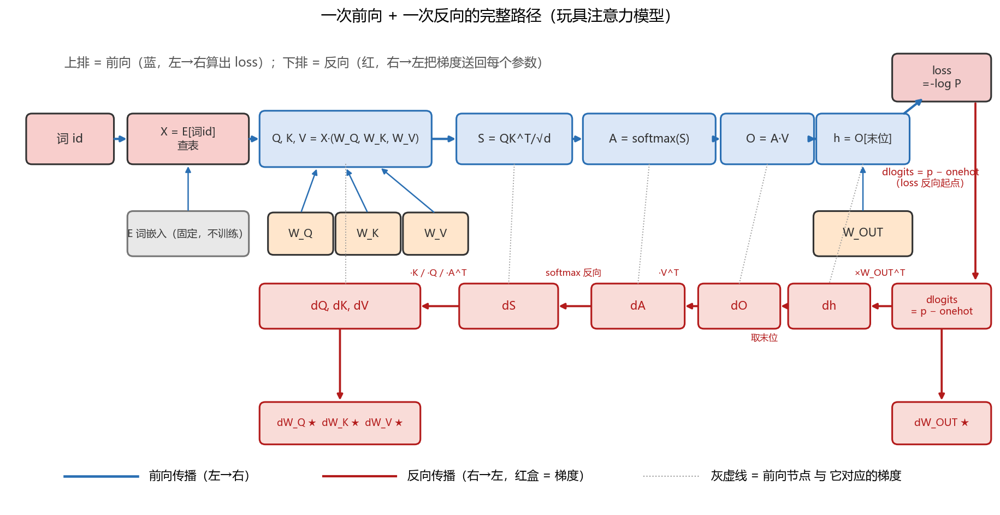
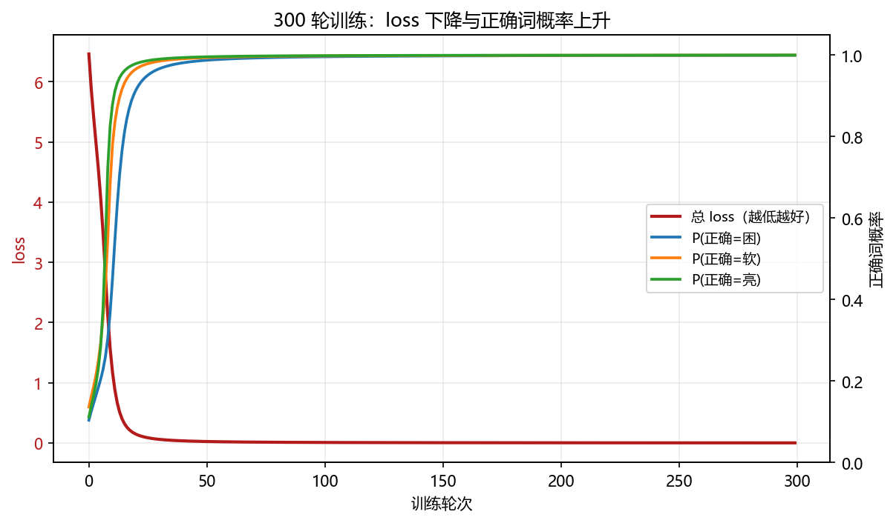
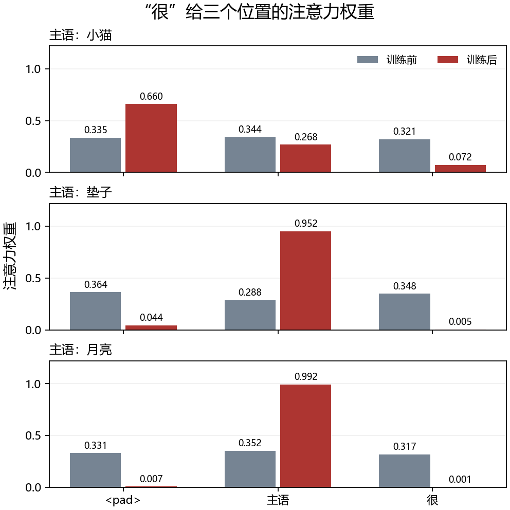
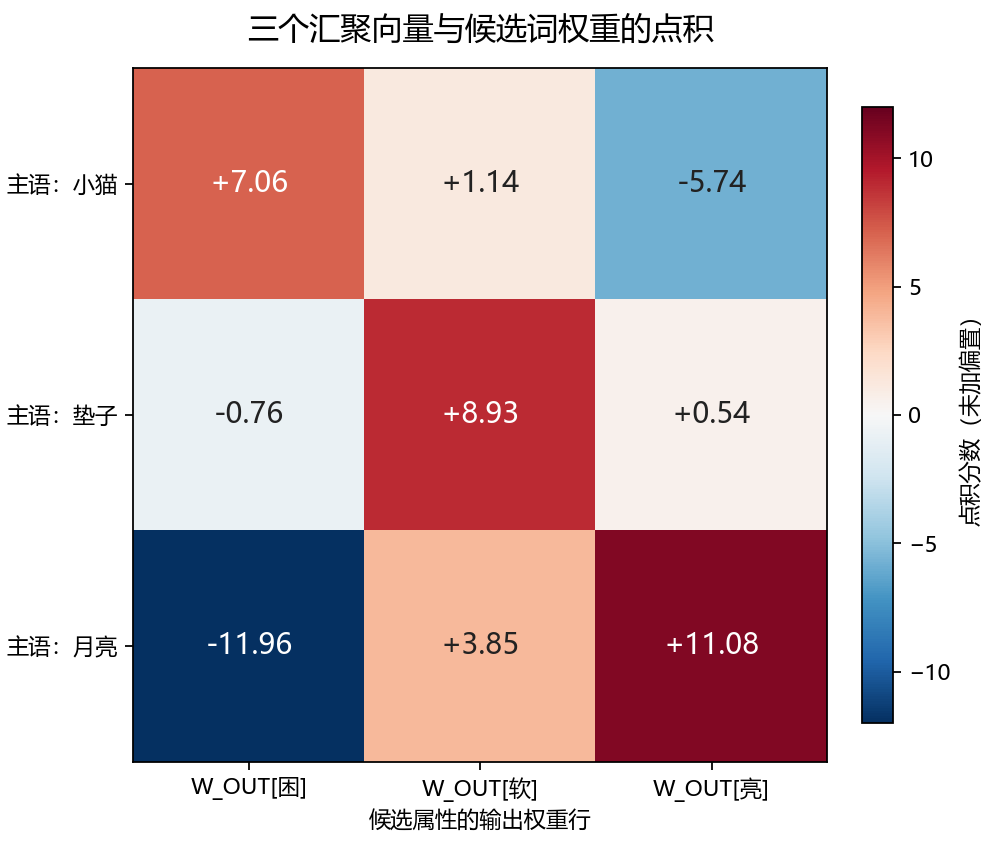

输入“小猫 很”，输出目标是“困”。用三个样本训练单头注意力，再把“很”这一行的三个权重与正确答案概率摆在一起，看它们如何分别变化。

[返回主文](/2026/08/26/attention-is-all-you-need/)

## 11. 多看不如多做：用简单的实验跑通流程，从中观察数据如何变化，并给出解释

只用 NumPy 就能看到训练前后有什么变化。先算模型把多少概率分给正确词，再拆开这项预测，看「很」从三个输入位置各读了多少。

输入是 `[<pad>, 主语, 很]`，答案是一个属性词：小猫→困、垫子→软、月亮→亮。每个词查出一个固定的八维向量；模型训练查询、键、值的三个矩阵，以及输出层的矩阵和偏置。`<pad>` 在这个实验里是一个普通输入，代码没有遮住它，因此它和主语一样可能得到注意力权重。

代码的位置从 `0` 开始编号，`2` 是“很”。同样在这个位置预测属性，三个样本会不会都把大部分权重给主语？看完预测概率，再对照第 2 行的权重。

### 11.1 核心代码

三条输入各有三个位置。`A` 是 `3×3` 的注意力权重表，第 `i` 行记录位置 `i` 怎么读三个输入位置。输出层只拿第 3 行汇聚出的向量 `h`，给词表中的八个词打分；训练损失看正确词得到了多少概率。

```python
import numpy as np

words = ["<pad>", "小猫", "垫子", "月亮", "很", "困", "软", "亮"]
word_id = {word: i for i, word in enumerate(words)}
batch = [
    ([word_id["<pad>"], word_id[subject], word_id["很"]], word_id[target])
    for subject, target in [("小猫", "困"), ("垫子", "软"), ("月亮", "亮")]
]
D = 8
lr = 0.5
rng = np.random.default_rng(7)
E = rng.normal(0, 1, (len(words), D))
W_Q, W_K, W_V = [rng.uniform(-0.3, 0.3, (D, D)) for _ in range(3)]
W_OUT = rng.uniform(-0.3, 0.3, (len(words), D))
B_OUT = np.zeros(len(words))
params = dict(W_Q=W_Q, W_K=W_K, W_V=W_V, W_OUT=W_OUT, B_OUT=B_OUT)


def softmax(x):
    x = x - x.max(axis=-1, keepdims=True)    # 数值稳定：先减去最大值
    e = np.exp(x)
    return e / e.sum(axis=-1, keepdims=True)


def forward(ids):
    X = E[ids]                               # 查词嵌入表（固定不训）
    Q, K, V = X @ W_Q, X @ W_K, X @ W_V      # 同一个 X 的三种投影
    S = Q @ K.T / np.sqrt(D)                 # 打分 + 除以 sqrt(D) 防饱和
    A = softmax(S)                           # 每行归一化 = 注意力权重
    O = A @ V                                # 按行混合各位置的 Value
    h = O[-1]                                # 只取“很”这一行的结果
    logits = W_OUT @ h + B_OUT               # 词表打分
    p = softmax(logits)                      # 概率；loss = -log p[正确词]
    return {"X": X, "Q": Q, "K": K, "V": V,
            "S": S, "A": A, "O": O, "h": h,
            "logits": logits, "p": p}


def backward(cache, tgt):
    X, Q, K, V = cache["X"], cache["Q"], cache["K"], cache["V"]
    A, h, p, O = cache["A"], cache["h"], cache["p"], cache["O"]
    target = np.zeros_like(p); target[tgt] = 1
    dlogits = p - target                     # CE + softmax 的极简形式
    dW_OUT = np.outer(dlogits, h)
    dB_OUT = dlogits
    dh = W_OUT.T @ dlogits
    dO = np.zeros_like(O)
    dO[-1] = dh                              # 只有位置 2 连着 loss
    dV = A.T @ dO
    dA = dO @ V.T
    dS = A * (dA - (dA * A).sum(axis=1, keepdims=True))
    dQ = dS @ K / np.sqrt(D)
    dK = dS.T @ Q / np.sqrt(D)
    return {
        "W_Q": X.T @ dQ,
        "W_K": X.T @ dK,
        "W_V": X.T @ dV,
        "W_OUT": dW_OUT,
        "B_OUT": dB_OUT,
    }


def total_loss():
    return sum(-np.log(forward(ids)["p"][target]) for ids, target in batch)


before = total_loss()
for _ in range(300):
    grads = {name: np.zeros_like(param) for name, param in params.items()}
    for ids, target_id in batch:
        sample_grads = backward(forward(ids), target_id)
        for name in grads:
            grads[name] += sample_grads[name]
    for name in params:
        params[name] -= lr * grads[name] / len(batch)  # 平均梯度更新

print(f"{before:.4f} -> {total_loss():.4f}")
for ids, target in batch:
    result = forward(ids)
    print(words[target], result["A"][-1].round(3), round(result["p"][target], 3))
```

### 11.2 前向与反向的路径



上排从词编号算到损失，下排反过来算每个参数对损失的影响。嵌入表 `E` 没放到 `params` 里，训练前后是同一张表。要核对手写反传，可以让某个参数分别增减 `0.00001`，用两次 `total_loss()` 的差除以 `0.00002`。这里算的是三条样本的损失之和，手写梯度的三份结果也要先相加，再和数值梯度比较。

### 11.3 数据如何变化：loss 与正确词概率



曲线画的是三条样本损失相加，从约 `6.463` 降到 `0.0022`；更新时把三个梯度取平均。均匀猜八个词时，每条损失是 `-log(1/8) ≈ 2.08`，三条加起来约 `6.24`，与初始值接近。训练后，三个正确词的预测概率都接近 1。

### 11.4 训练后的注意力落在哪里



训练前三处接近均摊（约 0.33）；训练后的位置 2 注意力如下。表中箭头左侧是训练前，右侧是训练后：

| 样本 | `<pad>` | **主语** | `很` |
| --- | ---: | ---: | ---: |
| 小猫→困 | 0.335 → 0.660 | 0.344 → 0.268 | 0.321 → 0.072 |
| 垫子→软 | 0.364 → **0.044** | 0.288 → **0.952** | 0.348 → 0.005 |
| 月亮→亮 | 0.331 → 0.007 | 0.352 → **0.992** | 0.317 → 0.001 |

垫子和月亮这两条样本的权重集中到了主语，小猫这条却更多落在 `<pad>` 上，三条样本并未表现出相同模式。最终预测由注意力权重、Value 和输出层共同计算，不能只凭最大的注意力权重解释。

### 11.5 最终权重的含义：3×3 对齐矩阵



每一格是一个点积：把“很”从三个位置汇聚出的向量 `h`，与某个候选词在 `W_OUT` 里的权重行逐项相乘，再把乘积加起来。以“小猫 很”为例，`h` 混合了 `<pad>`、小猫和“很”的 Value；它和“困”那行的点积是 `+7.06`。另外两条输入对应的正确属性也各自拿到行内最高分：`+8.93`、`+11.08`。完整预测还要加上 `B_OUT`，再在八个候选词之间算概率。

### 11.6 小猫这条样本为什么不一样

小猫样本把 `0.660` 的权重给 `<pad>`，留给主语的权重是 `0.268`，却仍把约 `0.999` 的输出概率给了「困」。权重和预测概率分属两次 softmax：一次在三个输入位置间分配，一次在八个输出词间分配。要弄清 `<pad>` 对答案有没有决定性作用，可以在固定参数的情况下遮住该位置，再比较「困」的分数；表中只有原始输入的记录。

这八个词里没有「石头」。若想测试新主语，先定义词表外输入如何表示，再另外准备未见过的样本。当前曲线回答的是同三条训练样本能否被拟合。

### 11.7 实验结果与解释范围

三条样本都答对了，但用的配比不同。读同一行结果时，先看模型最后选了哪个词，再看每个输入位置提供了什么 Value，以及它乘上的权重是多少。
