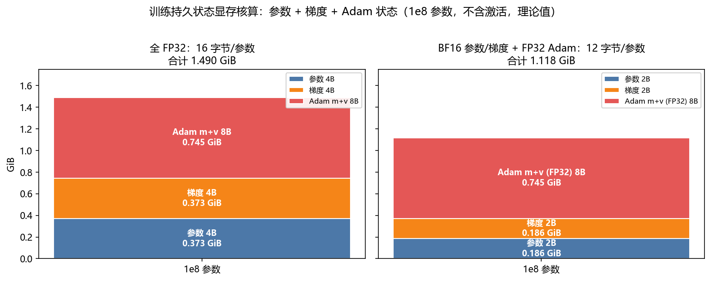

同一个模型，把批次加倍，GPU 要处理的 token 会加倍，模型权重却还是那一份。计算量和显存要分开算：先数每个 token 做多少次乘加，再看训练过程中哪几份张量要同时留在显存里。

[返回主文](/2026/09/23/cs336-day1-3-tokenizer-systems-architectures/)

## 2. 资源核算：张量、计算量与显存

### 2.1 张量：shape、stride、storage、dtype

分词后得到的整数序列会被组织成张量。张量可以理解为多维数组：向量是一维张量，矩阵是二维张量，一批文本的隐藏表示常是三维张量。训练中还有几类张量：

- 参数是模型通过训练调整的数值，例如线性层权重。
- 激活值是前向计算产生的中间结果，反向传播会用到其中一部分。
- 梯度描述损失对参数或中间变量的变化率，用来计算参数更新。
- 优化器状态保存更新参数所需的历史信息，例如 Adam 的梯度均值与平方均值。

PyTorch 张量的数值存储在 storage 中，元数据描述怎样读取这些数值。`shape` 表示各维长度，`stride` 表示沿某一维移动一步要跨过多少个存储元素，`dtype` 表示元素类型。视图与原张量共享存储，只改变访问方式：

```python
import torch

x = torch.arange(12, dtype=torch.float32).reshape(3, 4)  # 0 到 11，排成 3 行 4 列
y = x.T            # 转置为 4 行 3 列，仍然使用 x 的底层存储
z = y.reshape(-1)  # -1 表示自动推断长度；这个布局展平时需要复制数据

# 连续张量的存储顺序与默认的逐行访问顺序一致。
print(tuple(x.shape), x.stride(), x.is_contiguous())  # (3, 4) (4, 1) True
print(tuple(y.shape), y.stride(), y.is_contiguous())  # (4, 3) (1, 4) False
print(tuple(z.shape), z.stride(), z.is_contiguous())  # (12,) (1,) True
# 比较底层存储地址，直接验证共享或复制，而不只看 shape。
print(y.untyped_storage().data_ptr() == x.untyped_storage().data_ptr())  # True
print(z.untyped_storage().data_ptr() == x.untyped_storage().data_ptr())  # False
```

`x` 的 stride 是 `(4, 1)`：向下一行跨 4 个元素，向右一列跨 1 个元素。转置后，`y` 的 stride 变成 `(1, 4)`，数据本身没有移动。把 `y` 按逐行顺序展平则需要重新排列数据，所以本例的 `reshape(-1)` 创建了副本。`reshape` 是否复制，取决于原布局能否用新形状直接表示。

dtype 决定存储大小和可表示的数值。FP32 每个元素占 4 字节，FP16 和 BF16 各占 2 字节。动态范围描述能表示多大、多小的数；精度描述相近的数能区分得多细。下面的 `eps` 是 1 与比 1 大的下一个可表示数之间的间隔：

```python
import torch

for dt in (torch.float32, torch.float16, torch.bfloat16):
    fi = torch.finfo(dt)  # 查询该浮点类型的最大有限值和机器精度
    print(f"{str(dt):18s} max={fi.max:<14g} eps={fi.eps:<12g}")
# torch.float32      max=3.40282e+38   eps=1.19209e-07
# torch.float16      max=65504         eps=0.000976562
# torch.bfloat16     max=3.38953e+38   eps=0.0078125
```

| dtype | 最大值 | 机器 epsilon | 一句话 |
|---|---|---|---|
| FP32 | ≈3.40e38 | ≈1.19e-7 | 默认基准，稳但占内存 |
| FP16 | 65504 | ≈9.77e-4 | 指数只有 5 位，动态范围窄，易上/下溢 |
| BF16 | ≈3.39e38 | ≈7.81e-3 | 指数位与 FP32 相同，尾数更少 |

FP16 的指数位较少，可表示的范围较窄。训练时常用 loss scaling：先放大损失，让反向传播中的小梯度不容易下溢，再在更新前恢复梯度尺度。BF16 与 FP32 的指数位数相同，动态范围接近，但尾数位更少，区分相近数值的能力较弱。

混合精度让不同计算或存储使用不同 dtype。本节按课堂示例，采用 BF16 参数与梯度、FP32 Adam 状态来估算显存。Adam 状态涉及平方和跨步累积，需要更高精度；实际训练框架也可能保留 FP32 参数或额外的主参数副本，应按真实存储方式计算。

softmax 把一组未归一化分数（logits）转换成概率：

$$
p_i=\frac{e^{z_i}}{\sum_j e^{z_j}}
=\frac{e^{z_i-m}}{\sum_j e^{z_j-m}},\qquad m=\max_j z_j
$$

等式成立，是因为分子分母同时除以了 $e^m$。减去最大值后，最大的指数项是 $e^0=1$，可以避免对很大的正数直接求指数：

```python
import torch

logits = torch.tensor([1000.0, 1001.0, 999.0], dtype=torch.float64)
# 手动展开计算：先移到 [-1, 0, -2]，再求指数并除以总和。
shifted = logits - logits.max()
exp_scores = shifted.exp()
p = exp_scores / exp_scores.sum()
print([round(v, 4) for v in p.tolist()])  # [0.2447, 0.6652, 0.09]
# 假设正确类别是索引 1，则负对数似然为 -log(该类别的概率)。
print(-torch.log(p[1]).item())            # 0.40760596444438046
```

这里三个 logits 最大只差 2，问题在于它们的绝对值接近 1000，直接计算 `exp(1001)` 会溢出。减去 1001 后，概率保持不变，计算也能正常完成。PyTorch 的 `torch.softmax` 已包含稳定计算；这段手动展开的代码用于说明原理。

### 2.2 从矩阵乘法到 6ND

FLOPs 是浮点运算次数，衡量一项任务需要多少计算；FLOP/s 是每秒浮点运算次数，衡量计算速度。计算量除以实际计算速度，才得到耗时。

设线性层为 $Y=XW$，$X$ 的形状是 $T\times d$，$W$ 的形状是 $d\times k$。这里 $T$ 是一次处理的 token 数；批量大小为 $b$、序列长度为 $s$ 时，$T=bs$。

输出共有 $Tk$ 个元素，每个元素是两个长度为 $d$ 的向量做点积，约需 $d$ 次乘法和 $d$ 次加法，所以前向计算量约为 $2Tdk$。矩阵 $W$ 有 $dk$ 个参数，因此也可以写成“token 数 × 参数量 × 2”。这与一般矩阵乘法的 $2MKN$ 估算是同一规则。

反向传播需要计算输入梯度和权重梯度。若从下一层传来的梯度是 $G=\partial\mathcal L/\partial Y$，则两项分别是 $GW^\top$ 和 $X^\top G$。它们的矩阵形状不同，但各自都约需 $2Tdk$ 次运算。前向一次、反向两次，合起来就得到系数 6。

用两个 token、每个三个输入特征、四个输出特征来数：`[2,3] @ [3,4]` 得到 `[2,4]`。输入梯度要做 `[2,4] @ [4,3]`，权重梯度要做 `[3,2] @ [2,4]`。三个矩阵乘法都包含 `2×3×4=24` 次标量乘法，各配约 24 次加法。粗算这层训练就是 `3×2×24=144` 次浮点运算。

$$
\text{训练总 FLOPs} \approx 6ND
$$

这里统一用 $N$ 表示模型参数量，$D$ 表示训练中处理的 token 总数。估算一步训练时，$D$ 取这一步的 token 数；估算整个训练过程时，$D$ 取所有步骤的总量。例如 $10^8$ 个参数处理 $10^9$ 个 token，约需 $6\times10^{17}$ FLOPs。

用一个数把计算量和耗时接起来：若实测集群每秒能做 $10^{14}$ 次有效浮点运算，按这个估算要 `6000` 秒，也就是 100 分钟。这里用的是实际吞吐；换成显卡峰值，只能得到理想条件下的时间下界。

这个近似适用于线性层计算占主导的稠密模型。长上下文的注意力计算、激活重计算和优化器更新等，需要按具体配置另计。FLOPs 回答的是“要算多少”，下面再计算“要存多少”。

### 2.3 训练显存：参数、梯度、优化器状态与激活

Adam 为每个参数保存两份历史统计：一阶矩 $m$ 是梯度的指数移动平均，二阶矩 $v$ 是梯度平方的指数移动平均。它们与参数、梯度一起，构成这里核算的训练状态。

全 FP32 时，参数、梯度、$m$、$v$ 各占 4 字节，合计 16 字节/参数。若参数和梯度用 BF16，两个 Adam 状态仍用 FP32，则是 $2+2+4+4=12$ 字节/参数。这两种计算都没有包含激活和临时缓冲；如果还保存额外的 FP32 主参数副本，每参数需再加 4 字节。

以一亿个参数为例，GiB 的换算单位是 $2^{30}$ 字节：

```python
N = 100_000_000  # 一亿个参数；下划线只为方便阅读
# 括号内依次是参数、梯度、Adam 的 m/v 所占字节，除以 2**30 转为 GiB。
print((4 + 4 + 8) * N / 2**30)  # 1.4901161...：全 FP32
print((2 + 2 + 8) * N / 2**30)  # 1.1175870...：BF16 参数/梯度，无主参数副本
```

即全 FP32 约 1.490 GiB，混合精度约 1.118 GiB。



课堂还举了 8 张 80 GB H100 的例子。按每参数 12 字节、训练状态能在八张卡之间完全分片计算，总容量上限是 $8\times80\times10^9/12\approx53.3$ 十亿参数；单卡是约 6.67 十亿参数。GB 在这里按 $10^9$ 字节计算。实际还需给激活、通信和临时张量留空间，不能直接把这个上限当作可训练规模。

多张卡也不一定会减少每卡的状态占用。普通数据并行（DDP）让每张卡保存完整模型和优化器状态，各自处理不同数据，再同步梯度。ZeRO 则逐步将这些状态分片。下面回到全 FP32 假设，计算一亿参数、四张卡时的每卡占用：

```python
N, w = 100_000_000, 4  # N 为参数量，w 为数据并行卡数
# 未分片的项保留原字节数；分片的项除以 w，得到每卡持有的份额。
print((4 + 4 + 8)         * N / 2**30)   # 1.4901  DDP（不切）
print((4 + 4 + 8 / w)     * N / 2**30)   # 0.9313  ZeRO-1（切优化器状态）
print((4 + 4 / w + 8 / w) * N / 2**30)   # 0.6519  ZeRO-2（再切梯度）
print(((4 + 4 + 8) / w)   * N / 2**30)   # 0.3725  ZeRO-3（连参数一起切）
```

看 ZeRO-2 一行：每张卡仍要留完整的 `4` 字节权重，`4` 字节梯度和 `8` 字节 Adam 状态才各除以 `4`，合计 `7` 字节/参数。ZeRO-3 再分权重，持久状态按 `4` 字节/参数记；计算一层时仍要临时收集所需权重。这些公式回答平常要存多少，估算峰值还要加激活、通信缓冲和临时收集的参数。

### 2.4 算术强度与 Roofline：判断计算速度的瓶颈

GPU 做计算前要读取数据，计算后要写回结果。运行速度既受计算能力（FLOP/s）限制，也受显存带宽（字节/秒）限制。算术强度 $I$ 定义为“浮点运算次数 ÷ 搬移字节数”，表示每搬运 1 字节做多少计算。

Lecture 2 使用的 H100 示例取 BF16 稠密算力约 $989.5\times10^{12}$ FLOP/s、HBM（高带宽显存）带宽 $3.35\times10^{12}$ 字节/秒，两者相除约为 295 FLOPs/字节。这个临界值对应这组硬件和精度条件。

- 低于临界值时，理想模型下主要受带宽限制。例如 BF16 的 ReLU 对 $m$ 个元素各读写一次，共搬移 $4m$ 字节；把每次比较记作一次操作，算术强度约为 $m/(4m)=0.25$。即使每个元素做 20 次运算，强度也只有 5，仍远低于 295。
- 高于临界值时，理想模型下主要受计算能力限制。边长为 $m$ 的矩阵相乘，搬移量约为 $O(m^2)$，计算量为 $O(m^3)$，因此强度随 $m$ 增长。大矩阵能更充分地复用读入的数据，这也是批量矩阵运算适合 GPU 的原因。

Roofline 模型把这两种限制写成一个性能上限：

$$
\text{可达到的 FLOP/s}\leq
\min(\text{峰值 FLOP/s},\ I\times\text{显存带宽})
$$

按上面那组课堂数字，若某段运算每搬 1 字节算 10 次，带宽给它的上限就是 $10\times3.35=33.5$ TFLOP/s，远低于显卡的计算峰值。把横轴的算术强度逐渐加大，这个上限会上升，到了约 295 FLOPs/字节后才进入受算力限制的平台。运行时间还受调度和通信影响，Roofline 算的是上限。

MFU（模型 FLOPs 利用率）用模型有效计算量衡量训练效率：

$$
\mathrm{MFU}=
\frac{\text{模型每步 FLOPs}/\text{每步耗时}}
{\text{所用 GPU 的总峰值 FLOP/s}}
$$

分子通常不计激活重计算等额外工作，分母采用相同精度下的设备峰值。若每步有 200 TFLOPs 的有效计算、实测用时 0.5 秒，设备总峰值为 800 TFLOP/s，则 MFU 是 `200÷0.5÷800=50%`。课堂把 0.5 作为较好的训练参考值，并指出纯矩阵乘法可能用到 0.8 以上的峰值。优化训练时，在同一套模型和硬件上比较改动前后的值。

### 2.5 梯度累积与激活重计算：降低激活显存

梯度累积把一个大批次拆成若干微批次。每个微批次计算完就释放其计算图，但保留参数梯度，等全部处理完后再更新一次参数。

假设 8 个样本拆成两个大小为 4 的微批次，各自平均损失为 $\mathcal L_1$、$\mathcal L_2$，那么全批次平均损失是 $(\mathcal L_1+\mathcal L_2)/2$。因此，每个微批次的平均损失都要除以 2，再反向传播。下面比较两种方式得到的梯度：

```python
import torch

torch.manual_seed(0)  # 固定本例的随机初始化与输入
lin = torch.nn.Linear(3, 2, bias=False)  # 每个样本由 3 维映射为 2 维
x = torch.randn(8, 3)                   # 8 个样本，每个样本有 3 个特征
chunks = (x[:4], x[4:])                 # 拆为两个等大的微批次

# 全批次：用均方误差让两个输出都接近 1，记录基准梯度。
lin.zero_grad()
loss_full = ((lin(x) - 1) ** 2).mean()
loss_full.backward()
g_full = lin.weight.grad.clone()  # 复制数值，留作比较

# 累积前清零一次；循环内不清零，也不更新权重。
lin.zero_grad()
for chunk in chunks:
    loss_micro = ((lin(chunk) - 1) ** 2).mean()
    (loss_micro / len(chunks)).backward()  # backward 会把梯度加到已有的 .grad 上
print(torch.allclose(g_full, lin.weight.grad))  # True：在数值容差内相等
```

本例每个样本独立计算，两个微批次等大，按 $1/k$ 缩放后可以得到相同梯度。若微批次大小不同，应按样本数占比加权；语言模型按有效 token 求平均损失时，应按有效 token 数占比加权。包含 BatchNorm 等跨样本运算时，拆批次还会改变前向计算。梯度累积主要降低激活峰值显存，总计算量并不会因此直接减少。

例如两批分别有 12 和 4 个有效 token，平均损失各是 2 和 6。按 token 合起来是 `(12×2+4×6)/16=3`；直接平均两个批次会算出 4，多给短批次里的每个 token 算了权重。此时给两份批均损失分别乘 `12/16`、`4/16` 再反传。

激活重计算（activation checkpointing）减少的是另一部分存储：前向时只保留部分中间结果，反向时重新计算缺失结果。例如一个各层大小相近的 $L$ 层串行网络，每隔约 $\sqrt L$ 层保留一个检查点，反向时逐段重算，保存的检查点和单段临时激活都约为 $O(\sqrt L)$，额外计算总量约为一次前向，即 $O(L)$。课堂“省一半”的例子针对线性层加 ReLU 的特定存储方案，不能直接用于所有 Transformer。

数据较大时，`memmap` 可以把文件映射到进程地址空间，按需读取所用部分。测 GPU 时间时，先等前面提交的工作完成，再开始计时，最后用 `torch.cuda.synchronize()` 等待这段运算结束。否则 CPU 时钟可能只量到提交任务的时间。复跑曲线时记录种子、软件版本和硬件；种子固定的是随机输入与抽样顺序，算法是否确定还要另看实现。
