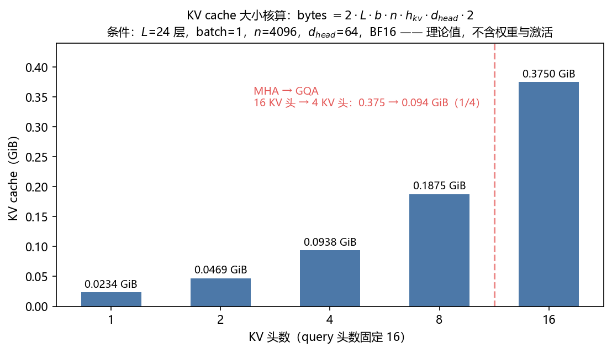

一个 token 进入 Transformer 后，注意力让它从其他位置读信息，前馈层接着变换它自己的向量。处理过的 token 还会留下 K、V 供后续生成使用。这里先拆开一个 block，再算生成时到底要保存多少数据。

[返回主文](/2026/09/23/cs336-day1-3-tokenizer-systems-architectures/)

## 3. Transformer 架构：各组件解决什么问题

CS336 第三讲把问题缩到一层：注意力和前馈网络之间的向量怎么传，哪些数会被归一化，哪些值得缓存。字节和运算量的换算见[训练成本](/2026/09/23/cs336-day1-3-tokenizer-systems-architectures/training-cost/)。

一个 Transformer block 通常先做注意力计算，再做前馈网络（FFN）计算。注意力让不同 token 交换信息；FFN 对每个 token 的向量分别变换。残差连接把子层输出加回输入，归一化则调节向量尺度。

### 3.1 Pre-Norm：归一化放在子层之前

把注意力或 FFN 子层记作 $F$。残差连接的形式是 $x+F(x)$，即把输入 $x$ 与子层算出的变化量相加。Pre-Norm 与 Post-Norm 的区别，在于归一化放在哪里：

$$
\begin{aligned}
\text{Post-Norm:}\quad &y=\operatorname{Norm}(x+F(x))\\
\text{Pre-Norm:}\quad &y=x+F(\operatorname{Norm}(x))
\end{aligned}
$$

Post-Norm 对相加后的整个结果做归一化。Pre-Norm 只先归一化传入 $F$ 的那一份输入，直接相加的 $x$ 保持不变。因此，Pre-Norm 的梯度中有一项可以通过恒等连接传回前层，不必经过子层或归一化运算。这有助于深层网络中的梯度传播。

把它分别应用到注意力和 FFN，就得到一个串行 Pre-Norm block：

$$
\begin{aligned}
h&=x+\operatorname{Attention}(\operatorname{Norm}_1(x))\\
y&=h+\operatorname{FFN}(\operatorname{Norm}_2(h))
\end{aligned}
$$

比如输入 $x=[2,4]$，归一化后的副本送去做注意力。若注意力给出的修正是 $[0.5,-0.5]$，加回的是原始的 $[2,4]$，得到 $h=[2.5,3.5]$；到了 FFN，再对 $h$ 另做一次归一化。沿残差线留下来的不是归一化后的副本。

Xiong 等人（2020）的实验显示，Pre-Norm 在其研究设置中可以减少对学习率预热的依赖。预热指训练初期逐渐增大学习率；现代训练仍常保留这一步，以适应整体优化配置。

另一种选择是在子层计算后、残差相加前归一化，即 $y=x+\operatorname{Norm}(F(x))$。它与上面的 Post-Norm 不同，通常称为 non-residual post-norm。Lecture 3 第 13 页列出 Grok、Gemma 2 等前后都加归一化的变体，以及仅采用 non-residual post-norm 的 OLMo 2。理解这类结构时，应直接看归一化作用于哪一条分支。

### 3.2 RMSNorm 与去偏置：简化归一化和线性层

LayerNorm 在每个 token 的特征维度上减去均值，再除以加入稳定项后的标准差，最后应用可学习的缩放和平移。RMSNorm 使用均方根（root mean square）调节尺度，省去减均值和平移：

$$
y = \frac{x}{\sqrt{\frac{1}{d}\sum_i x_i^2 + \varepsilon}} \cdot \gamma
$$

其中 $d$ 是向量维度，$\varepsilon$ 是避免分母为零的小常数，$\gamma$ 是每个特征上的可学习缩放系数。均方根的计算顺序就是“平方、求平均、开平方”。

课程引用的实验中，RMSNorm 保持了相近的建模效果，并减少了运算与参数。归一化需要读取、归约和写回向量，FLOPs 少也可能耗时：课堂结合 Ivanov 等人（2023）的图表，举出统计归一化约占 0.17% FLOPs、特定工作负载下却可占约 25% 运行时间的例子。具体加速幅度取决于模型形状和算子实现。

下面暂取 $\gamma=1$，只观察除以均方根这一步：

```python
import torch

def rmsnorm(x, eps=1e-6):
    # 最后一维是每个 token 的特征；keepdim 保留该维，便于逐 token 广播。
    mean_square = x.pow(2).mean(dim=-1, keepdim=True)
    inv_rms = torch.rsqrt(mean_square + eps)  # rsqrt(a) = 1 / sqrt(a)
    return x * inv_rms                       # 本例省略可学习的 gamma

torch.manual_seed(0)
x = torch.randn(2, 5, 8)  # 2 条序列，每条 5 个 token，每个 token 为 8 维
# 沿特征维重新计算 RMS，输出形状为 (2, 5)，每个 token 对应一个值。
rms = rmsnorm(x).pow(2).mean(dim=-1).sqrt()
print(rms)  # 本例各值保留 4 位小数为 1.0000；eps 使它们略小于 1
```

线性层的偏置也可以省去：把 $xW+b$ 改为 $xW$，就少了一组参数和一次加法。课程列举的 Llama 类模型常采用无偏置线性层。这种简化在相关训练实验中有效；它是否加快某个程序，还取决于偏置加法是否已经融合到矩阵乘法中。

### 3.3 SwiGLU：前馈网络中的门控与参数量

普通 FFN 先把 token 向量从 $d_{model}$ 维映射到 $d_{ff}$ 维，经过激活函数，再映射回来。使用 ReLU 时，公式是 $\max(0,xW_1)W_2$，其中 ReLU 将负数置零，正数保持原值。

SwiGLU 增加一条并行分支，两条分支的结果逐元素相乘，再投影回原维度：

$$
FF_{SwiGLU}(x) = \big(\text{SiLU}(xW_{gate}) \otimes (xW_{up})\big) W_{down}
$$

$\otimes$ 表示对应位置的数相乘。$xW_{up}$ 生成中间特征，$\operatorname{SiLU}(xW_{gate})$ 生成调节这些特征的系数，最后由 $W_{down}$ 映射回 $d_{model}$ 维。这里 $\operatorname{SiLU}(u)=u\,\operatorname{sigmoid}(u)$，$\operatorname{sigmoid}(u)=1/(1+e^{-u})$。

例如内容分支给出 `[3, 4]`，门控分支在 SiLU 前给出 `[0, 1]`。过了 SiLU，门控系数约为 `[0, 0.731]`，相乘后得到 `[0, 2.924]`。第一项归零，第二项缩小，再由最后一个矩阵把它们映射回模型维度。换一个 token，两条分支都重算。

Shazeer（2020，arXiv:2002.05202）在控制参数量的实验中比较了 GLU 变体，SwiGLU、GeGLU 等相对 ReLU/GELU 基线表现更好。GPT-3 使用的非门控 FFN 也能有效训练；门控是改变前馈层表达方式的一种选择。

为什么 SwiGLU 常把中间维度设为约 $2.67d_{model}$？忽略偏置，普通 FFN 的两个矩阵共有 $2d_{model}d_{ff}$ 个参数；取 $d_{ff}=4d_{model}$ 时，就是 $8d_{model}^2$。SwiGLU 有三个矩阵，共 $3d_{model}d_{ff}$ 个参数。令二者相等：

$$
3d_{model}d_{ff}=8d_{model}^2
\quad\Longrightarrow\quad
d_{ff}=\frac83d_{model}
$$

因此，“缩到原来的 $2/3$”来自等参数量比较。实际配置可以不同：课件第 38 页列出的 Qwen 14B 比例为 2.67、Yi 34B 为 2.85、PaLM 为 4、Mistral 7B 为 3.5。采用门控后是否节省计算，要结合所选中间维度判断。

### 3.4 RoPE：用旋转表达相对位置

注意力通常从每个 token 的隐藏向量生成 Q（query，查询）、K（key，键）和 V（value，值）。Q 与 K 的点积给出相关性分数，softmax 将分数转换成权重，再用权重对 V 加权求和。

如果既没有位置编码，也没有因果掩码等顺序约束，全注意力只根据内容计算：把输入重新排序，输出也随之按相同方式重排。这叫置换等变。语言需要区分先后和距离，因此模型通常显式加入位置信息。因果掩码限制“只能看当前位置及之前”，位置编码则进一步表示具体位置或间距。

原始 Transformer 将正弦位置向量加到输入上，GPT-2 使用可学习的绝对位置向量，T5 则按相对距离给注意力分数加偏置。RoPE 采用另一种方式：直接旋转参与点积的 Q 和 K。

RoPE（Su et al. 2021，arXiv:2104.09864）把向量坐标两两配对，每对按“位置 × 频率”旋转；不同坐标对使用不同频率，形成不同变化尺度的位置特征。设 $R_i$ 是位置 $i$ 对应的旋转矩阵，固定内容向量为 $q,k$，则：

$$
(R_iq)^\top(R_jk)=q^\top R_i^\top R_jk=q^\top R_{j-i}k
$$

两个位置共同增加相同的偏移时，$j-i$ 不变，点积也不变。点积仍然取决于内容向量 $q,k$，只是其中的位置影响通过相对距离出现。RoPE 在各注意力层的 Q、K 上应用旋转，与在输入上加位置向量的做法不同。

用一个二维对就可以把两个核心性质演示出来（真实实现里每个维度对用不同频率，这里取频率 1）：

```python
import math
import torch

def rot(v, pos, freq=1.0):
    a = pos * freq  # 位置乘频率，得到弧度制旋转角
    c, s = math.cos(a), math.sin(a)
    # 二维旋转矩阵左乘向量：改变方向，保留向量长度。
    return torch.tensor([[c, -s], [s, c]], dtype=torch.float64) @ v

# 固定内容向量，只改变位置，才能单独检验位置编码的性质。
v = torch.tensor([0.6, 0.8], dtype=torch.float64)
w = torch.tensor([-0.3, 0.5], dtype=torch.float64)

print(v.norm().item(), rot(v, 7).norm().item())  # 1.0 1.0，旋转前后长度相同
# @ 对两个一维向量表示点积；item() 将单元素张量转成 Python 数值。
print((rot(v, 2) @ rot(w, 3)).item())           # -0.3355278，位置差 1
print((rot(v, 10) @ rot(w, 11)).item())         # -0.3355278，位置差仍为 1
print((rot(v, 2) @ rot(w, 11)).item())          # -0.4229926，位置差改为 9
```

第二、三次输出相同，因为内容向量没变，位置差也都是 1。这里不能换成任意两对词再断言点积相同，不同内容对应的 Q、K 可以不同。

上述性质描述的是固定 Q、K 的旋转后点积；整个语言模型还包含上下文相关的隐藏状态和掩码。长度外推，即处理比训练时更长的序列，也需要单独验证或采用位置缩放、插值等方法。课件第 33 页还介绍了仅旋转部分坐标的变体；滑动窗口与 RoPE/NoPE 的组合见 3.7。

### 3.5 超参数：前馈维度、注意力头数与层数

超参数是训练前选定的配置，例如层数、向量维度、注意力头数，与通过梯度更新的权重不同。Lecture 3 结合模型配置表和参数扫描实验给出参考范围：

- 前馈比例：普通 FFN 常取 $d_{ff}=4d_{model}$，等参数量的 GLU 常取约 $2.67d_{model}$。Kaplan 等人（2020）在所测试配置中发现，比例约为 1 到 10 时损失变化较小。T5 11B 则取 $65536/1024=64$，希望利用更大的矩阵提高硬件利用率；后续 T5 v1.1 采用了更接近常见配置的 2.5。硬件利用率高与总计算成本低，是两个不同指标。
- 头维度与头数：常见配置满足 $d_{head}h=d_{model}$，即所有头拼接后的维度等于模型维度。例如 8 个头、每头 64 维，拼接后就是 512 维。这个等式是常用配置，不是矩阵计算的必要条件；课件列出的 T5 和 LaMDA 比率分别为 16 和 2。
- 宽深比：$d_{model}/n_{layer}$ 比较隐藏向量维度与层数。课件列出的 GPT-3 为 128、LLaMA 为 102、PaLM 为 156、BLOOM 为 205，也有低于 100 的模型。增加深度会增加串行计算和层间并行安排的难度；固定预算下增加宽度，则会改变能分配给深度的参数量。应把配置与硬件效率一起考虑。
- 正则化：Dropout 在训练时随机屏蔽部分激活，权重衰减则在更新时使参数趋向较小的值。在大规模、单遍、计算受限的预训练设置中，课程所列许多模型不使用 Dropout，但仍使用权重衰减。Andriushchenko 等人（2023）的实验表明，权重衰减还会与优化器和学习率调度相互作用，影响收敛，而不只是控制过拟合。

### 3.6 训练稳定性：z-loss、QK-Norm 与 soft-capping

语言模型里，输出端的 softmax 给词表里的候选词分配概率，注意力端的 softmax 给序列位置分配权重。[减去最大值](/2026/09/23/cs336-day1-3-tokenizer-systems-architectures/training-cost/)能防止指数溢出，同时保持原来的概率。下面三种办法则会改变被训练的目标或分数。

输出端的 z-loss 在原损失上增加 $\lambda(\log Z)^2$，其中 $Z=\sum_j e^{z_j}$，$\lambda$ 控制惩罚强度。所有 logits 同时加上常数，softmax 概率不变，但 $\log Z$ 会改变；z-loss 因而能约束这部分漂移，使 $\log Z$ 接近 0。实现时仍要稳定计算 $\log Z$。课件第 54 页将这一方法追溯到 Devlin（2014），并列出 PaLM、Baichuan 2、DCLM、OLMo 2/3 等采用案例。

注意力端的 QK-Norm 在 Q、K 做点积前分别归一化，例如使用 RMSNorm，从输入向量的尺度控制打分幅度。课件第 55 页介绍了视觉、多模态模型中的相关工作，并列出 DCLM、OLMo 2、Gemma 2、Qwen3 等语言模型案例。它与 block 入口处的 Pre-Norm 作用位置不同。

logit soft-capping 直接把分数 $x$ 变换为 $c\tanh(x/c)$，其中 $c>0$ 控制范围。变换后的分数位于 $(-c,c)$，接近边界时平滑饱和。课程以 Gemma 系列说明这种方法，并讨论了它对分数表达范围的约束：限制过强会妨碍模型拉开分数差距。课程转述的比较实验中，QK-Norm 的效果略优于仅做 soft-capping。

这些方法作用不同：减最大值改变计算方式而保留概率；z-loss 增加训练目标；QK-Norm 调节 Q、K；soft-capping 直接改变进入 softmax 的分数。

### 3.7 推理效率：KV Cache、GQA 与滑动窗口

训练时，完整文本已经给定，可以并行计算多个位置的预测。普通自回归解码时，同一条序列的下一个 token 依赖刚生成的 token，因此逐步进行；不同请求仍可组成批次一起处理。

KV Cache 保存各层历史 token 的 K、V，避免每一步重新计算历史表示。新 token 进入一层后，生成自己的 Q、K、V，将新 K、V 加入缓存，用 Q 与可见的 K 计算权重，再对 V 加权求和。缓存大小会随已处理的序列长度增加。

例如模型已经读完“猫坐在”，现在处理新位置“垫”。这一轮给“垫”算一个 Q，再用它查询“猫、坐、在、垫”四个位置的 K 和 V。前三个位置的 K 和 V 从缓存读取，第四个现场计算；前三个位置的 Q 已用在过去的输出里，这次不需要保存或重算。

解码每步处理的新位置很少，却要读取模型权重和历史缓存，因此容易受带宽限制。Lecture 3 第 60 页在 $n\lt d$、投影计算占主导的简化假设下，估算生成长度为 $n$ 的序列所需计算量为 $O(bnd^2)$，访存量为 $O(bn^2d+nd^2)$。其中 $b$ 是批量大小，$d$ 是隐藏维度。两者相除：

$$
I\sim\frac{bnd^2}{bn^2d+nd^2}
=\left(\frac nd+\frac1b\right)^{-1}
$$

这里省略了常数和每元素字节数。增大批量会减小 $1/b$ 项，提高权重的复用程度；序列变长会增加读取缓存的负担。这个简化式描述上述假设下的比例关系，不能直接当作任意长上下文的完整耗时公式。

KV Cache 容量可以按各维相乘计算：

$$
\text{KV Cache 字节数}=2Lbn h_{kv}d_{head}s
$$

$L$ 是层数，$b$ 是批量大小，$n$ 是缓存长度，$h_{kv}$ 是 KV 头数，$d_{head}$ 是每个头的维度，$s$ 是每个元素的字节数。最前面的 2 表示 K 和 V 两份。这里各层配置相同，缓存未量化：

```python
def kv_bytes(layers, batch, length, kv_heads, head_dim, element_bytes=2):
    # 单层 K 的形状可写作 (batch, kv_heads, length, head_dim)。
    # V 同样大，故乘 2；再乘层数与每元素字节数，得到总字节数。
    return 2 * layers * batch * length * kv_heads * head_dim * element_bytes

# 保持 24 层、1 条序列、4096 个位置、每头 64 维，只改变 KV 头数。
# element_bytes 默认是 2，对应 BF16 或 FP16；除以 2**30 转为 GiB。
mha = kv_bytes(24, 1, 4096, 16, 64) / 2**30  # MHA：16 个查询头配 16 个 KV 头
gqa = kv_bytes(24, 1, 4096, 4, 64) / 2**30   # GQA：16 个查询头共享 4 个 KV 头
print(mha, gqa, mha / gqa)                    # 0.375 0.09375 4.0
```

减少 KV 头数，可以直接减少缓存。三种注意力的差别是：

- MHA（多头注意力）：每个查询头有对应的 K、V 头。
- MQA（多查询注意力）：所有查询头共享一组 K、V。Shazeer（2019）用它减少解码访存；模型质量可能随共享程度和任务发生变化。
- GQA（分组查询注意力）：保留多个 KV 头，同组查询头共享 K、V。例如 16 个查询头配 4 个 KV 头，每 4 个查询头共享一组 K、V。Ainslie 等人（2023，arXiv:2305.13245）的实验中，GQA 质量接近 MHA、速度接近 MQA；将已有 MHA 模型继续训练为 GQA，使用了约 5% 的原预训练计算量。

同一条件下 KV 头从 16 降到 4，缓存正好缩到 1/4：



拿第一组看：查询头 `0–3` 读的是同一份 K、V，但这四个头各有一个 Q，因此会各算一行分数，也可能各自关注不同位置。`1/4` 缩的是缓存空间；查询头仍有 16 个，实际解码速度要看读缓存占了多少时间。

滑动窗口注意力（SWA）从另一个方向降低开销：每个位置只关注附近固定窗口中的 token。全序列注意力的交互数为 $O(n^2)$，窗口大小为 $w$ 时则为 $O(nw)$。单层窗口之外的位置无法直接交互，多层堆叠可以逐步扩大信息覆盖范围。

课件第 65 页以 Cohere Command A 为例：每四层中一层使用全注意力，其余三层使用滑窗；全局层采用 NoPE（不额外加入显式位置编码），局部层使用 RoPE。课件还列举了 LLaMA 4、Gemma 3/4、OLMo 3 中局部与全局层组合的设计。具体窗口和位置编码安排应以相应模型配置为准。

课件还举了 Qwen3-Next：部分层用门控 DeltaNet，不再逐个读取全部历史 K、V；穿插的全注意力层仍按位置访问历史。算这种混合模型的缓存时，先数清哪些层保留普通 KV，再对其余层按实际状态结构单独计算。
