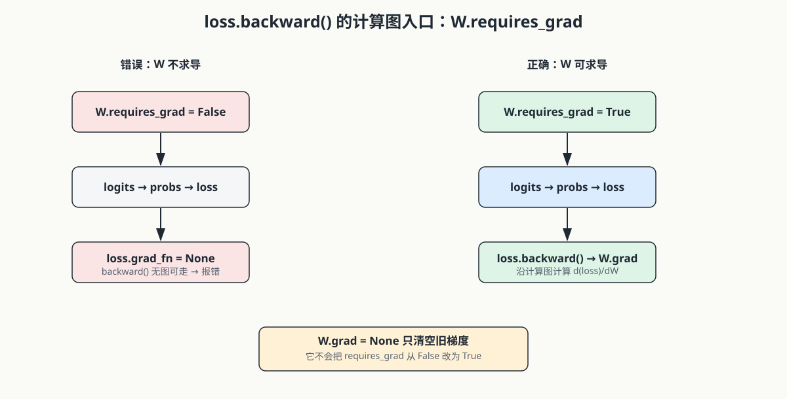
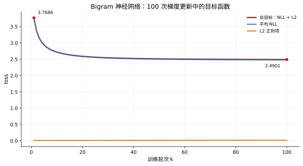

[原页](/2026/08/27/makemore-bigram/)用转移次数算概率。本页换成一张可训练的分数表：选中当前字符对应的一行，给下一个字符打分，再用真实答案来调这一行。第 8、9、11 节用一个名字就能试。第 10 节单独演示梯度报错，第 12 节再换成完整语料。

## 8. 用一个名字拆开神经网络输入

### 8.1 `emma` 变成 5 个监督样本

把 `emma` 写成 `.emma.`，再依次取相邻的两个字符。`stoi` 把 `.` 编成 0、`a` 编成 1，一直到 `z` 编成 26：

```python
import string

import torch
import torch.nn.functional as F

stoi = {char: i for i, char in enumerate("." + string.ascii_lowercase)}
toy_name = "emma"
xs = torch.tensor([stoi[c] for c in "." + toy_name])
ys = torch.tensor([stoi[c] for c in toy_name + "."])
```

五条样本的编号如下：

```text
xs = [0, 5, 13, 13, 1]
ys = [5, 13, 13, 1, 0]
```

对应关系为：

```text
. → e
 e → m
 m → m
 m → a
 a → .
```

`xs[i]` 是输入字符，`ys[i]` 是真实的下一个字符。第一条拿 `.` 猜 `e`，最后一条拿 `a` 猜 `.`，把开始和停止都变成模型要学习的预测。

### 8.2 one-hot 的形状

```python
xenc = F.one_hot(xs, num_classes=27).float()
```

得到：

```text
xs.shape   == (5,)
xenc.shape == (5, 27)
```

每一行是一个当前字符的 one-hot 向量：只有对应字符的位置是 `1`，其余位置是 `0`。`.float()` 很重要，因为后面要和浮点权重矩阵相乘。

## 9. one-hot × W：把表变成可训练参数

### 9.1 初始化权重矩阵

```python
g = torch.Generator().manual_seed(2147483647)
W = torch.randn((27, 27), generator=g, requires_grad=True)
```

`W.shape == (27, 27)`：

- 行 `i` 对应当前字符；
- 列 `j` 对应候选下一个字符；
- `W[i, j]` 是一个未归一化的分数，也就是 logit；
- `requires_grad=True` 让它成为自动微分图中的可训练叶子节点。

### 9.2 one-hot 矩阵乘法其实是在选行

```python
logits = xenc @ W
```

形状是：

```text
(5, 27) @ (27, 27) = (5, 27)
```

例如只有 `.`、`a`、`b` 时，`a` 编号为 1，向量是 `[0, 1, 0]`。拿这个向量乘 `W`，相当于用 0 乘第 0 行、用 1 乘第 1 行、用 0 乘第 2 行，再把三行加起来。最后剩下的是 `W[1]`。

如果 `xenc[i]` 是编号 `r` 的字符的 one-hot 向量，那么：

$$
\mathrm{onehot}(r)W=W_{r,:}
$$

一行分数已经覆盖所有候选字符。下一步把这行分数变成概率，真实下一个字符所在的列就能用来算损失。

### 9.3 从 logits 到概率

把 softmax 拆开，就能和计数表里的归一化逐步比较：

```python
counts = logits.exp()
probs = counts / counts.sum(1, keepdim=True)
```

数学形式是：

$$
P(j\mid i)
=\frac{\exp(W_{ij})}{\sum_k\exp(W_{ik})}
$$

三步分别是：

1. `W` 提供未归一化分数；
2. `exp` 把任意实数变成正数；
3. 按行归一化，让每一行加起来等于 1。

这里的 `counts` 是把模型分数取指数得到的正值权重；`N` 才记录语料里观察到的次数。对于全为正数的计数行，若把它的对数用作分数，softmax 会还原按该行计数归一化的分布。整行分数加上同一个常数，得到的分布也一样。

生产代码通常会写成：

```python
log_probs = F.log_softmax(logits, dim=1)
loss = -log_probs[torch.arange(xs.numel()), ys].mean()
```

或者直接使用：

```python
loss = F.cross_entropy(logits, ys)
```

直接计算对数概率，可以避免先 `exp` 再取 `log` 带来的溢出。展开写法的好处是把每一步都摆在眼前，方便与前面的计数归一化对照。

## 10. 这次 `loss.backward()` 报错到底错在哪里

### 10.1 报错信息的直译

原来的错误是：

```text
RuntimeError:
element 0 of tensors does not require grad and does not have a grad_fn
```

前向照样能算出 `loss`。报错发生在求导时：从这个损失往回找，找不到 PyTorch 记录过的、连到可训练参数的运算。

### 10.2 真正的错误行

错误版本的初始化是：

```python
W = torch.rand((27, 27), generator=g)
```

默认情况下：

```python
W.requires_grad == False
```

于是后面的链路虽然能做前向数值计算：

```text
W → logits → counts → probs → loss
```

但整个链路都不会建立 autograd 记录。此时通常可以观察到：

```python
loss.requires_grad   # False
loss.grad_fn         # None
```

所以执行：

```python
loss.backward()
```

就没有反向路径可走。



### 10.3 正确初始化与重新运行顺序

修复为：

```python
W = torch.randn(
    (27, 27),
    generator=g,
    requires_grad=True,
)
```

也可以先创建普通 Tensor，再显式开启：

```python
W = torch.rand((27, 27), generator=g)
W.requires_grad_(True)
```

但下面这一句**不能**修复问题：

```python
W.grad = None
```

它只是在清空上一轮已经算出的梯度，不会把 `requires_grad` 从 `False` 改成 `True`。

修复后不能只重新执行 `loss.backward()`，而要按顺序重新运行：

```text
重新创建 W
→ 重新计算 logits
→ 重新计算 counts / probs
→ 重新计算 loss
→ loss.backward()
```

因为旧的 `loss` 仍然连接着旧的、没有梯度记录的前向结果。

对修复后的新权重，打印形状和 `requires_grad` 会看到：

```text
W.shape=torch.Size([27, 27]), W.requires_grad=True
```

而训练前查看：

```python
(W ** 2).mean()
```

会得到带有 `grad_fn` 的结果，这也是 `W` 已经接入计算图的一个证据。

## 11. 单样本 NLL：高级索引如何选出正确答案

继续用第 9 节那次前向算出的 `probs`，逐个查看真实字符的概率：

```python
nlls = torch.zeros(xs.numel())
for i in range(xs.numel()):
    x = xs[i].item()
    y = ys[i].item()
    p_true = probs[i, y]
    logp = torch.log(p_true)
    nll = -logp
    nlls[i] = nll
```

`probs[i]` 有 27 个候选字符的概率。交叉熵用真实字符 `y` 那一列的概率计算损失；其余列仍会通过 softmax 的分母影响该概率，参与梯度。下面用索引一次取齐每行的正确列：

```python
probs[torch.arange(xs.numel()), ys]
```

一次性选出：

```text
第 0 个样本的 probs[0, ys[0]]
第 1 个样本的 probs[1, ys[1]]
...
```

形状由 `(5, 27)` 变成 `(5,)`。最后：

```python
loss = -probs[torch.arange(xs.numel()), ys].log().mean()
```

就是 5 条样本的平均 NLL。当前随机初始化下，教学 batch 的平均 NLL 约为：

```text
3.7693
```

这个值来自 `emma` 的五次预测，完整语料的训练曲线从第 12 节开始。

## 12. 全量数据训练

### 12.1 回到全部名字

教学 batch 只包含 `emma` 的 5 个转移；真正训练时重新遍历全部名字：

```python
from pathlib import Path

words = Path("names.txt").read_text(encoding="utf-8").splitlines()
xs, ys = [], []
for w in words:
    chs = ['.'] + list(w) + ['.']
    for ch1, ch2 in zip(chs, chs[1:]):
        xs.append(stoi[ch1])
        ys.append(stoi[ch2])

xs = torch.tensor(xs, dtype=torch.long)
ys = torch.tensor(ys, dtype=torch.long)
num = xs.nelement()
print('训练样本数：', num)
```

当前输出：

```text
训练样本数：228146
```

形状变成：

```text
xs.shape   == (228146,)
ys.shape   == (228146,)
xenc.shape == (228146, 27)
W.shape    == (27, 27)
logits     == (228146, 27)
probs      == (228146, 27)
```

### 12.2 训练目标

完整目标包含两项：

```python
nll = -probs[torch.arange(num), ys].log().mean()
reg_loss = reg_strength * (W ** 2).mean()
loss = nll + reg_loss
```

其中：

$$
L_{\mathrm{NLL}}
=-\frac{1}{n}\sum_i\log P(y_i\mid x_i)
$$

$$
L_{\mathrm{reg}}
=\lambda\cdot\mathrm{mean}(W^2)
$$

$$
L=L_{\mathrm{NLL}}+L_{\mathrm{reg}}
$$

全量训练用了这些数值：

| 超参数 | 数值 |
| --- | ---: |
| 训练轮数 | 100 |
| 学习率 | 50.0 |
| L2 正则系数 | 0.01 |
| 字符类别数 | 27 |

`50.0` 乘的是全量平均 NLL 加 L2 项之后的梯度。把 228146 条转移的损失从平均改成求和，梯度尺度就会变，学习率也要重试。

### 12.3 加一平滑和 L2 正则不是一回事

| 比较项 | 加一平滑 | L2 正则化 |
| --- | --- | --- |
| 作用对象 | 计数或概率 | 参数矩阵 `W` |
| 代码 | `N + 1` | `loss + 0.01 * mean(W**2)` |
| 直接作用 | 给零计数转移留下概率 | 惩罚过大的参数幅度 |
| 主要目的 | 避免 `log(0)` | 限制 logits 过度极端、缓解过拟合 |
| 是否等价 | 否 | 否 |

“加一”是概率层面的伪计数；`0.01` 是目标函数中的权重约束。它们都带有“平滑”意味，但不是同一个层面的东西。

### 12.4 清零、反传、更新

在第 12.1 节生成 `xs`、`ys` 后，运行下面的循环。`names.txt` 是 Karpathy 的 [makemore 字符语料](https://github.com/karpathy/makemore/blob/master/names.txt)，每行一个小写英文名。

```python
num_steps, learning_rate, reg_strength = 100, 50.0, 0.01
xenc = F.one_hot(xs, num_classes=27).float()
g = torch.Generator().manual_seed(2147483647)
W = torch.randn((27, 27), generator=g, requires_grad=True)
for k in range(num_steps):
    logits = xenc @ W
    counts = logits.exp()
    probs = counts / counts.sum(1, keepdim=True)

    nll = -probs[torch.arange(num), ys].log().mean()
    reg_loss = reg_strength * (W ** 2).mean()
    loss = nll + reg_loss

    W.grad = None
    loss.backward()

    with torch.no_grad():
        W -= learning_rate * W.grad
```

它对应深度学习里最小的四步：

1. **前向**：从当前字符得到 27 个候选下一个字符的概率；
2. **计算目标**：真实字符概率越小，NLL 越大；
3. **反向**：autograd 计算 `d(loss) / dW`；
4. **更新**：沿负梯度方向移动参数。

这里使用 `W.grad = None` 是为了避免梯度跨轮累加；使用 `torch.no_grad()` 是为了让参数更新本身不再被记录进下一轮计算图。

课程原始写法常见的是：

```python
W.data += -50 * W.grad
```

它能表达同样的更新方向，但 `.data` 会绕开 autograd 的安全检查。教学代码可以用来理解机制，正式代码更推荐 `torch.no_grad()`。

## 13. 训练结果

曲线把总目标、NLL 和 L2 正则项分开画。



当前输出的关键节点是：

| 训练轮次 | total loss | mean NLL | L2 正则项 |
| ---: | ---: | ---: | ---: |
| 0 | 3.768619 | 3.758954 | 0.009665 |
| 10 | 2.696506 | 2.688079 | 0.008426 |
| 50 | 2.509855 | 2.497399 | 0.012456 |
| 90 | 2.491893 | 2.477113 | 0.014781 |
| 99 | 2.490130 | 2.474973 | 0.015157 |

从第 0 轮到第 99 轮，NLL 少了约 `1.284`，L2 项多了约 `0.0055`，合起来总目标仍然下降。拉开常见和罕见转移的分数，能提高正确字符的概率，也会抬高参数平方均值。

### 13.1 训练曲线与参数更新

在这组初始化、学习率和正则化设置下，100 轮更新让训练目标降了下来。参数改变 logits，softmax 把它变成概率，NLL 再通过梯度将真实字符的预测误差反馈给参数。

这次没有划分验证集，所以曲线记录的是模型对训练数据的拟合。要比较泛化表现，还需要留出数据；要和计数模型比，也得先统一平滑、正则化与评估条件。

## 14. 训练后采样：为什么不保证和统计模型一样

训练完成后，每一步都重新从 `W` 计算概率：

```python
with torch.no_grad():
    xenc = F.one_hot(torch.tensor([ix]), num_classes=27).float()
    logits = xenc @ W
    counts = logits.exp()
    p = counts / counts.sum(1, keepdim=True)
```

完整生成仍从 `ix = 0` 开始，调用 `torch.multinomial(p[0], 1, generator=g)`，把采到的编号传入下一轮；编号 `0` 表示停笔。每次比较采样时分别初始化随机数生成器，并使用同样的种子。原实验的神经网络采样结果是：

```text
cexze.
momasurailezityha.
konimittain.
llayn.
ka.
```

统计模型和神经网络的第一、第三、第四、第五个样本相同，第二个样本不同：

```text
统计模型：momasurailezitynn.
神经网络：momasurailezityha.
```

第二个名字不同，可以回到两套概率的来源看：

- 统计模型直接使用加一平滑后的 `P`；
- 神经网络使用训练后的 `W` 再经过 softmax；
- 神经网络还有 L2 正则和有限步数优化；
- 固定随机种子只固定随机数消费顺序，不会把两套不同的概率分布变成同一套。

两种分布不同，也可能碰巧采到相同字符串。例如两组概率分别给 `a` 六成和七成，落在两段共有区间的随机数仍会选中 `a`。要对比两个模型，直接比较概率表或在同一批留出名字上比较 NLL，比数五条采样里有几条相同更有用。

## 15. 收工小结

只看当前字符，`em` 和 `am` 后面看到的都是 `m`，模型就给出同一行概率。想区分两者，下一篇[字符级 MLP](/2026/08/28/bengio-mlp-char/implementation/)把输入从一格扩大到三格。

## 附 · 资料下载

本篇配套的 bigram 统计模型与一层神经网络字符语言模型的完整代码，以及用于回顾的原始笔记，可直接下载。

### 完整实验代码与笔记

- [build_makemore_yay.ipynb](https://github.com/Redmoon-2333/Redmoon-2333.github.io/releases/download/day3-assets/build_makemore_yay.ipynb)：计数模型、神经网络训练与采样代码，含张量形状注释
- [Day3.md](https://github.com/Redmoon-2333/Redmoon-2333.github.io/releases/download/day3-assets/Day3.md)：原始 Day3 笔记原文（含详细推导与 “模型血肉” 讲解）
