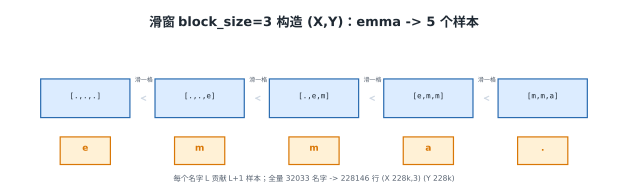
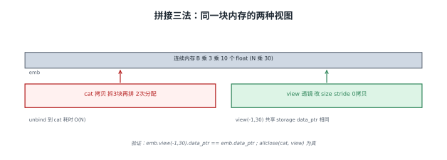
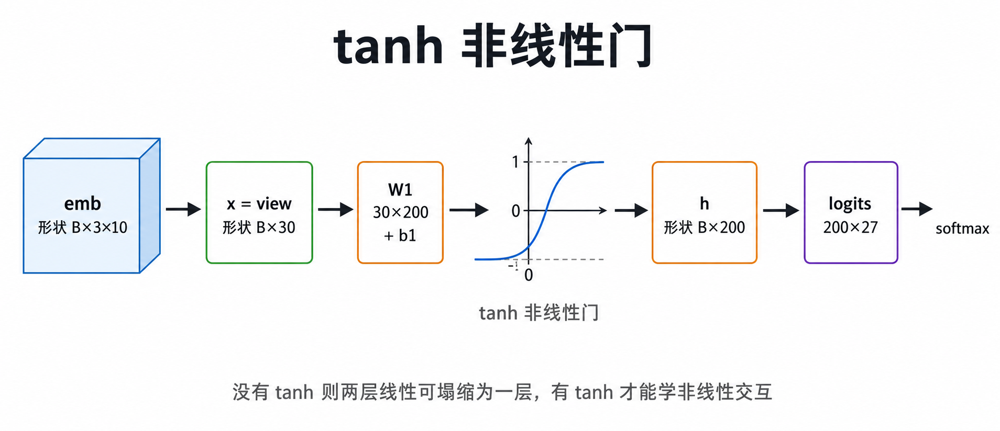
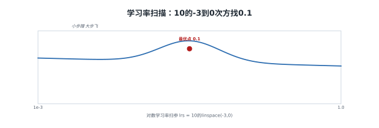
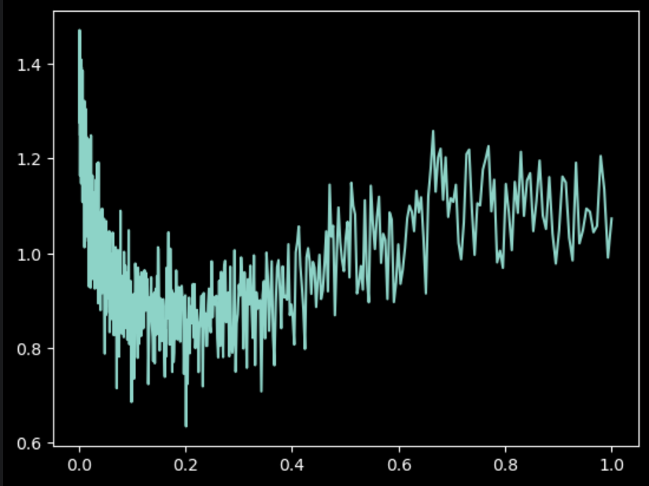
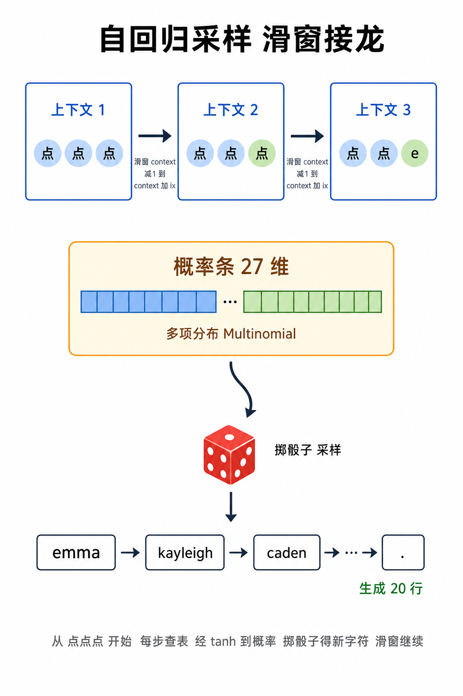
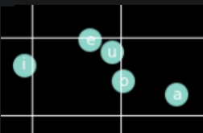
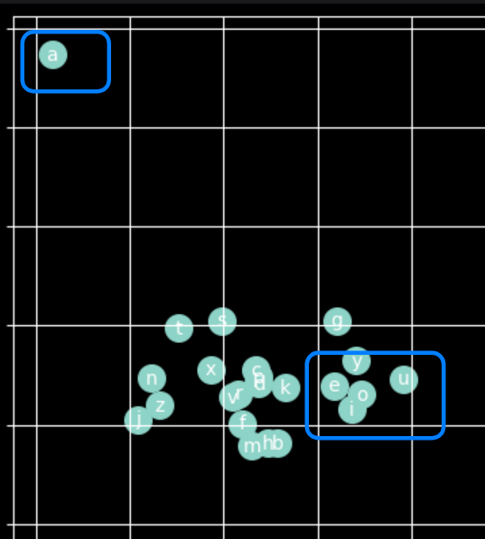

模型拿到 `emm` 时，怎样给下一个字母 `a` 打分？先把三个字母查成向量，按出现顺序拼起来，再交给一个有隐藏层的小网络。整套计算每次输出 27 个分数，对应 26 个字母和表示结束的 `.`。[回到原文：Bengio 为什么让词向量参与训练](/2026/08/28/bengio-mlp-char/)。

## MLP 实战：把 Bengio 的图跑通在字符上

## 8. 上下文窗口：block_size=3

`block_size=3` 是窗口宽度。想象纸上只有三个格子，起初填满 `.`。每写出一个字母，就删掉左端的一格，把刚写出的字母放到右端。对 `emma`，最后一条样本是 `mma → .`，用来教模型何时停笔。

**公式：** 训练集构造

$$
\mathcal{D} = \{(X_i, Y_i)\}_{i=1}^{N},\quad X_i\in\{0,\ldots,26\}^{3},\; Y_i\in\{0,\ldots,26\}
$$

$$
\text{emma}: [\_,\_,\_]\!\to\!e,\; [\_,\_,e]\!\to\!m,\; [\_,e,m]\!\to\!m,\; [e,m,m]\!\to\!a,\; [m,m,a]\!\to\!.
$$

```python
import string
import torch

stoi = {c: i for i, c in enumerate("." + string.ascii_lowercase)}
itos = {i: c for c, i in stoi.items()}

def build_dataset(names):
    contexts, targets = [], []
    for name in names:
        context = [0, 0, 0]
        for char in name + ".":
            target = stoi[char]
            contexts.append(context)
            targets.append(target)
            context = context[1:] + [target]
    return torch.tensor(contexts), torch.tensor(targets)

X, Y = build_dataset(["emma"])
for context, target in zip(X.tolist(), Y.tolist()):
    print("".join(itos[i] for i in context), "->", itos[target])
# ... -> e, ..e -> m, .em -> m, emm -> a, mma -> .
```

全量实验先按名字打乱、分成约 `8:1:1`，再对训练、验证、测试三份分别展开窗口，得到 182625、22655、22866 条样本。按名字切分能避免同一个名字的连续窗口落进不同集合；训练用第一份，调参看第二份，最后报告时才看第三份。



---

## 9. Embedding 查表：C 是字典
[Bigram 实验](/2026/08/27/makemore-bigram/implementation/)用 one-hot 乘 `W` 选取一行分数。这里直接用 `C[X]` 选取向量：`C` 的每一行对应一个字符，`C[5]` 就是字母 `e` 的十维坐标。训练时，这些坐标和打分网络一起更新。

**公式：** 查表前向（`m=10` 版更贴近实战）

$$
C \in \mathbb{R}^{27\times 10},\quad \text{emb}=C[X]\in\mathbb{R}^{B\times 3 \times 10},\quad \text{emb}_{b,t,:}=C[X_{b,t}]
$$

对任意字符编号 `i`，`one_hot(i) @ C` 的结果等于 `C[i]`，因为除了第 `i` 行，其余行的系数都是零。Bigram 查出的是 27 个候选字符的分数；这里查出的是 10 个特征，还要经过后面的网络才能变成 27 个分数。

用两维向量代替原实验的十维就能手算。`0` 是边界，`1` 是 `a`，`2` 是 `b`。上下文 `.ab` 和 `.ba` 用的是同三行向量，拼接顺序不同，后面的线性层就能区分。

```python
import torch

C = torch.tensor([[0.0, 0.0], [0.1, 0.2], [0.3, 0.4]])
X = torch.tensor([[0, 1, 2], [0, 2, 1]])
emb = C[X]                   # (2, 3, 2): 样本、位置、特征
flat = emb.flatten(start_dim=1)
assert flat.shape == (2, 6)
print(flat.round(decimals=1))
# [[0.0, 0.0, 0.1, 0.2, 0.3, 0.4],
#  [0.0, 0.0, 0.3, 0.4, 0.1, 0.2]]
```

![Embedding 查表：C[X] 选行 vs one-hot 乘法等价](/assets/img/mlp-embedding-lookup.svg)

---

## 10. 拼接：cat 与 view

`emb` 是 `(B,3,10)`，要喂给 `W1(30×200)`，需要拼成 `(B,30)`。`torch.cat([emb[:,0,:],emb[:,1,:],emb[:,2,:]],dim=1)` 会创建拼接后的张量；这里的连续存储也允许直接用 `emb.view(B,-1)`。`view` 通过形状和步长重新解释同一块内存，不搬动数据；两种写法的区别在于是否创建新的数据存储。

**公式：** 形状变换

$$
\text{emb}\in\mathbb{R}^{B\times 3 \times 10}\ \xrightarrow{\text{view}}\ x\in\mathbb{R}^{B\times 30},\quad x_b = [\text{emb}_{b,0};\text{emb}_{b,1};\text{emb}_{b,2}]
$$

$$
\text{cat 版：拼接 }3\times(B\times10)\quad\text{vs}\quad\text{view 版：重解释 }(B\cdot3\cdot10)\text{ 连续内存}
$$

`torch.unbind(emb, 1)` 也能取到三个位置的张量视图。真正分配新存储的是接下来的 `torch.cat`；这里可以直接用 `emb.view(-1, 30)`，因为查表所得张量的步长允许这种合并。



---

## 11. tanh 隐层

`x @ W1 + b1` 再线性到 logits，整体还是线性映射，3 个字符的非线性交互学不出来。`tanh` 让 `(e,m)` 和 `(m,m)` 这种组合能产生非线性响应。对应 Bengio 论文里的 `h = tanh(d+Hx)`，这里使用 `h = tanh(xW1+b1)`，形状从 `(B,30) → (B,200)`。

**公式：** 隐层前向（论文 ↔ MLP 对照）

$$
\text{论文: } h = \tanh(d + Hx),\; y = b + Wx + Uh \qquad\Longleftrightarrow\qquad
\text{MLP: } h = \tanh(\text{emb.view}(B,30)W_1 + b_1),\; \text{logits}=hW_2+b_2
$$

$$
W_1\in\mathbb{R}^{30\times 200},\; b_1\in\mathbb{R}^{200},\; W_2\in\mathbb{R}^{200\times 27}
$$

原论文的输出式还带有输入直连项 `Wx`，这次字符练习的输出只读隐藏层。去掉 `tanh`，两层仿射就可以合成一层；模型仍然读取三个位置，只是同一个位置的贡献无法随其他位置的内容改变。



---

## 12. 小批量梯度

每步从训练集的 182625 个窗口中有放回地抽 32 个。`ix` 是窗口编号，`Xtr[ix]` 和 `Ytr[ix]` 必须用同一组编号：前者装着题目，后者装着每道题的正确字符。`C[Xtr[ix]]` 的梯度只涉及抽到的窗口用过的向量行。

交叉熵只看正确字符获得的概率。例如，同样要预测 `a`，给 `a` 的概率从 `0.25` 提高到 `0.5`，这一项损失就从 `-log(0.25) ≈ 1.386` 降到 `-log(0.5) ≈ 0.693`。把 32 项取平均才是这一步用于求梯度的损失。

**公式：** 小批量交叉熵

$$
\mathcal{L}_{\text{batch}} = -\frac{1}{32}\sum_{k=1}^{32}\log p(Y_{\mathrm{ix}_k}\mid X_{\mathrm{ix}_k})
$$

$$
\theta_{t+1}=\theta_t - \eta \nabla_{\theta}\mathcal{L}_{\text{batch}}(\theta_t)
$$

接着第 8 节的 `build_dataset` 运行下段，用四个名字演示一次参数更新。训练时 `F.cross_entropy` 接收原始分数和字符编号，内部计算对数概率；只在观察单个字符的预测概率时调用 `softmax`。

```python
import torch.nn.functional as F

g = torch.Generator().manual_seed(214843657)
C = torch.randn(27, 10, generator=g, requires_grad=True)
W1 = torch.randn(30, 200, generator=g, requires_grad=True)
b1 = torch.randn(200, generator=g, requires_grad=True)
W2 = torch.randn(200, 27, generator=g, requires_grad=True)
b2 = torch.randn(27, generator=g, requires_grad=True)
params = [C, W1, b1, W2, b2]

def forward(windows):
    emb = C[windows].view(-1, 30)  # (B, 3, 10) -> (B, 30)
    return torch.tanh(emb @ W1 + b1) @ W2 + b2

def train_step(windows, targets, sample_rng, lr=0.001):
    ix = torch.randint(len(windows), (32,), generator=sample_rng)
    x, y = windows[ix], targets[ix]
    loss = F.cross_entropy(forward(x), y)
    for param in params:
        param.grad = None
    loss.backward()
    with torch.no_grad():
        for param in params:
            param -= lr * param.grad
        after = F.cross_entropy(forward(x), y)
    return loss.item(), after.item()

Xtr, Ytr = build_dataset(["emma", "emily", "anna", "ada"])
sample_rng = torch.Generator().manual_seed(42)
before, after = train_step(Xtr, Ytr, sample_rng)
print(f"这批 32 个窗口的损失：{before:.4f} -> {after:.4f}")
```

两次损失用的是同一批窗口，所以可以直接比较一次更新前后的变化。重复训练会换批；要看模型能否猜对没见过的名字，再另取验证集。


---

## 13. 学习率与 loss 曲线

课程演示把学习率从 `0.001` 逐步调到 `1.0`，观察小批量损失何时开始上升。每一步都接着前一步的参数训练，所以曲线适合找候选区间，不能当作每个学习率从同一起点训练后的横向排名。

本地练习用固定学习率 `0.001` 训练 10000 步，每批 32 条。下段代码用已经训练好的 `C`、`W1`、`b1`、`W2`、`b2` 对全部 22655 个验证窗口打分：`Xdev` 是三字符窗口，`Ydev` 是对应的下一个字符编号。保存的平均交叉熵约为 `2.2303`。

```python
with torch.no_grad():
    emb = C[Xdev]                            # (22655, 3, 10)
    h = torch.tanh(emb.view(-1, 30) @ W1 + b1)
    logits = h @ W2 + b2                      # (22655, 27)
    dev_loss = F.cross_entropy(logits, Ydev)
```

这里沿用训练时的查表、拼接和打分，省掉反向传播与参数更新。这个数取自原实验保存的输出；上面的四个名字例子只展示一次更新。比较不同训练设置时，都用同一份留出的名字算验证损失。




---

## 14. 采样复盘：multinomial 如何“写”出新名字

从 `[.,.,.]` 开始，按输出概率抽出一个字符，再把它补到窗口右端。假如头两次抽到 `e` 和 `m`，窗口就会从 `...` 变成 `..e`、再变成 `.em`。抽到起止标记 `.` 时，这个名字就生成完了。

**公式：** 自回归采样

$$
p(\cdot\mid c_{t-2},c_{t-1},c_t)=\text{softmax}(hW_2+b_2),\quad c_{t+1}\sim\text{Multinomial}(p),\quad \text{context}_{t+1}=[c_{t-1},c_t,c_{t+1}]
$$

给 `forward` 的输入仍是三格组成的一行。若刚抽到 `e`，就在下一轮传入 `[[0, 0, stoi["e"]]]`。以此滑动窗口，模型能在不同的开头下反复使用同一套参数。



---

## 17. 收工小结：N-gram → Bengio → MLP 的递进

下面两张图记录两次训练中的二维字符向量分布。第一次有更多元音聚得近，重训后图形变了。它们能帮助观察这两次训练学到了什么表示；预测质量要看留出的名字片段上，真实字符得到了多少概率。





---

## 附 · 资料下载

本篇配套的 Bengio 精读与 MLP 字符级实战代码、图示，可直接下载。

### 完整实验代码与笔记

- [MLP.ipynb](https://github.com/Redmoon-2333/Redmoon-2333.github.io/releases/download/day5-assets/MLP.ipynb)：注释版 MLP（在原始课程跟写版上新增 123 行中文注释）
- [MLP_original.ipynb](https://github.com/Redmoon-2333/Redmoon-2333.github.io/releases/download/day5-assets/MLP_original.ipynb)：原版备份（无注释原版，含输出）
- [Bengio 等，A Neural Probabilistic Language Model](https://www.jmlr.org/papers/v3/bengio03a.html)：论文原文
