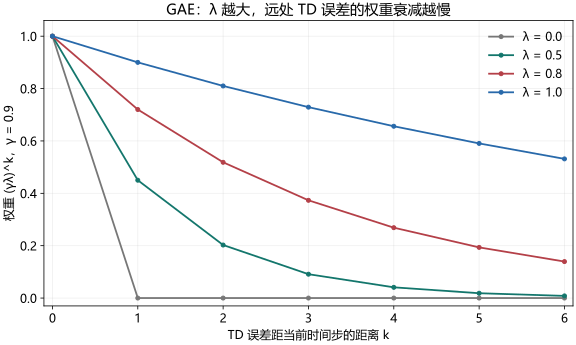

第一步没有奖励，第二步拿到 4 分。哪一步应该得到鼓励？先用这条短轨迹手算一步预测误差，再看 GAE 怎样把后一步的误差往前传，以及回合被截断时要留下哪一项。

[返回主文](/2026/10/06/rl-day4-reinforce-gae/)

这里用两种估计。Critic 预测从某状态出发还能得到多少折扣回报；Actor 根据动作的优势调整选择概率。优势可以用完整回报减状态价值来估，也可以先比较一步结果和预期，再把后几步的误差加回来，后者就是广义优势估计（GAE）。

## 8. MC、TD、n-step 和终止边界

### 8.1 三种目标的时间范围

**Monte Carlo（MC）目标**等到回合结束，将从当前步起实际得到的奖励按折扣相加：

$$
y_t^{\text{MC}}=G_t.
$$

**一步 TD 目标**只看一步真实奖励，再接上下一状态的估值：

$$
y_t^{\text{TD(0)}}
=r_t+\gamma(1-d_t)V(s_{t+1}),
$$

其中 $d_t=1$ 表示真正终止。

**n-step 目标**先使用前 $n$ 步真实奖励，再用 Critic 的预测补上还没走到的部分。用预测值构造训练目标，叫作 bootstrap。

$$
y_t^{(n)}
=\sum_{k=0}^{n-1}\gamma^k r_{t+k}
+\gamma^n V(s_{t+n}).
$$

若这 $n$ 步以内已经真正终止，就在终点截住真实奖励序列，去掉后面的价值预测，不能把终点前已经得到的奖励一起删掉。MC 通常采样方差更大；一步 TD 借助预测缩短采样范围，但 Critic 不准时会引入偏差；n-step 调节真实奖励和预测各占多少。

例如另设一个随机奖励过程：第一步奖励为 $0$，第二步以相同概率拿到 $0$ 或 $4$ 后终止。真实 $V(s_1)=2$，起点期望为 $1.8$。MC 样本是 $0$ 或 $3.6$，均值为 $1.8$；如果 Critic 错误地预测 $V(s_1)=1$，一步 TD 目标每次都为 $0.9$。它完全不波动，却稳定地偏离真实均值。**更平滑不等于更准确。**

### 8.2 真正终止和外部截断不能混为一谈

真正终止时，环境已经进入任务终点，未来价值为零：

$$
y_t=r_t.
$$

例如短路线最后一步奖励是 $1$，不能写成 $\gamma\times1$，因为当前奖励不需要再折扣。

如果是时间上限导致的外部截断，任务本身并没有自然结束。此时最后观测仍可能有未来价值，应当 bootstrap：

$$
y_t=r_t+\gamma V(s_{t+1}).
$$

更具体地说：

- `terminated=True`：真正完成任务，终止 mask 为 $0$；
- `truncated=True`：只是采样窗口结束，若任务仍可继续，bootstrap mask 为 $1$；
- 截断处不能把环境重置后的初始状态当成原轨迹的下一状态。

这也是实际代码里要把 `terminated` 和“采样批次结束”分开表示的原因。

## 9. GAE：在 TD 和 MC 之间调节

### 9.1 先算 TD 误差

非终止转移的一步 TD 误差为：

$$
\delta_t
=r_t+\gamma V(s_{t+1})-V(s_t).
$$

真正终止时把未来价值项设为零。

下面用一条自设轨迹手算。第一步没有即时得分，Critic 原先估计有 `3` 分，却走到了只值 `2` 的下一状态。第二步真正拿到了 `4` 分，回合结束：

```text
奖励：[0, 4]
Critic 预测值：[3, 2]
gamma = 0.9
lambda = 0.5
最后一步是真正终止
```

于是：

$$
\delta_0=0+0.9\times2-3=-1.2,
$$

$$
\delta_1=4-2=2.
$$

### 9.2 GAE 的定义

GAE 把当前和未来的 TD 误差按 $\gamma\lambda$ 衰减后相加：

$$
\hat A_t^{\text{GAE}(\gamma,\lambda)}
=
\delta_t
+\gamma\lambda\delta_{t+1}
+(\gamma\lambda)^2\delta_{t+2}
+\cdots.
$$

从后往前递推：

$$
\hat A_t
=
\delta_t+\gamma\lambda\hat A_{t+1}.
$$

本例中：

$$
\hat A_1=2,
$$

$$
\hat A_0=-1.2+0.9\times0.5\times2=-0.3.
$$

如果把 raw advantage 加回旧的 Critic 预测，就得到一组 Critic 目标：

$$
y_t^{\lambda}=V(s_t)+\hat A_t,
$$

因此：

$$
y_0^\lambda=3+(-0.3)=2.7,
\qquad
y_1^\lambda=2+2=4.0.
$$

在这条两步终止轨迹中，一步目标为 $0+0.9\times2=1.8$，完整两步回报为 $0+0.9\times4=3.6$，lambda 目标恰好是二者的混合：

$$
y_0^\lambda=(1-\lambda)\times1.8+\lambda\times3.6=2.7.
$$

这份实现把原始 GAE 加回采样时的价值预测，作为 Critic 的回报目标。也有实现直接用整局剩余回报拟合 Critic。

### 9.3 lambda 的含义

- $\lambda=0$：只保留一步 TD 误差，偏向低方差；
- $\lambda=1$：在终止轨迹上累加完整的折扣 TD 误差，等价于 MC 回报减去价值基线，偏向低偏差；
- $0<\lambda<1$：在一步 TD 和完整回报之间连续调节。

在本例中，$\lambda=0.5$ 时：

$$
\hat A_0
=(1-\lambda)\delta_0
+\lambda(\delta_0+\gamma\delta_1)
=0.5(-1.2)+0.5(-1.2+1.8)
=-0.3.
$$

图中的横轴是 TD 误差距离当前时间步的距离 $k$，纵轴是权重 $(\gamma\lambda)^k$。$\lambda$ 越大，远处误差衰减越慢，更多远期信息会参与当前优势估计。



### 9.4 两种 mask 要分开

TD target 是否接未来价值，与 GAE 是否跨回合递推，是两个不同问题：

| 边界 | 接最后状态的价值预测 | 把重置后新一局的 GAE 接过来 |
|---|---|---|
| 真正终止 | 不接 | 不接 |
| 外部截断后重置 | 接最后真实观测的价值 | 不接 |
| 只切开采样段、未重置 | 保留段末 bootstrap | 本段没有采样到的 TD 误差不累加 |

下面的函数接收一段按时间排序的采样记录（rollout）。`next_values[t]` 用第 `t` 步实际走到的观测计算。`episode_ends[t]` 标记接下来是否从新的一局开始，因此也管住了两局交界处的误差传递。

```python
import torch


@torch.no_grad()
def compute_gae(
    rewards, values, next_values, terminated, episode_ends,
    gamma=0.9, lam=0.5,
):
    # float 输入均为 [T]；两个结束标记为同长度的布尔张量
    # terminated: 真正终止；episode_ends: terminated 或外部截断重置
    bootstrap_mask = (~terminated).to(rewards.dtype)
    trace_mask = (~episode_ends).to(rewards.dtype)
    deltas = rewards + gamma * bootstrap_mask * next_values - values

    advantages = torch.zeros_like(rewards)
    gae = rewards.new_zeros(())    # 本段外没有采样到的 TD 误差

    for t in reversed(range(len(rewards))):
        gae = deltas[t] + gamma * lam * trace_mask[t] * gae
        advantages[t] = gae

    return advantages

raw_advantages = compute_gae(
    rewards=torch.tensor([0.0, 4.0]),
    values=torch.tensor([3.0, 2.0]),
    next_values=torch.tensor([2.0, 0.0]),
    terminated=torch.tensor([False, True]),
    episode_ends=torch.tensor([False, True]),
)
print(raw_advantages.tolist())
# 约 [-0.3, 2.0]
```

再试一段由两局拼成的记录。第一行得 `1` 分，当前状态值是 `2`，走到的下一状态也值 `2`。第二行来自重置后的新一局，拿到 `10` 分后完成任务。只切换第一行是外部截断还是真正终止，其他数值不动：

```python
rewards = torch.tensor([1.0, 10.0])
values = torch.tensor([2.0, 0.0])
next_values = torch.tensor([2.0, 0.0])
episode_ends = torch.tensor([True, True])

for first_is_terminal in (False, True):
    terminated = torch.tensor([first_is_terminal, True])
    advantages = compute_gae(
        rewards, values, next_values, terminated, episode_ends,
    )
    print((values + advantages).tolist())
# 截断再重置：[2.8, 10.0]（浮点数显示有舍入差）
# 真正终止：  [1.0, 10.0]
```

截断的目标是 `1 + 0.9 × 2 = 2.8`，终止的目标是 `1`。两种情况都挡住了新一局的 `10` 分。函数初始化 `gae=0`，表示这一段之外没有采样到的 TD 误差；最后状态的估值已经通过 `bootstrap_mask` 加进 `deltas`。

## 10. raw advantage、标准化和 Critic 目标

Actor 对优势的绝对尺度较敏感，所以常见做法是只在交给 Actor 前标准化：

```python
# 接上节结果；旧预测是采样时的数值快照
old_values = torch.tensor([3.0, 2.0])
critic_targets = (old_values + raw_advantages).detach()
normalized_advantages = (
    raw_advantages - raw_advantages.mean()
) / (raw_advantages.std(unbiased=False) + 1e-8)
print(critic_targets.tolist(), normalized_advantages.tolist())
# [2.7, 4.0], [-1.0, 1.0]（近似值）
```

以本例的 raw advantage `[-0.3, 2.0]` 为例：

$$
\operatorname{mean}=0.85,\qquad
\operatorname{std}=1.15,
$$

标准化后约为 `[-1.0, 1.0]`。

这里必须把两种用途分开：

- Actor 可以使用标准化后的优势，让一个批次内的梯度尺度更稳定；
- Critic 的目标要保留原始回报尺度，使用 `old_values + raw_advantages`；
- 标准化会减去均值，所以可能改变某个样本相对于零的符号，但在标准差为正时仍保持样本的大小顺序；
- 如果优势批次所有值都相同，标准差接近零，标准化会失去区分度。

例如 `[1,3]` 标准化后成为 `[-1,1]`：原来两个样本都高于零，第一个标准化后变成负数，但仍小于第二个。大小顺序与相对零的符号不是同一件事。

Critic 拟合的仍是回报尺度上的 `2.7` 和 `4.0`；`[-1,1]` 只是这个批次用来加权 Actor 梯度的数。是否标准化是独立的训练选项。

### 10.1 批次中的样本必须整行配对

一条训练样本至少包括：

```text
状态、实际动作、Actor 权重、时间折扣、Critic 目标
```

这些字段必须使用相同的样本索引。假设两条样本的正确关系是：

```python
states = ["s0", "s1"]
critic_targets = [2.7, 4.0]
```

如果状态改成 `["s1", "s0"]`，整行一起换序后目标必须变成：

```python
states = ["s1", "s0"]
critic_targets = [4.0, 2.7]
```

只交换状态、不交换目标会产生错误配对。即使当前 Critic 的预测刚好是：

```python
predicted_values = torch.tensor([4.0, 2.7])
```

正确目标下的 MSE 是：

$$
\operatorname{MSE}([4.0,2.7],[4.0,2.7])=0.
$$

错误目标下则是：

$$
\operatorname{MSE}([4.0,2.7],[2.7,4.0])
=\frac{1.3^2+(-1.3)^2}{2}
=1.69.
$$

`loss.mean()` 只会平均已经算出的逐样本误差，不会根据状态名称重新找目标。因此，打乱批次时要对各个张量使用同一个索引。下面的 `states` 是网络输入张量，`actor_weights` 是已经为 Actor 算好的权重，`time_discounts` 保存每个样本原回合的 $\gamma^t$：

```python
order = torch.tensor([1, 0])

states = states[order]
actions = actions[order]
actor_weights = actor_weights[order]
time_discounts = time_discounts[order]
critic_targets = critic_targets[order]
```

但要注意：GAE 本身依赖轨迹的时间顺序。不能在计算 GAE 之前随意把同一条轨迹打乱；应当先按原顺序计算目标，再对已经算好的整行样本做批次重排。

### 10.2 把整条更新链串起来

先按原始时间顺序计算并固定 raw GAE 与 Critic 目标，再计算当前网络的损失。下面是一次批次更新，沿用[主文](/2026/10/06/rl-day4-reinforce-gae/)的时间折扣。输入中 `states` 为 `[B, 状态特征数]`，`actions` 是 `[B]` 的整数编号，其余样本量均为 `[B]`；`model(states)` 返回 `[B, 动作数]` 的 logits 和 `[B]` 的价值。

```python
from torch.distributions import Categorical

def update_batch(
    model, optimizer, states, actions, raw_advantages,
    critic_targets, time_discounts, critic_coef=0.5,
    normalize_advantage=False,
):
    actor_weights = raw_advantages.detach()
    if normalize_advantage:
        actor_weights = (
            actor_weights - actor_weights.mean()
        ) / (actor_weights.std(unbiased=False) + 1e-8)

    logits, values = model(states)
    distribution = Categorical(logits=logits)
    log_probs = distribution.log_prob(actions)    # 原经历实际执行的动作

    actor_loss = -(log_probs * time_discounts * actor_weights).mean()
    critic_loss = (values - critic_targets.detach()).pow(2).mean()
    total_loss = actor_loss + critic_coef * critic_loss

    optimizer.zero_grad()
    total_loss.backward()
    optimizer.step()
    return actor_loss.item(), critic_loss.item()
```

同一个状态在这批数据里有两次价值计算：采样时的旧预测用来构造固定目标，优化时的当前预测拿来与目标比较。梯度经过当前预测和实际动作的 `log_prob` 回到网络；目标和优势只是这次更新的数字。更新后重新采轨迹，再为新数据算目标。
