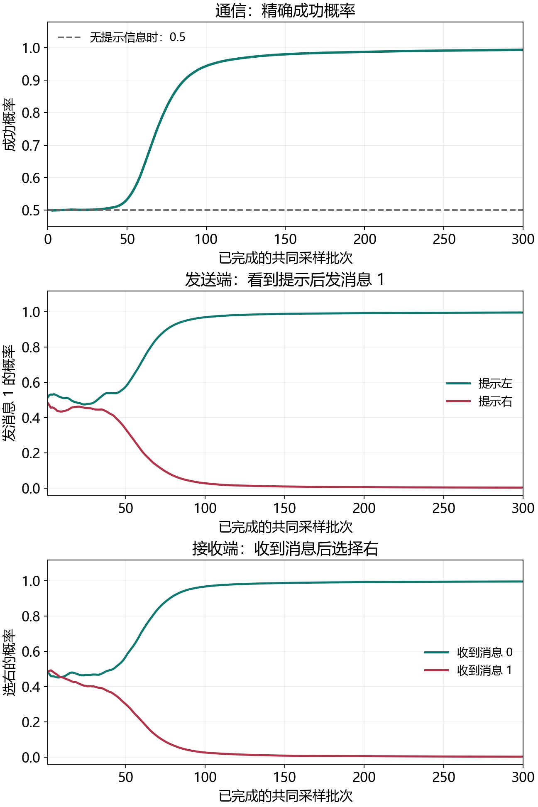
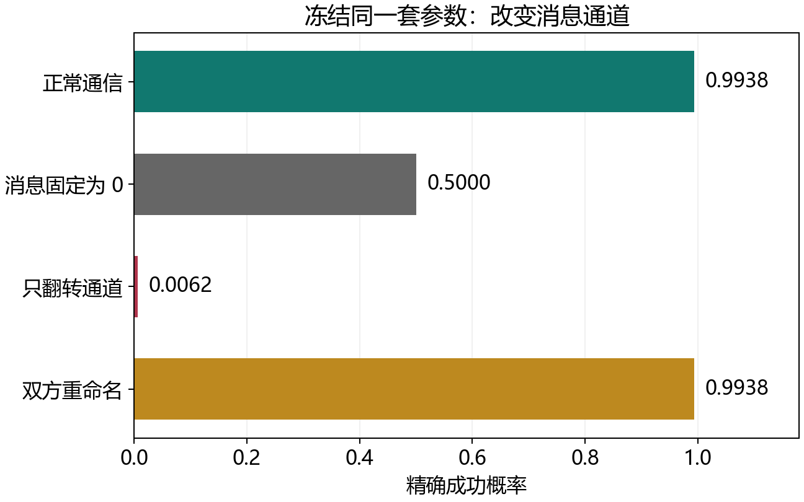

每局抽一次「左」或「右」。发送者看见这张提示卡，接收者走路。实验给双方一个只能发 0 或 1 的通道，用团队奖励一起学发什么、收到后怎么走；随后固定收到的数字，比较接收者还答得对多少。

[返回主文](/2026/10/08/rl-day6-multi-agent-learning/)

## 8. 局部记忆：当前画面相同，历史仍可能不同

设一个机器人先看到左或右的方向提示，后来走到画面完全相同的路口。只看当前观测，无法区分两种任务；保留此前提示的历史摘要，就有了选择方向的依据。

GRU（门控循环单元）每次读入当前观测和上一时刻的记忆，输出一份新的记忆：

$$
h_t=\operatorname{GRU}(o_t,h_{t-1}).
$$

$h_t$ 是本局到目前为止的历史摘要，Actor 可以用它选动作。GRU 的参数在各局共享，$h_t$ 则随观测改变，新的一局从空记忆开始。[5]

下方是结构演示：两行表示同一角色的两段不同历史，先分别输入 $-1$ 和 $+1$ 的提示，再输入相同的路口观测 0。

```python
import torch
from torch import nn

torch.manual_seed(7)
gru = nn.GRUCell(1, 4)
hidden = torch.zeros(2, 4)  # 两段历史各有一行自己的记忆。
hint_inputs = torch.tensor([[-1.], [1.]])
h_after_hint = gru(hint_inputs, hidden)
same_junction = torch.zeros(2, 1)
h_at_junction = gru(same_junction, h_after_hint)
print(torch.allclose(h_at_junction[0], h_at_junction[1]))  # False
```

随机初始化网络在这里产生不同摘要，展示的是历史如何进入表示；学会方向选择还需要相应策略与奖励训练。

共享循环网络的参数时，每个角色、每个环境仍保存自己的隐藏状态。新回合重置对应记忆，回合内持续更新；训练循环片段时保持时间顺序，不能像无记忆样本一样随意打乱片段内部的时刻。

如果提示是独立随机的，而且从未进入某人的观测、历史或可接收的消息，增加记忆也无法恢复它。记忆保留自己见过的信息，通信才能把队友见过的信息送过来。

## 9. 从奖励中学通信：消息本身也是动作

通信环境有先后两个阶段：发送端先看到等概率的左右提示，发送一个 `0/1` 消息；接收端收到后选择左或右。选对方向，团队奖励为 2，否则为 0，本局真正终止。

| 角色 | 网络输入 | 网络输出 |
|---|---|---|
| 发送端 | 自己看到的方向提示 one-hot | 两种消息的 logits |
| 接收端 | 实际收到的消息 one-hot | 左右方向的 logits |

发送者可以约定「左发 0」，也可以约定「左发 1」。奖励看的是最后有没有走对，两边的约定能对上就行。代码把 `0` 写成 `[1,0]`、把 `1` 写成 `[0,1]`，这就是 one-hot；每个 Actor 输出两个分数（logits），再用分数算出两种动作的抽样概率。[6]

下面把环境压缩成一个采样函数，可以直接跑。开始时两边的分数都是零，均匀抽样。发送者的输入是提示，接收者只有消息；计算奖励的环境才会比较 `move` 和 `hint`。

```python
import torch
from torch import nn
from torch.distributions import Categorical

torch.manual_seed(7)
sender = nn.Linear(2, 2, bias=False)
receiver = nn.Linear(2, 2, bias=False)
nn.init.zeros_(sender.weight)
nn.init.zeros_(receiver.weight)
optimizer = torch.optim.Adam([*sender.parameters(), *receiver.parameters()], lr=0.03)

@torch.no_grad()
def sample_episode(fixed_message=None):
    hint = torch.randint(2, ()).item()
    hint_obs = torch.eye(2)[hint]
    message = Categorical(logits=sender(hint_obs)).sample()
    received = message.item() if fixed_message is None else fixed_message
    message_obs = torch.eye(2)[received]
    move = Categorical(logits=receiver(message_obs)).sample()
    reward = 2.0 if move.item() == hint else 0.0
    return hint_obs, message_obs, message, move, reward

episodes = [sample_episode() for _ in range(64)]
```

每条记录的前两项是两边实际看到的输入，后面是实际发的符号、实际选的方向和这一局的奖励。采样时不用建梯度图；更新时根据保存的输入和动作重新算概率。

### 两个策略都需要自己的学习信号

当前使用 $\gamma=1$，所以两个阶段的回报都等于最终奖励；固定 baseline 为 1，正确局评分为 $+1$，错误局为 $-1$。

$$
L=-\mathbb E\left[
\left(\log\pi_S(m\mid h)+\log\pi_R(a\mid m)\right)(R-1)
\right].
$$

这里 $h$ 是方向提示，$m$ 是实际消息，$a$ 是实际方向，$\pi_S$、$\pi_R$ 分别表示发送和接收策略。假设一次成功的回合中，发出该消息的概率为 `0.8`，接收者选中正确方向的概率为 `0.75`，实际走出的这条路径就有 `0.8 × 0.75 = 0.60` 的概率。取对数后乘法变成相加，两个 `log_prob` 因此可以分别留给各自的网络求梯度。

```python
hint_obs, message_obs, messages, moves, rewards = zip(*episodes)
sender_dist = Categorical(logits=sender(torch.stack(hint_obs)))
receiver_dist = Categorical(logits=receiver(torch.stack(message_obs)))
logp_message = sender_dist.log_prob(torch.stack(messages))
logp_move = receiver_dist.log_prob(torch.stack(moves))
advantage = torch.tensor(rewards) - 1.0
sender_loss = -(logp_message * advantage).mean()
receiver_loss = -(logp_move * advantage).mean()
loss = sender_loss + receiver_loss
optimizer.zero_grad()
loss.backward()
optimizer.step()
```

两份 `log_prob` 都对应本局真正采到的决策，不重新采样替换。两份损失相加，是这条两阶段联合轨迹的策略梯度写法；奖励只有一份。

把两个代码块依次运行一遍得到第一批更新，然后交替执行剩下的 299 批：每批先重建 `episodes`，再运行更新块。用 `sender(torch.eye(2)).softmax(dim=-1)` 读出编码表 `enc`，用同样的方法读解码表 `dec`；`enc @ dec` 的第 `h` 行、第 `a` 列就是给定提示 `h` 最终选方向 `a` 的概率。两个对角元素求平均就是成功率。这段精简代码实跑得约 `0.994454`；固定消息为 0 后，用 `dec[0].mean()` 得 `0.5`。下面的图和 `499/500` 来自原来的两阶段环境。

普通 `Categorical.sample()` 得到的离散符号不是可微通道。接收端损失不会自动沿这个整数传回发送端；发送端通过自己消息的 `log_prob` 获取 REINFORCE 学习信号。[7] 当前通信闭环使用两个独立 Actor 和固定 baseline，专注观察符号协议怎样形成。

### 实际训练出的协议

上面的代码展示一批怎么采、怎么更新。下面的数据来自原来的两阶段环境，它显式记录了发消息和选方向这两步。两个 Actor 同样全零初始化，种子为 7，Adam 学习率为 $0.03$；每批 64 局，训练 300 批，每批采完更新一次。

| 计数 | 结果 |
|---|---:|
| 共同回合 | 19200 |
| 环境步 | 38400 |
| 两人决策总数 | 38400 |
| 参数更新 | 300 |

一局先发消息、再选方向，共两步；两名角色各决策一次。这里不采用 PPO 多轮复用，每批 REINFORCE 更新一次就重新采样。



精确成功概率从 $0.5$ 提高到约 $0.9937934$，精确期望团队回报为 $1.9875868$。本次学到的贪心协议是：

| 发送端提示 | 实际消息 | 接收端方向 | 团队奖励 | 结束状态 |
|---|---|---|---:|---|
| 左 | 1 | 左 | 2 | 真正终止 |
| 右 | 0 | 右 | 2 | 真正终止 |

发送端看到左时，发消息 1 的概率约为 $0.99665$；看到右时，发消息 0 的概率约为 $0.99681$。接收端收到消息 1 时倾向于左，收到消息 0 时倾向于右。

提示每局随机，策略也可以随机采样；训练后的消息却已和提示相关。这正是学出通信协议的含义。

## 10. 消息干预：它真的依赖通信吗

正常成功率高，先说明最终任务完成得好。要检查消息有没有被使用，可以冻结同一套参数，只改变传递给接收端的信息。

在上面的教学代码里，`sample_episode()` 表示原样送达，`sample_episode(fixed_message=0)` 表示固定收到 `0`。两种情况都照常随机抽提示，也让发送者照常发消息。改变的只是进入接收端的那一个数。

```python
normal_rewards = [sample_episode()[-1] for _ in range(500)]
blocked_rewards = [sample_episode(fixed_message=0)[-1] for _ in range(500)]
print(sum(normal_rewards) / 1000, sum(blocked_rewards) / 1000)
```

每局答对得 `2`，总奖励除以 `2 × 500` 就是成功率。这里没有调用 `optimizer.step()`，两种测试共用同一套参数。正常通信能不能赢过盲猜，要等策略训练到位再看。

### 采样成绩与精确成功率

| 冻结评估条件 | 采样成功次数 | 采样成功率 | 采样平均奖励 |
|---|---:|---:|---:|
| 正常通信 | 499 / 500 | 99.8% | 1.996 |
| 收到的消息固定为 0 | 272 / 500 | 54.4% | 1.088 |

采样保留动作随机性，并使用独立评估种子。$272/500$ 是这次有限样本的成绩；精确枚举与它是不同统计量。

本例的提示左右均匀，接收端没有其他提示相关信息。若接收输入恒定，令它选左的概率为 $p$，成功概率就是：

$$
P(\mathrm{成功})=\tfrac12p+\tfrac12(1-p)=\tfrac12.
$$

正常通信的精确成功率约为 $99.3793\%$；固定消息后的精确成功率约为 $50\%$。相同参数下，去掉消息承载的区分信息就退回盲猜，这解释了当前策略对通信的依赖。

### 改一边的协议与双方重命名



| 条件 | 操作 | 精确成功概率 |
|---|---|---:|
| 正常通信 | 保留编码、通道与解码 | 0.9937934 |
| 消息固定为 0 | 接收端失去左右区分信息 | 约 0.5 |
| 只翻转通道 | 发 0 收 1，发 1 收 0；解码不变 | 0.0062066 |
| 双方重命名 | 同时交换编码的消息列与解码的消息行 | 0.9937934 |

只改通道时，原本配套的编码与解码错开了，成功率很低。双方同时把 0 和 1 的含义交换，整体映射保持不变，通信仍有效。

符号叫 0 还是 1 不影响双方配套的协议。发送端根据自己看见的提示选择消息，接收端据此行动；冻结参数后的消息干预，则检验了这个信息通道对当前策略的作用。

[本篇参考文献：循环表示、离散通信和 PyTorch 概率分布（条目 5–7）](/2026/10/08/rl-day6-multi-agent-learning/#参考与继续阅读)。
